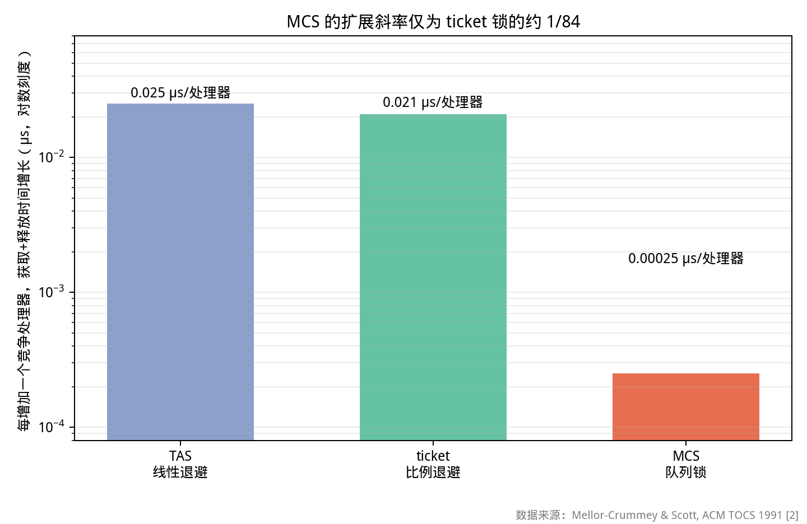
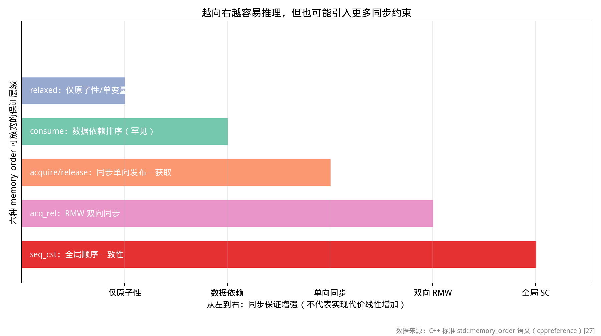
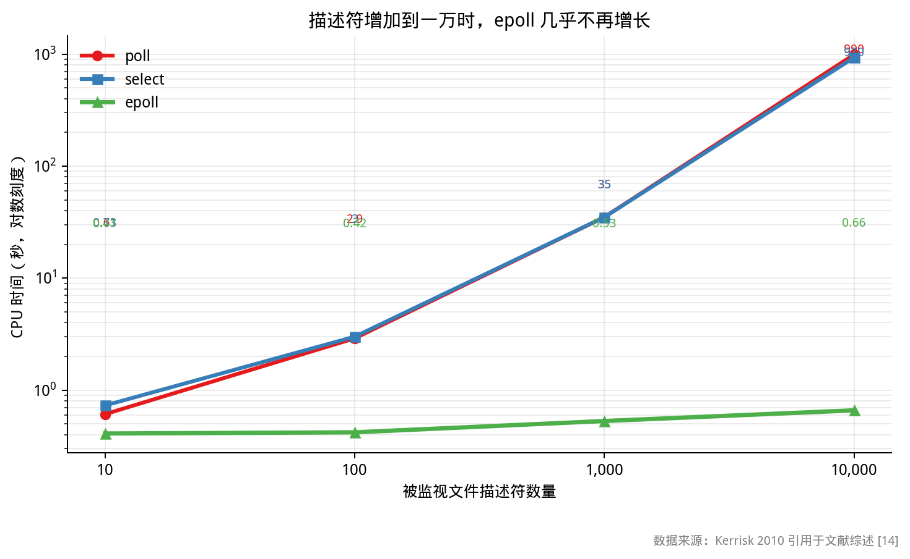
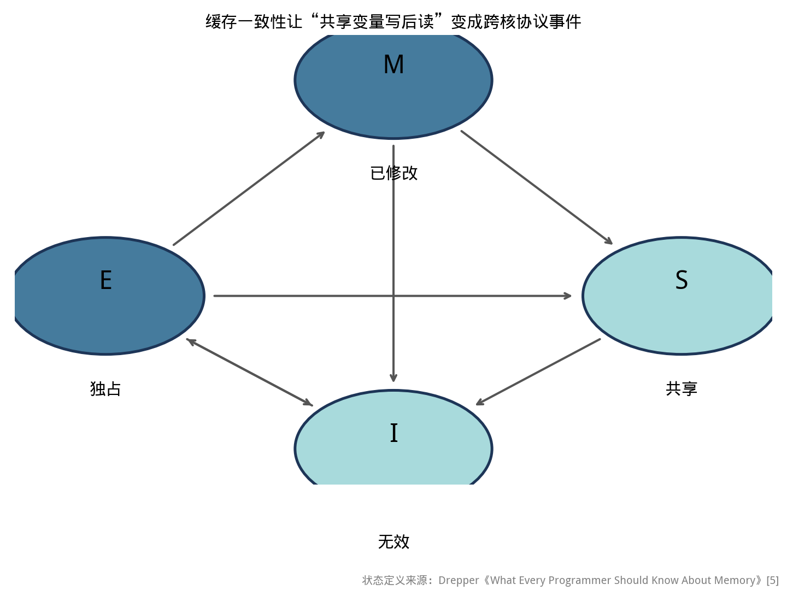

# 并发编程地基篇：经典文献综述与工程实践准则

> 本系列面向具备 C++ 语言基础、了解 `std::thread` 基本用法，但缺乏工业级并发系统实践经验的读者。
>
> 各项设计决策的理论依据，以便后续各篇在讨论库时能够追溯到其设计动机，而非停留于接口罗列。
>
> 本文所附代码均在 Linux x86-64 / GCC 环境下实际编译并执行，文中所列输出为真实运行结果，非示意性数据。

---

## 配套代码

本篇全部源码在 Gitee 仓库 [`champagnew/cpp-concurrent`](https://gitee.com/champagnew/cpp-concurrent)，目录 [`01-地基篇/code/`](https://gitee.com/champagnew/cpp-concurrent/tree/master/01-%E5%9C%B0%E5%9F%BA%E7%AF%87/code)（编译命令写在每个文件的头部注释里）：

| 源文件 | 内容 |
| --- | --- |
| [`race_demo.cpp`](https://gitee.com/champagnew/cpp-concurrent/blob/master/01-%E5%9C%B0%E5%9F%BA%E7%AF%87/code/race_demo.cpp) | 不加保护的共享计数器自增，演示数据竞争与丢失更新 |
| [`futex_mutex.cpp`](https://gitee.com/champagnew/cpp-concurrent/blob/master/01-%E5%9C%B0%E5%9F%BA%E7%AF%87/code/futex_mutex.cpp) | 手写 futex 互斥量，拆开「快路径 / 自旋 / 睡眠」三段 |
| [`spin_evolution.cpp`](https://gitee.com/champagnew/cpp-concurrent/blob/master/01-%E5%9C%B0%E5%9F%BA%E7%AF%87/code/spin_evolution.cpp) | TAS → TTAS → Ticket → MCS 与 `std::mutex` 的扩展性对比 |
| [`aba_treiber.cpp`](https://gitee.com/champagnew/cpp-concurrent/blob/master/01-%E5%9C%B0%E5%9F%BA%E7%AF%87/code/aba_treiber.cpp) | Treiber 无锁栈，演示 ABA 如何把链表改坏 |
| [`amdahl_demo.cpp`](https://gitee.com/champagnew/cpp-concurrent/blob/master/01-%E5%9C%B0%E5%9F%BA%E7%AF%87/code/amdahl_demo.cpp) | 固定总工作量、改变串行比例，复现阿姆达尔曲线 |
| [`false_sharing.cpp`](https://gitee.com/champagnew/cpp-concurrent/blob/master/01-%E5%9C%B0%E5%9F%BA%E7%AF%87/code/false_sharing.cpp) | 伪共享：两个毫无关系的计数器为何互相拖慢 |

配图源文件：[01-地基篇/figures/](https://gitee.com/champagnew/cpp-concurrent/tree/master/01-%E5%9C%B0%E5%9F%BA%E7%AF%87/figures)，下文插图均可在该目录找到原始 PNG。

---

## 绪论：本文的定位与论述顺序

若以 API 用法作为切入点，容易止步于接口层面的罗列。工业级并发系统的难点并不在于接口调用，而在于下列判断：

- 这段代码要不要加锁？加什么锁？
- 这个变量为什么要写成 `std::atomic`？`volatile` 行不行？
- 换成无锁队列真的会更快吗？
- 线程数开多少？为什么开多了反而慢？

这四个问题的答案，三十年前就已经有人用论文给出了。今天所有主流并发库——Boost.Asio、oneTBB、Folly、Seastar——内部做的每一个设计取舍，都能追溯到这几篇文献。

本文的目标是：提取上述文献中具备工程指导价值的结论，辅以可复现的验证实验，形成一份可对照执行的工程准则。

---

## 第 0 章　概念框架与层次划分

为避免后续论述中引入未经定义的术语，本节先行建立概念框架，明确各层次之间的边界。

### 0.1 并发与并行的概念区分

这两个术语在工程实践中常被混用，但其含义存在明确区别：

- **并发（Concurrency）**：*逻辑上*同时处理多件事。单核 CPU 上通过时间片切换，也能并发。它解决的是**结构问题**——怎么把程序组织成可以交替推进的多个部分。
- **并行（Parallelism）**：*物理上*同时执行多件事。必须有多个核。它解决的是**速度问题**——怎么把一件大事拆开同时干。

概言之：**并发指"具备同时处理多件事的能力"，并行指"多件事在同一时刻实际被执行"。** 网络服务器是典型的并发场景（连接数可达数万，但多数连接处于等待状态）；矩阵乘法则是典型的并行场景。

### 0.2 并发系统的层次划分

工业级并发系统可划分为下列五个层次。各层次对应不同的问题域、不同的库以及不同的理论文献：

| 层次 | 回答什么问题 | 典型工具 | 本文章节 |
|---|---|---|---|
| **执行单元** | 一段代码跑在什么上面？ | 进程、线程、协程 | 第 4 章、第 5 章 |
| **调度策略** | 下一个任务谁来做？ | 线程池、工作窃取、thread-per-core | 第 4 章 |
| **同步原语** | 共享数据怎么保护？ | mutex、自旋锁、条件变量、无锁结构 | 第 1 章、第 3 章 |
| **内存模型** | 一个线程的写，另一个线程什么时候能看到？ | `std::atomic`、内存序 | 第 2 章 |
| **I/O 模型** | 数据没来的时候，线程干什么？ | select/poll/epoll、io_uring、Proactor | 第 5 章 |

该划分将在后续讨论具体库时反复参照。**在评估任一并发库时，首先确定其所处的层次**，有助于把握其设计意图。

### 0.3 基本术语界定

**竞态条件（Race Condition）**：程序的正确性依赖于线程执行的*相对时序*，调度顺序改变则结果随之改变。该术语描述的是一种*现象*。

**数据竞争（Data Race）**：两个线程访问同一内存位置，其中至少一次访问为写操作，且二者之间不存在确定顺序的同步关系。这是 C++ 标准中的*规范性术语*，其后果是严重的——**存在数据竞争的程序行为未定义**（并非"可能读到旧值"，而是整个程序的行为均不再受标准保护）。

**临界区（Critical Section）**：一段要求"同一时刻仅允许一个线程进入"的代码区域。用于保护临界区的同步机制，在数据库领域通常称为 latch，在操作系统领域通常称为锁。

### 0.4 验证实验：非原子自增操作的竞态失效

先跑一个最小的程序，把"数据竞争"这件事变成看得见的数字。

```cpp
// race_demo.cpp —— 第一堂课：不加保护的共享变量，连 ++ 都会错
// 编译：g++ -std=c++17 -O2 -pthread race_demo.cpp -o race_demo
#include <atomic>
#include <iostream>
#include <thread>
#include <vector>

constexpr int kThreads = 4;
constexpr int kIters   = 2000000;

// 一个空的"优化屏障"：告诉编译器"别把循环折叠掉"，但不产生任何指令。
// 没有它，GCC 会把 200 万次 ++c 直接优化成一句 addq $2000000 —— 那就看不到竞争了。
inline void opt_barrier() { asm volatile("" ::: "memory"); }

template <typename T>
void bump(T &counter) {
  std::vector<std::thread> ts;
  std::atomic<int> go{0};
  for (int t = 0; t < kThreads; ++t)
    ts.emplace_back([&] {
      while (!go.load(std::memory_order_acquire)) {}   // 全部就位后一起开跑
      for (int i = 0; i < kIters; ++i) { ++counter; opt_barrier(); }
    });
  go.store(1, std::memory_order_release);
  for (auto &th : ts) th.join();
}

int main() {
  long long expected = (long long)kThreads * kIters;

  { long long c = 0; bump(c);
    std::cout << "裸 long long       : " << c
              << "  (期望 " << expected << ", 丢 " << expected - c << ")\n"; }
  { volatile long long c = 0; bump(c);
    std::cout << "volatile long long : " << (long long)c
              << "  (期望 " << expected << ", 丢 " << expected - (long long)c << ")\n"; }
  { std::atomic<long long> c{0}; bump(c);
    std::cout << "std::atomic        : " << c.load()
              << "  (期望 " << expected << ", 丢 " << expected - c.load() << ")\n"; }
}
```

我的机器上（2 核）跑两次的实际输出：

```
裸 long long       : 7080266  (期望 8000000, 丢 919734)
volatile long long : 8000000  (期望 8000000, 丢 0)
std::atomic        : 8000000  (期望 8000000, 丢 0)
---
裸 long long       : 6998763  (期望 8000000, 丢 1001237)
volatile long long : 5120448  (期望 8000000, 丢 2879552)
std::atomic        : 8000000  (期望 8000000, 丢 0)
```

由此可得出三项结论：

1. **`++counter` 并非原子操作。** 该表达式对应"读取—加一—写回"三个步骤。若两个线程并发读到同一旧值 100，各自计算得 101 并写回，则其中一次自增被覆盖。
2. **`volatile` 不能消除数据竞争。** 第二次运行中丢失计数值达 288 万次。`volatile` 的语义仅限于抑制特定的编译器优化（禁止将变量缓存至寄存器、禁止删除读写），**既不提供原子性，也不提供跨线程的可见性顺序保证**。首次运行结果正确纯属偶发——这正体现了并发缺陷的典型特征：测试环境下通过，生产环境下失效。
3. **只有 `std::atomic` 或互斥量能够保证正确性。** 前者在 x86-64 上编译为带 `lock` 前缀的 `addq` 指令，由处理器保证该指令执行期间不被其他核心介入。

> **补充说明**：该程序初版未加入 `opt_barrier()`，GCC 将 20 万次自增直接优化为单条 `addq $200000, (%rax)` 指令。编译器实施此类变换符合标准——其义务仅为保持*单线程*语义等价。该现象构成第 2 章的关键论据之一。

---

## 第 1 章　互斥同步原语的演进：三篇奠基性文献

这一章的主角是"互斥"——同一时刻只许一个线程进临界区。它的进化史，是三个阶段的人在同一个问题上接力。

### 1.1 Anderson 1990：自旋锁性能的首次系统量化

**论文**：Thomas E. Anderson，《The Performance of Spin Lock Alternatives for Shared-Memory Multiprocessors》，IEEE TPDS，1990 年 1 月。

**它解决的问题**：当时硬件已经提供了原子指令，但没人系统测量过"软件自旋等待"（就是 `while (抢不到) ;` 这种写法）在多核上到底有多糟。

**术语界定**：

- **原子指令**：CPU 保证"读旧值—计算—写新值"这个组合不被其他核打断的一条机器指令。最典型的是 **TAS（Test-And-Set，测试并置位）**：把锁字读出来的同时把它设成"已锁"。
- **缓存行（Cache Line）**：CPU 缓存和内存之间搬运数据的最小单位，x86 上通常是 64 字节。注意：哪怕你只读 4 字节的 `int`，CPU 也会把整条 64 字节的缓存行搬进缓存。这个细节在第 6 章会成为主角。

**核心结论**：最朴素的实现形式如下

```cpp
while (flag.exchange(true)) ;   // TAS：所有等待者反复抢同一个变量
```

问题在于：**每一次 `exchange` 都是一次跨核的"读—改—写"**。所有人都在抢同一个缓存行的所有权，这条缓存行就在各个核之间来回搬家。核越多，抢得越凶，性能不是"慢慢变差"，而是**每加一个核都持续变慢**。

Anderson 提出两个改进：

- **TTAS（Test-Test-And-Set）**：先用*普通读*看锁是不是空闲，只有"看起来空闲"时才去做昂贵的原子交换。锁被占着的时候，普通读可以命中本地缓存，不产生跨核流量。
- **退避（Backoff）**：连续抢不到就等一会儿再抢，让所有等待者错峰。

**工程含义**：`std::atomic_flag::test_and_set` 并非天然具备低开销。**不应默认令数十个线程共同竞争同一全局原子变量。**

### 1.2 Mellor-Crummey 与 Scott 1991：可扩展排队锁

**论文**：John M. Mellor-Crummey、Michael L. Scott，《Algorithms for Scalable Synchronization on Shared-Memory Multiprocessors》，ACM TOCS，1991 年 2 月。这是并发领域被引用最多的论文之一。

**它解决的问题**：TTAS 减少了流量，但"锁一释放，所有人一起冲上去"这个本质没变。能不能让等待者排好队，一个一个来？

#### Ticket 锁：基于票号计数的排队机制

**Ticket lock（票号锁）**的思路像银行取号：

- 一个 `next_ticket` 计数器：来一个人发一个号（`fetch_add`）。
- 一个 `now_serving` 计数器：当前叫到几号。
- 你拿到号之后，就盯着 `now_serving` 看是不是轮到自己。放锁的人只做 `now_serving++`。

好处是**天然 FIFO，不会有人饿死**。坏处是：所有等待者都在读同一个 `now_serving`，释放时那一次写会让所有人的缓存副本失效——**又一次全局流量**。

#### MCS 锁：基于每线程队列节点的本地自旋

MCS 的核心思想一句话：**不要让大家盯同一个地方，让每个人盯自己的口袋。**

做法是每个线程准备一个自己的队列节点 `qnode`（里面有一个"我拿到锁了吗"的标志位）：

1. 加锁：用一次原子交换把 `tail` 指向我的节点，交换返回的是**我的前驱**。
2. 如果前驱不为空：我把自己挂到前驱的 `next` 上，然后**只在自己的 `locked` 标志位上自旋**。
3. 放锁：如果我有后继，就**只把那一个后继的 `locked` 写成 false**。

```
初始：tail -> 空

线程A加锁：原子交换 tail，得到前驱 = 空     → 直接拿到锁
线程B加锁：原子交换 tail，得到前驱 = A
          A.next = B
          B 只盯着 B.locked 自旋            ← 关键：盯自己的
线程A放锁：发现 A.next == B
          把 B.locked 改成 false            ← 关键：只叫醒一个
线程B：自己的标志位变了，退出自旋，进临界区
```



*图：空临界区下，每增加一个竞争处理器造成的耗时增长（纵轴为对数刻度）。数据来源：Mellor-Crummey & Scott, ACM TOCS 1991。注意纵轴是对数——MCS 与 ticket 之间差了将近两个数量级。*

**论文数据**：在他们的实验平台上，每增加一个竞争处理器，一次"加锁+解锁"的耗时增长为：

| 算法 | 每多一个竞争者的耗时增长 |
|---|---:|
| 无退避 TAS / Anderson 数组锁 | ~0.4 µs |
| 指数退避 TAS | 0.025 µs |
| 比例退避 Ticket 锁 | 0.021 µs |
| **MCS 锁** | **0.00025 µs** |

MCS 比 ticket 锁好 84 倍。

**但请注意我加粗的这句话**：这些数字来自 1991 年的 Butterfly / Sequent Symmetry 机器。**不要把它们当成今天 x86 上的性能承诺**。第 1.6 节我会用真实测量告诉你为什么。

**对你的意义**（这才是重点）：MCS 留下的不是代码，是两条设计原则——

1. **等待通知要落在等待者自己的缓存行上**，不要所有人在一个全局字上打转；
2. **唤醒要精确定位一个后继**，不要广播给所有人。

这两条原则今天活在：Linux 内核 mutex 的乐观自旋队列（`osq`，就是 MCS 的实现）、Java 的 `AbstractQueuedSynchronizer`、以及所有读写锁的"FIFO 唤醒"逻辑里。

### 1.3 futex 2002：用户态快路径与内核等待队列的分离

**论文**：Hubertus Franke、Rusty Russell、Matthew Kirkwood，《Fuss, Futexes and Furwocks: Fast Userlevel Locking in Linux》，Ottawa Linux Symposium，2002 年 6 月。

**它解决的问题**：前面所有自旋锁都有一个前提——**等待者占着 CPU 空转**。如果锁要持有一毫秒，空转就是巨大浪费。那干脆进内核睡眠？但每次加锁都进内核，对只保护几条指令的细粒度锁来说，系统调用的开销比临界区本身还大。

**futex（Fast Userspace Mutex，快速用户态互斥量）的答案**：把锁拆成两半——

- **状态**放在用户态的一个 32 位整数里（0=未锁，1=已锁无等待者，2=已锁有等待者）；
- **等待队列**放在内核里。

由此得到的性质是：**无竞争情形下，加锁仅需一条原子指令，不触发任何系统调用。** 仅当竞争实际发生、线程需要阻塞时，才调用 `FUTEX_WAIT` 陷入内核；解锁方若检测到存在睡眠等待者，则通过 `FUTEX_WAKE` 唤醒其中之一。

**论文数据**：双 Pentium III 500MHz 上跑 TDB torture 测试（6 进程 × 20 万次随机操作）：

| 同步方式 | 完成时间 |
|---|---:|
| fcntl 文件锁 | 1003.69 秒 |
| 自旋锁 | 751.18 秒 |
| **futex** | **593.00 秒** |

**工程含义**：当前 Linux 平台上的 `pthread_mutex_t` 与 `std::mutex` 均构建于 futex 之上，**无需重复实现**。其中具有借鉴价值的设计思想是"无竞争快路径 + 竞争时转入睡眠"这一分层策略。

#### 1.3.1 futex 互斥量的参考实现与验证

写一遍是为了看清结构，不是为了在生产里用。

```cpp
// futex_mutex.cpp —— 手写一个 futex 互斥量，看清"快路径 / 自旋 / 睡眠"三段
// 仅 Linux。编译：g++ -std=c++17 -O2 -pthread futex_mutex.cpp -o futex_mutex
#include <linux/futex.h>
#include <sys/syscall.h>
#include <unistd.h>
#include <atomic>
#include <chrono>
#include <iostream>
#include <thread>
#include <vector>

static int futex_wait(std::atomic<uint32_t> *addr, uint32_t expected) {
  return (int)syscall(SYS_futex, (uint32_t *)addr, FUTEX_WAIT_PRIVATE,
                      expected, nullptr, nullptr, 0);
}
static int futex_wake(std::atomic<uint32_t> *addr) {
  return (int)syscall(SYS_futex, (uint32_t *)addr, FUTEX_WAKE_PRIVATE,
                      1, nullptr, nullptr, 0);
}

class FutexMutex {
  // 0 = 未锁   1 = 已锁且没人等   2 = 已锁且有人在等
  std::atomic<uint32_t> state_{0};
  static constexpr int kSpin = 40;
 public:
  void lock() {
    // ---- 快路径：一次原子指令，完全不进内核 ----
    uint32_t e = 0;
    if (state_.compare_exchange_strong(e, 1,
            std::memory_order_acquire, std::memory_order_relaxed))
      return;

    for (;;) {
      // ---- 中路径：赌持锁者很快释放，先自旋一小会儿 ----
      for (int i = 0; i < kSpin; ++i) {
        e = 0;
        if (state_.compare_exchange_weak(e, 1,
                std::memory_order_acquire, std::memory_order_relaxed))
          return;
        __builtin_ia32_pause();
      }
      // ---- 慢路径：先把状态标成"有等待者"，再睡 ----
      e = 1;
      if (state_.compare_exchange_strong(e, 2,
              std::memory_order_acquire, std::memory_order_relaxed)) {
        // 1 -> 2 成功，说明锁仍被持有，可以去睡了
      } else if (e != 2) {
        continue;   // e == 0：锁刚好被释放，回到自旋再抢一次
      }
      // 关键：只有"此刻 state 仍等于 2"才会真正睡眠。
      // 如果这中间锁被释放了，内核会立刻返回，不会丢失唤醒。
      futex_wait(&state_, 2);
    }
  }
  void unlock() {
    // 换成 0；如果换出来的是 2，说明有人睡在内核里，叫醒一个
    if (state_.exchange(0, std::memory_order_release) == 2) futex_wake(&state_);
  }
};
```

实测输出：

```
线程数=2  自研 futex 互斥量: 11.08 ms   counter=400000 (正确值应为 400000)
线程数=4  自研 futex 互斥量: 61.15 ms   counter=200000 (正确值应为 200000)
```

### 1.4 Drepper《Futexes Are Tricky》：唤醒丢失与正确同步协议

**文献**：Ulrich Drepper（Red Hat），《Futexes Are Tricky》，v1.6，2011 年 11 月。

该文献并非学术论文，而是一份面向实现者的技术手册。其论述的核心问题是：futex 接口仅包含 WAIT 与 WAKE 两类操作，为何在实现层面仍极易引入缺陷？

**答案是"丢失唤醒"（Lost Wakeup）**。看这个时序：

1. 线程 A 读到锁值是 1（被占着），决定去睡；
2. 就在 A 还没进内核的这一瞬间，线程 B 释放了锁，调用 `FUTEX_WAKE`——但 A 还没入队，这次唤醒打空了；
3. A 随后入队睡眠，**再也没有人来叫醒它**。

**futex 的解法**：`FUTEX_WAIT` 要求你传入一个"期望值"。内核只在**该地址的当前值仍然等于你给的期望值**时才让你入睡，否则立刻返回错误。这样"检查值"和"入队"之间就不会有窗口。

**对你的意义**：**普通业务代码不要手搓 futex。** 只有当你写线程库、条件变量、跨进程锁，或要实现带超时的 `try_lock` 时，才需要逐字读这篇。其余时候用 `std::condition_variable`。

### 1.5 现代 std::mutex 的三段式路径：上述演进的综合

Linux 内核的通用 mutex（截至 5.13 版本的实现）把上面所有思想装在了一起，分三段路径：

| 路径 | 触发条件 | 行为 | 思想来源 |
|---|---|---|---|
| **快路径** | 无竞争 | 一次 `cmpxchg` 拿到 owner | futex 论文 |
| **中路径** | 持锁者仍在别的核上跑，且我没被抢占 | **排队自旋**（乐观自旋） | Anderson + MCS |
| **慢路径** | 自旋也拿不到 | 进等待队列睡眠 | futex |

有意思的是：**中路径的排队用的就是 MCS 锁**（内核里叫 `osq`）。乐观自旋者先排进 MCS 队列，保证同一时刻只有一个自旋者去争抢锁的 owner 字段——1991 年的算法今天还在内核里跑。

而且中路径的退出条件很讲究，不是"转够 N 次就停"，而是：

- 锁的持有者**仍在另一个核上运行**（还在跑，可能马上就放）；
- 当前任务不需要被重新调度；
- 当前任务没被抢占、没有实时约束。

**这解释了一个重要事实**：Linux 的乐观自旋之所以成立，是因为内核**知道持锁者还在跑**；而你写的普通 C++ 程序**没有这个信息**。所以**别把 `while (!cas(...)) pause();` 抄进业务代码**——你不知道持锁的线程是不是已经被调度出去了。

### 1.6 实测结果与文献结论的偏差分析

这一节是本篇最重要的一节。

把 TAS / TTAS / Ticket / MCS / `std::mutex` 放在一起测（完整代码 [`spin_evolution.cpp`](https://gitee.com/champagnew/cpp-concurrent/blob/master/01-%E5%9C%B0%E5%9F%BA%E7%AF%87/code/spin_evolution.cpp)，每线程抢锁若干次，临界区里只做一个自增）：

```
线程数=2 每线程加锁次数=50000
TAS        2.94 ms
TTAS       3.25 ms
Ticket     3.15 ms
MCS       13.75 ms          ← 论文里最快的那个，在这里最慢
std::mutex 2.01 ms          ← 标准库赢了

线程数=4 每线程加锁次数=20000（注意：只有 2 个核！）
TAS       12.91 ms
TTAS       8.87 ms
Ticket    17.06 ms
MCS       58.01 ms
std::mutex 15.03 ms
```

**实测结果与文献结论呈现显著背离。** 其成因在于本次测量所满足的前提条件不同：

- **只有 2 个核**，而论文的平台是多处理器；
- **临界区是空的**（一次自增），协调成本完全主导；
- MCS 每次加锁都要做一次 `exchange` + 初始化自己的 qnode，在无竞争/低竞争时这些固定开销比 TAS 还贵。

**该偏差本身构成本节的主要结论**：

> **锁的性能 = 临界区工作量 ÷ 等待与协调成本。** 脱离硬件核数、竞争强度和临界区长度谈"哪个锁更快"，是没有意义的。

所以正确姿势不是"选一个最快的锁"，而是：

1. 先**缩短临界区**、**分片数据**、**减少共享**——这是收益最大的一步；
2. 然后默认用 `std::mutex`（它已经帮你做好了三段路径）；
3. 只有在测量证明"临界区极短 + 等待线程不超过可运行核数"时，才考虑自旋；
4. 无锁不是自旋锁的替代品（第 3 章详谈）。

---

## 第 2 章　内存模型：volatile 的局限与内存序的选取依据

第 0 章我们看到 `volatile` 靠不住。这一章解释底层原因——这也是整个 C++ 并发里最容易被误解的一块。

### 2.1 Lamport 1979：顺序一致性的形式化定义

**论文**：Leslie Lamport，《How to Make a Multiprocessor Computer That Correctly Executes Multiprocess Programs》，IEEE Transactions on Computers，1979 年 9 月。

**它解决的问题**：多核机器到底应该给程序员一个什么样的"承诺"？

**顺序一致性（Sequential Consistency，简称 SC）**的定义只有两条：

1. 每个线程自己的操作，按**程序写的顺序**发生；
2. 所有线程的操作，能排成一个**所有线程都同意的全局顺序**，且每次读都看到这个全局顺序里最近一次写。

用例子说。线程 A：`data = 42; flag = true;`。线程 B：`if (flag) print(data);`。
如果 B 看到 `flag == true` 却打印出 `0`，那就**违反 SC**——因为不存在任何一个既遵守 A 的程序顺序、又遵守 B 的程序顺序的全局序列，能产生这个结果。

**SC 是正确性的基准线，不是性能说明书。** 硬件依然可以用缓存、写缓冲、乱序执行来加速，只要*对外表现*等价于某个合法交错即可。

**一个高频误区**：SC ≠ 互斥。两个线程可以同时进临界区，却依然满足 SC。**SC 管的是"你写的他什么时候能看到"，互斥管的是"同一时刻谁能进"。** 所以 `memory_order_seq_cst` 不能替代 `std::mutex`。

### 2.2 Boehm 与 Adve 2008：C++ 内存模型的理论基础

**论文**：Hans-J. Boehm、Sarita V. Adve，《Foundations of the C++ Concurrency Memory Model》，PLDI 2008。

**它解决的问题**：C++11 之前的语言标准里根本没有"线程"这个概念。这篇论文把内存模型写进了 C++ 标准草案。

**核心结论一句话**：

> **无数据竞争的 C++ 程序，具有顺序一致的语义。**（术语叫 **DRF-SC**：Data-Race-Free ⇒ Sequential Consistency）

这句话有两层含义，都很重要：

- **正面**：只要你消灭了数据竞争，你就可以按单线程直觉去推理程序，不用背 x86/ARM 的内存模型细节。
- **反面**：**一旦有数据竞争，行为未定义。** C++ 里没有"良性数据竞争"这种东西。（Java 是有的，C++ 没有。）

#### Java "良性数据竞争"：

**它不是"竞争被消除了"，而是"竞争发生了，但无害"。**

典型场景：**多个线程竞争写，但写的是同一个值**。

JDK 里最经典的例子就是 `String.hashCode()` 的延迟缓存——`hash` 字段是非 `volatile` 的，多线程可能同时算、同时写，或者有的线程读到过期的 0 又重算一次。但**无论怎么交错，算出来的都是同一个正确的哈希值**。这就是良性竞争。

Java 内存模型（JSR-133）的设计目标是：**即使程序员写错了同步，JVM 也不能崩。**

它提供的底线保证是——**读到的值必须是某个线程真的写过的**。不会出现"凭空出现的值"（out-of-thin-air）。

这条保证的意义远超字面：

- 引用不会变成野指针 → 不会 segfault；
- 数组的 `length` 与实际元素始终一致 → 不会越界；
- 对象不会处于"半成品"状态而引发类型混淆 → 不会破坏内存安全。

于是 Java 里你**可以推理**最坏情况：

> "这个值要么是初始值 0，要么是 42，不会有第三种可能。第三种情况也就重算一次，无所谓。"

####  C++ 没有"良性数据竞争" 

数据竞争是 UB，后果「无界」，编译器可以假设竞争永不发生，并基于这个假设优化。

例如你以为的"最坏情况是读到过期值"，实际上编译器根本不保证它还去读。它把你的循环读提升到了循环外，一次读走。**后果不是"值过期"，是"代码被改写了"。**

所以第 0 章那个程序，丢自增只是它最容易观察到的症状；严格来说，它的整个程序行为都不再受标准保护——编译器可以做任何事。

### 2.3 Boehm 2005：线程语义无法仅由库实现的论证

**论文**：Hans-J. Boehm，《Threads Cannot Be Implemented as a Library》，PLDI 2005。

这个标题很挑衅，但论点很扎实。

**问题场景**：考虑以 C 语言配合 Pthreads 编写并发程序，且 Pthreads 的互斥量与条件变量实现完全正确。**编译器**在翻译各编译单元时，并不具备"某全局变量为共享变量"这一信息，其所见仅为单线程代码。因此编译器可以实施一系列在单线程语义下合法、而在多线程语义下引入缺陷的变换：

- **寄存器提升**：`while (!flag) { ... }` 里反复读 `flag`，编译器可能把它提到循环外只读一次。单线程等价，多线程下**永远看不到别人的更新**。
- **删除"多余"的写**：连续写两次同一个变量，删掉第一次。
- **合并相邻的位域访问**：两个不同字段的位操作合并成一次读改写整个字——**凭空制造出原本不存在的竞争**。

**Boehm 的论点**：这些问题**无法在线程库层面解决**，因为编译器在库调用被插入之前就已经把代码改完了。并发语义必须是**语言规范的一部分**。

**这就是为什么 C++11 引入内存模型是件大事**，也解释了第 0 章那个实验：GCC 把 20 万次 `++` 折叠成一句 `addq`，正是 Boehm 说的那种变换。

**对你的意义**（三条硬规则）：

1. **不要用普通变量做跨线程契约。** 共享的控制标志、完成标记、引用计数，一律 `std::atomic`。
2. **`volatile` 不是同步工具。** 它管编译器优化，不管原子性，也不管跨核可见性顺序。
3. **不要用裸的 `__asm__("mfence")` 或编译器屏障冒充同步。** 用 `std::atomic` 的内存序，让标准来定义语义。

C++ 的 `volatile` 只保证一件事：**这个访问必须真的发生，且不能挪位置。**

它管的是**编译器**要不要发出这次读/写，至于原子性、跨核可见性、CPU 重排——它一个都不管：

1. **访问不被删除（no elision）**

每次 volatile 读/写都必须在生成的代码里出现。

2. **访问不被合并、不缓存到寄存器**

连续三次写就是三次写；循环里读 N 次就是读 N 次，不会被提升出循环。

3. **volatile 访问之间的相对顺序**

按抽象机的求值顺序保持，不会被重排。保证的是 volatile 访问**彼此**的顺序，**不**保证它们和别的东西之间的顺序。**volatile 是一道栅栏，但它只挡在 volatile 与 volatile 之间；普通访问可以跨过它。**

**Java 的 `volatile` ≈ C++ 的 `std::atomic`（seq_cst），而 C++ 的 `volatile` 完全是另一回事。**

### 2.4 六种内存序的语义与指令级代价

`std::atomic` 的每个操作都可以带一个**内存序（memory order）**，表示"我在同步这件事上愿意承诺多少"。六种如下：

| 内存序 | 承诺什么 | 典型用途 |
|---|---|---|
| `relaxed` | 只保证这一个操作是原子的、该变量的修改有顺序 | 计数器、ID 生成、统计 |
| `consume` | 只保证数据依赖不被重排（**别用**，见下） | —— |
| `acquire` | 我这次读之后的所有读写，不许跑到这次读前面 | 接收别人发布的数据 |
| `release` | 我这次写之前的所有读写，不许跑到这次写后面 | 发布数据给别人 |
| `acq_rel` | 读改写操作同时具备 acquire + release | `fetch_add`、`exchange`、CAS |
| `seq_cst` | acquire/release 的全部承诺 **+ 所有 seq_cst 操作有一个全局公认的顺序** | **默认值**，跨变量同步 |



*图：越往右，同步承诺越强。但"更强"不等于"代价线性增加"——在 x86 上 acquire load 和 release store 都是免费的。*

以 `relaxed` 为例，`atomic` 保证的是

1. 原子性 
2. **同一变量**的修改顺序全序（modification order）
3. 最终可见性：在执行期间确保该缓存行在本核处于 **MESI 的 Modified 状态**（其他核的副本全部失效），写完后再由缓存一致性协议传播出去。

`relaxed` 丢的是：**其他内存访问**（包括普通变量、其他原子变量）相对于这个 relaxed 操作，没有任何先后保证。

**关于 `consume`：新代码不要用它。** 它本意是"只按数据依赖排序"，但编译器很难可靠地区分真正的数据依赖和可以被优化掉的控制依赖，主流实现干脆把它当 `acquire` 处理。C++26 已经往弃用方向走。**如果你看到教程推荐 `consume`，那篇教程过时了。**

#### 2.4.1 x86-64 架构下的指令级对照

编译下面这个文件看汇编：`g++ -std=c++17 -O2 -S memorder_asm.cpp -o -`

```cpp
#include <atomic>
std::atomic<int> flag{0};
int payload = 0;

void store_relaxed() { flag.store(1, std::memory_order_relaxed); }
void store_release() { flag.store(1, std::memory_order_release); }
void store_seq_cst() { flag.store(1, std::memory_order_seq_cst); }
int  load_acquire()  { return flag.load(std::memory_order_acquire); }
int  load_seq_cst()  { return flag.load(std::memory_order_seq_cst); }

// 经典的「发布-获取」：写线程先填数据再置标志；读线程看到标志后才读数据
void publish() {
  payload = 42;                              // 普通写（非原子）
  flag.store(1, std::memory_order_release);  // 发布
}
int consume_data() {
  while (!flag.load(std::memory_order_acquire)) { }  // 获取
  return payload;                                    // 保证读到 42
}
```

实际生成的指令：

| 写法 | x86-64 汇编 | 说明 |
|---|---|---|
| `store(relaxed)` | `movl $1, flag(%rip)` | 普通写 |
| `store(release)` | `movl $1, flag(%rip)` | **免费**，x86 本身就不允许 store-store 重排 |
| `store(seq_cst)` | `movl $1,%eax` + **`xchgl flag(%rip),%eax`** | 贵，带隐式 lock 前缀 |
| `load(acquire)` | `movl flag(%rip), %eax` | **免费** |
| `load(seq_cst)` | `movl flag(%rip), %eax` | x86 上也是免费的 |

两点收获：

- **在 x86 上，release store 和 acquire load 是免费的**，只有 `seq_cst` 的 store 要付 `xchgl` 的代价。所以"用 acquire-release 替代 seq_cst"在 x86 上能省的主要是 store。
- **但这个结论不能外推到 ARM/POWER**。那些架构上 acquire/release 也需要真实屏障指令。**所以"为了性能改内存序"必须针对目标架构实测。**

### 2.5 内存序的降级决策流程

```
第 1 步：全部用默认（seq_cst）。
         ↓
第 2 步：画出同步图。问：我这个原子变量，是不是唯一的"发布点"？
         生产者写 payload → release 写 flag；消费者 acquire 读 flag → 读 payload。
         ↓ 是
第 3 步：把这一对改成 acquire / release。
         ↓
第 4 步：还有别的原子变量只是计数、不承载任何发布关系吗？
         ↓ 是
第 5 步：那几个改成 relaxed。
         ↓
第 6 步：在目标架构 + 真实争用级别上实测吞吐、p99、CPU。
         一旦重构改变了同步图 —— 立刻退回 seq_cst。
```

**为什么不一开始就写 relaxed？** 因为内存模型 bug 是最难查的一类 bug：它在 x86 上永远不复现，换台 ARM 机器或者换个编译器版本就炸。省下的那几个纳秒，不值得赌上这个风险。

---

## 第 3 章　无锁同步：能力边界、正确性判据与三项工程约束

"无锁更快"是并发领域流传最广的误解。这一章把它拆开。

### 3.1 Herlihy 1991：共识层级与 CAS 的通用性

**论文**：Maurice Herlihy，《Wait-Free Synchronization》，ACM TOPLAS，1991 年 1 月。

**进度条件的区分**（该组概念在文献与工程实践中常被混淆）：

- **Obstruction-free（无阻碍）**：如果一段时间内没人跟我抢，我一定能完成。
- **Lock-free（无锁）**：**系统整体**一直在前进——总有人能完成。但**某一个**线程可能被反复抢先，理论上可以饿死。
- **Wait-free（无等待）**：**每个**线程都能在有限步内完成，不管别人多慢、甚至崩溃。

三者的包含关系为：wait-free ⊂ lock-free ⊂ obstruction-free，**反向不成立**。工程实践中所称的"无锁队列"大多属于 lock-free 范畴，而非 wait-free。

**Herlihy 的核心贡献是共识数（Consensus Number）**。其含义为：给定原子原语，能够借助该原语与原子寄存器使 N 个线程达成一致的 N 的最大值。文中证明：

| 原语 | 共识数 | 含义 |
|---|---:|---|
| 原子读 / 原子写 | 1 | 没法给 2 个以上线程做无等待实现 |
| `test-and-set`、`fetch-and-add`、`swap` | 2 | 仅可支持 2 个线程的无等待实现 |
| **CAS（比较并交换）/ LL-SC** | **∞** | **通用**，能构造任意对象的无等待实现 |

所以 CAS 是"万能积木"。但**Herlihy 的通用构造在实践中开销巨大**。工业上真正好用的无锁队列（比如第 3.4 节的 MS-Queue）是**针对队列专门设计的算法**，不是套通用模板。

**对你的意义**：`compare_exchange_weak` 是写无锁结构的必备工具，但**它不提供正确性保险**。它只保证"这次条件更新是原子的"，不保证 ABA、不保证节点没被释放、不保证多个变量的切换是原子的。

### 3.2 Herlihy 与 Wing 1990：线性一致性作为正确性判据

**论文**：Maurice Herlihy、Jeannette Wing，《Linearizability: A Correctness Condition for Concurrent Objects》，ACM TOPLAS，1990 年 7 月。

**线性一致性（Linearizability）**的定义：**每个操作在外部观察者看来，等价于在其调用时刻与返回时刻之间的某一瞬时点原子地生效。**

以图书馆借阅流程类比：借阅请求在"提交"与"取得回执"之间的某一时刻生效。外部观察者无需了解内部执行步骤，但**所有操作必须对应一个互不冲突的生效时刻**，且**先完成的操作不得对后完成的操作产生逆向影响**。

它为什么重要？因为它**可组合**：

> 如果每个对象分别满足 linearizability，那把它们组合成的系统也满足。

这意味着你可以分别证明一个无锁栈、一个无锁队列是对的，再放心把它们拼起来——不用为整个系统重新做一次全局推理。这是我们能"用库"而不是"每个项目从头证明"的理论基础。

**另一个常见混淆**：数据库的**可串行化（Serializability）**允许重排操作，只要求结果等价于某种串行执行；**Linearizability 要求保持实时顺序**（先做完的不能排到后面）。前者是事务级、全局的；后者是单对象、带实时约束的。

### 3.3 约束一：ABA 问题的成因与可复现验证

**Treiber 栈**（R. Treiber，IBM 技术报告 RJ 5118，1986）是最简单的无锁结构：一个单链表，栈顶是个原子指针，push 和 pop 都用 CAS 换栈顶。

它的问题叫 **ABA**：一个值从 A 变成 B，又变回 A，**CAS 看不出中间发生过什么**。

```cpp
// aba_treiber.cpp —— Treiber 无锁栈，以及 ABA 是怎么把链表弄坏的
// 编译：g++ -std=c++17 -O2 -pthread aba_treiber.cpp -o aba_treiber
#include <atomic>
#include <iostream>
#include <thread>

struct Node { int value; Node *next; };

class TreiberStack {
 public:
  std::atomic<Node *> top{nullptr};
  void push(Node *n) {
    Node *old = top.load(std::memory_order_relaxed);
    do { n->next = old; }
    while (!top.compare_exchange_weak(old, n,
               std::memory_order_release, std::memory_order_relaxed));
  }
  Node *pop() {
    Node *h = top.load(std::memory_order_acquire);
    while (h && !top.compare_exchange_weak(h, h->next,
               std::memory_order_acquire, std::memory_order_relaxed)) {}
    return h;
  }
  // 慢速 pop：读完 top 之后停在 gate 上，模拟"线程被调度走"
  Node *pop_pausable(std::atomic<int> &gate) {
    Node *h = top.load(std::memory_order_acquire);
    Node *h_next = h ? h->next : nullptr;
    while (gate.load(std::memory_order_acquire) == 0) { }
    top.compare_exchange_strong(h, h_next, std::memory_order_acq_rel);
    return h;
  }
  void dump(const char *tag) {
    std::cout << tag << ": ";
    for (Node *p = top.load(); p; p = p->next) std::cout << p->value << " -> ";
    std::cout << "(nil)\n";
  }
};

int main() {
  TreiberStack s;
  Node n1{1, nullptr}, n2{2, nullptr}, n3{3, nullptr};
  s.push(&n1); s.push(&n2); s.push(&n3);   // 栈：3 -> 2 -> 1
  s.dump("初始");

  std::atomic<int> gate{0};
  std::thread t1([&] { s.pop_pausable(gate); });  // T1 读到 top=&n3 后被卡住
  std::this_thread::sleep_for(std::chrono::milliseconds(50));

  Node *a = s.pop();   // 弹出 3
  Node *b = s.pop();   // 弹出 2
  (void)b;
  s.dump("弹出 3 和 2 之后");
  s.push(a);           // 把同一个地址 &n3 重新压回栈顶
  s.dump("把 3 号节点压回之后");

  gate.store(1);       // 放行 T1
  t1.join();
  s.dump("T1 的 CAS 完成之后");
}
```

真实输出：

```
初始:                  3 -> 2 -> 1 -> (nil)
弹出 3 和 2 之后:      1 -> (nil)
把 3 号节点压回之后:   3 -> 1 -> (nil)
T1 的 CAS 完成之后:    2 -> 1 -> (nil)      ← 灾难
```

发生了什么：T1 在 50 毫秒前读到 `top == &n3`，打算把它换成 `&n2`。这 50ms 里栈已经变成了 `3 -> 1`。T1 醒来后做 CAS：检查 `top` 是不是还等于 `&n3`——**是的**（因为 3 号节点被重新压回来了），于是 CAS 成功，把 `top` 写成了它 50ms 前读到的旧值 `&n2`。

**结果：2 号节点凭空复活，真正的栈顶 3 号节点丢失，链表结构损坏。**

**四类解决方案**（前三类的适用范围更广）：

1. **版本号/标签**：把"指针 + 一个单调递增的计数器"打包成一个 128 位结构，CAS 同时比较地址和计数。地址可以复用，计数不能。Linux 内核的 `seqcount`、MS-Queue 的指针计数对都是这个思路。
2. **类型保持分配器**：节点内存只用于同一种类型，永不归还操作系统。
3. **延迟回收**：hazard pointer / EBR / RCU（见 3.5）。
4. **设计上让地址不可复用**：用稳定描述符（比如数组下标）代替裸指针。

**只靠"malloc 一般不会立刻复用同一块内存"来规避 ABA，是在赌运气。**

### 3.4 MS-Queue：工业级无锁队列的设计要素

**论文**：Maged M. Michael、Michael L. Scott，《Simple, Fast, and Practical Non-Blocking and Blocking Concurrent Queue Algorithms》，PODC 1996。

该算法是工业界多数无锁队列实现的源头（Java `ConcurrentLinkedQueue` 即源自此）。其包含四项设计要素，分述如下：

1. **哑节点（Dummy Node）**：初始化时 head 与 tail 均指向一个空哨兵节点，使"队首元素"与"队尾节点"的边界条件始终成立，从而消除大量特殊分支处理。
2. **两阶段入队**：先 CAS 把新节点挂到当前尾节点的 `next`（这一步成功 = 逻辑上已经入队），再尝试 CAS 推进 `tail`。**第二处失败无所谓**——节点已经在链表里了。
3. **帮助推进（Helping）**：一个线程发现 `tail` 落后了，会**替别人**把 `tail` 推上去。"先逻辑完成、后元数据推进"是无锁结构的通用模式。
4. **指针 + 版本计数**：CAS 同时比较地址和版本，解决 ABA。

**但请注意原论文的一个前提**：官方伪代码页明确写着，原始算法依赖"不把队列节点改用作不同类型、也不把内存返还操作系统"的分配器。**如果做不到，必须额外加 hazard pointer / EBR / interval-based reclamation。**

这句话的含义很重：**把论文伪代码直接翻译成 C++ 是不完整的**——节点什么时候 `delete`，不是实现细节，而是正确性的一部分。

### 3.5 约束二：并发内存回收机制

核心问题：**线程 A 读到了一个指针，正准备解引用；线程 B 已经把这个节点从链表摘掉并 `delete` 了。** C++ 没有垃圾回收，怎么办？

| 方案 | 思路 | 优点 | 代价 |
|---|---|---|---|
| **Hazard Pointer**（Michael, IEEE TPDS 2004） | 每个线程先"公告"我要用这个指针，再去解引用；回收线程扫描所有公告，没人公告才真删 | 精确、对任意重用安全、不依赖内核 | 要扫描所有线程×槽位；线程意外退出需特殊处理 |
| **EBR（Epoch-Based Reclamation）** | 把时间分成"纪元"，读者声明自己在哪个纪元；某纪元无人后，该纪元退役的内存可批量释放 | 实现简单、批量释放快 | 一个慢线程会拖住整个纪元 |
| **RCU**（McKenney & Slingwine, 1998） | 写者复制出新版本、原子替换指针，等"宽限期"（所有旧读者离开）后回收旧版本 | 读者路径几乎零同步开销 | 适合读多写少、对象可整体替换；写者通常需锁协调 |
| 引用计数 | `shared_ptr` 原子操作 | 用起来最自然 | 在无锁结构里本身就成了竞争热点，且有自己的生命周期陷阱 |

**结论**：`std::atomic<T*>::load()` **不会**阻止那个地址背后的对象被释放。**优先用成熟库**（Folly 的 `hazard_pointer`、Boost.Lockfree 内部的回收机制），不要自己发明 retire/scan 协议。

### 3.6 约束三：无锁方案的性能适用边界

Michael & Scott 自己在 1997 年的后续论文里给出的结论是**有条件的**：

- 对**栈、队列、计数器**这类有成熟专用无锁算法的结构，无阻塞算法可以显著优于抢占安全锁和普通锁；
- 对**复杂结构**（比如优先队列），**抢占安全锁仍是更好的选择**。

低竞争下无锁反而更慢的因果链：

1. **低竞争时**，`std::mutex` 的快路径极短；而无锁的 CAS 重试、内存屏障、缓存一致性流量反而更贵。
2. **lock-free 只保证系统前进，不保证你的线程不被饿死**，重试和缓存行乒乓会制造长尾。
3. **复杂结构套通用无锁变换**会带来大量副本、协助逻辑和内存开销。
4. **回收器本身可能是新瓶颈**：hazard pointer 扫描、EBR 批量释放都可能成为热点。

**判断要不要上无锁，先问故障模型，再问基准：**

- 如果痛点是**持锁线程被抢占/崩溃、优先级反转、临界区太长** → 无锁收益大。
- 如果痛点只是**普通多核吞吐、临界区本来就很短** → 先优化锁粒度、数据局部性、减少共享，通常更划算。

> 任何"把 mutex 换成 CAS，QPS 从 X 涨到 Y"的博文，如果没告诉你**线程数、核拓扑、工作集大小、争用分布、p99 延迟和内存回收方案**，都不构成证据。

---

## 第 4 章　任务调度：工作窃取理论与调度范式比较

前面三章都在讲"怎么保护共享数据"。这一章换个角度：**如果压根没有共享数据，是不是就不用保护了？**

### 4.1 Blumofe 与 Leiserson：工作窃取的复杂度上界

**论文**：Robert D. Blumofe、Charles E. Leiserson，《Scheduling Multithreaded Computations by Work Stealing》，FOCS 1994 / JACM 1999。

**待解决的问题**：对于由程序自身派生、且彼此存在依赖关系的一组任务（典型情形为递归的 fork-join 结构），应如何分配至 P 个处理核心？

**术语界定**：**关键路径（Critical Path）**，记为 `T∞`。把程序画成一张有向无环图（节点是工作，边是依赖），**最长的那条依赖链**就是关键路径。哪怕给你无限个核，你也至少得沿这条链串行走完。它是**并行的物理下限**。

**工作窃取（Work Stealing）**的规则极简：

- 每个 worker 有**自己的**任务队列；
- 自己产生的新任务放进自己队列；
- **空闲的 worker 才去别人队列里偷**。

对比另一种思路"工作共享"（产生任务时主动分发给别人）：**当所有核都忙时，工作共享还在不停地做迁移；工作窃取一次都不做。** 只有真闲的人才动。

**论文的定理**：对"完全严格"（fully strict，即标准 fork-join 依赖树）的计算，随机工作窃取的期望执行时间是

```
T_P = T_1 / P + O(T∞)
```

其中 `T_1` 是单核总工作量。`T_1/P` 是理想均分，`O(T∞)` 是关键路径的固有开销。空间占用不超过 `S_1 · P`。

**这个公式怎么用**：如果 `T∞` 占总时间的比例很大（比如串行链几乎等于全部工作），那加核毫无意义。真正决定加速比的是**平均并行度 `T_1 / T∞`**。

**对你的意义**：

- 用 oneTBB 的 `parallel_for`、C++17 并行算法时，保持任务是**可分割、可合并的纯函数**；
- **不要在每个微小元素上 fork**——调度开销会吃掉一切；
- 关键路径上的同步（`future::get`、barrier、跨任务锁）**直接伤害加速比**；
- 任务里有阻塞 I/O 时，工作窃取的假设被破坏，要把阻塞操作隔离到独立线程池。

### 4.2 Cilk-5：双端队列与 work-first 原则

**论文**：Matteo Frigo、Charles E. Leiserson、Keith H. Randall，《The Implementation of the Cilk-5 Multithreaded Language》，PLDI 1998。

理论好不等于跑得快。Cilk-5 的贡献是两条工程原则：

**（1）Work-first 原则**：优先把**正常执行路径**上的派发成本降到最低，哪怕把成本转移到关键路径上。因为关键路径本来就有上界，而热路径上每多一条原子指令，都要乘以海量任务数。

**（2）双端队列 deque（读作 "deck"）**：

- **owner** 从**底部** push/pop，像栈一样后进先出——刚派生的子任务很可能还在缓存里，接着做它局部性最好；
- **thief** 从**顶部**偷，拿走**较早**的（较大的）任务——偷一次拿到一大块，避免碎片化；
- 两端分开 = **热路径竞争和冷路径均衡物理隔离**。

论文实测：在 167MHz UltraSPARC 上，用这套协议的 `fib` 比用硬件锁原语的实现快约 25%；派生一个并行任务的开销只有普通 C 函数调用的 **2~6 倍**。

**对你的意义**：oneTBB、Go runtime、Java ForkJoinPool 都吸收了这套"本地 LIFO 续跑 + 远端 FIFO 偷取"的混合策略。**写应用层代码时直接用 TBB 或标准并行算法；写框架时才需要自己实现 Chase-Lev deque。**

### 4.3 三种调度范式的适用负载与失效边界

| 范式 | 负载特征 | 优势 | 失效边界 |
|---|---|---|---|
| **共享队列线程池** | 同构短任务、外部提交、任务间少依赖（典型：Web 请求） | 直观，天然全局均衡 | 队列头成全局瓶颈；任务太短时同步比计算贵 |
| **工作窃取** | 递归、不规则、可分（典型：并行排序、树遍历） | 本地栈快、理论界清晰、局部性好 | 任务过细；共享热数据；任务里有阻塞；关键路径过长 |
| **thread-per-core / share-nothing** | 数据可稳定分片、要压 p99（典型：数据库、存储） | 无全局锁、缓存局部性好、尾延迟可控 | **分片倾斜**（一个核 100% 其余空闲）；跨核通信频繁；任何阻塞调用 |

**三者的本质差异可概括如下**：共享队列为"集中排队"；工作窃取为"仅空闲工作线程发起迁移"；thread-per-core 为"数据与处理核心建立固定归属关系"。

---

## 第 5 章　I/O 模型：Reactor 与 Proactor 模式

前述各章讨论的对象均为 CPU 侧的并发问题。然而当线程因等待网络数据而阻塞时，前述优化的有效性将被 I/O 等待时间所掩盖，此时 I/O 模型成为主导因素。

### 5.1 I/O 多路复用与触发模式

**I/O 多路复用（I/O Multiplexing）**：一个系统调用同时监视多个文件描述符（fd，file descriptor，操作系统给打开的文件/套接字编的号），等其中任何一个"就绪"了再返回。Linux 上主要是 `select` / `poll` / `epoll`。

**水平触发 vs 边缘触发**：

- **水平触发（LT）**：只要 fd 还处于就绪状态，就一直通知你。你可以分多次读。
- **边缘触发（ET）**：只在状态**发生变化**的那一次通知。你必须一直读写到返回 `EAGAIN` 为止，**漏掉一个事件，那条连接就永久卡死**。

新手不要为了"性能"盲选 `EPOLLET`。

### 5.2 Reactor 与 Proactor 的通知语义差异

这两个是**设计模式**，出自 Schmidt 等人的 POSA2（《Pattern-Oriented Software Architecture》第 2 卷，2000）。它们的区别只有一句话：

> **Reactor 通知你"可以读了"；Proactor 通知你"已经读完了"。**

| 维度 | Reactor | Proactor |
|---|---|---|
| 通知内容 | fd 就绪 | 操作完成 |
| 你收到后要做什么 | **自己**调用 `read`/`write` | 在回调里处理**结果** |
| 部分读写 | 常见，要自己写状态机 | 运行时替你续读，凑够再通知 |
| 典型平台 | epoll、kqueue、select | Windows IOCP；Linux io_uring |
| 代表库 | libevent、libev | Boost.Asio、Windows IOCP |

用餐厅打比方：**Reactor** 是取餐屏告诉你"3 号好了"，你得自己去端；**Proactor** 是服务员直接把餐端到你桌上。

### 5.3 Boost.Asio 在 Linux 上的 Proactor 模拟实现

Asio 官方文档明确写着：在许多平台上，它**用 Reactor 实现 Proactor 模式**。也就是说 Linux 上 `async_read` 并不是"内核真的异步帮你读了"，而是：

```
epoll 发现 fd 可读 → Asio 内部替你发起 read → 读完后把你的 handler 放进完成队列
```

**这个认知直接影响你写代码的方式**：Asio 的一个异步操作**可能同步完成，也可能跨线程完成**。你不能假设 handler 一定在调用线程执行。

### 5.4 C10K 问题与 I/O 接口的演进

**C10K 问题**（Dan Kegel, 1999~2001）的遗产不是"一万个连接"这个数字，而是一份检查清单：fd 上限、线程栈内存、调度开销、通知接口的成本。

**epoll 相对 select/poll 的价值**：把每轮成本从"被监视的全部 fd"变成"活跃的 fd"。Kerrisk 引用的基准里，fd 从 10 涨到 10,000 时，select/poll 的 CPU 时间从约 0.7/0.6 秒涨到约 930/990 秒，而 epoll 仍约 0.66 秒。



*图：被监视描述符增多时，epoll 的 CPU 时间几乎不增长。（数据来源：Kerrisk 引用的基准）*

**io_uring**（Jens Axboe, 2019）更进一步：它有两个共享环形队列——**SQ（Submission Queue，提交队列）** 和 **CQ（Completion Queue，完成队列）**，应用和内核共享内存，不用来回拷贝。它解决了两件事：**系统调用次数**（可以一次提交上百个请求再批量收割）和**网络/文件接口统一**（epoll 根本没法表达"异步读文件"，因为普通文件永远"就绪"）。

### 5.5 I/O 模型的选型依据

| 模型 | 适用规模 | 适用 | 主要成本 |
|---|---|---|---|
| 阻塞 I/O + 每连接一线程 | 数百连接 | 内部工具、管理面 | 线程栈、上下文切换；上万连接就不合适 |
| select / poll | 数十~数千，活跃率低 | 兼容老平台、简单场景 | 每轮扫描全部被监视项 |
| epoll / kqueue | 数万~数十万连接 | 长连接、网关、代理、聊天 | ET 漏事件；慢 handler 造成队头阻塞 |
| io_uring | 高 IOPS、网络+文件混合 | 存储、数据库、代理 | 内核版本依赖、固定缓冲区/SQPOLL 复杂 |
| DPDK / 内核旁路 | 十万~千万 pps | 防火墙、LB、用户态协议栈 | 独占核、要自己管内存/驱动/协议栈 |

---

## 第 6 章　可伸缩性上界：并行收益的理论限制与硬件因素

### 6.1 阿姆达尔定律及其实测验证

**阿姆达尔定律（Amdahl's Law）**：如果程序中比例为 `P` 的部分可并行，`1-P` 必须串行，那么用 `N` 个核的加速比上限是

```
Speedup(N) = 1 / [ (1 - P) + P / N ]
```

**残酷的地方在于它的非线性**：哪怕只有 **5%** 必须串行，核数无限时也最多快 **20 倍**；50% 串行的话，最多 2 倍。

跑一遍 [`amdahl_demo.cpp`](https://gitee.com/champagnew/cpp-concurrent/blob/master/01-%E5%9C%B0%E5%9F%BA%E7%AF%87/code/amdahl_demo.cpp)（固定总工作量，改变必须串行的比例，2 核机器）：

```
串行比例   1线程      2线程      实测加速   阿姆达尔理论上限(2线程)
  0.00%     771.34 ms    335.93 ms      2.30x       2.00x
  5.00%     776.36 ms    395.35 ms      1.96x       1.90x
 10.00%     716.85 ms    404.76 ms      1.77x       1.82x
 25.00%     706.63 ms    482.23 ms      1.47x       1.60x
 50.00%     710.57 ms    578.14 ms      1.23x       1.33x
```

实测曲线和理论曲线贴合得很好。**串行比例从 0% 到 50%，2 核的收益就从 2.3 倍掉到 1.23 倍。**

**Hill & Marty 的补充**（《Amdahl's Law in the Multicore Era》, IEEE Computer 2008）：他们引入 **BCE（Base Core Equivalent，基准核等价物）**，把大小核、GPU 类核心按实际可交付性能折算成"相当于几个基准核"。**所以别问"线程数是不是等于逻辑 CPU 数"，要问"这些线程在当前负载下能提供多少有效算力"。** 超线程不等于两个独立核——它们共享执行单元、缓存和内存带宽。

### 6.2 通用可伸缩性定律：吞吐递减现象的建模

**USL（Universal Scalability Law，通用扩展性定律）**，Neil Gunther，1993 年 CMG 首次提出：

```
C(N) = N / [ 1 + α(N-1) + βN(N-1) ]
```

- `α`（竞争系数）：共享资源排队，比如一把全局锁；
- `β`（一致性系数）：多核之间的协调成本，近似成对增长。

`α > 0` 时吞吐增长放缓；**`β > 0` 时吞吐会到达顶点然后掉头向下**。

**怎么用**：如果你的程序在 8 核还在涨、16 核开始跌，拟合出的 `β` 就是在告诉你——新增的核主要带来了冲突和一致性流量，而不是有效工作。**这时候该做的是减少共享，不是继续加核。**

但它只是模型，不是因果证明。诊断时还是要区分：

| 观察 | 更可能的原因 | 该测什么 |
|---|---|---|
| 线程数超过物理核后吞吐下降 | 自旋空转、上下文切换 | 可运行线程数、CPU 占用、调度延迟 |
| 线程数不超过核却持续变慢 | 共享原子/缓存行、锁队列 | `perf c2c`、LLC miss、持锁时长 |
| 核数翻倍但吞吐不涨 | 远端内存、数据不在本地节点 | NUMA miss、跨节点流量 |

### 6.3 缓存层次、一致性协议与伪共享

**文献**：Ulrich Drepper，《What Every Programmer Should Know About Memory》，Red Hat，2007。

**先理解硬件在做什么**。多核之间靠**缓存一致性协议**保持数据一致，最常见的是 **MESI**（四个状态取首字母）：

| 状态 | 含义 |
|---|---|
| **M**odified | 本核独占这个副本，且已改过，与内存不一致 |
| **E**xclusive | 本核独占，与内存一致 |
| **S**hared | 多个核可能同时持有只读副本 |
| **I**nvalid | 本核副本已失效，不能用了 |



*图：核心 MESI 状态及其转移含义。具体状态集依微架构而异（Intel 常见扩展是 MESIF，多一个 Forward 状态）。*

**关键认知**：**"释放一把锁"不是一句代码，而是一次跨核的缓存行状态转移。** 一个核改了锁字，其他所有核手里那条缓存行都会变成 Invalid。这就是"锁很贵"的物理原因。

**伪共享（False Sharing）**：两个线程各自修改**同一个缓存行里的不同变量**。它们程序上毫无关系，但硬件每次写都会让对方的缓存副本失效，这条缓存行就在两个核之间来回弹。

```cpp
// false_sharing.cpp —— 伪共享：两个毫无关系的计数器，为什么会拖慢彼此
// 编译：g++ -std=c++17 -O2 -pthread false_sharing.cpp -o false_sharing
#include <atomic>
#include <chrono>
#include <cstdint>
#include <iostream>
#include <thread>

static const uint64_t kIters = 40'000'000;

// A：两个计数器紧挨着，几乎必然落在同一条 64 字节缓存行里
struct Unpadded { std::atomic<uint64_t> a{0}; std::atomic<uint64_t> b{0}; };

// B：显式让两个计数器各自撑满一条缓存行
struct Padded {
  alignas(64) std::atomic<uint64_t> a{0};
  alignas(64) std::atomic<uint64_t> b{0};
};

template <typename T>
double run() {
  T counters;
  auto worker = [](std::atomic<uint64_t> &c) {
    for (uint64_t i = 0; i < kIters; ++i) c.fetch_add(1, std::memory_order_relaxed);
  };
  auto t0 = std::chrono::steady_clock::now();
  std::thread t1(worker, std::ref(counters.a));
  std::thread t2(worker, std::ref(counters.b));
  t1.join(); t2.join();
  return std::chrono::duration<double, std::milli>(
             std::chrono::steady_clock::now() - t0).count();
}

int main() {
  std::cout << "sizeof(Unpadded) = " << sizeof(Unpadded) << " 字节\n";
  std::cout << "sizeof(Padded)   = " << sizeof(Padded) << " 字节\n\n";
  std::cout << "同一缓存行(未 padding): " << run<Unpadded>() << " / " << run<Unpadded>() << " ms\n";
  std::cout << "各自一条缓存行(padding): " << run<Padded>() << " / " << run<Padded>() << " ms\n";
}
```

实测输出：

```
sizeof(Unpadded) = 16 字节
sizeof(Padded)   = 128 字节

同一缓存行(未 padding): 1078.07 / 998.44 ms
各自一条缓存行(padding): 588.84 / 812.44 ms
```

**两个毫无关系的计数器，仅仅因为挨在一起，就慢了大约 30%~40%。**

**规则**（别过度使用）：

1. 高频计数器、状态字、空闲链表头，**各自独占至少一条缓存行**；
2. **先用 `perf c2c`（或等价工具）确认，再 padding**。盲目填 64 字节会增加内存占用和缓存容量压力；
3. 冷数据不值得 padding；
4. 锁保护的字段尽量集中、热字段尽量隔离；只读字段可以和锁放一起。

### 6.4 NUMA 架构下的非对称访问延迟

**NUMA（Non-Uniform Memory Access，非统一内存访问）**：多路服务器上，每个 CPU 插槽有自己的本地内存。**访问别的插槽挂着的内存在延迟和带宽上都更差。**

- 线程、它要访问的锁、共享数据、动态内存，**尽量留在同一个 NUMA 节点**；
- 用 `numactl --hardware`、`numastat` 看拓扑，用 Intel MLC 之类工具实测延迟矩阵——**不要照抄论文里的纳秒数**；
- 临界区频繁跨节点访问，持锁时间会被远端内存延迟主导，这时候优化自旋是没用的。

---

## 第 7 章　并发编程工程准则汇总

本节将前述文献结论与实验结果归纳为一份可对照执行的准则清单。

### 7.1 互斥量的使用准则

1. **默认用 `std::mutex` + RAII（`lock_guard` / `unique_lock`）**。Linux 上它已经实现了"快路径 → 乐观自旋 → 睡眠"三段，**不要因为"想省一次系统调用"就自己写自旋**。
2. **缩短临界区的收益 > 换锁算法。** 顺序是：减少共享 → 分片 → 缩短临界区 → 才考虑换锁。
3. **不要用自旋锁，除非你能同时证明**：(a) 临界区 p99 远小于一次线程切换；(b) 等待线程数 ≤ 可运行物理核；(c) 有退出机制。普通程序拿不到"持锁者是否还在运行"这个信息，而这正是内核乐观自旋成立的前提。
4. **临界区里禁止**：系统调用、页错误、长计算、阻塞 I/O、虚函数派发到未知代码。
5. **自研锁要抄的是策略不是代码**：无竞争原子获取 → 有界自旋 → 内核等待 → 被唤醒后**重新检查谓词**（处理虚假唤醒）。
6. **读写锁要自己管等待队列**（不能用 futex 自带队列），因为读锁要"唤醒一批"而不是"唤醒一个"。

### 7.2 原子操作与内存序准则

7. **跨线程共享的控制变量一律 `std::atomic`**；普通变量 + `volatile` 是错的。
8. **默认 `seq_cst`**。只有画出同步图、确认唯一的发布/获取配对后，才降级到 acquire/release；只有纯计数、不承担任何发布关系时，才用 relaxed。
9. **不要用 `consume`**，不要用裸 `asm("mfence")` 冒充同步。
10. **CAS 循环必须回答三个问题**：失败时能回到一致状态吗？ABA 不可能发生吗？解引用时旧节点一定还活着吗？
11. **`compare_exchange_weak` 用于循环（允许假失败），`compare_exchange_strong` 用于单次判断。**

### 7.3 数据布局与内存访问准则

12. **高频写的独立变量，各自独占缓存行**（`alignas(64)`），但**先测量再 padding**。
13. **分片优于共享**：分片计数器、thread-local 累积、批量合并，比一个全局原子计数器好得多。
14. **锁保护的字段集中，热字段隔离，只读字段可以和锁共处。**
15. **NUMA 机器上把线程、锁、数据、内存绑定到同一节点。**
16. **内存分配是隐形锁**。热路径上避免频繁 `malloc`；需要时考虑对象池、`std::pmr`、或 jemalloc/tcmalloc（第 4 篇会展开）。

### 7.4 无锁方案的适用准则

17. **先问故障模型，再问基准。** 痛点是"持锁线程被抢占/崩溃/优先级反转"时才更值得上无锁。
18. **优先用成熟库**（Boost.Lockfree、Folly、moodycamel），**不要手搓无锁栈/队列/哈希表**。
19. **用了无锁结构，必须明确回收方案**（hazard pointer / EBR / RCU），并把它写进 API 文档——它是类型不变量的一部分。
20. **区分 lock-free 和 wait-free**。要求"每个线程都有完成上界"时必须证明 wait-free，"用了 CAS"不构成证明。

### 7.5 任务调度与线程池准则

21. **线程池大小不要机械等于 `hardware_concurrency()`**。计算池和阻塞池要分开。
22. **共享队列线程池**：任务要够大，避免队列头成瓶颈；一把全局大锁的线程池是反模式。
23. **工作窃取**：任务要够粗、依赖要可追踪、关键路径要短；有阻塞任务时隔离出去。
24. **thread-per-core**：先设计好"数据归谁所有"。分片倾斜、跨核共享、阻塞 API 是三大杀手。

### 7.6 协程的适用条件与约束

25. **协程不迁移 `thread_local`，也不迁移 `errno`。** 把请求上下文放进协程帧/任务对象，不要依赖 TLS 跨挂起点保存状态。
26. **纯 CPU 计算不会因协程而并行**——没有挂起点就会独占线程。
27. **协程里调用阻塞 API 会阻塞整个线程**。第三方同步 SDK 要提交到独立线程池再 `co_await`。
28. **协程需要显式的取消与生命周期管理**，`shared_from_this` + 检查 `operation_aborted` 是常用模式。

### 7.7 可观测性与验证准则

29. **并发调优的指标是 p99/p999，不是平均值**，更不是"支持多少万连接"。
30. **把锁和等待做成可观测的事件**。这是从 OceanBase 那里能学到的最实用一招：它把每个临界区都编号成一个 latch 事件，有 `GV$LATCH` 之类的视图统计"spin 次数 / 调用次数"。**你自己写的服务也应该给关键锁加计数和耗时直方图。**
31. **TSan（ThreadSanitizer）能找数据竞争，但不能穷举弱内存序行为。** 核心结构要考虑模型检查或专门的并发测试。
32. **性能测试必须覆盖四个维度**：线程数、是否跨 NUMA、争用程度、是否会被抢占。每个维度记录吞吐、p50/p99/p999、CPU 周期、缓存失效率。
33. **实验室结果只证明机制，不证明生产收益。** 在目标拓扑、目标内核、真实负载上复测。

### 7.8 同步方案的选型决策流程

```
要不要共享数据？
├─ 能不共享吗？（分片 / thread-local / 消息传递）─── 能 → 直接做，最快
└─ 必须共享
   ├─ 临界区长吗？含 I/O 吗？ ─── 是 → std::mutex（会睡眠）
   ├─ 临界区极短 + 等待者 ≤ 核数？ ─── 是 → 自旋 / spin-then-park
   ├─ 读多写少？ ─── 是 → 读写锁；极端读多写少 → RCU
   ├─ 痛点是持锁线程被抢占/优先级反转？ ─── 是 → 考虑无锁 + 明确回收方案
   └─ 只是想提速？ ─── 先测！通常是锁粒度或数据布局的问题，不是锁算法的问题
```

---

## 第 8 章　后续篇章规划

地基打完，后面六篇按"层次 + 场景"展开。每篇都会回答：**它是哪一层？解决什么场景？内部用了前面哪条论文结论？**

| 篇 | 主题 | 层次 | 主场景 |
|---|---|---|---|
| 02 | **libev 与事件循环** | I/O 模型 | 网络、代理、嵌入式通信；也是 OceanBase RPC 的底座 |
| 03 | **Boost.Asio** | I/O 模型 + 执行上下文 | C++ 网络服务、RPC、任何需要跨平台完成语义的地方 |
| 04 | **Boost.Lockfree 与无锁容器** | 同步原语 | 行情分发、日志队列、线程间高频消息 |
| 05 | **oneTBB** | 调度 | 计算密集：图像处理、科学计算、仿真 |
| 06 | **Folly** | 同步原语 + 数据结构 + 内存 | 通用后端服务、KV 存储、高性能组件库 |
| 07 | **Seastar** | 调度 + I/O + 执行单元的完整栈 | 数据库、存储、消息系统（thread-per-core 极致派） |

阅读建议：**02 → 03 是网络主线，04 → 05 → 06 是 CPU 主线，07 是把两条主线合起来的架构派。** 两条主线可以并行读。

---

## 参考资料

### 锁与同步原语

- [Anderson, "The Performance of Spin Lock Alternatives for Shared-Memory Multiprocessors", IEEE TPDS 1990](https://dl.acm.org/doi/10.1109/71.80120)
- [Mellor-Crummey & Scott, "Algorithms for Scalable Synchronization on Shared-Memory Multiprocessors", ACM TOCS 1991（MCS 锁原文 PDF）](https://www.cs.rice.edu/~johnmc/papers/tocs91.pdf)
- [Rochester 大学同步算法伪代码页（MCS / CLH / Ticket / MS-Queue 一手伪代码）](https://www.cs.rochester.edu/research/synchronization/pseudocode/ss.html)
- [CLH 队列锁伪代码页](https://www.cs.rochester.edu/research/synchronization/pseudocode/queues.html)
- [Franke, Russell, Kirkwood, "Fuss, Futexes and Furwocks: Fast Userlevel Locking in Linux", OLS 2002](https://kernel.org/doc/ols/2002/ols2002-pages-479-495.pdf)
- [Drepper, "Futexes Are Tricky", v1.6, Red Hat 2011](https://www.akkadia.org/drepper/futex.pdf)
- [Linux 内核 mutex 设计文档（中文版，含 osq 乐观自旋说明）](https://kernel.org/doc/html/next/translations/zh_CN/locking/mutex-design.html)

### 内存层次与可伸缩性

- [Drepper, "What Every Programmer Should Know About Memory", Red Hat 2007](https://www.akkadia.org/drepper/cpumemory.pdf)
- [Hill & Marty, "Amdahl's Law in the Multicore Era", IEEE Computer 2008（含论文与工具）](https://www.cs.wisc.edu/multifacet/amdahl)
- [Gunther, Universal Scalability Law 原始推导与说明](http://www.perfdynamics.com/Manifesto/USLscalability.html)
- [cppreference: std::memory_order 语义](https://en.cppreference.com/w/cpp/atomic/memory_order)

### 内存模型

- [Lamport, "How to Make a Multiprocessor Computer That Correctly Executes Multiprocess Programs", IEEE TC 1979](https://www.microsoft.com/en-us/research/publications/how-to-make-a-multiprocessor-computer-that-correctly-executes-multiprocess-programs/)
- [Adve & Gharachorloo, "Shared Memory Consistency Models: A Tutorial", IEEE Computer 1996](http://rsim.cs.illinois.edu/~sadve/Publications/computer96.pdf)
- [Boehm & Adve, "Foundations of the C++ Concurrency Memory Model", PLDI 2008](http://portal.acm.org/doi/10.1145/1375581.1375591)
- [Boehm, "Threads Cannot Be Implemented as a Library", PLDI 2005](https://web.stanford.edu/class/cs240/old/sp2016/readings/p261-boehm.pdf)
- [Adve & Boehm, "Memory Models: A Case for Rethinking Parallel Languages and Hardware", CACM 2010](https://rsim.cs.illinois.edu/Pubs/10-cacm-memory-models.pdf)

### 无锁与内存回收

- [Herlihy, "Wait-Free Synchronization", ACM TOPLAS 1991（consensus number）](https://cs.brown.edu/~mph/Herlihy91/p124-herlihy.pdf)
- [Herlihy & Wing, "Linearizability: A Correctness Condition for Concurrent Objects", ACM TOPLAS 1990](http://www.cs.brown.edu/~mph/HerlihyW90/p463-herlihy.pdf)
- [Michael & Scott, "Simple, Fast, and Practical Non-Blocking and Blocking Concurrent Queue Algorithms", PODC 1996](https://urresearch.rochester.edu/institutionalPublicationPublicView.action?institutionalItemId=1333&versionNumber=1)
- [Michael, "Hazard Pointers: Safe Memory Reclamation for Lock-Free Objects", IEEE TPDS 2004](https://doi.org/10.1109/TPDS.2004.8)
- [Treiber, "Systems Programming: Coping with Parallelism", IBM RJ 5118, 1986](http://domino.research.ibm.com/library/cyberdig.nsf/papers/58319A2ED2B1078985257003004617EF/$File/rj5118.pdf)
- [McKenney & Slingwine, "Read-Copy Update: Using Execution History to Solve Concurrency Problems", 1998](http://www.rdrop.com/users/paulmck/RCU/rclockpdcsproof.pdf)
- [Herlihy, Luchangco & Moir, "Obstruction-Free Synchronization: Double-Ended Queues as an Example"](https://cs.brown.edu/~mph/HerlihyLM03/main.pdf)

### 任务调度

- [Blumofe & Leiserson, "Scheduling Multithreaded Computations by Work Stealing", JACM 1999](https://doi.org/10.1145/324133.324234)
- [Frigo, Leiserson & Randall, "The Implementation of the Cilk-5 Multithreaded Language", PLDI 1998](https://dlnext.acm.org/doi/10.1145/277650.277725)
- [Randall, Cilk-5 相关 MIT 技术报告（work-first 原则）](https://publications.csail.mit.edu/lcs/pubs/pdf/MIT-LCS-TR-749.pdf)

### I/O 模型与事件库

- [Schmidt et al., "Reactor: An Object Behavioral Pattern for Demultiplexing and Dispatching Handles for Synchronous Events"](http://www.laputan.org/pub/sag/reactor.pdf)
- [POSA2（《Pattern-Oriented Software Architecture》第 2 卷）书目页，含 Proactor 章节](https://www.dre.vanderbilt.edu/~schmidt/POSA/POSA2/)
- [Kegel, "The C10K problem"](https://www.kegel.com/c10k.html)
- [libev 官方手册（backend 复杂度与选择）](https://manpages.debian.org/unstable/libev-dev/ev.3)
- [libev README（与 libevent 的对比数据）](https://cgit.grumpycoder.net/cgit/libev/tree/README?h=rel-2_0)
- [Boost.Asio 官方文档：异步核心 / Proactor 用 Reactor 实现的说明](https://www.boost.org/doc/libs/latest/doc/html/boost_asio/overview/core/async.html)
- [Boost.Asio 官方教程：strand 与多线程](https://live.boost.org/doc/libs/1_67_0/doc/html/boost_asio/tutorial/tuttimer5.html)
- [Axboe, io_uring 引入补丁（SQ/CQ 共享环形队列说明）](https://lore.kernel.org/linux-api/20190209211346.26060-6-axboe@kernel.dk/T/)
- [Seastar 官方文档](https://docs.seastar.io/index.html)
- [ScyllaDB：thread-per-core 架构说明](https://www.scylladb.com/2020/03/26/avi-kivity-at-core-c-2019)
- [DPDK 官方文档：Poll Mode Driver](https://dpdk.org/doc/guides/prog_guide/ethdev/ethdev.html)
- [Boost.Fiber 官方文档（协程与 TLS、阻塞 I/O 的关系）](https://boost.ac.cn/doc/libs/latest/libs/fiber/doc/html/fiber/overview.html)

### 关联：OceanBase 的工程实践

- [OceanBase 官方：OceanBase 中的锁（ObLatch 互斥锁与读写锁实现详解）](http://mp.weixin.qq.com/s?__biz=MzU0ODg0OTIyNw==&mid=2247485991&idx=1&sn=d723168db2dc8e527581c34945eb67a0)
- [OceanBase 官方文档：锁事件（latch 监控视图与调优指标）](https://www.oceanbase.com/docs/common-oceanbase-database-cn-1000000003977493)
- [OceanBase 官方博客：自旋锁设计（ObSpinLock / ObQSyncLock）](https://open.oceanbase.com/blog/19632579617)
- [OceanBase 官方博客：内存管理原理解析（为何不用 TCMalloc）](https://open.oceanbase.com/blog/166)
- [OceanBase 社区问答：4.0 为什么移除协程（TLS / errno / 抢占的官方结论）](https://ask.oceanbase.com/t/topic/35601620/5)
- [OceanBase 源码解读（二）：目录结构（deps/easy 与 libev 的关系）](https://open.oceanbase.com/blog/1100224)

---

## 系列导航

[← 返回系列目录](/cpp/concurrent) ｜ [下一篇：事件循环与 libev →](02-event-loop-libev.md)

> 本系列的源码、配图与勘误都在 Gitee：[champagnew/cpp-concurrent](https://gitee.com/champagnew/cpp-concurrent)。
