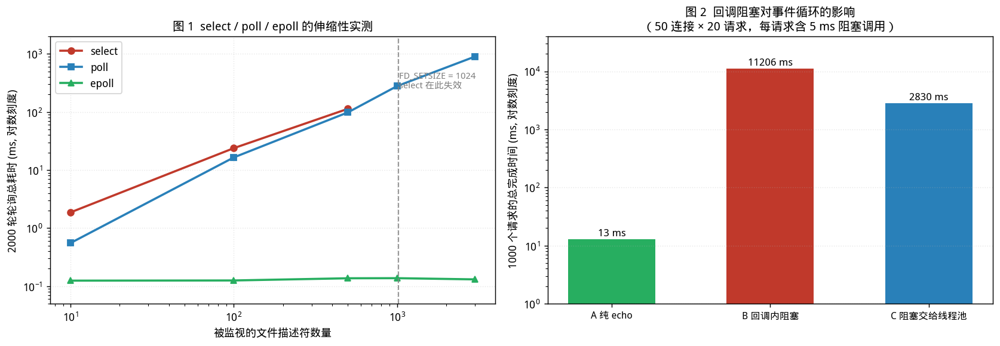

# 事件循环与 libev：从 select 到 epoll，以及回调为何必须短小

> [第 01 篇（并发地基篇）](01-foundations.md)已确立并发系统的层次划分，并给出锁、内存模型、无锁与调度方面的工程准则。
>
> 本文讨论**第 5 层：I/O 模型**，对应第 01 章 0.2 节表格中的"I/O 模型"一行。
>
> 本文所有实测数据均在 Linux x86-64 / GCC 环境下真实运行获得。
>
> 手写事件循环的完整源码（[`mini_reactor.cpp`](https://gitee.com/champagnew/cpp-concurrent/blob/master/02-libev%E7%AF%87/code02/mini_reactor.cpp)）与多路复用基准（[`multiplex_bench.cpp`](https://gitee.com/champagnew/cpp-concurrent/blob/master/02-libev%E7%AF%87/code02/multiplex_bench.cpp)）。

---

## 配套代码

本篇全部源码在 Gitee 仓库 [`champagnew/cpp-concurrent`](https://gitee.com/champagnew/cpp-concurrent)，目录 [`02-libev篇/code02/`](https://gitee.com/champagnew/cpp-concurrent/tree/master/02-libev%E7%AF%87/code02)（编译命令写在每个文件的头部注释里）：

| 源文件 | 内容 |
| --- | --- |
| [`mini_reactor.cpp`](https://gitee.com/champagnew/cpp-concurrent/blob/master/02-libev%E7%AF%87/code02/mini_reactor.cpp) | 手写 epoll 事件循环 echo 服务器，量化「回调阻塞」的代价 |
| [`multiplex_bench.cpp`](https://gitee.com/champagnew/cpp-concurrent/blob/master/02-libev%E7%AF%87/code02/multiplex_bench.cpp) | select / poll / epoll 在「被监视 fd 数」增长时的真实代价 |

配图源文件：[02-libev篇/figures/](https://gitee.com/champagnew/cpp-concurrent/tree/master/02-libev%E7%AF%87/figures)，下文插图均可在该目录找到原始 PNG。

---

## 绪论：本文讨论的范围与不讨论的范围

**事件循环（Event Loop）**是一种程序结构：单个执行流在一个循环中反复询问操作系统"哪些 I/O 已经就绪"，然后逐个处理。它要解决的核心问题是——**当线程因等待数据而无所事事时，如何用最少的资源照看尽可能多的连接。**

本文讨论三件事：

1. 操作系统提供的就绪通知接口（`select` / `poll` / `epoll`）各自的代价模型；
2. 基于这些接口构建程序结构的 **Reactor 模式**；
3. **libev** 作为一个具体的事件循环库，在上述两者之上额外提供了什么。

本文不讨论：

- **Proactor 模式与 Boost.Asio**——那是[第 03 篇（Boost.Asio）](03-boost-asio.md)的主题；
- 内核旁路（DPDK / AF_XDP）——那是[第 07 篇（Seastar）](07-seastar.md)讨论 Seastar 时才会涉及；
- 具体的协议实现（HTTP、RPC 编解码等）。

先明确一个前提性判断：**事件循环不是"让单次 I/O 变快"的技术，而是"让等待变便宜"的技术。** 若服务的瓶颈在于 CPU 计算或下游数据库，改写 I/O 模型不会带来任何收益。第 3.4 节的实测将量化说明：一段仅 5 毫秒的阻塞调用，如何使整个事件循环的吞吐下降到原来的千分之一。

---

## 第 1 章　I/O 多路复用接口的演进与代价模型

### 1.1 术语界定

**文件描述符（File Descriptor，fd）**：操作系统为进程打开的每个 I/O 对象分配的整数标识。套接字、管道、普通文件、定时器（Linux 的 `timerfd`）、跨线程唤醒（`eventfd`）均通过 fd 表示。

**I/O 多路复用（I/O Multiplexing）**：一个系统调用同时监视多个 fd，待其中任一就绪（或不阻塞地可操作）时返回。它使得单个线程能够同时管理大量 I/O 对象。

**就绪通知与完成通知**：

- **就绪通知（Readiness Notification）**：内核告知"该 fd 现在可以无阻塞地执行 I/O"。实际读写仍由应用程序执行。
- **完成通知（Completion Notification）**：内核或运行时告知"你请求的操作已完成，结果在此"。

`select` / `poll` / `epoll` / `kqueue` 均属于就绪通知；Windows IOCP 与 Linux `io_uring` 属于完成通知。这一区别是 Reactor 与 Proactor 两种模式的分水岭（第 2 章详述）。

**水平触发与边缘触发**：

- **水平触发（Level-Triggered, LT）**：只要 fd 仍处于就绪状态，每次调用都会报告该 fd。应用程序可分多次处理。
- **边缘触发（Edge-Triggered, ET）**：仅在 fd 状态发生变化的那一刻报告一次。应用程序必须持续读写至返回 `EAGAIN` / `EWOULDBLOCK`，否则将永久丢失后续事件。

### 1.2 select：位图集合与其固有上限

`select` 的接口形式如下：

```c
int select(int nfds, fd_set *readfds, fd_set *writefds,
           fd_set *exceptfds, struct timeval *timeout);
```

其代价模型有两个特征：

**第一，每次调用都要重新传递完整的 fd 集合。** `fd_set` 是一段固定大小的位图，调用前需由应用程序重新填充（`FD_ZERO` + 逐个 `FD_SET`），内核返回后应用程序又需逐个 `FD_ISSET` 检查。这两趟遍历的成本均为 **O(nfds)**，与"有多少 fd 真的就绪"无关。

**第二，`fd_set` 的大小在编译期固定。** 标准库常量 `FD_SETSIZE` 通常为 1024，这意味着**编号大于等于 1024 的 fd 无法被 `select` 监视**；若强行 `FD_SET` 一个超出范围的 fd，将造成缓冲区越界写入。

### 1.3 poll：数组替代位图，但代价模型未变

```c
int poll(struct pollfd *fds, nfds_t nfds, int timeout);
```

`poll` 以 `struct pollfd` 数组替代位图，因此**消除了 fd 编号的硬上限**。但每次调用仍需传递全部条目，内核仍需遍历全部条目，故其复杂度仍为 **O(被监视的 fd 总数)**。

### 1.4 epoll：将代价从"被监视总量"转移到"活跃事件量"

`epoll` 引入了一个持久的内核对象（**epoll 实例**），应用程序通过三个调用使用它：

```c
int epfd = epoll_create1(0);                                  // 创建实例
epoll_ctl(epfd, EPOLL_CTL_ADD/MOD/DEL, fd, &event);           // 增删兴趣项
int n = epoll_wait(epfd, events, maxevents, timeout);         // 等待就绪
```

关键区别在于：**兴趣集合由内核长期维护**，fd 只需注册一次，此后无需在每次调用时重新传递。内核维护一个就绪链表，`epoll_wait` 直接返回其中的内容。因此其复杂度近似为 **O(活跃事件数)**，与被监视的 fd 总数基本无关。

正是在这一点上，`epoll` 完成了代价模型的根本转移——**从"你监视了多少"转向"有多少真的在动"**。

### 1.5 实测：三者的伸缩性曲线

下面的代码在真实 socketpair 上比较三者。为避免"测量的是发现就绪而非真实吞吐"这一常见偏差，本测试固定活跃 fd 数为 1，仅改变被监视的 fd 总数，从而隔离出"扫描成本"这一个变量。

```cpp
// multiplex_bench.cpp —— select / poll / epoll 在"被监视 fd 数"增长时的真实代价
// 编译：g++ -std=c++17 -O2 multiplex_bench.cpp -o multiplex_bench
// 用法：./multiplex_bench <fd数量> <活跃数量>

static const int kRounds = 2000;

int main(int argc, char **argv) {
  int nfd      = argc > 1 ? std::atoi(argv[1]) : 100;
  int active_n = argc > 2 ? std::atoi(argv[2]) : 1;

  signal(SIGPIPE, SIG_IGN);
  std::vector<int> fds, peers;
  for (int i = 0; i < nfd; ++i) {
    int sv[2];
    socketpair(AF_UNIX, SOCK_STREAM, 0, sv);
    fds.push_back(sv[0]);
    peers.push_back(sv[1]);              // 对端必须保持打开，否则写入会触发 SIGPIPE
    if (i < active_n) (void)!write(sv[1], "x", 1);
  }

  // select：每轮都要重新构造 fd_set，并检查 FD_SETSIZE 上限
  int maxfd_num = 0;
  for (int f : fds) if (f > maxfd_num) maxfd_num = f;
  bool select_ok = (maxfd_num < FD_SETSIZE);
  if (select_ok) {
    for (int r = 0; r < kRounds; ++r) {
      fd_set rfds; FD_ZERO(&rfds);
      int maxfd = 0;
      for (int f : fds) { FD_SET(f, &rfds); if (f > maxfd) maxfd = f; }
      timeval tv{0, 0};                              // 超时为 0，纯轮询
      select(maxfd + 1, &rfds, nullptr, nullptr, &tv);
      for (int f : fds) if (FD_ISSET(f, &rfds)) { char c; (void)!read(f, &c, 1); (void)!write(f, "x", 1); }
    }
  }

  // poll：每轮重新填充 pollfd 数组
  for (int r = 0; r < kRounds; ++r) {
    for (int i = 0; i < nfd; ++i) { pfds[i].fd = fds[i]; pfds[i].events = POLLIN; pfds[i].revents = 0; }
    poll(pfds.data(), nfd, 0);
    for (int i = 0; i < nfd; ++i) if (pfds[i].revents & POLLIN) { /* ... */ }
  }

  // epoll：fd 只注册一次，之后每轮只取就绪项
  int ep = epoll_create1(0);
  for (int i = 0; i < nfd; ++i) {
    epoll_event e{}; e.events = EPOLLIN; e.data.fd = fds[i];
    epoll_ctl(ep, EPOLL_CTL_ADD, fds[i], &e);
  }
  for (int r = 0; r < kRounds; ++r) {
    int n = epoll_wait(ep, evs.data(), nfd, 0);
    for (int i = 0; i < n; ++i) { /* 只处理这 n 个 */ }
  }
}
```

实测结果（同一台机器，2000 轮轮询，活跃 fd 恒为 1）：

| 被监视 fd 数 | 最大 fd 编号 | select | poll | epoll |
|---:|---:|---:|---:|---:|
| 10 | 24 | 1.87 ms | 0.554 ms | 0.125 ms |
| 100 | 204 | 23.84 ms | 16.50 ms | 0.125 ms |
| 500 | 1004 | 113.41 ms | 98.40 ms | 0.137 ms |
| 1000 | 2004 | **不可用** | 278.98 ms | 0.137 ms |
| 3000 | 6004 | **不可用** | 899.42 ms | 0.131 ms |



*图 1（左）：被监视 fd 数增长时三者的耗时曲线，双对数刻度。图 2（右）：回调阻塞对事件循环吞吐的影响，详见第 3 章。数据来源：本文实测。*

三项观察值得单独指出：

1. **`select` 在 1000 个 fd 时已经无法使用**，不是"变慢"，而是"不可用"——fd 编号超过了 `FD_SETSIZE`。这验证了 1.2 节的论断。
2. **`poll` 的耗时近似线性增长**：10 → 3000 个 fd，耗时从 0.554 ms 增至 899 ms，增幅约 1600 倍，与 fd 数量增幅 300 倍相比呈现超线性（因为遍历成本之外还有每轮数组填充与内核拷贝）。
3. **`epoll` 的耗时在整个区间内几乎恒定**（0.125 ~ 0.137 ms），与 fd 总数无关。

### 1.6 关于"少量 fd 时 epoll 更慢"这一说法

libev 官方文档中关于 epoll 后端有如下表述：

> "For few fds, this backend is a bit little slower than poll and select, but it scales phenomenally better."

（在 fd 很少时，该后端比 poll 和 select 略慢，但其伸缩性显著更优。）

然而本文实测显示，即使在 10 个 fd 时，`epoll`（0.125 ms）也快于 `poll`（0.554 ms）。二者并不矛盾，原因在于**测量口径不同**：

- libev 文档描述的是**内核侧** `epoll_wait` 与 `poll` 系统调用本身的对比。fd 很少时，epoll 需要一次 `epoll_ctl` 维护内核兴趣表，单次调用固定开销略高。
- 本文的测量包含**用户态成本**。`poll` 每轮必须重新构造并传递整个 `pollfd` 数组，而 `epoll` 的兴趣表由内核长期维护。2000 轮下来，这部分用户态开销的差异主导了结果。

**工程结论**：所谓"fd 少时用 select/poll 更快"只在极端场景（fd 数量极少、活跃率极高、且已消除用户态重建成本）下成立。对于典型的服务器程序——每轮都要重新构造 fd 集合——**epoll 在全部区间内都是更优选择**。不应以该说法作为选用 `select` 的依据。

### 1.7 epoll 的三个标志位及其适用场景

`epoll_ctl` 的 `events` 字段除事件类型（`EPOLLIN` / `EPOLLOUT` 等）外，还可设置若干**输入标志**，它们影响 epoll 的行为但不会被 `epoll_wait` 返回。依据 Linux 官方手册页（`epoll_ctl(2)`），三个与多线程和触发语义相关的标志如下。

**`EPOLLET`（边缘触发）**

设置后对该 fd 采用边缘触发通知。默认行为为水平触发。采用边缘触发时，应用程序必须持续读写至返回 `EAGAIN`，否则将永久丢失事件。

**`EPOLLONESHOT`（一次性通知，Linux 2.6.2 起）**

设置后，一旦 `epoll_wait` 报告了该 fd 上的事件，该 fd 即在兴趣表中被禁用，此后不再报告任何事件；必须显式调用 `epoll_ctl(EPOLL_CTL_MOD)` 重新装载。

其典型用途是**多线程事件循环**。若多个线程同时在同一个 epoll 实例上调用 `epoll_wait`，同一个 fd 的就绪事件可能被多个线程同时取得，导致两个线程并发读取同一连接——结果是报文被撕裂、协议解析失败。`EPOLLONESHOT` 保证一个 fd 在任何时刻只被一个线程处理。

代价是每次处理完毕后都需要一次 `EPOLL_CTL_MOD` 系统调用。因此它适用于"每个连接处理代价较高"的场景，而非极短回调的场景。

**`EPOLLEXCLUSIVE`（独占唤醒，Linux 4.5 起）**

当多个 epoll 实例监视同一个 fd 时，默认行为是**所有** epoll 实例都会收到事件。设置 `EPOLLEXCLUSIVE` 后，内核只保证唤醒其中**一个或多个**，而非全部。

这一标志用于缓解**惊群（Thundering Herd）**问题：多个工作线程各自持有独立的 epoll 实例并在同一个监听套接字上等待，新连接到来时若全部被唤醒，则只有一个能成功 `accept`，其余线程的唤醒纯属浪费。

需要注意的限制：

- `EPOLLEXCLUSIVE` 仅可用于 `EPOLL_CTL_ADD`，用于 `EPOLL_CTL_MOD` 将返回 `EINVAL`；
- 可与之组合的标志仅限于 `EPOLLIN`、`EPOLLOUT`、`EPOLLWAKEUP`、`EPOLLET`；
- 若同一 fd 同时被设置了该标志的 epoll 实例与未设置该标志的实例监视，则**未设置者仍会全部收到事件**，设置者中至少一个收到事件。

三者的适用关系可概括如下：

| 标志 | 解决的问题 | 代价 / 风险 |
|---|---|---|
| `EPOLLET` | 减少同一 fd 的重复通知 | 必须读写至 `EAGAIN`，否则永久丢事件 |
| `EPOLLONESHOT` | 防止同一 fd 被多个线程并发处理 | 每次处理后需一次 `EPOLL_CTL_MOD` |
| `EPOLLEXCLUSIVE` | 缓解多 epoll 实例下的惊群 | 仅 Linux 4.5+；仅可用于 `ADD`；不保证只唤醒一个 |

**工程建议**：单线程事件循环无需这三个标志中的任何一个，水平触发已足够安全。仅在引入多线程后，才需要按具体并发模型选择 `EPOLLONESHOT`（同一实例多线程）或 `EPOLLEXCLUSIVE`（每线程独立实例）。

---

## 第 2 章　Reactor 模式：事件循环的程序结构

### 2.1 模式来源

**Reactor** 模式出自 Douglas C. Schmidt 等人的《Pattern-Oriented Software Architecture, Vol.2》（Wiley, 2000），原始论文题为《Reactor: An Object Behavioral Pattern for Demultiplexing and Dispatching Handles for Synchronous Events》。

其原始定义为：同步事件多路分解器在一组句柄上阻塞，直至其中某个句柄可以无阻塞地发起操作。

### 2.2 五个参与者

| 参与者 | 职责 | 在 epoll 实现中的对应物 |
|---|---|---|
| **Handle**（句柄） | 操作系统资源的标识 | 文件描述符 `fd` |
| **Synchronous Event Demultiplexer**<br>（同步事件多路分解器） | 在无事件时阻塞，有事件时返回 | `epoll_wait` |
| **Initiation Dispatcher**<br>（启动分发器） | 维护 handle → handler 的注册表，运行事件循环 | 事件循环主循环 |
| **Event Handler**（事件处理器） | 定义处理特定事件的抽象接口 | 回调函数的签名 |
| **Concrete Event Handler**<br>（具体事件处理器） | 实现业务逻辑 | 实际的读写与协议处理函数 |

程序的执行流程为：

```
注册阶段：把「我对哪个 fd 的哪类事件感兴趣」登记到 Dispatcher
循环阶段：
    Dispatcher 收集所有 handle → 调用 Demultiplexer 等待
    Demultiplexer 返回就绪的 handle 集合
    Dispatcher 按 handle 查表找到对应 handler
    逐个调用 handler 的回调
    回到等待
```

### 2.3 Reactor 的核心契约：回调必须短小

Reactor 的全部优势——单线程照看数万连接——建立在一个前提上：**回调能够迅速返回，把控制权交还给事件循环**。

一旦某个回调执行阻塞操作，后果不是"这个连接变慢"，而是**整个事件循环停摆**，所有连接一起等待。这个现象称为**队头阻塞（Head-of-Line Blocking）**。

第 3 章将通过实测量化这一后果。

### 2.4 Reactor 与 Proactor 的分野

为给第 03 篇铺垫，此处先给出两者的本质区别：

| 维度 | Reactor | Proactor |
|---|---|---|
| 内核通知的内容 | fd 已就绪 | 操作已完成 |
| 应用程序收到通知后 | **自行**调用 `read` / `write` | 在回调中处理**结果** |
| 部分读写的处理 | 需自行维护状态机 | 由运行时续做，凑足后通知 |
| 典型平台 | epoll、kqueue、select | Windows IOCP、Linux io_uring |
| 代表实现 | libevent、libev | Boost.Asio、Windows IOCP |

一句话概括：**Reactor 通知"你现在可以读了"；Proactor 通知"已经帮你读完了"。**

---

## 第 3 章　手写事件循环：结构、陷阱与实测

本章给出一个约 200 行的 epoll 事件循环实现，并用它验证第 2.3 节的论断。完整源码见随附的 `mini_reactor.cpp`。

### 3.1 服务端骨架

```cpp
void run_server(int port, int mode) {
  signal(SIGPIPE, SIG_IGN);                     // ① 对端关闭后写入会触发 SIGPIPE
  int ln = socket(AF_INET, SOCK_STREAM, 0);
  int one = 1;
  setsockopt(ln, SOL_SOCKET, SO_REUSEADDR, &one, sizeof(one));
  /* bind / listen */
  set_nonblock(ln);                              // ② 监听套接字也应为非阻塞

  int ep = epoll_create1(0);
  epoll_event e{}; e.events = EPOLLIN; e.data.fd = ln;
  epoll_ctl(ep, EPOLL_CTL_ADD, ln, &e);

  for (;;) {
    int n = epoll_wait(ep, evs.data(), evs.size(), -1);
    for (int i = 0; i < n; ++i) {
      int fd = evs[i].data.fd;
      if (fd == ln) { /* accept 循环 */ continue; }
      /* 读 → 处理 → 写 */
    }
  }
}
```

三个必须注意的细节：

1. **`SIGPIPE` 必须忽略**。若对端已关闭而本端仍 `write`，默认行为是进程被信号终止。
2. **监听套接字应设为非阻塞**。水平触发模式下，若 `accept` 期间又有新连接到来，阻塞式 `accept` 会使循环卡住。
3. **`accept` 应在循环中执行至返回 `EAGAIN`**。一轮内接受全部待处理连接，可显著提高连接建立的吞吐。libev 官方文档对 select 后端亦有同样建议。

### 3.2 读的非阻塞处理

```cpp
char buf[4096];
for (;;) {
  ssize_t r = read(fd, buf, sizeof(buf));
  if (r > 0) { inbuf[fd].append(buf, r); continue; }        // 继续读
  if (r == 0) { /* 对端关闭：注销并 close */ break; }
  if (errno == EAGAIN || errno == EWOULDBLOCK) break;       // 本轮读完
  /* 其他错误：注销并 close */
  break;
}
```

### 3.3 已知缺陷：写入不完整时未注册 `EPOLLOUT`

本实现的写回逻辑如下：

```cpp
if (!outbuf[fd].empty()) {
  ssize_t w = write(fd, outbuf[fd].data(), outbuf[fd].size());
  if (w > 0) outbuf[fd].erase(0, w);
}
```

若一次 `write` 未能写完（内核发送缓冲区已满），剩余数据虽被保留在 `outbuf` 中，但**并未注册 `EPOLLOUT`，因而永远不会再次尝试写入**。这是一个真实存在的缺陷，本实现予以保留，原因有二：

- 保持代码长度可控，便于阅读；
- 该缺陷恰好说明手工实现事件循环的隐患所在——**这类边界条件正是 libev、libevent 等库替你处理的核心内容之一**。

正确的做法是：写入不完整时为 fd 增加 `EPOLLOUT` 监听，待可写时继续发送，发送完毕后移除 `EPOLLOUT`，否则将因持续收到"可写"通知而空转。

### 3.4 实测：回调阻塞的代价

为量化第 2.3 节的论断，本实现提供三种模式：

- **模式 A**：回调极轻（纯 echo 回显），代表事件循环的理想用法；
- **模式 B**：回调内执行一次 5 ms 阻塞调用（模拟同步数据库访问、同步磁盘 I/O 或 DNS 解析），即**反例**；
- **模式 C**：阻塞调用移出事件循环，交由线程池执行，完成后通过 `eventfd` 唤醒事件循环，即**正确做法**。

阻塞调用采用 `std::this_thread::sleep_for` 而非忙等。这一选择是必要的：同步数据库客户端、磁盘 I/O 等调用会让出 CPU；若以忙等模拟，则 CPU 本身成为瓶颈，线程池方案的优势将无法体现。

客户端采用 **burst 模式**：所有连接同时把全部请求发出，再统一收集响应。若改为串行地"发一个、等一个"，客户端自身即成为串行瓶颈，服务端并行度再高也无法体现。

实测结果（50 条连接，每连接 20 个请求，共 1000 个请求；每请求含 5 ms 阻塞调用）：

| 模式 | 总耗时 | 吞吐 | 首个响应到达 p50 | 首个响应到达 max |
|---|---:|---:|---:|---:|
| **A** 纯 echo | 12.96 ms | **77,178 req/s** | 12.93 ms | 12.96 ms |
| **B** 回调内阻塞 | 11,206 ms | **89 req/s** | 5,830 ms | 11,206 ms |
| **C** 阻塞交给线程池 | 2,830 ms | **353 req/s** | 1,407 ms | 2,806 ms |

三组数据的解读：

1. **模式 B 相对模式 A，吞吐下降至约 1/865。** 这不是"慢了一点"，而是量级上的坍塌。原因在于事件循环被 5 ms 的阻塞串行化：1000 个请求 × 5 ms ≈ 5 秒的理论下限，实测 11.2 秒（含调度与系统调用开销）。
2. **模式 B 的 p50 首响应延迟为 5.83 秒。** 一半的连接要等近 6 秒才收到第一个字节。对于任何在线服务，这都是不可接受的水平。
3. **模式 C 相对模式 B 提速 3.96 倍**，与线程池的 4 个工作线程数量吻合。这说明阻塞工作已被真正并行化。
4. **但模式 C 仍远慢于模式 A**（353 vs 77,178 req/s）。这说明线程池只是缓解手段——**真正的解法是消除阻塞调用本身**，改用异步 I/O 或 `io_uring`。

### 3.5 模式 C 的实现：跨线程唤醒

模式 C 中，工作线程完成后需要通知事件循环。这里使用 **eventfd**：

```cpp
int wake = eventfd(0, EFD_NONBLOCK);                    // 创建唤醒 fd
pool.start(4, [&] { uint64_t one = 1; write(wake, &one, 8); });   // 工作线程写它
epoll_event we{}; we.events = EPOLLIN; we.data.fd = wake;
epoll_ctl(ep, EPOLL_CTL_ADD, wake, &we);                // 事件循环监听它
```

`eventfd` 是一个内核维护的 64 位计数器：写入即递增，读取即清零并（可选）阻塞。它作为 fd 可被 `epoll` 监听，因此**可以把"某个线程完成了工作"这一事件转换为"某个 fd 变得可读"，从而统一纳入事件循环**。

在事件循环侧的处理：

```cpp
if (fd == wake) {
  uint64_t v;
  while (read(wake, &v, 8) > 0) { }        // 清空计数器
  for (auto &d : pool.drain())             // 取回结果
    write(d.fd, d.resp.data(), d.resp.size());
  continue;
}
```

这一机制正是 libev 的 `ev_async` 与 Boost.Asio 内部唤醒机制的原理。第 4.4 节将说明 libev 在此之上额外保证了什么。

### 3.6 从字节流到业务消息：事件循环不替你跨越的鸿沟

第 3.1~3.3 节的实现隐含着一个尚未解决的问题：**一次 `read` 得到的字节，并不构成一条完整的业务消息。**

这是 TCP 协议的固有性质：TCP 提供的是**字节流（byte stream）**服务，不保留发送端的消息边界。发送方调用三次 `write` 发送三条消息，接收方可能一次 `read` 就全部读到（**粘包**），也可能分五次才读完（**半包**）。

就绪通知的语义仅是"该 fd 现在可读"，既不保证"有多少字节可读"，也不保证"读到的构成一个完整报文"。因此应用程序必须自行维护**协议解析状态机**：

```
接收缓冲区（累积未解析的字节）
    ↓
尝试解析：缓冲区中是否包含一个完整报文？
    ├─ 是 → 取出报文，交给业务逻辑，缓冲区移除已消费部分，继续尝试解析下一个
    └─ 否 → 保留缓冲区，等待下一次可读事件
```

本实现中以 `\n` 作为报文分隔符演示该流程：

```cpp
size_t pos;
while ((pos = inbuf[fd].find('\n')) != std::string::npos) {
    std::string req = inbuf[fd].substr(0, pos);   // 取出一条完整报文
    inbuf[fd].erase(0, pos + 1);                  // 移除已消费部分
    /* 处理 req */
}
```

真实协议中常见的两种编码方式：

- **长度前缀**：报文头部携带长度字段（如 4 字节大端整数）。解析时先判断缓冲区是否达到 4 字节以读出长度，再判断是否已收满整个报文体。
- **分隔符**：以特定字节序列（如 `\r\n`）分隔，如 HTTP 头部、Redis 协议。

无论采用哪种，**接收缓冲区必须是每连接独立的，且状态必须跨事件保留**——这正是 Reactor 模式下"连接状态机"的由来，也是 libev 不提供缓冲抽象（而 libevent 提供 `bufferevent`）所留下的工作。

### 3.7 必须处理的异常事件位

`epoll_wait` 返回的 `events` 位掩码中，除 `EPOLLIN` / `EPOLLOUT` 外，还有三类必须处理：

| 事件位 | 含义 | 处理 |
|---|---|---|
| `EPOLLRDHUP`（Linux 2.6.17+） | 对端关闭连接，或关闭了写半部 | 可据此判断半关闭状态；在边缘触发模式下尤其有用 |
| `EPOLLHUP` | 挂起 | 无需在 `epoll_ctl` 中设置，`epoll_wait` 总会报告 |
| `EPOLLERR` | 出错 | 同上；典型如对端重置连接 |

依据官方手册页，`EPOLLERR` 与 `EPOLLHUP` **无需显式注册**，`epoll_wait` 在它们发生时总会报告。

另需注意 `EPOLLHUP` 的一个细节：对于管道或流式套接字，该事件仅表示对端关闭了它的一端；**只有在缓冲区中剩余的数据全部被读完后，后续的 `read` 才会返回 0（EOF）**。因此收到 `EPOLLHUP` 时不应立即关闭 fd，而应先读完剩余数据。

### 3.8 慢客户端与写缓冲区膨胀

第 3.3 节提到的"写入不完整"缺陷，在真实系统中还有一个更严重的后果：**写缓冲区膨胀**。

若某个连接的对端读取缓慢（慢客户端）或网络拥塞，内核发送缓冲区将持续占满，应用程序的 `write` 长期无法完成。此时若无限累积待发送数据，内存将持续增长。工程上的处理方式包括：

- 为每连接的发送缓冲区设置**上限**，超过则断开连接或触发流控；
- 正确注册 `EPOLLOUT`，在可写时继续发送，发送完毕后注销，避免"始终可写"导致的空转；
- 为整体内存设置配额。

这一问题的存在，是"事件循环库不解决缓冲与流控"这一边界的直接体现。

---

## 第 4 章　libev：事件循环库提供的抽象

### 4.1 定位与来历

**libev** 由 Marc Alexander Lehmann 编写，其官方自述为"a high performance full-featured event loop written in C"。

其产生背景是对 **libevent** 的设计反思。libev 的 README 列出的改进点包括：

| 维度 | libevent（1.3e 时期） | libev |
|---|---|---|
| watcher 体积（amd64） | 152 字节 | **≤ 56 字节** |
| epoll 后端实现 | 366 行，无缓存 | **90 行，完整缓存** |
| 定时器数据结构 | 红黑树 | **优先级队列，关键操作 O(1)** |
| 全局状态 | 存在全局变量，多线程不安全 | **无全局状态，`ev_loop` 作为上下文** |
| HTTP / DNS 组件 | 内置 | **不提供**，仅做事件循环 |
| 时间跳变处理 | 不精确 | 可检测并校正 |
| fd 数量限制 | 存在硬编码限制 | **无硬编码限制** |
| fork 支持 | 无法从中恢复 | 有 `ev_fork` watcher |

其中"**按类型拆分的轻量 watcher**"是最核心的设计决策：libevent 的一个 watcher 同时容纳 I/O、定时器与信号处理器所需的全部字段，而 libev 为每种事件类型提供独立的结构体，从而显著减小体积。

### 4.2 Watcher 体系

**Watcher（观察者）**是 libev 的核心抽象：一个由用户分配的结构体，用于登记"我对某类事件感兴趣"。所有 watcher 遵循统一的生命周期：

```c
ev_TYPE_init(&watcher, callback, ...);   // 初始化（等价于 ev_init + ev_TYPE_set）
ev_TYPE_start(loop, &watcher);           // 开始监视
ev_TYPE_stop(loop, &watcher);            // 停止监视
```

回调函数统一具有如下签名：

```c
void callback(struct ev_loop *loop, ev_TYPE *w, int revents);
```

第三个参数 `revents` 是**实际接收到的事件位掩码**，可能同时包含多个位。可用位包括 `EV_READ`、`EV_WRITE`、`EV_TIMER`、`EV_SIGNAL`、`EV_CHILD`、`EV_STAT`、`EV_IDLE`、`EV_ASYNC` 等。

libev 提供的 watcher 类型如下：

| Watcher | 触发条件 | 典型用途 |
|---|---|---|
| `ev_io` | fd 可读 / 可写 | 网络与管道 I/O |
| `ev_timer` | 相对时间超时，可重复 | 超时控制、心跳、重试 |
| `ev_periodic` | 绝对时间（挂钟）到达，可自定义重新调度 | 类 cron 的定时任务 |
| `ev_signal` | 收到指定信号 | 优雅退出、配置重载 |
| `ev_child` | 子进程状态变化 | 进程管理 |
| `ev_stat` | 文件路径属性变化（基于 inotify） | 配置文件热加载 |
| `ev_idle` | 事件循环无事可做时 | 低优先级后台任务 |
| `ev_prepare` / `ev_check` | 每轮收集事件前 / 收集后 | 批量缓冲、与外部状态同步 |
| `ev_async` | 其他线程调用 `ev_async_send` | **跨线程唤醒** |
| `ev_fork` | 发生 `fork` 后 | 子进程中重建循环 |
| `ev_embed` | 嵌入另一个事件循环 | 库集成 |
| `ev_cleanup` | 事件循环销毁前 | 资源释放 |

### 4.3 事件循环的创建与控制

```c
struct ev_loop *loop = ev_default_loop(0);     // 默认循环（非线程安全）
struct ev_loop *loop = ev_loop_new(EVBACKEND_EPOLL);   // 自建循环，可指定后端
ev_run(loop, 0);                                // 运行，直到无活跃 watcher 或 ev_break
ev_break(loop, EVBREAK_ALL);                    // 跳出
```

`ev_break` 的第二个参数取 `EVBREAK_ONE`（仅跳出最内层的 `ev_run`）或 `EVBREAK_ALL`（跳出全部嵌套的 `ev_run`）。

**后端（backend）**可显式指定，取值包括：

| 常量 | 值 | 说明 |
|---|---:|---|
| `EVBACKEND_SELECT` | 1 | 可移植；O(最高 fd)；fd 少且编号低时可能最快 |
| `EVBACKEND_POLL` | 2 | 无 fd 硬上限；O(被监视 fd 总数) |
| `EVBACKEND_EPOLL` | 4 | Linux；O(1) 或 O(活跃 fd) |
| `EVBACKEND_KQUEUE` | 8 | BSD 系 |
| `EVBACKEND_LINUXAIO` | — | Linux AIO |
| `EVBACKEND_IOURING` | — | io_uring |

libev 默认采用自动选择策略。工程上建议：**允许自动选择，但把实际选中的后端记录到日志**；在容器、WSL 或旧内核环境下，自动选择的结果可能与预期不符。

### 4.4 `ev_async`：跨线程唤醒及其重要限制

`ev_async` 用于从其他线程唤醒一个不受本线程控制的事件循环：

```c
ev_async async_w;
ev_async_init(&async_w, async_cb);
ev_async_start(loop, &async_w);

// 任意线程中：
ev_async_send(loop, &async_w);      // 线程安全、信号安全
```

官方文档明确说明 `ev_async_send` 是 **thread- and signal safe**，即无需额外加锁即可从任意线程调用。

**但必须注意两项限制**，它们在工程实践中频繁导致缺陷：

1. **`ev_async` 不提供任何数据排队能力。** 官方文档的表述是："ev_async does not support queueing of data in any way." 这意味着**若需传递数据，必须自行提供队列**，并在回调中排空该队列。第 3.5 节手写实现中的 `WorkerPool::drain()` 承担的正是这一职责。

2. **多次 `ev_async_send` 可能被合并为一次回调。** 官方指出该行为与信号处理类似，即回调的调用次数可能少于 `ev_async_send` 的调用次数。因此**回调必须以"排空队列"的方式编写，而不能假设"一次 send 对应一次回调"**。

这两点共同决定了 `ev_async` 的正确用法：**批量取走，而非逐次处理**。

### 4.5 引用计数与循环的存活

```c
ev_ref(loop);      // 引用计数 +1
ev_unref(loop);    // 引用计数 -1
```

每个活跃的 watcher 持有一个引用，**只要引用计数非零，`ev_run` 就不会自行返回**。若某个 watcher 永不注销但不希望它阻止循环退出（例如定时器常驻但不希望它维持进程存活），可在 `start` 之后调用 `ev_unref`，在 `stop` 之前调用 `ev_ref`。

### 4.6 用 libev 重写第 3 章的 echo 服务器

作为对照，以下是使用 libev 的等价实现（需安装 `libev-dev`，编译时加 `-lev`）：

```c
// echo_libev.c —— 与 mini_reactor.cpp 模式 A 等价的 libev 实现
// 编译：gcc -std=c11 -O2 echo_libev.c -lev -o echo_libev
#include <ev.h>
#include <stdio.h>
#include <stdlib.h>
#include <string.h>
#include <unistd.h>
#include <fcntl.h>
#include <arpa/inet.h>
#include <netinet/in.h>
#include <signal.h>

static void set_nonblock(int fd) {
  int fl = fcntl(fd, F_GETFL, 0);
  fcntl(fd, F_SETFL, fl | O_NONBLOCK);
}

// 每个连接一个 io watcher + 一个接收缓冲
typedef struct {
  ev_io  io;
  char   buf[4096];
  size_t len;
} Conn;

// 读回调：读到什么就回什么（echo）
static void read_cb(struct ev_loop *loop, ev_io *w, int revents) {
  Conn *c = (Conn *)w;
  char tmp[4096];
  for (;;) {
    ssize_t r = read(w->fd, tmp, sizeof(tmp));
    if (r > 0) {
      (void)!write(w->fd, tmp, r);        // 简化：直接写回（未处理写不完整）
      continue;
    }
    if (r == 0 || (r < 0 && errno != EAGAIN && errno != EWOULDBLOCK)) {
      ev_io_stop(loop, w);
      close(w->fd);
      free(c);
      return;
    }
    break;                                 // EAGAIN：本轮读完
  }
}

// accept 回调：循环接受，直到 EAGAIN
static void accept_cb(struct ev_loop *loop, ev_io *w, int revents) {
  for (;;) {
    int fd = accept(w->fd, NULL, NULL);
    if (fd < 0) return;                    // EAGAIN
    set_nonblock(fd);
    Conn *c = calloc(1, sizeof(Conn));
    ev_io_init(&c->io, read_cb, fd, EV_READ);
    ev_io_start(loop, &c->io);
  }
}

int main(int argc, char **argv) {
  signal(SIGPIPE, SIG_IGN);
  int port = argc > 1 ? atoi(argv[1]) : 18888;

  int ln = socket(AF_INET, SOCK_STREAM, 0);
  int one = 1;
  setsockopt(ln, SOL_SOCKET, SO_REUSEADDR, &one, sizeof(one));
  struct sockaddr_in a = {0};
  a.sin_family = AF_INET;
  a.sin_port = htons(port);
  a.sin_addr.s_addr = inet_addr("127.0.0.1");
  bind(ln, (struct sockaddr *)&a, sizeof(a));
  listen(ln, 4096);
  set_nonblock(ln);

  struct ev_loop *loop = ev_default_loop(0);

  ev_io accept_w;
  ev_io_init(&accept_w, accept_cb, ln, EV_READ);
  ev_io_start(loop, &accept_w);

  ev_run(loop, 0);                         // 进入事件循环
  return 0;
}
```

对照第 3 章的手写实现，libev 承担了下列工作：

| 手写实现需自行处理 | libev 的处理方式 |
|---|---|
| `epoll_create1` / `epoll_ctl` / `epoll_wait` | 封装为 `ev_loop`，自动选择后端 |
| fd → 回调的映射表 | 由 watcher 结构本身携带回调 |
| 定时器管理 | `ev_timer`，基于优先级队列，关键操作 O(1) |
| 信号处理 | `ev_signal`，无竞态（libevent 可能延迟至下一轮事件） |
| 跨线程唤醒 | `ev_async` + `ev_async_send`（线程安全） |
| 时间跳变校正 | 内建检测与校正 |
| fork 后的恢复 | `ev_fork` watcher |
| `EBADF` 的处理 | 优雅移除出错的 fd |
| 后端差异（epoll/kqueue/ports） | 统一抽象，代码无需改动 |

### 4.7 libev 未替你解决的部分

明确边界同样重要。libev **不**负责：

1. **写回不完整时的 `EPOLLOUT` 管理**——若一次 `write` 未写完，仍需自行注册可写事件并在写完后注销；
2. **缓冲区与协议解析**——libev 只通知"可读"，不提供缓冲或分包（libevent 提供 `bufferevent`，libev 不提供）；
3. **线程池**——阻塞工作如何移出事件循环，由应用程序决定；
4. **`ev_async` 的数据队列**——必须自行提供（见 4.4 节）；
5. **Windows 支持**——libev 在 Windows 上非重点，跨平台需求应选用 libuv 或 Boost.Asio。

### 4.8 定时器：相对时间、绝对时间与时间跳变

libev 提供两类定时器，其区别是工程实践中常见的混淆点。

**`ev_timer`：相对时间，可重复**

```c
ev_timer timer_w;
ev_timer_init(&timer_w, timeout_cb, 5.0, 1.0);   // 5 秒后首次触发，之后每 1 秒重复
ev_timer_start(loop, &timer_w);
```

第三个参数为**首次触发的延迟**（相对于 `ev_timer_start` 的时刻），第四个参数为**重复间隔**；重复间隔为 0 表示只触发一次。

对于已启动的重复定时器，可用：

- `ev_timer_again(loop, &w)`：按 `repeat` 值重新启动。若定时器已活跃，则按当前时间加上 `repeat` 重新排期；若 `repeat` 为 0，则停止它。这一接口常用于**超时续期**（每次收到数据就重置超时）。
- `ev_timer_remaining(loop, &w)`：查询距离下次触发的剩余时间。

**`ev_periodic`：绝对时间（挂钟），可自定义重新调度**

```c
ev_periodic periodic_w;
ev_periodic_init(&periodic_w, cron_cb, 0., 3600., NULL);  // 每小时触发一次
```

`ev_periodic` 基于挂钟时间（wall clock）而非单调时间，并可提供自定义的重新调度回调（reschedule callback），适用于类 cron 的场景，例如"每天凌晨 3 点执行一次"。

**时间跳变（Time Jump）的处理**

若系统时钟被 NTP 校时或手动修改，基于挂钟的定时器可能提前或延后触发。libev 能够检测时间跳变并据此校正定时器，且对向前跳变与向后跳变均有效。libev 文档指出，当前实现仅在第一个 `ev_periodic` watcher 启动时才尝试创建 `timerfd`，若创建失败则回退到其他方式；可通过 `EVFLAG_NOTIMERFD` 标志强制禁用 `timerfd`，代价是检测时间跳变变慢、精度降低，但每个循环可节省一个 fd。

**典型应用：连接超时控制**

```c
typedef struct { ev_io io; ev_timer timer; /* ... */ } Conn;

static void timeout_cb(struct ev_loop *loop, ev_timer *w, int revents) {
    Conn *c = (Conn *)((char *)w - offsetof(Conn, timer));
    ev_io_stop(loop, &c->io);      // 停止该连接的 I/O 监视
    close(c->io.fd);
    free(c);
}

// 每次收到数据时重置超时（典型的心跳/空闲断连逻辑）
static void touch(Conn *c) {
    c->timer.repeat = 30.0;        // 空闲 30 秒后断开
    ev_timer_again(loop, &c->timer);
}
```

libev 的定时器基于优先级队列实现，官方说明关键操作（查找下一个到期定时器）为 **O(1)**；相比之下 libevent 早期版本使用红黑树，libev README 明确将其列为改进点之一。

### 4.9 信号处理：竞态与 fork

`ev_signal` 将信号转换为事件循环中的普通事件：

```c
ev_signal sig_w;
ev_signal_init(&sig_w, sigint_cb, SIGINT);
ev_signal_start(loop, &sig_w);
```

libev README 将"race-free signal processing"列为相对 libevent 的改进项，并指出 libevent 可能将信号的处理延迟至下一个事件之后。libev 在 Linux 上可利用 `signalfd` 实现更简洁的信号处理。

**fork 的处理**是另一项 libev 独有的能力。libevent 无法从 `fork` 中恢复，而 libev 提供 `ev_fork` watcher，用于在 `fork` 之后于子进程中重建事件循环状态：

```c
ev_fork fork_w;
ev_fork_init(&fork_w, fork_cb);
ev_fork_start(loop, &fork_w);
```

此外，libev 还提供 `ev_child`（监视子进程状态变化）与 `ev_cleanup`（循环销毁前的清理）。

---

## 第 5 章　libevent / libev / libuv：三者的关系与选型

### 5.1 演进脉络

| 时间 | 事件 |
|---|---|
| 2000 年前后 | **libevent** 问世，由 Niels Provos 等人编写，功能最全（含 HTTP、DNS、bufferevent） |
| 2007 年前后 | **libev** 由 Marc Lehmann 从 libevent 的设计出发重写，去除 HTTP/DNS，专注事件核心，修正全局变量、watcher 体积与定时器精度问题 |
| 2011 年前后 | **libuv** 为 Node.js 而生；Node.js 早期使用 libev + libeio，因 Windows 支持不足与维护问题，于 **v0.9.4 起彻底移除 libev 依赖** |

### 5.2 三方对比

| 维度 | libevent | libev | libuv |
|---|---|---|---|
| 定位 | 功能最全的网络库 | 最精简的事件循环 | 跨平台异步 I/O 运行时 |
| HTTP / DNS | 内置 | 无 | 无（但提供 `uv_getaddrinfo` 等） |
| 缓冲抽象 | `bufferevent` | 无 | `uv_stream` / `uv_write` |
| Windows | 支持（IOCP） | 非重点 | **一等公民（IOCP + epoll/kqueue 双栈）** |
| 线程池 | 无 | 无 | **内置 `uv_queue_work`** |
| 文件系统异步 | 无 | 无 | **内置** |
| watcher 体积（amd64） | 152 字节 | **≤ 56 字节** | — |
| 维护活跃度 | 活跃 | 缓慢 | 活跃 |
| 典型使用者 | Memcached、Tor、ntpd、Google Chrome | EV perl module、rxvt-unicode、gvpe、Shadowsocks | Node.js、Julia、CMake、ASP.NET Core、uvloop（Python） |

### 5.3 选型建议

| 场景 | 建议 |
|---|---|
| 仅需事件循环，Unix 环境，追求体积与可控性 | **libev** |
| 需要 HTTP/DNS/bufferevent 等成套组件，Unix 环境 | **libevent** |
| 需要跨平台（含 Windows）、文件异步、内置线程池 | **libuv** |
| C++ 项目，需要类型安全、与 Boost 生态集成、协程、组合式异步 | **Boost.Asio**（第 03 篇） |
| 已使用 C++20 协程，需要完成语义与 executor 抽象 | **Boost.Asio**（第 03 篇） |

**判断问题的提法**：需要的是"事件原语"、"组合语义"，还是"完整的异步执行框架"？libev 提供第一种，Boost.Asio 提供第二与第三种。

---

## 第 6 章　应用场景与工程准则

### 6.1 libev 与事件循环的主要应用领域

| 领域 | 典型场景 | 说明 |
|---|---|---|
| **网络中间件** | 代理、网关、负载均衡、消息网关 | 连接数多、每连接逻辑轻，是事件循环最擅长的场景 |
| **数据库内部 RPC** | 分布式数据库的节点间通信 | 本文 6.3 节详述 |
| **通信中间件** | MQTT broker、AMQP 客户端、长连接推送 | 大量空闲长连接，活跃率低 |
| **嵌入式与终端工具** | 终端复用器、守护进程 | 体积小、依赖少 |
| **脚本语言运行时** | Perl 的 EV 模块 | libev 可被无修改地嵌入 |

**不适用的场景**：

- 计算密集型服务（事件循环不提供并行能力）；
- 每个请求都需要阻塞调用、且无法异步化的服务（应改用线程池模型或异步 I/O）；
- 需要严格控制尾延迟的在线服务——此时应考虑 thread-per-core 架构（第 07 篇）。

### 6.2 多 Reactor 架构：单线程循环如何扩展到多核

事件循环的根本限制是：**单个循环只占用一个核。** 无论 epoll 多么高效，一个循环的处理能力上限就是单核的算力。要利用多核，必须引入多个事件循环，即**多 Reactor**。

两种主流组织方式：

**方式一：accept 分发 + 固定归属（推荐）**

- 主线程（或某个 sub-reactor）持有监听套接字，负责 `accept`；
- 新连接建立后，按某种策略（轮询、最少连接数、哈希）分配给某个 sub-reactor；
- **此后该连接的所有事件都由这个 sub-reactor 处理，不再迁移**。

优点是连接状态无需跨线程同步，缓存局部性好；缺点是若某连接特别繁忙，会造成 sub-reactor 之间的负载不均。

**方式二：每线程一个完整循环 + 共享业务线程池**

- 每个线程运行一个独立的事件循环，各自持有独立的 epoll 实例；
- 各循环自行 `accept`（需配合第 1.7 节的 `EPOLLEXCLUSIVE` 缓解惊群）；
- I/O 事件在各自的循环中处理，CPU 密集或阻塞工作提交至共享线程池。

这种结构中，若多个线程在同一监听套接字上等待，可采用 `EPOLLEXCLUSIVE` 减少无效唤醒。

**连接归属与 `EPOLLONESHOT`**

若采用"多个线程在同一个 epoll 实例上调用 `epoll_wait`"这一结构（而非每线程独立实例），则同一连接的事件可能被多个线程同时取得，导致并发读取同一 fd、报文撕裂。此时应使用第 1.7 节的 `EPOLLONESHOT`，保证一个 fd 在任一时刻只被一个线程处理。

**判断扩展是否成功的指标**

不应以"支持多少万连接"衡量，而应观察：

- 每核每秒可处理的事件数；
- 尾延迟（p99 / p999）；
- 各 sub-reactor 的负载是否均衡；
- 跨线程消息与缓存一致性开销。

### 6.3 案例：OceanBase 的 RPC 层

第 01 篇曾提及 OceanBase 的并发原语几乎全部自研，唯独网络层依赖第三方。此处补充其细节。

OceanBase 的 RPC 构建于 **libeasy** 之上。libeasy 是阿里巴巴自研的 RPC 框架，其底层基于 **libev**；OceanBase 的内存上下文体系中亦专设 `LIBEASY` 一项用于统计该部分的内存开销。libeasy 采用 share-nothing 架构，并曾尝试以协程管理任务调度以减少用户态与内核态之间的切换。

值得注意的是，OceanBase 在 4.0 版本中**移除了协程方案**。官方给出的理由包括：现有协程库（含自研实现）无法解决对线程局部变量的依赖问题（最典型者为系统调用中的 `errno`）；协程局部变量与线程局部变量的区分易于混淆；且传统协程方案无法实现抢占调度，容易产生死锁。长期方案被表述为"轻量级线程"。

这一案例说明两点：

1. **即使是自研程度极高的数据库内核，仍会在事件循环这一层选择成熟库**——因为该层的正确性与可移植性成本，远高于其为特定场景定制所能获得的收益；
2. **协程不是事件循环阻塞问题的通用解药**——第 01 篇准则 25~28 已就协程与 `thread_local`、`errno`、阻塞 API 的关系给出约束。

### 6.4 工程准则汇总

承接第 01 篇第 7 章，本节补充 I/O 模型相关的准则（编号续接）。

**准则 34**：**回调必须短小、无阻塞、无锁竞争。** 事件循环线程中的任何阻塞都会使全部连接一起等待。第 3.4 节实测显示，5 ms 的阻塞可使吞吐下降至原来的约 1/865。

**准则 35**：**阻塞调用有三条出路**，按优先级排序：(a) 改为真正的异步 I/O（首选）；(b) 提交至独立线程池，完成后以 `eventfd` / `ev_async` 唤醒事件循环；(c) 隔离到专用的阻塞线程池。切勿直接置于事件循环回调中。

**准则 36**：**`ev_async` 的回调必须以"排空队列"的方式编写。** 多次 `ev_async_send` 可能被合并为一次回调，且 libev 本身不提供数据排队。

**准则 37**：**一次 `write` 未写完时，必须注册可写事件并在写完后注销。** 否则数据将滞留且不再被发送（第 3.3 节）。

**准则 38**：**水平触发是默认的正确选择。** 边缘触发要求持续读写至 `EAGAIN`，漏掉一次事件即导致连接永久挂起。初学实现不应为追求性能而选用 `EPOLLET`。

**准则 39**：**`accept` 应循环执行至 `EAGAIN`**，且监听套接字应设为非阻塞。

**准则 40**：**忽略 `SIGPIPE`。** 对端关闭后继续 `write` 会默认终止进程。

**准则 41**：**记录事件循环实际选中的后端**，特别是在容器、WSL 或旧内核环境下；自动选择的结果可能与预期不符。

**准则 42**：**衡量指标是活跃事件率与 p99 延迟，而非"支持多少万连接"。** 维持十万条空闲连接的成本极低，而每秒处理十万次请求的成本高得多。

**准则 43**：**多 Reactor 的两种组织方式**：(a) acceptor 将新连接分配给固定的 sub-reactor，此后该连接始终由其处理，减少线程迁移；(b) 每线程一个完整事件循环，业务任务跨线程池执行。判断扩展是否成功，应看每核可处理事件数与尾延迟，而非连接总数。

**准则 44**：**事件循环与线程池是协作关系，而非二选一。** 前者负责 I/O 与调度，后者负责 CPU 密集与阻塞工作。

**准则 45**：**就绪通知不等于完整报文。** 必须先累积到每连接独立的接收缓冲区，并按长度前缀或分隔符解析出完整消息后才交给业务逻辑（第 3.6 节）。

**准则 46**：**收到 `EPOLLHUP` 不应立即关闭连接**，应先读完缓冲区中剩余的数据，直至 `read` 返回 0。

**准则 47**：**单线程事件循环无需 `EPOLLET` / `EPOLLONESHOT` / `EPOLLEXCLUSIVE`**，水平触发已足够安全。仅在引入多线程后按需选择：同一 epoll 实例多线程用 `EPOLLONESHOT`，每线程独立实例用 `EPOLLEXCLUSIVE`。

**准则 48**：**多 Reactor 扩展时优先采用"accept 分发 + 连接固定归属"**，使连接状态无需跨线程同步。衡量扩展效果应看每核事件处理率与尾延迟，而非连接总数。

**准则 49**：**为每连接发送缓冲区设置上限。** 慢客户端会使内核发送缓冲区长期占满，若无限制地累积待发数据将导致内存持续增长（第 3.8 节）。

---

## 第 7 章　后续篇章规划

| 篇 | 主题 | 层次 | 主场景 |
|---|---|---|---|
| 01 | 经典文献综述与工程实践准则（已完成） | 全部层次 | 通论 |
| 02 | 事件循环与 libev（本文） | I/O 模型 | 网络、代理、数据库 RPC |
| 03 | **Boost.Asio** | I/O 模型 + 执行上下文 | 跨平台网络服务、RPC、需要完成语义的场景 |
| 04 | **Boost.Lockfree 与无锁容器** | 同步原语 | 行情分发、日志队列、线程间高频消息 |
| 05 | **oneTBB** | 调度 | 计算密集：图像处理、科学计算、仿真 |
| 06 | **Folly** | 同步原语 + 数据结构 + 内存 | 通用后端服务、KV 存储、高性能组件库 |
| 07 | **Seastar** | 调度 + I/O + 执行单元的完整栈 | 数据库、存储、消息系统（thread-per-core 架构） |

第 03 篇将以本文第 2.4 节为起点，展开 Proactor 模式，并说明 Boost.Asio 在 Linux 上如何以 Reactor 模拟完成语义，以及 `io_context`、`strand` 与 C++20 协程在其中扮演的角色。

---

## 参考资料

### 操作系统接口

- [epoll_ctl(2) — Linux 官方手册页（EPOLLET / EPOLLONESHOT / EPOLLEXCLUSIVE 的权威定义）](https://man7.org/linux/man-pages/man2/epoll_ctl.2.html)
- [epoll(7) — Linux 官方手册页（水平触发与边缘触发语义）](https://man7.org/linux/man-pages/man7/epoll.7.html)
- [Kerrisk 引用的 select/poll/epoll 基准数据](https://arrow.tudublin.ie/context/scschcomdis/article/1255/viewcontent/D18124332_MSc_ASD_Dissertation_FInal_Draft_Feedback.pdf)

### libev 官方文献

- [libev 官方手册（完整版，含 watcher 体系与后端说明）](https://hexmos.com/freedevtools/man-pages/library-functions/standard-io-buffering/libev)
- [libev 官方手册（Debian man page，含后端复杂度说明）](https://manpages.debian.org/unstable/libev-dev/ev.3)
- [libev README（与 libevent 的逐项对比数据，作者 Marc Lehmann）](https://git.lighttpd.net/mirrors/libev/src/commit/bb2c65efbc84fa7209355c0ce9e9627268f61403/README)
- [libev API Reference（watcher 类型与生命周期）](https://deepwiki.com/enki/libev/2-api-reference)
- [libev 官方性能基准（与 libevent 对比）](http://libev.schmorp.de/bench.html)

### 设计模式与 I/O 模型

- [Schmidt et al., "Reactor: An Object Behavioral Pattern for Demultiplexing and Dispatching Handles for Synchronous Events"](http://www.laputan.org/pub/sag/reactor.pdf)
- [POSA2（《Pattern-Oriented Software Architecture》第 2 卷）书目页，含 Proactor 章节](https://www.dre.vanderbilt.edu/~schmidt/POSA/POSA2/)
- [Kegel, "The C10K problem"](https://www.kegel.com/c10k.html)
- [Axboe, io_uring 引入补丁（SQ/CQ 共享环形队列说明）](https://lore.kernel.org/linux-api/20190209211346.26060-6-axboe@kernel.dk/T/)
- [Boost.Asio 官方文档：异步核心 / 以 Reactor 实现 Proactor 的说明](https://www.boost.org/doc/libs/latest/doc/html/boost_asio/overview/core/async.html)

### 三个库的演进关系

- [libuv 官方网站](https://libuv.org/)
- [libevent / libev / libuv 对比、演进与实现原理（含 Node.js v0.9 移除 libev 的时间点）](https://blog.csdn.net/u011487024/article/details/159380757)
- [《Web Server 编年史》（libevent 2000、libev 2007、libuv 2011 的脉络与各自使用者）](https://segmentfault.com/a/1190000023050141)
- [Node.js 与 libuv 的诞生（libev 依赖在 v0.9.4 被移除）](https://juejin.cn/book/m/7196627546253819916/section/7197074908004745254)

### 关联：OceanBase 的工程实践

- [OceanBase 源码解读（二）：目录结构（deps/easy 与 libev 的关系）](https://open.oceanbase.com/blog/1100224)
- [OceanBase 社区问答：4.0 移除协程的原因（官方答复，涉及 TLS 与 errno）](https://ask.oceanbase.com/t/topic/35601620/5)
- [OceanBase 社区问答：协程实现方式的讨论](https://ask.oceanbase.com/t/topic/439/2)
- [OceanBase 内存上下文说明（含 LIBEASY 与 CO_STACK 两项）](https://ask.oceanbase.com/t/topic/35624616/1)

### 关联：第 01 篇已引用的基础文献

- [Mellor-Crummey & Scott, "Algorithms for Scalable Synchronization on Shared-Memory Multiprocessors", ACM TOCS 1991](https://www.cs.rice.edu/~johnmc/papers/tocs91.pdf)
- [Franke, Russell, Kirkwood, "Fuss, Futexes and Furwocks: Fast Userlevel Locking in Linux", OLS 2002](https://kernel.org/doc/ols/2002/ols2002-pages-479-495.pdf)
- [Blumofe & Leiserson, "Scheduling Multithreaded Computations by Work Stealing", JACM 1999](https://doi.org/10.1145/324133.324234)

---

## 系列导航

[← 上一篇：并发地基篇](01-foundations.md) ｜ [← 返回系列目录](/cpp/concurrent) ｜ [下一篇：Boost.Asio →](03-boost-asio.md)

> 本系列的源码、配图与勘误都在 Gitee：[champagnew/cpp-concurrent](https://gitee.com/champagnew/cpp-concurrent)。
