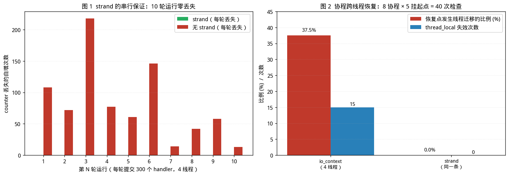

# Boost.Asio：Proactor 模式、执行上下文与 strand

> 本文讨论 **I/O 模型层的另一半：Proactor 模式**，以及 Boost.Asio 如何在 Linux 上实现它。
> 
> 本文所附代码均在 Linux x86-64 / GCC 11.4 环境下实际编译运行，使用的是 **standalone Asio 1.30.2**（`ASIO_VERSION = 103002`），输出为真实结果。
>
> 文中凡涉及性能数字处，均标注了测量条件与波动范围；波动过大者已明确说明不作为结论依据。

---

## 配套代码

本篇全部源码在 Gitee 仓库 [`champagnew/cpp-concurrent`](https://gitee.com/champagnew/cpp-concurrent)，目录 [`03-Asio篇/code03/`](https://gitee.com/champagnew/cpp-concurrent/tree/master/03-Asio%E7%AF%87/code03)（编译命令写在每个文件的头部注释里）：

| 源文件 | 内容 |
| --- | --- |
| [`hello_asio.cpp`](https://gitee.com/champagnew/cpp-concurrent/blob/master/03-Asio%E7%AF%87/code03/hello_asio.cpp) | 最小可运行的 Asio 示例 |
| [`asio_syscall.cpp`](https://gitee.com/champagnew/cpp-concurrent/blob/master/03-Asio%E7%AF%87/code03/asio_syscall.cpp) | 统计一次 `async_read` 实际发生了哪些系统调用 |
| [`syscall_counter.c`](https://gitee.com/champagnew/cpp-concurrent/blob/master/03-Asio%E7%AF%87/code03/syscall_counter.c) | LD_PRELOAD 用的系统调用计数器（配合 `asio_syscall.cpp`） |
| [`basics_probe.cpp`](https://gitee.com/champagnew/cpp-concurrent/blob/master/03-Asio%E7%AF%87/code03/basics_probe.cpp) | 验证 `work_guard`、`post` / `dispatch` / `defer` 的语义 |
| [`probe_conc.cpp`](https://gitee.com/champagnew/cpp-concurrent/blob/master/03-Asio%E7%AF%87/code03/probe_conc.cpp) | 诊断多线程 `io_context` 下 handler 是否真的并发执行 |
| [`strand_demo.cpp`](https://gitee.com/champagnew/cpp-concurrent/blob/master/03-Asio%E7%AF%87/code03/strand_demo.cpp) | 验证 `strand` 保证的是什么，以及它的代价 |
| [`asio_echo.cpp`](https://gitee.com/champagnew/cpp-concurrent/blob/master/03-Asio%E7%AF%87/code03/asio_echo.cpp) | echo 服务器：单线程 / 多线程 / 每连接 strand 三种配置 |
| [`coro_migration.cpp`](https://gitee.com/champagnew/cpp-concurrent/blob/master/03-Asio%E7%AF%87/code03/coro_migration.cpp) | 验证协程跨线程恢复时 `thread_local` 失效 |

配图源文件：[03-Asio篇/figures/](https://gitee.com/champagnew/cpp-concurrent/tree/master/03-Asio%E7%AF%87/figures)，下文插图均可在该目录找到原始 PNG。

---

## 绪论：本文要回答的三个问题

[第 02 篇（事件循环与 libev）](02-event-loop-libev.md)结尾留了一个问题：Reactor 通知"你现在可以读了"，而另有通知"已经帮你读完了"。后者即 **Proactor**。本文围绕三个问题展开：

1. **Proactor 与 Reactor 的本质差别是什么？** 如果 Linux 上没有原生的完成通知接口，Asio 又是如何提供完成语义的？
2. **多个线程同时跑一个事件循环时，如何保证同一连接的回调不会并发执行？** 这是从 libev 迁移到 Asio 时最容易出错的地方。
3. **C++20 协程在 Asio 中解决了什么问题，又引入了什么新的陷阱？**

先给出三句话的结论，后文逐一展开：

- Asio 在 Linux 上**用 Reactor 模拟 Proactor**：就绪通知由 epoll 提供，实际的 `recv` 仍由 Asio 在用户态发起，完成后才把回调投递到完成队列。
- **strand** 是 Asio 提供的串行化原语，它保证"同一 strand 上的 handler 不并发、按提交顺序执行"，但**不保证在哪个线程执行**。
- 协程消除了回调嵌套，但**协程在多线程 `io_context` 上恢复时可能换线程**，届时 `thread_local` 与 `errno` 语义随之改变。

---

## 第 1 章　从 Reactor 到 Proactor：完成语义

### 1.1 两种通知的根本差别

第 02 篇的 1.1 节已给出定义，此处对照重述：

| | Reactor | Proactor |
|---|---|---|
| 内核/运行时通知的内容 | "该 fd 现在可以无阻塞地读" | "你要的 8 个字节已经读好了" |
| 应用程序收到通知后 | **自己**调用 `recv` | 在回调里**直接使用结果** |
| 部分读写的处理 | 自行维护状态机，循环续读 | 由运行时续做，凑足所请求的字节数后一次通知 |
| 典型平台接口 | `select` / `poll` / `epoll` / `kqueue` | Windows IOCP、Linux `io_uring` |

差别看似只在"谁去调用 `recv`"，但它决定了**编程模型**：

- Reactor 下，一次业务请求常被拆成多次就绪事件，程序需要显式维护"我读到哪了""还要读多少"的中间状态。
- Proactor 下，应用程序表达的是**意图**（"我要读满 8 字节"），运行时负责把它做完，完成后调用一次回调。

### 1.2 Proactor 模式的参与者

Proactor 与 Reactor 同出 Schmidt 的 POSA2 系列。其参与者为：

| 参与者 | 职责 |
|---|---|
| **Asynchronous Operation**（异步操作） | 应用程序发起的请求，如"读满 8 字节" |
| **Asynchronous Operation Processor**（异步操作处理器） | 真正执行该操作的实体；可能由操作系统承担 |
| **Completion Event Queue**（完成事件队列） | 存放已完成操作及其完成处理器 |
| **Completion Handler**（完成处理器） | 操作完成后的回调 |
| **Asynchronous Event Demultiplexer**（异步事件多路分解器） | 等待完成事件队列中出现可用项 |
| **Proactor**（主动器） | 调用多路分解器取出完成事件，派发对应回调 |
| **Initiator**（发起者） | 应用程序代码，发起异步操作 |

对照第 02 篇的 Reactor 五参与者可见：**Proactor 多了一层"完成事件队列"**。Reactor 中事件直接来自内核的就绪通知；Proactor 中，就绪只是内部实现细节，应用程序面对的是完成队列。

### 1.3 官方依据：Asio 在 Linux 上如何实现 Proactor

Boost.Asio 官方文档《Asynchronous Operations》一节的表述为：

> "On many platforms, Boost.Asio implements the Proactor design pattern **in terms of a Reactor**, such as `select`, `epoll` or `kqueue`."
>
> — 异步操作处理器：由 `select` / `epoll` / `kqueue` 实现的 reactor。当 reactor 指示资源已就绪可执行操作时，**处理器执行该异步操作**，并把关联的完成处理器**入队到完成事件队列**。
> — 完成事件队列：一个由完成处理器（即函数对象）组成的链表。
> — 异步事件多路分解器：通过等待某个事件或条件变量，直到完成事件队列中出现可用的完成处理器。

（Boost.Asio 文档，`boost_asio/overview/core/async.html`）

同一个 io_context 在 Windows 上则是另一条路径：

> "On Windows NT, 2000 and XP, Vista, 7 and later, Boost.Asio takes advantage of **overlapped I/O** to provide an efficient implementation of the Proactor design pattern."
>
> — 异步操作处理器：**由操作系统承担**。通过 `AcceptEx` 等 overlapped 函数发起操作。
> — 完成事件队列：**由操作系统实现**，与 I/O 完成端口关联；每个 `io_context` 实例对应一个完成端口。

**这就是关键：Asio 对外呈现的是统一的 Proactor 接口，但其下有两种截然不同的实现。**

### 1.4 模拟 Proactor 在内核调用层面的代价

既然是"模拟"，就要付出额外代价。理论分析如下：

- **真 Proactor（IOCP）**：应用程序发起一次 overlapped 操作（1 次系统调用），操作系统完成后把完成包放入完成端口；应用程序从完成端口收割（1 次系统调用）。当一次收割能取回多个完成包时，系统调用被摊薄。
- **模拟 Proactor（Linux/epoll）**：调用 `epoll_wait` 等待就绪（1 次），就绪后**由 Asio 在用户态发起 `recv`**（1 次），再把完成处理器入队。

即：**每个异步 I/O 操作至少需要两次系统调用，且无法像 io_uring 那样批量摊薄。**

下面用实验验证。方法是用 `LD_PRELOAD` 拦截 `recv`、`epoll_wait`、`epoll_ctl` 等函数并计数（计数器源码见随附 [`syscall_counter.c`](https://gitee.com/champagnew/cpp-concurrent/blob/master/03-Asio%E7%AF%87/code03/syscall_counter.c)），被测程序在 socketpair 上执行 N 次 `async_read`。

```cpp
// asio_syscall.cpp（节选）
// 模式 later：先发起 async_read（此时无数据），对端随后才写入，强制走 epoll 等待路径
std::function<void()> do_read = [&] {
  if (done >= n) { ctx.stop(); return; }
  asio::async_read(sock, asio::buffer(buf, 8),
      [&](const std::error_code &ec, std::size_t) {
        if (ec) { ctx.stop(); return; }
        ++done;
        (void)!write(sv[1], "abcdefgh", 8);     // 对端再发下一个
        do_read();
      });
};
```

实测结果（`n = 1000`）：

```
模式 = later   完成 async_read 次数 = 1000   耗时 3.47 ms
[syscall] recv=1001  epoll_wait=1000  epoll_ctl=4
```

数据解读：

1. **`recv = 1001`**：1000 次 `async_read` 各对应一次 `recv`，多出的 1 次是最后一次探测到 EOF。**每次异步读确实都要一次真正的 `recv`。**
2. **`epoll_wait = 1000`**：每次等待就绪一次。**这印证了"就绪通知 + 用户态发起 I/O"这一两段式结构。**
3. **`epoll_ctl = 4`**：仅 4 次，说明 fd 只注册一次，之后复用——与第 02 篇对 epoll 的分析一致。
4. **Asio 使用 `recv` 而非 `read`** 进行套接字读取，这一点由计数结果直接证实。

结论：在 Linux 上，**一次 Asio 异步读 = 1 次 `epoll_wait` + 1 次 `recv`**。这正是"用 Reactor 模拟 Proactor"的具体代价。

### 1.5 Asio 的 epoll 后端：三个实现细节

阅读 `asio/detail/impl/epoll_reactor.ipp` 可得三项事实，它们对理解 Asio 的行为很有帮助：

**（1）使用边缘触发 `EPOLLET`**

```c
ev.events = EPOLLIN | EPOLLERR | EPOLLHUP | EPOLLPRI | EPOLLET;
epoll_ctl(epoll_fd_, EPOLL_CTL_ADD, descriptor, &ev);
```

这与常见直觉相反——很多人假定 Asio 用水平触发。**Asio 用的是边缘触发**，因此它必须自己保证"读至 `EAGAIN`"，这一职责由 Asio 内部承担，使用者无需关心。

**（2）存在 interrupter 与 timer_fd**

除业务 fd 外，Asio 还向 epoll 实例注册了：
- **interrupter**：用于跨线程唤醒阻塞中的 `epoll_wait`，在 Linux 上由 `eventfd` 实现（第 02 篇 3.8 节手写实现中的 `eventfd` 与之同原理）；
- **timer_fd**：用于定时器。

这解释了 `epoll_ctl = 4` 中除业务 fd 之外的几次调用。

**（3）`epoll_wait` 一次最多收 128 个事件**

```c
epoll_event events[128];
int num_events = epoll_wait(epoll_fd_, events, 128, timeout);
```

即每轮循环最多处理 128 个就绪事件，超出的需下一轮再取。

**（4）推测执行（speculative execution）**

`epoll_reactor::start_op` 中有如下逻辑：

```c
if (descriptor_data->try_speculative_[op_type])
{
  if (reactor_op::status status = op->perform())
  {
    if (status == reactor_op::done_and_exhausted)
      if (descriptor_data->registered_events_ != 0)
        descriptor_data->try_speculative_[op_type] = false;
    descriptor_lock.unlock();
    on_immediate(op, is_continuation, immediate_arg);   // 立即完成，不入 reactor
    return;
  }
}
```

其含义是：**发起异步操作时，Asio 会先尝试立刻执行一次非阻塞 I/O；若数据已到达，则当场完成，完全绕过 epoll 等待路径。**若某次执行后判定"资源已耗尽"（`done_and_exhausted`），则关闭该描述符的推测标记，后续改走 reactor 路径。

这一优化对"请求已到达、排队等待处理"的高负载场景尤其有效。需要注意：本次实验中 `epoll_wait` 计数并未因此下降，因为 `io_context::run()` 的循环在队列为空时仍会阻塞于 `epoll_wait` 等待新事件——推测执行省去的是**单次操作的 reactor 往返**，而非循环本身的等待。

### 1.6 io_uring：Asio 的第三种路径

`io_uring` 是 Linux 5.1 引入的**真完成通知**接口：提交与完成各用一个共享环形队列，批量提交、批量收割，可显著降低系统调用次数。

Asio 已包含 io_uring 后端（`ASIO_HAS_IO_URING`），但在默认配置下**不作为默认后端**：

```c
#if !defined(ASIO_HAS_IO_URING_AS_DEFAULT)
# if !defined(ASIO_HAS_EPOLL) && defined(ASIO_HAS_IO_URING)
#  define ASIO_HAS_IO_URING_AS_DEFAULT 1
# endif
#endif
```

即：**只有在没有 epoll 且存在 io_uring 时才默认启用**。在常规 Linux 上，默认仍是 epoll。

工程含义：若要从 Asio 获得 io_uring 的收益，需要显式配置并验证，且应实测确认后端确已切换。

---

## 第 2 章　io_context：执行上下文与线程模型

### 2.1 io_context 是什么

**`io_context`** 是 Asio 的核心类型，官方文档将其描述为 Proactor 的抽象。它承担三项职责：

1. **持有完成事件队列**（以及底层的 reactor / IOCP 句柄）；
2. **提供 `run()` 等函数**，驱动事件循环；
3. **作为 Executor**，供异步操作绑定"回调应在何处执行"。

可以从操作系统资源角度理解它：在 Linux 上，一个 `io_context` 内部至少包含一个 epoll 实例、一个用于唤醒的 eventfd，以及（按需）一个 timerfd。

### 2.2 run() 的语义与 work guard

`io_context::run()` 的行为是：**执行处理器，直到没有未完成的 work 为止，然后返回。**

这意味着一个空 `io_context` 调用 `run()` 会立即返回。实测（随附 [`basics_probe.cpp`](https://gitee.com/champagnew/cpp-concurrent/blob/master/03-Asio%E7%AF%87/code03/basics_probe.cpp)）：

```
[1] 空 io_context 直接 run()：立即返回，耗时 0.00377 ms
[2] 有 work_guard 时 run()：阻塞 159.031 ms（直到 guard 释放）
```

若希望在没有待处理 I/O 时也让 `run()` 保持阻塞（典型如服务端主线程），需使用 **`executor_work_guard`**：

```cpp
asio::io_context ctx;
auto guard = asio::make_work_guard(ctx);   // 持有它，run() 就不会因"无 work"而返回
...
guard.reset();                              // 释放后，run() 在处理完剩余 work 后返回
```

`work_guard` 的语义是"声明还存在未完成的 work"，它本身不产生任何事件。

### 2.3 多线程 run() 与线程模型

多个线程可以同时在同一个 `io_context` 上调用 `run()`，形成一个**线程池共享一个完成队列**的结构。这是 Asio 最常用的扩展方式：

```cpp
asio::io_context ctx;
for (int i = 0; i < N; ++i)
  threads.emplace_back([&] { ctx.run(); });
```

需要注意：**handler 会并发执行，且同一个 handler 的多次调用可能落在不同线程。** 第 3 章讨论其后果与对策。

第 03 篇配套的诊断程序（[`probe_conc.cpp`](https://gitee.com/champagnew/cpp-concurrent/blob/master/03-Asio%E7%AF%87/code03/probe_conc.cpp)）在 2 核环境下提交 2000 个 handler、由 4 个线程 `run()`，结果为：

```
handler 并发执行的最大同时数 = 2
参与执行的线程数 = 2
  thread A 执行了 1950 次
  thread B 执行了   50 次
```

两项观察：

1. **最大并发数受核数限制**（2 核 → 2），符合预期；
2. **负载分布极不均衡**。这是因为 handler 极短，先取得队列的线程会连续取走大量任务。在真实负载（handler 较长、I/O 较多）下分布会改善，但"同一 io_context 多线程下负载可能倾斜"这一现象值得记录。

### 2.4 concurrency_hint：一个常被忽略的构造参数

`io_context` 的构造函数接受一个 `concurrency_hint`：

```cpp
io_context::io_context(int concurrency_hint)
  : impl_(add_impl(new impl_type(*this, concurrency_hint == 1
          ? ASIO_CONCURRENCY_HINT_1 : concurrency_hint, false))) {}
```

其作用是**告知 Asio 预期的并发程度，从而决定是否启用内部锁**。scheduler 的构造中：

```cpp
one_thread_(concurrency_hint == 1
    || !ASIO_CONCURRENCY_HINT_IS_LOCKING(SCHEDULER, concurrency_hint)
    || !ASIO_CONCURRENCY_HINT_IS_LOCKING(REACTOR_IO, concurrency_hint)),
mutex_(ASIO_CONCURRENCY_HINT_IS_LOCKING(SCHEDULER, concurrency_hint)),
```

即当 `concurrency_hint == 1` 时，scheduler 被标记为单线程模式，相应设施可不启用锁。

相关的特殊取值定义在 `asio/detail/concurrency_hint.hpp` 中，并附带明确的限制说明：

| 常量 | 含义 | 官方列出的限制 |
|---|---|---|
| `ASIO_CONCURRENCY_HINT_1`（即传 1） | 单线程使用 | 需自行保证 `io_context` 及其关联 I/O 对象的操作**只在一个线程内**发生 |
| `ASIO_CONCURRENCY_HINT_UNSAFE` | 关闭 scheduler 与 reactor I/O 的锁 | 同上；且**异步 resolve 操作会失败**（返回 `operation_not_supported`）；若使用 `signal_set`，则不能与其他 `io_context` 共存 |
| `ASIO_CONCURRENCY_HINT_UNSAFE_IO` | 仅关闭 reactor I/O 的锁 | 需保证 `run()` 与关联 I/O 对象的操作在同一线程内 |
| `ASIO_CONCURRENCY_HINT_SAFE` | 完整线程安全 | 无 |
| `ASIO_CONCURRENCY_HINT_DEFAULT`（默认，值为 -1） | 默认策略 | 无 |

**工程建议**：单线程事件循环的场景（绝大多数服务端主线程）应使用 `io_context ctx(1)`，以省去不必要的锁开销；但**一旦误用——在多线程下调用其 `run()`——将破坏线程安全**。这是一个"用错了就很难查"的选项，团队内应有明确约定。

> 本文曾尝试实测 `concurrency_hint` 对派发吞吐的影响，但在共享的 2 核沙盒环境中，20 万个空 handler 的派发耗时在 16~80 ms 之间波动（约 5 倍），远超该参数本身可能带来的差异，故**不给出性能数字**。此处仅陈述其机制与限制。

### 2.5 生命周期：stop、restart 与重建

```cpp
ctx.stop();      // 请求停止：run() 会尽快返回（已入队的 handler 仍会执行完）
ctx.restart();   // 复位 stopped 状态，使 run() 可以再次被调用
```

实测（`basics_probe.cpp`）：

```
[5] 第一次 run 的 handler
[5] restart 后第二次 run 的 handler
[5] restart() 后可再次 run()：成功
```

即 `run()` 返回后 `io_context` 处于 stopped 状态，**必须 `restart()` 才能再次 `run()`**。这是一个常见的"第二次 run 没反应"类缺陷的成因。

### 2.6 post / dispatch / defer 的差别

三者都用于"把一个函数对象交给某个执行器执行"，语义不同：

| 函数 | 语义 |
|---|---|
| `asio::post(ex, f)` | 把 `f` **入队**，不立即执行；保证"提交者先返回，再执行" |
| `asio::dispatch(ex, f)` | 若**当前已在 `ex` 所代表的上下文中**，则**立即同步执行**；否则入队 |
| `asio::defer(ex, f)` | 与 `post` 类似，但明确表达"不希望立即执行"的意图（用于避免递归） |

实测（`basics_probe.cpp`）：

```
    [4a] 在 handler 内部 dispatch 之前
    [4b] dispatch: 立即在当前线程同步执行
    [4c] dispatch 返回之后
```

可见 `dispatch` 在 handler 内部确实是同步执行的。`dispatch` 的这一特性使其可用于"如果已经在正确的线程上就省去一次入队"的优化，但也意味着**它可能带来递归调用与栈深度问题**，应谨慎使用。

---

## 第 3 章　Executor 与 strand

### 3.1 为什么需要串行化

考虑一个典型的连接处理流程：

```
async_read（读请求）
    → handler: 解析请求
    → async_write（写响应）
    → handler: 更新连接状态、判断是否关闭
    → async_read（读下一个请求）
```

在**单线程** `io_context` 下，这些步骤天然串行，无需额外同步。

在**多线程** `io_context` 下则不同：handler 可能在不同线程上并发执行。若两个 handler 同时操作同一连接的状态（缓冲区、解析状态机、业务对象），就产生[第 01 篇（并发地基篇）](01-foundations.md)所述的数据竞争。

一种做法是给每个连接加互斥量，但这在异步回调链中极易出错——锁的持有跨越 `co_await` 或异步边界后，死锁与性能问题接踵而至。

Asio 给出的解法是 **strand**。

### 3.2 Executor 概念

**Executor（执行器）**是 C++ 标准提案 P0443 引入、并被 Asio 长期使用的一个抽象：**它描述"一段代码应该在何处、以何种方式执行"**。

可以把它理解为"函数对象 + 执行策略"的组合。Asio 中常见的执行器有：

| 执行器 | 含义 |
|---|---|
| `io_context::executor_type` | 在 io_context 的线程池中执行（多线程下会并发） |
| `asio::strand<Executor>` | 在底层执行器上执行，但保证**串行** |
| `asio::system_executor` | 在系统级线程池中执行 |
| `asio::any_io_executor` | 类型擦除后的执行器容器 |

判断某段代码运行在哪个执行器上，是理解 Asio 并发语义的关键。

### 3.3 strand 的语义

**`asio::strand<Executor>`** 是一个执行器适配器，官方文档给出的保证为（据 Asio 参考文档对 `strand` 的描述归纳）：

1. **非并发**：同一 strand 上的 handler 不会同时执行；
2. **按序**：按提交（post/dispatch）的顺序执行；
3. **不指定线程**：不保证在哪个 OS 线程上执行——**可能每次都不同**。

第 3 点是初学者最容易误解之处：**strand 不是"绑定到一个专用线程"，而是"加了一把逻辑锁"**。它把"加锁"这件事从数据上转移到了执行序列上。

### 3.4 实测：strand 的两项保证

下面的程序（随附 [`strand_demo.cpp`](https://gitee.com/champagnew/cpp-concurrent/blob/master/03-Asio%E7%AF%87/code03/strand_demo.cpp)）在共享状态上做"读—空转—写"三步操作，暴露读-改-写被撕裂的情况：

```cpp
struct SharedState {
  int counter = 0;              // 普通 int，非原子
  std::vector<int> order;       // 记录每个 handler 的提交序号
};

// 模式 strand：post 到 strand
asio::post(strand, [&, i] {
  int tmp = st.counter;         // 读
  spin(work);                   // ★ 制造窗口
  st.counter = tmp + 1;         // 改 + 写
  st.order.push_back(i);
});

// 模式 nostrand：直接 post 到 io_context
asio::post(ctx, [&, i] {
  int tmp = st.counter;         // ★ 读
  spin(work);                   // ★ 窗口
  st.counter = tmp + 1;         // ★ 写：多线程读到同一个 tmp 就会丢更新
  st.order.push_back(i);        // ★ 并发 push_back
});
```

`work` 参数用于在"读"与"写"之间插入可观测的窗口。取 0 时 handler 极短，多线程下来不及交错，竞争不易复现；取 20000 可稳定复现。

**10 轮运行结果（每轮提交 300 个 handler，4 线程，work = 20000）：**

| 轮次 | strand 丢失次数 | strand 按序 | 无 strand 丢失次数 | 无 strand 按序 |
|---:|---:|:---:|---:|:---:|
| 1 | 0 | 是 | 108 | 否 |
| 2 | 0 | 是 | 72 | 否 |
| 3 | 0 | 是 | 218 | 否 |
| 4 | 0 | 是 | 77 | 否 |
| 5 | 0 | 是 | 61 | 否 |
| 6 | 0 | 是 | 146 | 否 |
| 7 | 0 | 是 | 14 | 否 |
| 8 | 0 | 是 | 42 | 否 |
| 9 | 0 | 是 | 58 | 否 |
| 10 | 0 | 是 | 13 | 否 |



*图 1（左）：10 轮运行中，strand 模式的丢失次数恒为 0，无 strand 模式丢失 13~218 次（占 300 的 4%~73%）。图 2（右）：协程在多线程 io_context 与 strand 上的线程迁移比例。数据来源：本文实测。*

结论明确且稳定：

1. **strand 模式下，10 轮全部零丢失、全部严格按提交顺序执行**；
2. **无 strand 模式下，10 轮全部出现丢失，且执行顺序全部被打乱**。

此外，程序同时统计了"handler 并发执行的最大同时数"：strand 模式恒为 1，无 strand 模式可达 2~3（受 2 核环境限制）。这从另一角度印证了 strand 的串行保证。

### 3.5 两种使用方式：bind_executor 与 post

**方式一：`asio::bind_executor`**——在发起异步操作时指定回调的执行器（推荐）：

```cpp
socket_.async_read_some(
    asio::buffer(buf_),
    asio::bind_executor(ex_, [self = shared_from_this()](
                                 const std::error_code &ec, std::size_t n) {
      /* 这个 lambda 一定在 ex_ 上执行 */
    }));
```

**方式二：显式 `post` 到 strand**——在 handler 内部把后续工作交给 strand：

```cpp
asio::post(strand_, [self = shared_from_this()] { self->do_read(); });
```

**方式三：让整个协程跑在 strand 上**——见第 5 章。

`bind_executor` 的优势在于**声明式**：一旦绑定，该异步操作的完成处理器必定在指定执行器上运行，不需要在每个 handler 内部记得去 post。这是更不易出错的写法。

随附的 [`asio_echo.cpp`](https://gitee.com/champagnew/cpp-concurrent/blob/master/03-Asio%E7%AF%87/code03/asio_echo.cpp) 中，Session 根据模式构造不同的 `any_io_executor`：

```cpp
Session(tcp::socket s, bool use_strand)
    : socket_(std::move(s)),
      ex_(use_strand ? asio::any_io_executor(asio::make_strand(socket_.get_executor()))
                     : asio::any_io_executor(socket_.get_executor())) {}
```

### 3.6 strand 的代价与常见误解

**代价**：strand 内部维护一个操作队列与一个"正在执行"标记，因此每次派发涉及一次入队与一次（无竞争时廉价的）原子操作。对于极短的 handler，这一开销相对显著。

**常见误解，逐条澄清：**

| 误解 | 事实 |
|---|---|
| "strand 会把任务绑定到某个固定线程" | 不会。strand 只保证串行与顺序，不保证线程。实测中曾观察到同一 strand 的 handler 在不同线程执行 |
| "用了 strand 就不需要锁了" | 仅对**完全在 strand 上访问**的数据成立。若有其他线程绕过 strand 直接访问同一数据，仍然需要同步 |
| "strand 能提高性能" | 不能。它是**正确性工具**，通常带来轻微额外开销 |
| "多个线程 run() + 每连接一个 strand 就等于多线程并行" | 不同 strand 之间**可以并行**；同一 strand 内串行。若所有连接共用一个 strand，则退化为串行 |
| "strand 可以跨 io_context" | 每个 strand 绑定到一个底层执行器（通常是一个 io_context） |

### 3.7 关于吞吐数据的说明

本文亦实现了 Asio echo 服务器（`asio_echo.cpp`），对比单线程、多线程、多线程+每连接 strand 三种配置。但在共享的 2 核沙盒中，同一配置的重复测量结果在 **7,600 ~ 81,000 req/s** 之间波动（约 10 倍），远超配置间可能存在的差异。

因此**本文不给出三种配置的吞吐对比结论**。这一点本身值得记录：

> **在共享宿主机/容器上测得的吞吐基准，波动可达一个数量级。任何"某框架比某框架快 X 倍"的结论，若未说明测量环境、重复次数与波动范围，都不构成证据。**

第 01 篇的 3.6 节已就无锁方案提出同样的要求，此处同理。若需可信的吞吐对比，应在独占的物理机或绑核环境下、多次重复并报告分位数。

---

## 第 4 章　缓冲区、对象生命周期与取消

本章讨论使用 Asio 时最容易引入缺陷的三类问题。它们的共同特征是：**编译通过、测试偶发失败、线上难以复现。**

### 4.1 缓冲区的所有权陷阱

`asio::buffer` **不拥有内存**，它只是一个"指针 + 长度"的视图。因此：

```cpp
// ★ 错误：buf 是栈上的局部数组，async_read 返回后函数即结束，
//        而此时读操作可能尚未完成
void bad_read(tcp::socket &sock) {
  char buf[1024];
  sock.async_read_some(asio::buffer(buf), [](auto ec, auto n) {
    /* 此处 buf 已失效 */
  });
}
```

这是 Asio 最常见的缺陷之一。正确的做法是让缓冲区的生命周期**长于异步操作**：

- 把缓冲区作为连接对象的成员（随 `Session` 一同由 `shared_ptr` 管理）；
- 或使用 `asio::streambuf` / 动态分配的缓冲，并在完成回调中释放。

**准则**：**缓冲区必须比异步操作活得久。** 判据是：启动异步操作的函数返回时，该缓冲区是否仍然有效？

### 4.2 组合操作

**组合操作（Composed Operation）**指由多个底层操作构成的异步操作。Asio 提供：

| 操作 | 语义 |
|---|---|
| `async_read_some` | 读到多少算多少（一次就绪通知） |
| `async_read` | **读满**指定的字节数才完成（内部循环续读） |
| `async_write` | **写完**全部数据才完成 |
| `async_read_until` | 读到指定分隔符或正则匹配 |

组合操作体现了 Proactor 的价值：应用程序表达"我要读满 8 字节"，而**不必自己维护"已读 3 字节、还差 5 字节"的状态机**——这正是第 1.1 节所述两种模型的差别。

注意 `async_read` 完成的条件是"读满"，而非"对端关闭"。若对端只发了 3 字节就关闭连接，`async_read` 会以错误（通常为 `asio::error::eof` 或 `connection_reset`）完成，而非返回 3 字节。

### 4.3 对象生命周期：shared_from_this

异步回调链中的对象（典型如 `Session`）必须在其所有 pending 操作完成前保持存活。标准做法：

```cpp
class Session : public std::enable_shared_from_this<Session> {
  void do_read() {
    // 用 shared_from_this() 捕获，使 lambda 持有一份强引用
    socket_.async_read_some(asio::buffer(buf_),
        [self = shared_from_this()](const std::error_code &ec, std::size_t n) {
          if (ec) return;                 // 出错时 self 析构，对象释放
          self->on_data(n);
        });
  }
};
```

要点：

1. **用 `shared_from_this()` 捕获，不要捕获 `this`**。捕获 `this` 时若对象已析构，回调将访问悬垂指针；
2. **出错路径必须能释放对象**。上例中 `if (ec) return;` 使 lambda 析构、`self` 引用计数归零，对象被回收；
3. **注意循环引用**。若 `Session` 被某个全局容器持有，则永远不会析构。

### 4.4 取消与超时

Asio 提供多种取消机制：

| 机制 | 适用 |
|---|---|
| `socket.cancel()` | 取消该 socket 上所有未完成的异步操作 |
| `socket.close()` | 关闭套接字，未完成的操以 `operation_aborted` 结束 |
| `steady_timer` + 手动判断 | 经典的超时实现：定时器与 I/O 赛跑 |
| `cancellation_slot`（Asio 1.19+ / Boost 1.77+） | 标准化的取消机制，可与协程的 `co_await` 配合 |

一个简单的超时实现（利用 `awaitable` 的并行组合）将在第 5 章给出。

---

## 第 5 章　C++20 协程

### 5.1 回调方式的问题

考虑"读一个请求—处理—写响应—再读下一个"的循环，用回调写需要把流程拆成多个函数，状态靠对象成员传递：

```cpp
void do_read() {
  socket_.async_read_some(asio::buffer(buf_),
      [self = shared_from_this()](auto ec, auto n) { self->on_read(ec, n); });
}
void on_read(error_code ec, size_t n) {
  if (ec) { close(); return; }
  process(std::string_view(buf_, n));
  asio::async_write(socket_, asio::buffer(out_),
      [self = shared_from_this()](auto ec2, auto) { self->on_write(ec2); });
}
void on_write(error_code ec) {
  if (ec) { close(); return; }
  do_read();                 // 回到开头
}
```

这是**回调地狱（callback hell）**的轻度版本：控制流被切成碎片，局部变量无法跨回调保持，只能提升为成员变量。

### 5.2 Asio 的协程支持

Asio 自 1.13 / Boost 1.70 起支持 C++20 协程，提供：

| 设施 | 作用 |
|---|---|
| `asio::awaitable<T>` | 协程的返回类型，表示一个可等待的异步结果 |
| `asio::co_spawn(ex, coro, token)` | 在某个执行器上启动协程 |
| `asio::use_awaitable` | 作为完成令牌，使异步操作可被 `co_await` |
| `asio::detached` | 完成令牌之一：启动后不关心结果 |
| `asio::this_coro::executor` | 在协程内取得当前执行器 |

### 5.3 实测：协程的线程迁移与 thread_local 失效

协程带来一个在回调模型中不存在的问题：**协程挂起后，可能在另一个线程上恢复。**

下面的程序（随附 [`coro_migration.cpp`](https://gitee.com/champagnew/cpp-concurrent/blob/master/03-Asio%E7%AF%87/code03/coro_migration.cpp)）在协程内记录首次运行的线程 id 与 `thread_local` 值，在每次挂起恢复后重新检查：

```cpp
static thread_local int tls_value = 0;

co_spawn(ctx, [&]() -> awaitable<void> {
  init_tls();                                          // 初始化 TLS
  std::thread::id first = std::this_thread::get_id();
  int expect_tls = tls_value;
  for (int r = 0; r < rounds; ++r) {
    asio::steady_timer t(co_await asio::this_coro::executor);
    t.expires_after(std::chrono::milliseconds(1));
    co_await t.async_wait(use_awaitable);              // ★ 挂起点

    std::thread::id now = std::this_thread::get_id();
    ++checks;
    if (now != first) ++migrations;                    // 换线程了
    if (tls_value != expect_tls) ++tls_lost;           // TLS 也跟着换了
  }
  co_return;
}, detached);
```

**实测结果（8 个并发协程 × 5 个挂起点 = 40 次检查）：**

| 执行上下文 | io_context 线程数 | 迁移次数（比例） | thread_local 失效 | 实际用到的线程数 |
|---|---:|---:|---:|---:|
| `io_context`（多线程） | 1 | 0（0%） | 0 | 1 |
| `io_context`（多线程） | 4 | 15（**37.5%**） | **15 次** | 3 |
| **strand（同一条）** | 4 | **0（0%）** | **0 次** | **1** |

结论：

1. **单线程 io_context 下不会迁移**——协程始终在同一线程执行；
2. **多线程 io_context 下，40 个恢复点中有 15 次（37.5%）换到了另一个线程**；
3. **`thread_local` 失效次数与迁移次数完全相等（15 = 15）**——这直接证明 `thread_local` 属于 OS 线程而非协程；
4. **把协程 `co_spawn` 到同一条 strand 上，迁移次数与 TLS 失效次数均为 0**，且只用到 1 个线程。

### 5.4 这个问题的严重性

`thread_local` 失效意味着什么？考虑第 01 篇提到的 `errno`：

```c
// errno 在 Linux 上是 thread_local 的
int r = ::some_syscall();
int saved = errno;              // 保存
co_await some_async_op();       // ★ 协程可能在此换线程
if (saved == EAGAIN) { ... }    // 此时读到的 saved 是旧线程的 errno 副本
```

若协程在 `co_await` 后换到另一个线程执行，而代码中使用了 `errno`、线程局部的日志上下文、线程局部的内存池、追踪 ID 等，则行为将出错且极难定位。

**这正是 OceanBase 在 4.0 中移除协程方案的原因之一。** OceanBase 官方在社区问答中给出的答复包括：现有协程库（含其自研实现）无法解决对线程局部变量的依赖问题（最典型者为系统调用中的 `errno`）；协程局部变量与线程局部变量的区分易于混淆；且传统协程方案无法实现抢占调度，容易产生死锁。

**对策**：

1. **接受线程迁移，不使用跨挂起点的 `thread_local`**（把需要跨挂起点保持的数据放在协程的局部变量里——协程局部变量是随协程走的）；
2. **把协程固定在一条 strand 上**（`co_spawn(strand, coro, detached)`），实测可完全消除迁移；
3. **使用单线程 io_context**（牺牲并行度换取语义简单）。

### 5.5 协程版本的 echo 服务器

作为对照，同一逻辑用协程写：

```cpp
awaitable<void> session(tcp::socket sock) {
  try {
    char buf[1024];
    for (;;) {
      std::size_t n = co_await sock.async_read_some(asio::buffer(buf), use_awaitable);
      co_await asio::async_write(sock, asio::buffer(buf, n), use_awaitable);
    }
  } catch (const std::system_error &e) {
    // 连接关闭等错误
  }
}

// 启动
co_spawn(ctx, session(std::move(sock)), detached);
```

对比 5.1 节的回调版本：

- 控制流是**直叙**的，`for(;;)` 循环一目了然；
- `buf` 是**协程的局部变量**，无需提升为成员变量；
- 异常可跨协程边界传播，可用 `try/catch` 统一处理。

需要注意：`buf` 作为协程的局部变量是安全的——**协程帧在挂起期间保持存活**，因此其局部变量的生命周期覆盖整个异步操作。这与 4.1 节"栈上局部数组"的情形不同：**普通函数的栈帧在函数返回时销毁，协程帧在挂起时保留。**

这是协程相对回调的一项实质性优势，也是 4.1 节所述陷阱的一种自然解法。

### 5.6 协程的适用边界

协程**不是**万能解：

| 适用 | 不适用 |
|---|---|
| 顺序依赖的异步流程（读→处理→写） | 需要极高并行度、极短生命周期的海量小任务（协程帧分配有成本） |
| 需要跨步骤保持局部状态 | 热路径上每操作仅需几十纳秒的场景 |
| 希望用同步风格表达异步逻辑 | 与既有大量回调代码混合、且无法统一改造的项目 |

此外，**协程不解决"回调阻塞"的问题**。第 02 篇 3.4 节的结论依然成立：在协程中调用阻塞式数据库客户端，同样会卡住整个 `io_context` 线程。

---

## 第 6 章　应用场景、案例与工程准则

### 6.1 Boost.Asio 的主要应用领域

| 领域 | 典型场景 | 选用 Asio 的理由 |
|---|---|---|
| **跨平台网络服务** | 需要同时支持 Linux 与 Windows 的服务 | Asio 在两端分别用 epoll 与 IOCP，接口统一 |
| **RPC 与通信框架** | gRPC 之外的自研 RPC、消息中间件 | 完成语义 + 组合操作 + 协程，代码可维护 |
| **数据库与存储的网络层** | 分布式数据库节点间通信 | 与业务线程池易于集成 |
| **网关与代理** | 协议转换、负载均衡 | 大量长连接，Proactor 语义便于表达流水线 |
| **需要精细控制 I/O 的服务** | 自定义协议、需要超时/取消的场景 | 定时器、取消机制、buffer 控制都较完备 |
| **嵌入式与客户端** | 需要轻量异步 I/O 的本地程序 | 可仅用 header-only 的 standalone 版本 |

**不适合的场景**：

- 计算密集型任务（Asio 不提供并行计算能力，应配合 oneTBB 等，见[第 05 篇（oneTBB 与任务调度）](05-onetbb.md)）；
- 需要极致尾延迟、追求内核旁路的场景（应考虑 DPDK / Seastar，见[第 07 篇（Seastar）](07-seastar.md)）；
- 只做简单的一次性脚本式网络请求（直接用阻塞 socket 更简单）。

### 6.2 Boost.Asio 与 standalone Asio

| 维度 | Boost.Asio | standalone Asio |
|---|---|---|
| 依赖 | 需要 Boost | 仅头文件，无 Boost 依赖 |
| 头文件 | `<boost/asio.hpp>` | `<asio.hpp>`，需定义 `ASIO_STANDALONE` |
| 编译 | 需链接 `boost_system`（较新版本可免） | 仅需 `-pthread`，部分功能需链接 |
| 版本节奏 | 随 Boost 发布 | 独立发布，特性更新更快 |
| 命名空间 | `boost::asio` | `asio` |

本文实验采用 standalone Asio 1.30.2（`ASIO_VERSION = 103002`），编译命令形如：

```bash
g++ -std=c++17 -O2 -pthread -DASIO_STANDALONE your_file.cpp -o your_file
```

### 6.3 工程准则汇总

承接第 01 篇（准则 1~33）与第 02 篇（准则 34~49），本节补充 Proactor 与 Asio 相关准则。

**准则 50**：**明确区分就绪与完成。** `async_read_some` 是"读一次"，`async_read` 是"读满"。混用二者是常见缺陷来源。

**准则 51**：**缓冲区必须比异步操作活得久。** 判定方法是：启动异步操作的函数返回时，缓冲区是否仍有效？栈上局部数组通常不满足（第 4.1 节）。

**准则 52**：**回调中用 `shared_from_this()` 捕获，不要用 `this`。** 并确保出错路径能够使对象释放。

**准则 53**：**多线程 `run()` 时，每个有状态的连接必须绑定到一个 strand。** 推荐用 `bind_executor` 声明式绑定，而非在每个 handler 内手动 post。

**准则 54**：**记住 strand 不保证线程。** 若依赖 `thread_local`、`errno` 或线程亲和性，仅用 strand 不够——还需要单线程 `io_context` 或把协程固定到同一 strand（实测见 5.3 节）。

**准则 55**：**单线程事件循环用 `io_context ctx(1)`**，但必须确保不会有多线程调用其 `run()`，否则破坏线程安全。

**准则 56**：**`run()` 返回后必须 `restart()` 才能再次 `run()`。** 服务端长期运行应使用 `executor_work_guard` 防止 `run()` 提前返回。

**准则 57**：**优先用 `post` 而非 `dispatch`。** `dispatch` 可能在当前线程同步执行，带来递归与栈深度风险；仅在确实需要"已在正确上下文就省去入队"时使用。

**准则 58**：**不要跨挂起点使用 `thread_local`。** 协程在多线程 `io_context` 上恢复时可能换线程，实测 40 个恢复点中有 15 次迁移（第 5.3 节）。需要跨挂起点保持的数据应放在协程局部变量中。

**准则 59**：**协程不解决阻塞问题。** 在协程里调用阻塞 API 仍会卡住整个 `io_context` 线程。第 02 篇准则 34~35 依然适用。

**准则 60**：**验证实际使用的后端。** 默认在 Linux 上是 epoll，io_uring 需显式配置；可通过日志记录版本与后端，避免因环境差异导致行为不符预期。

**准则 61**：**同一 `io_context` 多线程下负载可能倾斜。** 实测 2000 个极短 handler 中，一个线程执行 1950 次、另一个 50 次。若 handler 长短差异大，应考虑按连接归属划分（第 02 篇 6.2 节的多 Reactor 结构）。

**准则 62**：**不要以共享环境下的单次吞吐测量作为选型依据。** 本文实测同一配置在 2 核共享沙盒中波动达 10 倍。选型应基于语义匹配度、生态与可维护性，性能结论需在独占环境下重复测量并报告分位数。

---

## 第 7 章　后续篇章规划

| 篇 | 主题 | 层次 | 主场景 |
|---|---|---|---|
| 01 | 经典文献综述与工程实践准则（已完成） | 全部层次 | 通论 |
| 02 | 事件循环与 libev（已完成） | I/O 模型 | 网络、代理、数据库 RPC |
| 03 | Boost.Asio（本文） | I/O 模型 + 执行上下文 | 跨平台网络服务、RPC、需要完成语义的场景 |
| 04 | **Boost.Lockfree 与无锁容器** | 同步原语 | 行情分发、日志队列、线程间高频消息 |
| 05 | **oneTBB** | 调度 | 计算密集：图像处理、科学计算、仿真 |
| 06 | **Folly** | 同步原语 + 数据结构 + 内存 | 通用后端服务、KV 存储、高性能组件库 |
| 07 | **Seastar** | 调度 + I/O + 执行单元的完整栈 | 数据库、存储、消息系统（thread-per-core 架构） |

[第 04 篇（无锁容器）](04-boost-lockfree.md)将回到第 01 篇第 3 章的无锁主题，讨论 Boost.Lockfree 的三类容器（`queue`、`spsc_queue`、`stack`）、它们各自的进度保证，以及最重要的——**为什么"无锁"不等于"更快"**。

---

## 参考资料

### Asio 官方文档

- [Boost.Asio 官方文档：异步操作与 Proactor 在 Reactor 上的实现](https://www.boost.org/doc/libs/latest/doc/html/boost_asio/overview/core/async.html)
- [Boost.Asio 官方文档：io_context 参考](https://www.boost.org/doc/libs/latest/doc/html/boost_asio/reference/io_context.html)
- [Boost.Asio 官方文档：strand 参考](https://www.boost.org/doc/libs/latest/doc/html/boost_asio/reference/strand.html)
- [Boost.Asio 官方文档： buffers 与缓冲区所有权](https://www.boost.org/doc/libs/latest/doc/html/boost_asio/overview/core/buffers.html)
- [Boost.Asio 官方文档：C++20 协程支持](https://www.boost.org/doc/libs/latest/doc/html/boost_asio/overview/core/coroutines.html)
- [Boost.Asio 官方文档：`use_awaitable` 完成令牌](https://www.boost.org/doc/libs/latest/doc/html/boost_asio/reference/use_awaitable.html)
- [Boost.Asio 官方文档：`co_spawn`](https://www.boost.org/doc/libs/latest/doc/html/boost_asio/reference/co_spawn.html)
- [Boost.Asio 官方文档：`executor_work_guard`](https://www.boost.org/doc/libs/latest/doc/html/boost_asio/reference/executor_work_guard.html)
- [standalone Asio 官方仓库（含 example 目录）](https://github.com/chriskohlhoff/asio)
- [Boost.Asio 官方示例索引](https://www.boost.org/doc/libs/latest/doc/html/boost_asio/examples.html)

### 相关标准与提案

- [P0443R13：A Unified Executors Proposal for C++（executor 概念的标准化提案）](https://www.open-std.org/jtc1/sc22/wg21/docs/papers/2020/p0443r13.html)
- [P1055 / P1341 等协程相关提案索引（WG21 papers）](https://www.open-std.org/jtc1/sc22/wg21/docs/papers/)
- [cppreference：`std::thread::id` 与线程局部存储说明](https://en.cppreference.com/w/cpp/thread/thread/id)

### 设计模式

- [Schmidt et al., POSA2（《Pattern-Oriented Software Architecture》第 2 卷）书目页，含 Proactor 章节](https://www.dre.vanderbilt.edu/~schmidt/POSA/POSA2/)
- [Schmidt et al., "Reactor: An Object Behavioral Pattern for Demultiplexing and Dispatching Handles for Synchronous Events"](http://www.laputan.org/pub/sag/reactor.pdf)

### Linux I/O 接口

- [epoll_ctl(2) — Linux 官方手册页](https://man7.org/linux/man-pages/man2/epoll_ctl.2.html)
- [epoll(7) — Linux 官方手册页（水平触发与边缘触发语义）](https://man7.org/linux/man-pages/man7/epoll.7.html)
- [Axboe, io_uring 引入补丁（SQ/CQ 共享环形队列说明）](https://lore.kernel.org/linux-api/20190209211346.26060-6-axboe@kernel.dk/T/)
- [Wikipedia: Overlapped I/O（Windows 异步 I/O 机制）](https://en.wikipedia.org/wiki/Overlapped_I/O)
- [Microsoft Docs: I/O Completion Ports](https://learn.microsoft.com/en-us/windows/win32/fileio/i-o-completion-ports)

### 关联：OceanBase 的工程实践

- [OceanBase 社区问答：4.0 移除协程的原因（官方答复，涉及 TLS 与 errno）](https://ask.oceanbase.com/t/topic/35601620/5)
- [OceanBase 社区问答：协程实现方式的讨论](https://ask.oceanbase.com/t/topic/439/2)
- [OceanBase 源码解读（二）：目录结构（deps/easy 与 libev 的关系）](https://open.oceanbase.com/blog/1100224)

### 关联：本系列已引用的基础文献

- [Mellor-Crummey & Scott, "Algorithms for Scalable Synchronization on Shared-Memory Multiprocessors", ACM TOCS 1991](https://www.cs.rice.edu/~johnmc/papers/tocs91.pdf)
- [Herlihy, "Wait-Free Synchronization", ACM TOPLAS 1991](https://dl.acm.org/doi/10.1145/114005.102808)
- [Herlihy & Wing, "Linearizability: A Correctness Condition for Concurrent Objects", ACM TOPLAS 1990](https://dl.acm.org/doi/10.1145/78969.78972)
- [Michael & Scott, "Simple, Fast, and Practical Non-Blocking and Blocking Concurrent Queue Algorithms", PODC 1996](https://dl.acm.org/doi/10.1145/248052.248106)
- [Blumofe & Leiserson, "Scheduling Multithreaded Computations by Work Stealing", JACM 1999](https://doi.org/10.1145/324133.324234)

---

## 系列导航

[← 上一篇：事件循环与 libev](02-event-loop-libev.md) ｜ [← 返回系列目录](/cpp/concurrent) ｜ [下一篇：无锁容器 →](04-boost-lockfree.md)

> 本系列的源码、配图与勘误都在 Gitee：[champagnew/cpp-concurrent](https://gitee.com/champagnew/cpp-concurrent)。
