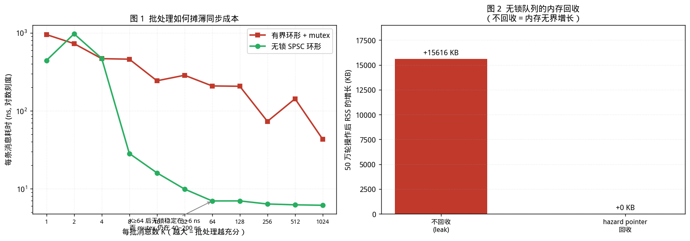

# Boost.Lockfree 与无锁容器：什么时候该用，什么时候不该用

> [第 01 篇（并发地基篇）](01-foundations.md)第 3 章已从 Herlihy 1991 的无等待层级、Herlihy & Wing 1990 的线性一致性、Michael & Scott 1996 的 MS-Queue 出发，建立了无锁同步的理论基础。
> 
> 本文回到**同步原语层**，讨论这些理论在工程库中如何落地，以及最重要的——**无锁在什么条件下并不比加锁更快。**
> 
> 本文所有实测数据均在 Linux x86-64 / GCC 11.4 环境下真实运行获得。
>
> 需要说明：实验环境为 **2 核共享沙盒**，绝对数值波动较大，凡波动显著者文中均已标注范围，不作为单点结论使用。

---

## 配套代码

本篇全部源码在 Gitee 仓库 [`champagnew/cpp-concurrent`](https://gitee.com/champagnew/cpp-concurrent)，目录 [`04-Lockfree篇/code04/`](https://gitee.com/champagnew/cpp-concurrent/tree/master/04-Lockfree%E7%AF%87/code04)（编译命令写在每个文件的头部注释里）：

| 源文件 | 内容 |
| --- | --- |
| [`pingpong.cpp`](https://gitee.com/champagnew/cpp-concurrent/blob/master/04-Lockfree%E7%AF%87/code04/pingpong.cpp) | 用一去一回的往返测出 SPSC 队列的真实传递成本 |
| [`batch_bench.cpp`](https://gitee.com/champagnew/cpp-concurrent/blob/master/04-Lockfree%E7%AF%87/code04/batch_bench.cpp) | 批处理如何摊薄同步成本（批次 K 从 1 到 1024） |
| [`bounded_bench.cpp`](https://gitee.com/champagnew/cpp-concurrent/blob/master/04-Lockfree%E7%AF%87/code04/bounded_bench.cpp) | 公平对比：所有队列都加同样的容量上限 |
| [`alloc_cost.cpp`](https://gitee.com/champagnew/cpp-concurrent/blob/master/04-Lockfree%E7%AF%87/code04/alloc_cost.cpp) | 链表型无锁队列「每次 push 都要 new 一个节点」的代价 |
| [`stall_demo.cpp`](https://gitee.com/champagnew/cpp-concurrent/blob/master/04-Lockfree%E7%AF%87/code04/stall_demo.cpp) | 持锁线程卡死时，mutex 与无锁队列的可用性差别 |
| [`reclaim_demo.cpp`](https://gitee.com/champagnew/cpp-concurrent/blob/master/04-Lockfree%E7%AF%87/code04/reclaim_demo.cpp) | 内存回收：不回收会怎样，hazard pointer 要付多少代价 |

配图源文件：[04-Lockfree篇/figures/](https://gitee.com/champagnew/cpp-concurrent/tree/master/04-Lockfree%E7%AF%87/figures)，下文插图均可在该目录找到原始 PNG。

---

## 绪论：先纠正一个流行误解

关于无锁（lock-free），工程界最常见的说法是：

> "把 `mutex` 换成 CAS，QPS 就能涨。"

这个说法在**特定条件下成立**，但它成立的条件比多数人想象的苛刻得多。本文的核心任务就是用可复现的实验，把这个"条件"具体化。

先给出本文的三个主要结论：

1. **无锁的价值不在"快"，而在"有界"**——任一线程崩溃或挂起时，其他线程仍能推进（第 3.5 节的实测：持锁线程卡住 300 ms 时，消费者 500 条消息**一条都取不到**；无锁方案则全部取走）。性能是副产品，且不保证为正。
2. **同步成本能否被摊薄，取决于生产/消费的耦合方式**。实测显示：严格交替时每条消息 443 ns，批量 1024 条时降到 6 ns，**相差 72 倍**。
3. **无锁队列的内存回收不是可选项**。实测 50 万轮操作：不回收时 RSS 增长 15.6 MB，用 hazard pointer 回收时增长 0 KB，而代价仅约 1%。

---

## 第 1 章　术语与正确性判据（回顾与补充）

第 01 篇已给出定义，此处只列出本文会直接引用的几项。

### 1.1 三个进度条件

| 条件 | 定义 | 实际含义 |
|---|---|---|
| **wait-free**（无等待） | 每个线程都能在**有限步**内完成操作 | 最强；不存在饥饿 |
| **lock-free**（无锁） | 系统整体保证**总有线程**能推进 | 单个线程可能饥饿 |
| **obstruction-free**（无障碍） | 一个线程**独享执行**时能在有限步内完成 | 最弱；有竞争时可能永远不推进 |

包含关系：**wait-free ⊂ lock-free ⊂ obstruction-free**，反向不成立。

**关键区分**：`boost::lockfree::spsc_queue` 是 **wait-free**；`boost::lockfree::queue` 和 `stack` 只是 **lock-free**。

原因很直接：SPSC 场景下，生产者只写 `tail`、消费者只写 `head`，两者互不竞争，**没有任何 CAS 重试循环**——所以是 wait-free。而 MPMC 场景下多个线程要 CAS 同一个 `head`/`tail`，失败者必须重试，因此只能保证 lock-free。

### 1.2 线性一致性

**线性一致性（Linearizability，Herlihy & Wing 1990）**：每个操作在外部观察者看来，等价于在其调用时刻与返回时刻之间的某一瞬时点原子地生效。

它的重要性在于**可组合性**：若干线性一致的对象组合后，整体仍是线性一致的。这使得我们可以独立推理每个容器。

### 1.3 无锁不提供哪三种保证

必须澄清无锁**不能**带来什么：

| 常见期待 | 事实 |
|---|---|
| "无锁就没有阻塞" | 错。无锁只保证**系统层面**有线程在推进，单个线程可能反复 CAS 失败 |
| "无锁就没有系统调用" | 错。若库内部需要向 OS 申请内存，仍可能陷入内核（Boost.Lockfree 官方文档明确提示这一点） |
| "无锁就没有内存分配" | 错。基于链表的无锁队列（MS-Queue、Treiber 栈）通常**每次 push 都要分配一个节点** |

第三点是本文第 3.2 节的实测对象。

---

## 第 2 章　Boost.Lockfree 的三个容器

### 2.1 总览

依据 Boost.Lockfree 官方文档，该库提供三种数据结构：

| 类型 | 线程模型 | 进度保证 | 底层结构 |
|---|---|---|---|
| `boost::lockfree::queue<T>` | **MPMC**（多生产者/多消费者） | **lock-free** | 链表（基于 MS-Queue 思路） |
| `boost::lockfree::spsc_queue<T>` | **SPSC**（单生产者/单消费者） | **wait-free** | 环形数组 |
| `boost::lockfree::stack<T>` | **MPMC** | **lock-free** | 链表（Treiber 栈） |

### 2.2 元素类型 T 的要求

官方文档列出的约束为：**T 必须具有拷贝构造函数、平凡的赋值运算符（trivial assignment operator）、平凡的析构函数（trivial destructor）**。

这一约束的根源是第 1 章末尾提到的内存回收难题：无锁容器无法安全地知道"何时可以析构一个对象"，因此要求 T 的析构是平凡的，即不需要真正执行析构逻辑。

工程含义：**不能把 `std::string`、`std::vector` 这类非平凡类型直接放进 Boost.Lockfree 容器**；应放 POD 或定长结构。

### 2.3 内存分配与 freelist（关键陷阱）

官方文档的说明为：

> "The node-based data structures of boost.lockfree use a **memory pool** to allocate the internal nodes. If this memory pool is exhausted, memory for new nodes **has to be allocated from the operating system**. However all data structures of boost.lockfree can be configured to avoid memory allocations (instead the specific calls will fail)."

即：链表型容器（`queue`、`stack`）内部维护一个 **freelist（空闲节点池）**。当池子耗尽时，会向操作系统申请新节点——**而这一步可能不是无锁的**。

对应到 API，有两个选择：

| 函数 | 池子耗尽时的行为 | 是否保证无锁 |
|---|---|---|
| `push(t)` | 向 OS 申请新节点 | **否**（文档明确："This may not be lock-free."） |
| `bounded_push(t)` | **失败**，返回 `false` | 是（"Thread-safe and non-blocking"） |

这直接引出一个工程准则：**在硬实时或严格无锁要求的路径上，应使用 `bounded_push` 而非 `push`，并预先 `reserve()` 足够的容量。**

### 2.4 fixed_sized 与 capacity

官方对 `fixed_sized` 的说明：

> "Configures the data structure as fixed sized. The internal nodes are stored inside an array and they are addressed by array indexing. This limits the possible size of the queue to the number of elements that can be addressed by the index type (**usually 2^16-2**), but on platforms that **lack double-width compare-and-exchange instructions**, this is the best way to achieve lock-freedom."

要点：

1. `fixed_sized<true>` 把节点放进**数组**，用**数组下标**而非指针寻址。这是为了规避 **ABA 问题**（第 5 章详述）——下标不会像地址那样被复用。
2. 代价是容量上限通常为 **2^16 - 2 = 65534**。
3. 在**缺少双字宽 CAS（DWCAS）指令**的平台上，这是实现无锁的唯一途径。
4. `capacity<N>` **隐含** `fixed_sized`。

**一个必须注意的坑**：使用 `fixed_sized<true>` 时，若用默认构造函数，容量为 **0**，此时**每次 `push` 都会失败**。必须通过构造函数（`queue(size_type n)`）或 `reserve(n)` 显式设置容量。

### 2.5 is_lock_free() 的局限

文档对 `is_lock_free()` 的警告值得原文引用：

> "It only checks, if the queue head and tail nodes and the freelist can be modified in a lock-free manner. ... there is no possibility to provide a completely accurate implementation, because one would need to test every internal node, which is impossible if further nodes will be allocated from the operating system."

即：**该函数只检查头/尾节点与 freelist 是否可无锁修改，不覆盖后续从 OS 分配的节点。** 返回值是必要而非充分条件。

### 2.6 三个容器的最小可用示例

**`spsc_queue`（SPSC，wait-free）**

```cpp
#include <boost/lockfree/spsc_queue.hpp>

// 容量必须在编译期或构造时给定；不支持动态扩容
boost::lockfree::spsc_queue<int, boost::lockfree::capacity<1024>> q;

// 生产者线程（只能有一个）
void producer() {
  for (int i = 0; i < N; ++i) {
    while (!q.push(i)) { }        // 满则返回 false，需自行重试或丢弃
  }
}
// 消费者线程（只能有一个）
void consumer() {
  int v;
  while (!done) { while (q.pop(v)) { /* 处理 v */ } }
}
```

要点：
- **容量固定**，超出时 `push` 返回 `false`，**不会阻塞也不会扩容**；
- **生产者只能 `push`、消费者只能 `pop`**——跨线程调用是未定义行为；
- 官方示例亦演示了 `consume_one(f)` / `consume_all(f)` 的批量消费接口。

**`queue`（MPMC，lock-free）**

```cpp
#include <boost/lockfree/queue.hpp>

// 预分配 128 个节点给 freelist
boost::lockfree::queue<int> q(128);

void producer() {
  for (int i = 0; i < N; ++i) {
    // push  ：freelist 耗尽时向 OS 申请（可能非无锁）
    // bounded_push：耗尽时直接返回 false（保持非阻塞）
    while (!q.bounded_push(i)) { /* 满：退避或丢弃 */ }
  }
}
int consumer() {
  int v;
  return q.pop(v) ? v : -1;        // 空则返回 false
}
```

**`stack`（MPMC，lock-free，Treiber 栈）**

```cpp
#include <boost/lockfree/stack.hpp>

// 建议显式使用 fixed_sized/capacity 以规避 ABA（见第 5 章）
boost::lockfree::stack<int, boost::lockfree::capacity<1024>> st;
st.push(42);
int v; if (st.pop(v)) { /* ... */ }
```

三者的 `is_lock_free()` 均可用于运行时自检，但需记住 2.5 节的局限说明。

---

## 第 3 章　实测

本章是本文的核心。实验目标是把"无锁更快吗"这个笼统问题，转化为"在什么耦合方式下更快"。

### 3.1 实验设计：为什么要控制"批处理量"

常见的队列基准是"生产者猛灌、消费者猛收，跑一段时间看吞吐"。这个设计有一个隐藏缺陷：

> 若生产者和消费者速度不匹配，快的一方会**空转等待**慢的一方，测到的是**调度行为**而非队列本身的代价。

更糟的是，若队列**无界**，生产者会一直跑到最快、把消息堆积在队列里，生产者和消费者被**完全解耦**——此时测到的"吞吐"其实是两个独立速度的叠加。

因此本实验引入一个控制变量 **K（每批消息数）**：

- 生产者一次连推 K 条；
- 然后等待消费者把 K 条全部取完并回一个确认；
- 再推下一批。

**K 直接控制了"同步操作被摊薄的程度"**：K=1 是严格交替（最坏情况），K=1024 是一次同步摊到 1024 条消息上。

为保证公平，两种队列使用**完全相同的环形结构、相同的容量（4096）**，唯一差别是：一个用 `std::mutex` 保护，一个用原子下标。

```cpp
// 无锁 SPSC 环形队列（wait-free）
template <size_t Cap>
class SPSCRing {
 public:
  bool push(Elem v) {
    size_t t = tail_.load(std::memory_order_relaxed);
    size_t n = (t + 1) % Cap;
    if (n == head_.load(std::memory_order_acquire)) return false;   // 满
    buf_[t] = v;
    tail_.store(n, std::memory_order_release);      // 先写数据，再发布索引
    return true;
  }
  bool pop(Elem &o) {
    size_t h = head_.load(std::memory_order_relaxed);
    if (h == tail_.load(std::memory_order_acquire)) return false;   // 空
    o = buf_[h];
    head_.store((h + 1) % Cap, std::memory_order_release);
    return true;
  }
 private:
  alignas(64) std::atomic<size_t> head_{0};   // 只被消费者写
  alignas(64) std::atomic<size_t> tail_{0};   // 只被生产者写
  alignas(64) Elem buf_[Cap];
};
```

注意 `alignas(64)`：把 `head_` 与 `tail_` 放到**不同的缓存行**，避免伪共享（第 01 篇 6.3 节）。这是 SPSC 队列性能的关键细节。

> **实验设计中的一个真实教训**：本程序的第一版让两个线程**共用一条队列**做双向传递。结果死锁——速度快的那一方会**把自己刚发的消息又收回去**，另一方永远等不到。修正方法是使用**两条独立队列**（一去一回）。若你写类似的握手基准，请务必注意这一点。

### 3.2 实测结果

消息总数固定 40 万，每档 K 重复 3 轮取中位数（源码见 [`batch_bench.cpp`](https://gitee.com/champagnew/cpp-concurrent/blob/master/04-Lockfree%E7%AF%87/code04/batch_bench.cpp)）：

| 每批消息数 K | mutex 环形队列<br>ns/条 | 无锁 SPSC 环形<br>ns/条 | 无锁相对优势 |
|---:|---:|---:|---:|
| 1 | 950.9 | 443.3 | 2.1× |
| 2 | 728.3 | 972.6 | —（噪声） |
| 4 | 467.0 | 471.5 | ≈1× |
| 8 | 459.8 | 28.4 | **16.2×** |
| 16 | 242.9 | 16.0 | **15.2×** |
| 32 | 286.0 | 9.9 | **28.9×** |
| 64 | 208.5 | 7.0 | **29.9×** |
| 128 | 206.5 | 7.0 | **29.5×** |
| 256 | 73.2 | 6.4 | **11.5×** |
| 512 | 142.8 | 6.2 | **23.0×** |
| 1024 | 43.2 | 6.1 | **7.1×** |



*图 1（左）：每条消息耗时随批处理量 K 的变化，双对数刻度。图 2（右）：内存回收对 RSS 的影响。数据来源：本文实测。*

**三条解读：**

**（1）K 从 1 增到 64，无锁方案的每条耗时从 443 ns 降到 7 ns——相差 63 倍。**

这是本文最重要的一组数字。它说明：无锁队列的开销**绝大部分不是 CAS 指令本身**，而是**跨核的缓存行传递**。当生产者连续写入环形缓冲时，多个消息落在同一或相邻缓存行，一次传递可以服务多条消息；而严格交替时，每发一条就要来回传递一次 `head`/`tail`/数据所在的缓存行。

**（2）mutex 方案的耗时始终降不到无锁的水平，最优也要 43 ns。**

原因在于：**每次 `push` 和每次 `pop` 都要获取一次锁**，这与 K 无关——K 再大，锁获取次数仍是 2 × 消息总数。批处理能摊薄的是**因争用导致的 futex 睡眠/唤醒**（从 950 ns 降到 43 ns），但摊不掉**锁操作本身的固定成本**。

**（3）K=1 时两者差距最小（2.1×），且这一档的噪声最大。**

在 2 核共享环境下，K=1 档的重复测量曾出现 mutex 841 ns / 无锁 1525 ns 的反向结果。这说明**在极端交替、且环境存在其他负载时，该档位结论不可靠**。稳定可靠的结论出现在 K ≥ 8 之后。

### 3.3 补充实验：往返延迟

另一组独立测量（源码 [`pingpong.cpp`](https://gitee.com/champagnew/cpp-concurrent/blob/master/04-Lockfree%E7%AF%87/code04/pingpong.cpp)）采用严格的一去一回握手，每次往返包含 2 次传递：

| 队列 | 单次往返耗时（中位） |
|---|---:|
| 有界环形 + mutex | **6,515 ns** |
| 无锁 SPSC 环形 | **2,444 ns**（范围 668 ~ 2,930） |

mutex 慢 2.7 倍。这个数字比 3.2 节的 K=1 档更悬殊，因为每次往返涉及**两次**"等待对方"的过程，而每次等待都可能触发一次 futex 睡眠与唤醒。

> **注意这两个实验的数量级差异**（K=1 档 951 ns vs 往返 6515 ns）。差异来自往返实验每轮有两次强制等待、且两个线程交替更频繁。这本身再次说明：**队列基准的绝对值高度依赖于耦合方式，跨实验比较数字是没有意义的。**

### 3.4 节点分配的代价

链表型无锁队列（`boost::lockfree::queue`、Treiber 栈）每次 `push` 需要一个新节点。实测（源码 [`alloc_cost.cpp`](https://gitee.com/champagnew/cpp-concurrent/blob/master/04-Lockfree%E7%AF%87/code04/alloc_cost.cpp)，100 万次）：

| 操作 | 每次耗时 |
|---|---:|
| `new` 一个 16 字节节点（不释放，模拟无回收的场景） | **26.1 ns** |
| 写入预分配的环形数组槽位 | **0.76 ns** |

相差约 **34 倍**。

> **一处测量陷阱**：本实验最初也测了"new + 写 + delete"配对操作，得到 0.66 ns——这个数字是假的。自 C++14（N3664）起，编译器**允许消除不可观测的 `new`/`delete` 配对**，GCC 确实这么做了。只有"只 new 不 delete"（指针被保存下来）这一档无法被优化掉，因此是唯一可信的数字。

**推论**：一个每次 push 都要分配节点的无锁队列，仅分配成本就达 26 ns/条——**高于 3.2 节中 SPSC 环形队列在 K≥16 时的全部成本（6~16 ns/条）**。这正是 Boost.Lockfree 提供 `fixed_sized` + 预分配 freelist 的动机，也是 `bounded_push` 存在的理由。

### 3.5 决定性实验：一个线程卡住时，别人还能不能推进

前面四组数据都在比较"快多少"。但无锁最重要、也最容易被忽略的价值是**有界性**：

> 当某个线程被卡住（被调度器抢占、遇到页错误、命中断点、或直接崩溃）时，
> 其他线程是否还能继续推进？

实验设计（源码 [`stall_demo.cpp`](https://gitee.com/champagnew/cpp-concurrent/blob/master/04-Lockfree%E7%AF%87/code04/stall_demo.cpp)）：

1. 生产者先往队列里放 500 条消息；
2. 然后"卡住" 300 毫秒；
3. 统计这 300 毫秒内消费者能取出多少条。

关键差别在于**卡住的方式**：

```cpp
// mutex 版：模拟"在临界区内被卡住" —— 拿着锁睡觉
int stall_in_critical_section(int ms) {
  std::lock_guard<std::mutex> lk(mu_);        // ★ 锁在手
  std::this_thread::sleep_for(milliseconds(ms));
  return -1;
}

// 无锁版：不存在"临界区"这一概念，只能模拟"生产者自己睡着了"
int stall_in_critical_section(int ms) {
  std::this_thread::sleep_for(milliseconds(ms));   // 并不持有任何别人需要的东西
  return -1;
}
```

**实测结果（缓冲区里本来就有 500 条）：**

| 队列 | 卡住的 300 ms 内，消费者取到的条数 |
|---|---:|
| 有界环形 + mutex | **0 条**（缓冲区里有 500 条，但一条都拿不到） |
| 无锁 SPSC 环形 | **500 条**（全部取走） |

这是本文最有说服力的一组数字，因为它与"快慢"无关：

- 加锁方案中，**锁的持有者被卡住会连带阻塞所有人**，哪怕数据早已就绪地躺在缓冲区里；
- 无锁方案中，**不存在"持有者"这一角色**，因此不存在这种连带失效。

这正是无锁在实时系统、金融交易、存储引擎中被优先选用的根本原因——**它买的不是吞吐，是故障隔离。**

> 现实中"持有锁的线程被卡住"并不罕见：调度器抢占、缺页、断点调试、CPU 亲和性设置错误导致的迁移、甚至线程崩溃。加锁方案在这些情形下的表现，是上游延迟尖刺（latency spike）的常见来源之一。

---

## 第 4 章　内存回收：无锁正确性的另一半

### 4.1 问题

第 01 篇 3.5 节已说明：无锁容器无法在弹出节点后立即 `delete`，因为**其他线程可能正持有该节点的指针并准备对其做 CAS**。立即释放会导致 use-after-free。

这就是"内存回收是无锁正确性的一半"这句话的含义：**没有回收方案的无锁数据结构，在长期运行的服务中等价于内存泄漏。**

### 4.2 实测：不回收 vs hazard pointer

下面的实验（源码 [`reclaim_demo.cpp`](https://gitee.com/champagnew/cpp-concurrent/blob/master/04-Lockfree%E7%AF%87/code04/reclaim_demo.cpp)）对一个 MS-Queue 做 50 万轮"入队 + 出队"，对比两种策略。hazard pointer 的实现极简：每个线程一个槽位，声明"我正在访问这个节点"，回收前扫描所有槽位。

```cpp
static std::atomic<Node *> hazard[kMaxThreads];
static void hp_protect(int tid, Node *p) { hazard[tid].store(p, std::memory_order_seq_cst); }
static void hp_clear(int tid)            { hazard[tid].store(nullptr, std::memory_order_seq_cst); }
static bool hp_is_hazard(Node *p) {
  for (int i = 0; i < kMaxThreads; ++i)
    if (hazard[i].load(std::memory_order_seq_cst) == p) return true;
  return false;
}

// 出队时：先保护再 CAS
hp_protect(0, nx);
if (head.compare_exchange_weak(h, nx, ...)) { retired.push_back(h); hp_clear(0); break; }
hp_clear(0);

// 回收扫描（每 64 轮一次）
for (Node *p : retired) {
  if (hp_is_hazard(p)) keep.push_back(p);   // 还有人在用，推迟
  else                 delete p;            // 安全释放
}
```

**实测结果（50 万轮）：**

| 策略 | 每轮耗时 | RSS 变化 | 扫描/释放/推迟 |
|---|---:|---:|---|
| **不回收（leak）** | 44.20 ns | **+15,616 KB** | — |
| **hazard pointer** | 44.56 ns | **+0 KB** | 扫描 499,969 / 释放 499,969 / 推迟 0 |


两条结论：

1. **不回收时内存无界增长**——50 万轮就涨了 15.6 MB。一个每秒百万消息的服务，几分钟就会耗尽内存。
2. **hazard pointer 的代价仅约 0.8%**（44.20 → 44.56 ns）。相对于它换来的内存有界性，这个代价极低。

> **必须说明本实验的局限**：本例中"推迟释放"计数为 0，因为只有一个线程在做回收扫描，没有真正的并发访问。真实多线程场景下会有推迟，且扫描成本随线程数线性增长。因此这个 0.8% 是**乐观下限**，不是普遍结论。

### 4.3 三种主流回收方案

| 方案 | 原理 | 优点 | 缺点 |
|---|---|---|---|
| **Hazard Pointer**<br>（Michael 2004） | 线程声明正在访问的指针，回收前检查 | 内存及时释放，无界等待数为 O(线程数) | 每次访问都要写/清槽位（含内存屏障） |
| **Epoch-Based Reclamation** | 划分为若干纪元，所有线程都离开某纪元后才回收该纪元的节点 | 每次访问开销小（读本地 epoch） | 一个线程长时间不进入 quiescent state 会阻塞整批回收 |
| **RCU** | 读侧临界区 + 宽限期 | 读侧近乎零开销 | 写侧开销大；宽限期不确定 |

C++26 已将 `hazard_pointer` 与 RCU 纳入标准库（`<hazard_pointer>`），届时可直接使用而不必自研。

---

## 第 5 章　ABA 问题：为什么 Boost.Lockfree 要提供 fixed_sized

### 5.1 问题的形式

考虑 Treiber 栈的 `pop`：

```cpp
Node *h = head.load();          // 读到 A
Node *next = h->next;           // A 的 next 是 B
// ★ 此刻线程被挂起
head.compare_exchange(h, next); // 若 head 仍是 A，则改为 B
```

若线程在此处被挂起，期间另一个线程：
1. 弹出 A → head = B
2. 弹出 B → head = C
3. 压入一个新节点，**恰好复用了 A 的地址** → head = A

此时原线程恢复，CAS 发现 `head == A`（与它读到的旧值相同），于是**成功**把 head 改为 B。但 B 已经被弹出并可能已被释放——**栈被破坏**。

这就是 ABA：值从 A 变成 B 又变回 A，单纯的"值相等"判断无法识别中间发生的变化。

第 01 篇 3.3 节已给出可复现的 ABA 演示（`aba_treiber.cpp`）。

### 5.2 三种解法与 Boost.Lockfree 的选择

| 解法 | 原理 | Boost.Lockfree 是否采用 |
|---|---|---|
| ** tagged pointer**<br>（版本号） | 指针旁附带一个递增计数，CAS 同时比较指针和计数 | 需要 **DWCAS**（双字宽 CAS）；x86-64 的 `cmpxchg16b` 支持 |
| **数组下标**<br>（`fixed_sized`） | 用下标代替地址；下标**不会被复用** | **是** —— 这正是 `fixed_sized` 的动机 |
| **延迟回收**<br>（hazard pointer / epoch） | 保证地址在观察期内不被复用 | 是（作为内存管理手段） |

官方文档在 `fixed_sized` 条目下明确指出该配置"on platforms that lack double-width compare-and-exchange instructions, ... is the best way to achieve lock-freedom"——即**当平台没有 DWCAS 时，用数组下标是达成无锁的最佳途径**。

这解释了为什么 `fixed_sized` 会把容量限制在约 **2^16 - 2**：索引类型通常是 16 位。

### 5.3 stack 尤其容易中招

`boost::lockfree::stack` 基于 Treiber 栈，是 ABA 的经典受害者。相对地，`queue`（MS-Queue 结构）的 head 只会向后移动、且 Michael & Scott 的算法通过"哑节点"与帮助推进 tail 的机制降低了 ABA 风险，但**并未完全消除**——这也是为什么 `fixed_sized` 选项对两者都存在。

**工程建议**：若必须使用 `boost::lockfree::stack`，优先考虑 `fixed_sized<true>` 或 `capacity<N>`；若元素本身可以编码版本号，也可用 tagged pointer 方案。

### 5.4 解法一的代码形态：tagged pointer

若平台支持双字宽 CAS（x86-64 上是 `cmpxchg16b`），可以把"指针 + 版本号"打包成 16 字节，用一次 CAS 同时比较两者：

```cpp
// 指针低 48 位放地址，高 16 位放版本号（x86-64 用户态地址有效位为 48）
struct TaggedPtr {
  uintptr_t val;                     // [63:48] = tag, [47:0] = ptr
  static constexpr int kTagShift = 48;
  Node *ptr() const { return reinterpret_cast<Node *>(val & ((1ull << kTagShift) - 1)); }
  uint16_t tag() const { return static_cast<uint16_t>(val >> kTagShift); }
  static TaggedPtr make(Node *p, uint16_t t) {
    return TaggedPtr{reinterpret_cast<uintptr_t>(p) | (uintptr_t(t) << kTagShift)};
  }
};

// 使用：每次 pop 都让 tag 自增，于是"A → B → A"中的第二个 A
// 与第一个 A 的 tag 不同，CAS 会失败，ABA 被识别出来
alignas(16) std::atomic<TaggedPtr> head;
```

需要注意：

1. `alignas(16)` 与 16 字节的原子操作**必须**由 `std::atomic<TaggedPtr>::is_lock_free()` 在运行时确认；GCC 通常会生成 `cmpxchg16b`，但不保证。
2. tag 只有 16 位，存在回绕（wrap-around）可能。工程上需评估回绕周期是否可接受——通常 2^16 次操作内同一地址被复用的概率已足够低，但严格场景应使用更宽的方案或改用数组下标。
3. 这正是 Boost.Lockfree 在**缺少 DWCAS 的平台**上改用数组下标（`fixed_sized`）的原因：下标天然不复用，且只需单字宽 CAS。

---

## 第 6 章　应用场景

### 6.1 适用的场景

| 场景 | 为什么适合 | 推荐类型 |
|---|---|---|
| **行情/日志的线程间传递** | 典型 SPSC：一个线程收包，一个线程处理；消息量极大、需要稳定低延迟 | `spsc_queue`（**wait-free**） |
| **线程池的任务队列** | MPMC，任务短小 | `queue` + `fixed_sized` + 预分配 |
| **网络框架的连接间消息** | 每连接可配一条 SPSC | `spsc_queue` |
| **不能有线程因持锁者崩溃而卡死的场景** | 无锁的核心价值：任一线程挂起不影响他人 | `queue` / `stack` |
| **实时性要求严格、不能接受 futex 抖动** | 加锁方案在争用下有系统调用抖动 | `spsc_queue` + 绑核 |

### 6.2 不适用 / 需谨慎的场景

| 场景 | 问题 |
|---|---|
| **元素类型非平凡**（`std::string`、含析构逻辑的类型） | 违反 T 的要求（trivial assignment / trivial destructor） |
| **需要无界容量** | `fixed_sized` 上限约 65534；不设 `fixed_sized` 则可能触发 OS 分配，**丧失无锁保证** |
| **低吞吐、每次传递间隔很长** | 加锁即可；无锁的复杂度不划算 |
| **需要阻塞等待** | 无锁容器 `pop` 失败即返回，需自行实现等待（自旋/条件变量/eventfd） |
| **元素体积大** | 拷贝进出容器成本高；应传递指针或索引 |

### 6.3 一个关键提醒：无锁容器不解决"等待"问题

`boost::lockfree::queue::pop` 的语义是：**队列空则返回 `false`，不阻塞。**

因此消费端必须自行实现等待策略：

| 策略 | 适用 |
|---|---|
| 忙等自旋 | 延迟敏感、CPU 充足 |
| 自旋 + `sched_yield` | 一般场景 |
| 自旋 + `eventfd` / 条件变量 | 空闲时不能占核 |
| 与事件循环集成（第 02/03 篇） | 已有 io_context / libev |

把"无锁"等同于"不需要等待机制"是常见误解。

### 6.4 同类库对照

若 Boost.Lockfree 不满足需求，工业界常见的替代如下（详细讨论见[第 06 篇（Folly）](06-folly.md)）：

| 库 | 类型 | 特点 |
|---|---|---|
| **moodycamel::ConcurrentQueue** | MPMC，lock-free | 单头文件；内部按生产者分子队列降低争用；支持批量入队/出队（`enqueue_bulk`）；被 ClickHouse、MongoDB 使用 |
| **moodycamel::ReaderWriterQueue** | SPSC，wait-free | 单头文件；极轻，适合延迟敏感路径 |
| **Folly MPMCQueue** | MPMC | Meta 出品；支持阻塞式 `blockingRead`；可配置自旋与让步策略 |
| **oneTBB concurrent_queue** | MPMC | 与 TBB 调度器集成；**不保证无锁**（实现可用锁），但接口稳定 |

**选择要点**：

- 需要**单头文件、零依赖** → moodycamel；
- 需要**阻塞等待语义**而不是自旋 → Folly MPMCQueue；
- 已在用 TBB 生态 → `tbb::concurrent_queue`（但注意它不提供无锁保证）；
- 需要**规避 ABA 且容量不大** → Boost.Lockfree + `fixed_sized`。

最后一点值得强调：**"concurrent_" 前缀不等于"lock-free"**。选型时务必查阅该类型是否明确声明了进度保证。

---

## 第 7 章　工程准则汇总

承接前三篇，本节补充无锁相关准则（编号续接[第 03 篇（Boost.Asio）](03-boost-asio.md)的 62）。

**准则 63**：**先问"要不要无锁"，再问"怎么无锁"。** 无锁的首要价值是**有界性**（任一线程崩溃不影响他人），性能是副产品。若只是想提速，先确认瓶颈确实在锁上。

**准则 64**：**优先选择 SPSC。** 单生产者单消费者场景下 `spsc_queue` 是 **wait-free**，实测在批量传递时可达 6 ns/条，比 MPMC 方案简单且快得多。能用 SPSC 就不要用 MPMC。

**准则 65**：**分开缓存行。** 生产者的写下标与消费者的写下标必须位于不同缓存行（`alignas(64)`），否则伪共享会吃掉全部收益（第 01 篇 6.3 节）。

**准则 66**：**批量传递。** 实测每条消息耗时随批量从 443 ns（K=1）降到 6 ns（K≥256），相差 70 倍以上。同步成本主要来自跨核缓存行传递，批量能直接摊薄它。

**准则 67**：**预先 `reserve()` 容量，热路径用 `bounded_push` 而非 `push`。** `push` 在 freelist 耗尽时会向 OS 申请内存，**官方文档明确指出这可能不是无锁的**。

**准则 68**：**用 `fixed_sized<true>` 时刻必须显式指定容量。** 默认构造的容量为 0，**每次 push 都会失败**。且容量上限通常约 2^16-2。

**准则 69**：**不要把 `is_lock_free()` 当作充分保证。** 官方警告它只检查头/尾节点与 freelist，不覆盖后续从 OS 分配的节点。

**准则 70**：**元素类型必须平凡。** 需要拷贝构造、平凡赋值、平凡析构。不要放 `std::string` / `std::vector`。

**准则 71**：**无锁不等于无分配。** 链表型容器每次 push 通常要一个节点，实测分配成本 26 ns/条，高于定长环形队列的全部成本。

**准则 72**：**必须有内存回收方案。** 实测不回收时 50 万轮操作 RSS 增长 15.6 MB；hazard pointer 回收时代价约 1%。没有回收方案的无锁容器在长跑服务中等价于内存泄漏。

**准则 73**：**MPMC 栈（Treiber）要警惕 ABA。** 优先选 `fixed_sized` 或带版本号的 tagged pointer 方案。

**准则 74**：**无锁容器不提供等待语义。** `pop` 空队列返回 `false`，需自行实现自旋/让步/事件通知。

**准则 75**：**不要相信脱离条件的性能数字。** 本文实测中同一配置在不同批次量下从 443 ns 变到 6 ns；在共享环境下同一档位重复测量也曾出现 2 倍以上的反向波动。任何"换成无锁性能提升 X 倍"的结论，必须附带线程数、核拓扑、批量大小、消息大小与测量次数。

---

## 第 8 章　后续篇章规划

| 篇 | 主题 | 层次 | 主场景 |
|---|---|---|---|
| 01 | 经典文献综述与工程实践准则（已完成） | 全部层次 | 通论 |
| 02 | 事件循环与 libev（已完成） | I/O 模型 | 网络、代理、数据库 RPC |
| 03 | Boost.Asio（已完成） | I/O 模型 + 执行上下文 | 跨平台网络服务、RPC |
| 04 | Boost.Lockfree 与无锁容器（本文） | 同步原语 | 行情分发、日志队列、线程间高频消息 |
| 05 | **oneTBB** | 调度 | 计算密集：图像处理、科学计算、仿真 |
| 06 | **Folly** | 同步原语 + 数据结构 + 内存 | 通用后端服务、KV 存储、高性能组件库 |
| 07 | **Seastar** | 调度 + I/O + 执行单元的完整栈 | 数据库、存储、消息系统（thread-per-core） |

[第 05 篇（oneTBB 与任务调度）](05-onetbb.md)将进入**调度层**：从 Blumofe & Leiserson 的工作窃取理论（第 01 篇 4.1 节）出发，讨论 oneTBB 的任务窃取自底向上实现、`flow_graph` 表达依赖，以及最重要的——**为什么并行算法的加速比上界由串行部分决定（阿姆达尔定律）**。

---

## 参考资料

### Boost.Lockfree 官方文档

- [Boost.Lockfree 官方文档（概述：三种容器与 fixed_sized）](https://www.boost.org/doc/libs/latest/doc/html/lockfree.html)
- [Boost.Lockfree `queue` 类参考（push / bounded_push / pop / is_lock_free 的语义）](https://www.boost.org/doc/libs/1_72_0/doc/html/boost/lockfree/queue.html)
- [Boost.Lockfree 官方示例（queue / stack / spsc_queue 三例完整代码）](https://www.boost.org/doc/libs/master/doc/html/lockfree/examples.html)
- [Boost.Lockfree 官方参数说明（fixed_sized / capacity / allocator）](https://www.boost.org/doc/libs/latest/doc/html/boost/lockfree/policies.html)
- [The Boost C++ Libraries：Chapter 46. Boost.Lockfree（容量与 reserve 的用法说明）](https://www.theboostcpplibraries.com/boost.lockfree)
- [Stack Overflow：fixed_sized<true> 下默认构造容量为 0 导致 push 恒失败](https://stackoverflow.com/questions/17927411/boost-lockfree-queue-behavior-in-case-fixed-sizedtrue)

### 无锁算法与内存回收的基础文献

- [Herlihy, "Wait-Free Synchronization", ACM TOPLAS 1991（共识数理论）](https://dl.acm.org/doi/10.1145/114005.102808)
- [Herlihy & Wing, "Linearizability: A Correctness Condition for Concurrent Objects", ACM TOPLAS 1990](https://dl.acm.org/doi/10.1145/78969.78972)
- [Michael & Scott, "Simple, Fast, and Practical Non-Blocking and Blocking Concurrent Queue Algorithms", PODC 1996（MS-Queue）](https://dl.acm.org/doi/10.1145/248052.248106)
- [Michael, "Hazard Pointers: Safe Memory Reclamation for Lock-Free Objects", IEEE TPDS 2004](https://dl.acm.org/doi/10.1109/TPDS.2004.8)
- [Treiber, "Systems Programming: Coping with Parallelism", IBM Research 1986（Treiber 栈，ABA 问题的经典来源）](https://dominoweb.draco.res.ibm.com/583c3264e5c26e0200618303.html)
- [Fraser, "Practical Lock-Freedom", PhD Thesis, Cambridge 2004（epoch-based reclamation）](https://www.cl.cam.ac.uk/techreports/UCAM-CL-TR-579.pdf)

### C++ 标准与语言层面

- [C++26 `std::hazard_pointer` 提案与 cppreference 说明](https://en.cppreference.com/w/cpp/thread/hazard_pointer)
- [N3664：Clarifying Memory Allocation（允许编译器消除不可观测的 new/delete 配对）](https://www.open-std.org/jtc1/sc22/wg21/docs/papers/2013/n3664.html)
- [cppreference：`std::memory_order`（acquire/release 语义）](https://en.cppreference.com/w/cpp/atomic/memory_order)

### 关联：本系列已引用的基础文献

- [Mellor-Crummey & Scott, "Algorithms for Scalable Synchronization on Shared-Memory Multiprocessors", ACM TOCS 1991（MCS 锁）](https://www.cs.rice.edu/~johnmc/papers/tocs91.pdf)
- [Franke, Russell, Kirkwood, "Fuss, Futexes and Furwocks", OLS 2002（futex）](https://kernel.org/doc/ols/2002/ols2002-pages-479-495.pdf)
- [Blumofe & Leiserson, "Scheduling Multithreaded Computations by Work Stealing", JACM 1999](https://doi.org/10.1145/324133.324234)
- [Lamport, "How to Make a Multiprocessor Computer That Correctly Executes Multiprocess Programs", IEEE TC 1979](https://dl.acm.org/doi/10.1109/TC.1979.1675439)

---

## 系列导航

[← 上一篇：Boost.Asio](03-boost-asio.md) ｜ [← 返回系列目录](/cpp/concurrent) ｜ [下一篇：oneTBB 与任务调度 →](05-onetbb.md)

> 本系列的源码、配图与勘误都在 Gitee：[champagnew/cpp-concurrent](https://gitee.com/champagnew/cpp-concurrent)。
