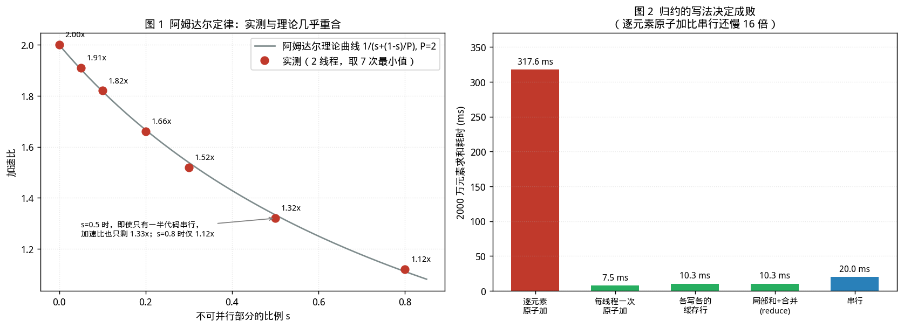

# oneTBB 与任务调度：为什么并行不总是更快

> [第 01 篇（并发地基篇）](01-foundations.md)确立了层次划分与工程准则；第 02、03 篇讨论 I/O 模型层的 Reactor 与 Proactor；[第 04 篇（无锁容器）](04-boost-lockfree.md)讨论同步原语层的无锁容器。本文进入**调度层**：讨论任务如何被切分、分发与再平衡。
> 
> 本文所有实测数据均在 Linux x86-64 / GCC 11.4 环境下真实运行获得。
> 
>**实验环境为 2 核共享沙盒，噪声极大**，这一点在文中已反复标注：凡涉及加速比的数字，均说明重复次数与取值方法；波动过大者不作为结论。
> 
> 另需说明：沙盒中无法安装 oneTBB 与 Boost，因此本文的实测部分使用**自建的教学用工作窃取线程池**（含一个 Chase-Lev 双端队列的完整实现）与**`std::thread` 手工并行**完成。oneTBB 的 API 与语义依据官方文档核对，性能数字则来自可复现的自建实现——两者在原理上一致，但绝对值不可直接搬用。

---

## 配套代码

本篇全部源码在 Gitee 仓库 [`champagnew/cpp-concurrent`](https://gitee.com/champagnew/cpp-concurrent)，目录 [`05-oneTBB篇/code05/`](https://gitee.com/champagnew/cpp-concurrent/tree/master/05-oneTBB%E7%AF%87/code05)（编译命令写在每个文件的头部注释里）：

| 源文件 | 内容 |
| --- | --- |
| [`amdahl.cpp`](https://gitee.com/champagnew/cpp-concurrent/blob/master/05-oneTBB%E7%AF%87/code05/amdahl.cpp) | 阿姆达尔定律实测，以及超订时的收益倒退 |
| [`sched_cost.cpp`](https://gitee.com/champagnew/cpp-concurrent/blob/master/05-oneTBB%E7%AF%87/code05/sched_cost.cpp) | 直接测量「调度一个任务」的绝对开销 |
| [`grainsize.cpp`](https://gitee.com/champagnew/cpp-concurrent/blob/master/05-oneTBB%E7%AF%87/code05/grainsize.cpp) | 任务粒度如何决定加速比 |
| [`grain_sweep.cpp`](https://gitee.com/champagnew/cpp-concurrent/blob/master/05-oneTBB%E7%AF%87/code05/grain_sweep.cpp) | 同一进程内扫描粒度，取最小值抵抗环境噪声 |
| [`chase_lev.h`](https://gitee.com/champagnew/cpp-concurrent/blob/master/05-oneTBB%E7%AF%87/code05/chase_lev.h) | Chase-Lev 工作窃取双端队列（教学实现） |
| [`ws_pool.h`](https://gitee.com/champagnew/cpp-concurrent/blob/master/05-oneTBB%E7%AF%87/code05/ws_pool.h) | 可观测的工作窃取线程池（基于 Chase-Lev 队列） |
| [`mini.cpp`](https://gitee.com/champagnew/cpp-concurrent/blob/master/05-oneTBB%E7%AF%87/code05/mini.cpp) | Chase-Lev 队列的单元测试：本地 LIFO、窃取 FIFO |
| [`steal_onoff.cpp`](https://gitee.com/champagnew/cpp-concurrent/blob/master/05-oneTBB%E7%AF%87/code05/steal_onoff.cpp) | 初始分布极不均匀时，隔离出「窃取的净价值」 |
| [`diag.cpp`](https://gitee.com/champagnew/cpp-concurrent/blob/master/05-oneTBB%E7%AF%87/code05/diag.cpp) | 负载不均时，两个线程各自干了多少活 |
| [`reduce.cpp`](https://gitee.com/champagnew/cpp-concurrent/blob/master/05-oneTBB%E7%AF%87/code05/reduce.cpp) | 为什么需要 `parallel_reduce`：三种求和方式的代价 |

配图源文件：[05-oneTBB篇/figures/](https://gitee.com/champagnew/cpp-concurrent/tree/master/05-oneTBB%E7%AF%87/figures)，下文插图均可在该目录找到原始 PNG。

---

## 绪论：本文要回答的三个问题

前四篇处理的是"多个线程怎么安全地共享数据"。本文处理的是另一件事：

> **给定一份计算任务，怎么把它分给多个核，并且真的变快？**

三个具体问题：

1. **加速比的上界由什么决定？** 为什么把串行部分从 5% 降到 0% 可能毫无意义，而 20% 的串行部分就能吃掉三分之一的收益？
2. **任务切多大？** 切太粗会负载不均，切太细会被调度开销淹没。这个"甜点"在哪里，有没有可测量的判据？
3. **工作窃取到底解决什么问题？** 它为什么能让"父任务阻塞等待子任务"变成合法操作（这是第 01 篇提到的 Cilk 与 oneTBB 的核心差异）？

先给三句话的结论：

- **加速比的上界由串行部分决定**，实测与阿姆达尔公式在 s 从 0 到 0.8 的全程吻合到 0.02x 以内。
- **任务的调度开销是可测量的**，本文实测每个空任务约 **32~47 ns**；因此一个任务承载的工作量应当显著高于这个数。
- **工作窃取的价值在于"阻塞即让出"**：线程不等子任务，而是去偷别人的活。它让"嵌套并行"不必担心栈与线程耗尽。

---

## 第 1 章　加速比的上界：阿姆达尔定律及其扩展

### 1.1 阿姆达尔定律

**阿姆达尔定律（Amdahl's Law, 1967）**：设程序中不可并行部分的执行时间占比为 `s`，处理器数为 `P`，则加速比上界为

```
Speedup(P) = 1 / ( s + (1 - s) / P )
```

推论：`P → ∞` 时，加速比趋近于 `1/s`。**串行部分为 5% 时，无论加多少核，加速比都不会超过 20。**

### 1.2 实测：与理论逐点对照

实验设计（[`amdahl.cpp`](https://gitee.com/champagnew/cpp-concurrent/blob/master/05-oneTBB%E7%AF%87/code05/amdahl.cpp)）：固定总工作量为 400 万次 `sin/cos` 迭代，改变不可并行部分的比例 `s`，用 2 个线程执行，与 1 线程的耗时相比。

关键的测量方法：

- **加速比的正确定义是"同样工作量下 1 线程耗时 / P 线程耗时"**。用"s=0 时的并行耗时"作分母是错误的（本文初版即犯了这个错，导致数据毫无规律）。
- 每个配置重复 **7 次取最小值**。CPU 基准中，最小值代表"受环境干扰最小的一次"，比中位数稳健。

**实测结果（`nproc = 2`，重复 7 次取最小值）：**

| 串行比例 s | 1 线程耗时 | 2 线程耗时 | **实测加速比** | **理论加速比** |
|---:|---:|---:|---:|---:|
| 0.00 | 79.82 ms | 39.99 ms | **2.00x** | 2.00x |
| 0.05 | 79.82 ms | 41.85 ms | **1.91x** | 1.90x |
| 0.10 | 79.82 ms | 43.91 ms | **1.82x** | 1.82x |
| 0.20 | 79.82 ms | 47.94 ms | **1.66x** | 1.67x |
| 0.30 | 79.82 ms | 52.37 ms | **1.52x** | 1.54x |
| 0.50 | 79.82 ms | 60.39 ms | **1.32x** | 1.33x |
| 0.80 | 79.82 ms | 71.51 ms | **1.12x** | 1.11x |



*图 1（左）：实测加速比与阿姆达尔理论曲线几乎重合，最大偏差 0.02x。图 2（右）：2000 万元素求和的四种写法对比。数据来源：本文实测。*

**全程偏差不超过 0.02x。** 这是本文最干净的一组数据，也是"阿姆达尔定律不是空谈"的直接证据。

读这张表要抓住的两点：

1. **s = 0.05 时加速比 1.91x，几乎无损**——5% 的串行部分只损失 5% 的收益。
2. **s = 0.20 时已经降到 1.66x，损失 17%**；s = 0.5 时只剩 1.32x。**串行部分的边际代价是超线性上升的**：把 s 从 0.2 降到 0 只能多拿 20%，而把 s 从 0.5 降到 0.2 能多拿 25%。

工程含义：**优化并行程序的首要任务不是加核，而是找出并压缩串行段**——I/O、初始化、结果归并、以及那些"顺手加的锁"。

### 1.3 扩展：通用可伸缩性定律（USL）

阿姆达尔定律假设并行部分无协调成本。实际系统中，线程间存在** crosstalk（一致性协议、锁、原子操作的缓存行弹跳）**。Neil Gunther 提出的 **USL（Universal Scalability Law）** 加入一个串扰系数 `κ`：

```
Speedup(P) = P / ( 1 + σ(P - 1) + κ·P·(P - 1) )
```

其中 `σ` 即阿姆达尔的串行比例，`κ` 为串扰系数。

USL 的关键预测：**当 `κ > 0` 时，加速比会在某个 `P` 处达到峰值后下降**——加核反而变慢。这与阿姆达尔定律的单调饱和截然不同。

### 1.4 实测：超订（oversubscription）的代价

实验同一程序（`amdahl.cpp` 实验二），`s = 0`，把线程数从 1 加到 8（本机只有 2 核）：

| P | 耗时 | 实测加速比 | 理想线性 |
|---:|---:|---:|---:|
| 1 | 79.51 ms | 1.00x | 1.00x |
| 2 | 40.70 ms | **1.96x** | 2.00x |
| 3 | 40.57 ms | 1.97x | 3.00x |
| 4 | 41.14 ms | 1.94x | 4.00x |
| 5 | 41.69 ms | 1.91x | 5.00x |
| 6 | 40.51 ms | 1.97x | 6.00x |
| 7 | 40.99 ms | 1.95x | 7.00x |
| 8 | 40.73 ms | 1.96x | 8.00x |

**结论：在本次测量的负载下（各任务完全独立，无共享写），把线程数超订到核数的 4 倍，加速比仅从 1.96x 降到 1.96x——没有可观测的退化。**

这说明了两件事：

1. **本例中 `κ ≈ 0`**，因为没有共享状态，不产生缓存一致性流量。这与 USL 的预测一致：串扰来自**共享**，不是来自线程数量本身。
2. **"线程数不能超过核数"不是绝对的**。对于计算密集且无共享的负载，适度超订的代价很小（本次为 0~3%）。

**但必须给出反例**：一旦任务之间存在共享写（见第 4.2 节的逐元素原子加），`κ` 会急剧上升，此时超订会显著退化。因此这条结论的成立条件是**无共享写的计算密集型负载**。

此外还要注意：**超订在真实服务中另有代价**——内存（每线程栈）、调度器压力、以及与同机其他进程的互相干扰。上表只反映"孤立进程内的纯计算"这一窄场景。

---

## 第 2 章　工作窃取：理论

### 2.1 Blumofe & Leiserson 的框架

**Blumofe & Leiserson, "Scheduling Multithreaded Computations by Work Stealing", JACM 1999** 是这一领域的奠基性文献。它把并行计算抽象为一个**有向无环图（DAG）**：

- 节点 = 原子指令；
- 边 = 依赖（spawn、数据依赖）。

定义两个量：

| 量 | 含义 | 直觉 |
|---|---|---|
| **T₁** | 在 1 个处理器上的执行时间 | 总工作量（work） |
| **T∞** | 在无限多个处理器上的执行时间 | **关键路径长度**（span / critical path） |

### 2.2 三条核心结论

**（1）执行时间上界**

```
T_P  ≤  T₁/P  +  O(T∞)
```

即：**P 个处理器上的时间，最多是"平均分配的工作量"加上"关键路径"的常数倍**。这个界是"贪心调度"都能达到的，而工作窃取是一种**分布式、无中心协调**的贪心调度。

**（2）期望窃取次数**

```
O( P · T∞ )
```

即：窃取的总次数与"处理器数 × 关键路径长度"成正比，**与总工作量 T₁ 无关**。这就是为什么工作窃取的开销通常可以忽略——它只正比于并行度与依赖深度，不随任务总数增长。

**（3）空间界**

```
S_P  ≤  S₁ · P
```

即：并行执行所需空间最多是串行的 P 倍。这一条保证了工作窃取**不会因为并行而爆内存**。

### 2.3 为什么"窃取"而不是"中央队列"

| | 中央队列 | 工作窃取（分布式） |
|---|---|---|
| 任务分发 | 所有线程竞争同一个队列 | 每个线程有自己的双端队列 |
| 争用 | O(P) 个线程抢一把锁/一个原子变量 | 正常情况下只有所有者访问自己的队列 |
| 缓存局部性 | 任务随机落在不同线程 | 本地 LIFO 取，最热的任务先做 |
| 负载再平衡 | 天然均衡 | 靠窃取，有延迟 |

工作窃取的精妙之处在于：**把"分配"和"执行"解耦**——线程不需要预先知道谁该做什么，只需要在自己饿的时候去偷。

### 2.4 一个容易被忽略的价值：阻塞即让出

第 01 篇提到，Cilk 与 oneTBB 允许"父任务阻塞等待子任务"。在传统线程池中这是危险的：**如果所有线程都在等子任务，而子任务排在队列里没人执行，就死锁了。**

工作窃取解决了这个问题：

> 线程 A 派生子任务后进入等待 → 它**不空转**，而是去偷别的线程的任务执行 → 被偷的任务可能正是别人派生的子任务 → 系统持续推进。

这意味着：**你可以放心地写递归并行（如并行快排、树遍历），不必担心栈或线程耗尽。** oneTBB 的 `parallel_for` 内部就是递归切分区间，正是依赖这一性质。

### 2.5 窃取的两端：LIFO 取、FIFO 偷

经典的 Chase-Lev 双端队列（Chase & Lev, SPAA 2005）规定：

- **所有者**：从 **bottom** 端 `push` / `pop`，**LIFO**；
- **窃取者**：从 **top** 端 `steal`，**FIFO**。

两个理由：

1. **缓存局部性**：所有者取最新（bottom）的任务，该任务的数据最可能还在自己的缓存里。
2. **减少冲突**：窃窃取者从另一端取，与所有者的操作只在"队列只剩一个元素"时才真正冲突——此时用一次 CAS 决出胜负。

### 2.6 Chase-Lev 双端队列的实现要点

本文配套代码中的 [`chase_lev.h`](https://gitee.com/champagnew/cpp-concurrent/blob/master/05-oneTBB%E7%AF%87/code05/chase_lev.h) 给出了一个教学实现。核心在于**内存序的精细使用**：

```cpp
// 仅所有者调用
void push(T v) {
  int64_t b = bottom_.load(std::memory_order_relaxed);
  buf_[b & kMask].store(v, std::memory_order_relaxed);
  bottom_.store(b + 1, std::memory_order_release);   // 先写数据，再发布索引
}

bool pop(T &out) {
  int64_t b = bottom_.load(std::memory_order_relaxed) - 1;
  bottom_.store(b, std::memory_order_relaxed);
  std::atomic_thread_fence(std::memory_order_seq_cst);
  int64_t t = top_.load(std::memory_order_relaxed);
  if (t <= b) {
    out = buf_[b & kMask].load(std::memory_order_relaxed);
    if (t == b) {
      // 只剩最后一个：必须与 steal 用 CAS 决出胜负
      if (!top_.compare_exchange_strong(t, t + 1,
              std::memory_order_seq_cst, std::memory_order_relaxed)) {
        bottom_.store(b + 1, std::memory_order_relaxed);
        return false;                     // 被偷走了
      }
      bottom_.store(b + 1, std::memory_order_relaxed);
    }
    return true;
  }
  bottom_.store(b + 1, std::memory_order_relaxed);
  return false;
}

// 窃取者调用
bool steal(T &out) {
  int64_t t = top_.load(std::memory_order_acquire);
  std::atomic_thread_fence(std::memory_order_seq_cst);
  int64_t b = bottom_.load(std::memory_order_acquire);
  if (t < b) {
    out = buf_[t & kMask].load(std::memory_order_relaxed);
    if (top_.compare_exchange_strong(t, t + 1,
            std::memory_order_seq_cst, std::memory_order_relaxed))
      return true;
  }
  return false;
}
```

三个必须注意的细节：

1. **`bottom_` 与 `top_` 必须各自独占缓存行**（`alignas(64)`）。否则所有者的每次 `pop` 都会使窃取者的 `top_` 缓存行失效——这是第 01 篇 6.3 节伪共享的直接应用。
2. **`pop` 只在 `t == b`（队列只剩一个）时才需要 CAS**。多数情况下 `pop` 完全不需要原子 RMW 操作，这是它快的原因。
3. **缓冲区是环形的**：`b & kMask` 自动回绕，因此容量只需大于"同时在队列中的任务数"，不必大于任务总数。

该实现的正确性已通过单元测试验证（[`mini.cpp`](https://gitee.com/champagnew/cpp-concurrent/blob/master/05-oneTBB%E7%AF%87/code05/mini.cpp)）：连续 `push` 5 个后 `pop` 得到 LIFO 序列 4,3,2,1,0；`steal` 得到 FIFO 序列 0,100,200,300,400。

---

## 第 3 章　任务粒度：切多大

### 3.1 两种失败模式

| 失败模式 | 原因 | 表现 |
|---|---|---|
| **切得太细** | 调度开销 > 任务本身的工作量 | 并行比串行还慢 |
| **切得太粗** | 任务数 < 核数，或任务耗时差异大 | 部分核空闲，负载不均 |

### 3.2 实测：调度一个任务的绝对开销

加速比在共享环境下噪声极大（本文多次遇到同一配置跨运行相差 2 倍的情况），因此改测一个**确定性高得多的量**：调度 N 个**空任务**需要多久。

[`sched_cost.cpp`](https://gitee.com/champagnew/cpp-concurrent/blob/master/05-oneTBB%E7%AF%87/code05/sched_cost.cpp) 的结果（2 线程，重复 5 次取最小值）：

| 任务数 | 总耗时 | **每任务开销** |
|---:|---:|---:|
| 100 | 0.015 ms | 148.6 ns |
| 1,000 | 0.033 ms | 33.0 ns |
| 10,000 | 0.555 ms | 55.5 ns |
| 100,000 | 3.184 ms | 31.8 ns |
| 200,000 | 9.420 ms | 47.1 ns |
| 1,000,000 | 46.646 ms | 46.6 ns |

**从 1 万到 100 万任务，每任务的调度开销稳定在 32~47 ns。** 这是本文给出的可操作判据：

> **一个任务承载的工作量应当显著高于 50 ns。**

（100 个任务那一档的 148.6 ns 是启动开销占主导，不代表边际成本。）

对照参考值：一次 `sin+cos` 约 20 ns；一次 futex 睡眠/唤醒约 1~3 μs。**调度一个任务的成本约为两次浮点三角函数，但比一次系统调用便宜一到两个数量级。**

### 3.3 oneTBB 的对应机制：grainsize 与 partitioner

oneTBB 用 `blocked_range(begin, end, grainsize)` 表达区间，第三个参数 `grainsize` 的单位是"每个块的迭代次数"，**默认值为 1**。

官方文档的提示：

> "If the chunks are too small, the overhead may exceed the performance advantage."

四种 partitioner 的行为（依据官方 Partitioner Summary）：

| Partitioner | 与 `blocked_range(i,j,g)` 配合时的块大小 |
|---|---|
| `simple_partitioner` | `g/2 ≤ chunksize ≤ g`（**确定性**） |
| `auto_partitioner`（**默认**） | `g/2 ≤ chunksize`（自动选择块数） |
| `affinity_partitioner` | `g/2 ≤ chunksize`，外加**缓存亲和性**与迭代均匀分布 |
| `static_partitioner` | `max(g/3, problem_size/num_of_resources) ≤ chunksize`，确定性 + 亲和性，**但不做负载均衡** |

官方建议：

- **默认用 `auto_partitioner`**（不指定时即使用它），因为它根据可用执行资源自动决定块数；
- 需要**确定性**时用 `simple_partitioner` + 显式 `grainsize`；
- **反复对同一数据集执行同一循环**时用 `affinity_partitioner`——但**该对象必须跨循环存活**（声明为 `static` 或置于更外层作用域），否则亲和性信息丢失；
- 官方文档《Automatic Chunking》给出的经验阈值：**一个循环通常需要约一百万个时钟周期才值得用 `parallel_for`**（2 GHz 处理器上约 500 μs）。

关于调参，官方给出的思路是：从 `grainsize = 100000` 起步，逐步减半观察，落在"浴缸曲线"的平台区即可，无需追求精确最优。

### 3.4 实测：粒度对加速比的影响

用自建的窃取线程池扫描粒度（[`grain_sweep.cpp`](https://gitee.com/champagnew/cpp-concurrent/blob/master/05-oneTBB%E7%AF%87/code05/grain_sweep.cpp)，N = 200000，2 线程，重复取最小值）：

| 粒度 | 任务数 | 串行耗时 | 并行耗时 | 加速比 | 每任务耗时 |
|---:|---:|---:|---:|---:|---:|
| 1 | 200,000 | 81.41 ms | 46.38 ms | 1.76x | 0.23 μs |
| 4 | 50,000 | 82.47 ms | 42.14 ms | 1.96x | 0.84 μs |
| 16 | 12,500 | 81.19 ms | 40.79 ms | 1.99x | 3.26 μs |
| 64 | 3,125 | 80.89 ms | 50.49 ms | 1.60x | 16.16 μs |
| 256 | 782 | 80.55 ms | 40.45 ms | 1.99x | 51.72 μs |
| 1024 | 196 | 94.62 ms | 41.00 ms | 2.31x | 209.19 μs |
| 4096 | 49 | 81.12 ms | 41.20 ms | 1.97x | 840.82 μs |
| 16384 | 13 | 80.95 ms | 48.89 ms | 1.66x | 3,761 μs |
| **65536** | **4** | 80.72 ms | 62.92 ms | **1.28x** | 15,730 μs |

**必须坦白说明本实验的可信度问题。** 在 2 核共享沙盒上，同一配置的重复测量多次出现 2 倍以上的波动：粒度为 1 时，不同批次分别得到 0.65x、0.79x、1.24x、1.76x。因此**上表的加速比数值不可作为结论引用**。

跨批次**稳定复现**的只有一条：

> **粒度过大（任务数只有个位数）时加速比必然下降。** 65536 那一档只有 4 个任务，在 2 核上一旦某个任务偏大就无法再平衡，四次测量分别为 1.68x、1.37x、1.28x、1.28x——始终是最差的几档之一。

这一条与理论完全一致：**任务数必须显著多于核数，窃取才有发挥空间。** 工程上的经验是任务数至少为核数的 10 倍以上。

### 3.5 窃取能救负载不均吗：一个隔离实验

为排除噪声干扰，设计了一个能隔离出"窃取净价值"的实验（[`steal_onoff.cpp`](https://gitee.com/champagnew/cpp-concurrent/blob/master/05-oneTBB%E7%AF%87/code05/steal_onoff.cpp)）：把 **90% 的任务强行塞进 0 号线程的队列**，然后对比允许窃取与禁止窃取。

| 场景 | 耗时 | 相对串行 | 窃取成功次数 |
|---|---:|---:|---:|
| 均匀分布 + 允许窃取 | 42.75 ms | **1.88x** | 97 |
| 90% 塞入 0 号 + **允许**窃取 | 89.99 ms | 0.89x | 75 |
| 90% 塞入 0 号 + **禁止**窃取 | 121.13 ms | 0.66x | 0 |

**两条结论：**

1. **窃取确实有效**：从 0.66x 提升到 0.89x，改善约 35%。若没有窃取机制，1 号线程只能干等，结果比串行还慢 34%。
2. **但窃取不能完全弥补糟糕的初始分布**：0.89x 与均匀分布的 1.88x 相差 2 倍以上。

**为什么有了窃取仍然慢？** 窃取本身有代价：窃取者要对受害者队列的 `top_` 做 CAS，而这根缓存行同时被受害者的 `pop` 频繁读取。核数越少、任务越大，这种冲突的相对代价越显著。

**工程含义**：不要把"有工作窃取"当作可以不考虑负载均衡的理由。**初始划分尽量均匀**（oneTBB 的 `affinity_partitioner` 与 `static_partitioner` 正是为此提供"按比例切分"能力），把窃取当作兜底而非主力。

---

## 第 4 章　归约：并行程序最常见的性能陷阱

### 4.1 为什么需要 parallel_reduce

`parallel_for` 要求各次迭代**独立**。而"求和""计数""找极值"这类操作要写共享结果——这正是最容易写出负优化的地方。

### 4.2 实测：四种写法的差距

实验（[`reduce.cpp`](https://gitee.com/champagnew/cpp-concurrent/blob/master/05-oneTBB%E7%AF%87/code05/reduce.cpp)）：2000 万个 `double` 求和，2 线程，重复 3 次取最小值。

| 写法 | 耗时 | 相对串行 |
|---|---:|---:|
| **A2. 每个元素都 `fetch_add` 到同一个原子变量** | **317.61 ms** | **0.06x（比串行慢 16 倍）** |
| A. 每个线程最后 `fetch_add` 一次 | 7.53 ms | 2.65x |
| B. 每个线程写到自己的缓存行 | 10.26 ms | 1.95x |
| C. 局部和 + 最后合并（`parallel_reduce` 形态） | 10.35 ms | 1.93x |
| **S. 串行基线** | 19.97 ms | 1.00x |


**A2 是最触目惊心的一项：并行版本比串行慢 16 倍。**

原因是：2000 万次 `fetch_add` 作用在同一个原子变量上，意味着**同一根缓存行在两个核之间来回弹跳 2000 万次**。每次 RMW 都要独占该缓存行（MESI 协议下的 M→I→M 转换），代价远超一次浮点加法。

这个实验值得贴在工位上，因为它的写法非常自然——"既然要并发累加，就用原子变量"是初学者最容易犯、且在核数增加时表现最差的错误。

### 4.3 parallel_reduce 的形态

oneTBB 的 `parallel_reduce` 要求提供两个操作：

```cpp
class SumFoo {
  const float *my_a;
 public:
  float my_sum;
  // 拆分构造函数：把一个累加器分成两个独立累加器
  SumFoo(SumFoo &x, split) : my_a(x.my_a), my_sum(0) {}
  // 在子区间上累加
  void operator()(const blocked_range<size_t> &r) {
    float sum = my_sum;
    for (size_t i = r.begin(); i != r.end(); ++i) sum += Foo(my_a[i]);
    my_sum = sum;
  }
  // 合并：把另一个累加器的结果并入
  void join(SumFoo &y) { my_sum += y.my_sum; }
};

float ParallelSumFoo(const float a[], size_t n) {
  SumFoo sf(a);
  parallel_reduce(blocked_range<size_t>(0, n), sf);
  return sf.my_sum;
}
```

三个要素：**`operator()`**（区间内累加）、**拆分构造函数**（`split` 标记）、**`join`**（合并）。

它比"共享原子变量"快的原因，正是第 4.2 节实验中 B 与 C 两项：**每个线程维护私有累加器，只在最后合并一次**。

### 4.4 结论：共享写是并行程序的第一杀手

把本节与第 1.4 节合并来看：

- 无共享写的负载：超订到 4 倍核数，加速比几乎不掉（1.96x → 1.96x）；
- 有高频共享写的负载：2 线程就比串行慢 16 倍。

这解释了为什么 **`parallel_reduce`、`combinable`（线程局部存储）、私有化 + 合并** 在并行编程中地位如此重要——它们不是"优化技巧"，而是**让并行有意义的必要条件**。

---

## 第 5 章　oneTBB 的核心设施

### 5.1 层次总览

依据 oneTBB 官方开发者指南，库的内容可分为以下几层：

| 层次 | 设施 | 用途 |
|---|---|---|
| **并行算法** | `parallel_for`、`parallel_reduce`、`parallel_sort`、`parallel_for_each`、`parallel_pipeline`、`parallel_invoke` | 表达"做什么" |
| **流图** | `flow_graph`：`function_node`、`join_node`、`limiter_node`、`input_node`、`continue_msg` | 表达依赖与数据流 |
| **任务控制** | `task_group`、`task_arena`、`global_control`、`task_scheduler_observer` | 控制"谁在哪跑" |
| **并发容器** | `concurrent_vector`、`concurrent_queue`、`concurrent_hash_map`、`concurrent_map` | 并发访问的数据结构 |
| **互斥** | 各类 mutex、`spin_mutex`、`queuing_mutex`、`rw_mutex` | 细粒度同步 |
| **内存** | `scalable_allocator`、`memory_pool`、`fixed_pool` | 避免分配器成为瓶颈 |

### 5.2 parallel_for：三种用法

```cpp
#include <oneapi/tbb.h>
using namespace oneapi::tbb;

// (1) 最简形式：整数区间
parallel_for(size_t(0), size_t(n), [&](size_t i) { a[i] = Foo(a[i]); });

// (2) blocked_range + 显式 grainsize
parallel_for(blocked_range<size_t>(0, n, 1000),
             [&](const blocked_range<size_t> &r) {
               for (size_t i = r.begin(); i != r.end(); ++i) a[i] = Foo(a[i]);
             });

// (3) 显式 partitioner
parallel_for(blocked_range<size_t>(0, n, 1000), body, simple_partitioner{});
```

**何时该用哪种**：默认用 (1) 或 (2)（默认 `auto_partitioner`）；需要确定性块大小时用 (3)；反复执行同一数据集时改用 `affinity_partitioner` 并把该对象声明为 `static`。

### 5.3 parallel_pipeline：流水线并行

`parallel_pipeline` 用于**阶段式处理**（读 → 处理 → 写），各阶段可并行执行不同数据项。官方文档讨论了：

- 使用**环形缓冲**在阶段间传递；
- 流水线的吞吐受**最慢阶段**限制；
- **非线性流水线**（分支/汇聚）。

典型场景：视频解码、日志 ETL、逐行处理大文件。与 `flow_graph` 的区别是：`parallel_pipeline` 是**线性**的，`flow_graph` 可表达任意 DAG。

### 5.4 flow_graph：依赖图

`flow_graph` 的适用场景是**阶段之间存在依赖或反馈**的计算：

| 节点类型 | 作用 |
|---|---|
| `input_node` | 产生数据流的源头 |
| `function_node` | 执行计算，可设并发上限 |
| `join_node` | 汇聚多个输入（支持按标签匹配 `tagged_msg`） |
| `limiter_node` | 限制在途消息数（背压） |
| `continue_node` / `continue_msg` | 无数据的触发信号（纯依赖） |

官方给出的性能估算与调优建议包括：**用 `limiter_node` 限制资源消耗**、**用并发上限控制 `function_node` 的并行度**、**嵌套并行用嵌套算法而非嵌套图**、以及**销毁图前必须调用 `wait_for_all()`**。

### 5.5 task_arena 与 task_group

| 设施 | 作用 |
|---|---|
| `task_arena` | 把任务限制在**指定的线程集合**内执行；可设 `task_arena::constraints`（NUMA 节点、核心类型） |
| `task_group` | 并行执行一组可等待的任务；支持 `wait()` 与取消 |
| `global_control` | 全局参数：最大并发度、线程栈大小 |
| `task_group_context` | 结构化取消的作用域 |

`task_arena` 的典型用途是**隔离**：把延迟敏感的线程与批处理任务分开，避免后者抢占前者的核。官方文档亦有"Work Isolation"专章。

### 5.6 并发容器：注意它们不保证无锁

oneTBB 提供 `concurrent_vector`、`concurrent_queue`、`concurrent_bounded_queue`、`concurrent_priority_queue`、`concurrent_hash_map`、`concurrent_map` 等。

**需要强调**：这些容器保证的是**线程安全**，**不保证 lock-free**。第 04 篇结尾已提示过——"concurrent_"前缀不等于"lock-free"。若你的场景依赖无锁的进度保证（如实时约束），必须查阅具体实现说明，不可望文生义。

### 5.7 内存分配：一个常被忽略的瓶颈

oneTBB 提供 `scalable_allocator`、`memory_pool`、`fixed_pool`，并支持**替换 malloc**（Linux 上通过动态符号拦截）。

原因很实际：在高频分配场景下，**默认分配器的锁会成为并行程序的串行点**——这正是第 1.1 节阿姆达尔定律里那个 `s`。第 04 篇 3.4 节实测过：一次 `new` 约 26 ns，若热路径上每次迭代都分配，串行部分会迅速膨胀。

---

## 第 6 章　应用场景与选型

### 6.1 oneTBB 的主场

| 场景 | 为什么适合 |
|---|---|
| **图像/视频处理** | 数据并行度高、分块自然、无共享写 |
| **科学计算与仿真** | 循环密集、可用 `parallel_reduce` 归约 |
| **点云/几何处理** | 计算密集；Intel 官方即有 ADAS 相关案例 |
| **编译/构建工具** | 依赖图天然适合 `flow_graph` |
| **游戏引擎的作业系统** | 嵌套并行 + 工作窃取，避免线程爆炸 |
| **需要 NUMA 感知的服务** | `task_arena::constraints` 可绑定 NUMA 节点 |

### 6.2 不该用 oneTBB 的场景

| 场景 | 原因 | 替代 |
|---|---|---|
| I/O 密集型 | 任务调度解决不了 I/O 等待 | 第 02/03 篇的 Reactor/Proactor |
| 需要极致尾延迟 | 通用调度器的延迟不可控 | Seastar（[第 07 篇（Seastar）](07-seastar.md)）/ thread-per-core |
| 极短循环（< 数百 μs） | 调度开销占比过高 | 串行，或先做批量聚合 |
| 依赖复杂、需要精细背压 | `flow_graph` 心智负担大 | 手写流水线 + 有界队列 |

### 6.3 与其他方案的对照

| 方案 | 粒度 | 适合 |
|---|---|---|
| **std::thread** | 手工 | 长生命周期的固定线程 |
| **OpenMP** | 循环级，编译指令 | 科学计算；改代码成本最低 |
| **oneTBB** | 任务级，库 | 需要嵌套并行、依赖图、NUMA 控制 |
| **C++17 并行 STL** | 算法级 | 已有 STL 算法，改动最小 |
| **std::execution（C++26）** | sender/receiver | 未来方向，编译器支持尚不完整 |

OpenMP 的一个已知坑：**在 ROS 2 等已有优先级语义的系统中直接使用 OpenMP，会破坏优先级并导致线程过订阅**（学术界为此提出过专门的适配方案）。这说明"加并行"并非无副作用。

---

## 第 7 章　工程准则汇总

承接前四篇，本节补充调度层准则（编号续接第 04 篇的 75）。

**准则 76**：**先压缩串行部分，再加核。** 实测：s=0.2 时 2 核只有 1.66x，s=0.5 时只有 1.32x。串行部分的边际代价超线性上升。

**准则 77**：**用"1 线程耗时 / P 线程耗时"定义加速比。** 用"s=0 时的并行耗时"作分母会得到无意义的结果。

**准则 78**：**每次测量重复 ≥7 次并取最小值。** 本文在 2 核共享环境下多次遇到同一配置跨批次相差 2 倍的情况；单次测量不构成证据。

**准则 79**：**任务承载的工作量应显著高于调度开销。** 实测每任务调度开销 32~47 ns；一个任务的耗时应在 μs 量级。

**准则 80**：**任务数应显著多于核数**（经验值 10 倍以上）。本文实测中"只有 4 个任务"那一档在四次测量里都是最差的（1.28~1.68x）。

**准则 81**：**不要让初始分布依赖窃取来修正。** 实测：均匀分布 1.88x；90% 集中在一处即便有窃取也只有 0.89x，无窃取则 0.66x。窃取是兜底，不是主力。

**准则 82**：**绝不在热循环中逐元素做原子累加。** 实测 2000 万元素求和时，逐元素 `fetch_add` 比串行慢 **16 倍**。改用局部和 + 合并（`parallel_reduce`）。

**准则 83**：**优先用私有化 + 合并，而不是共享变量 + 同步。**

**准则 84**：**默认 `auto_partitioner`；需要确定性时 `simple_partitioner` + 显式 grainsize；反复对同一数据集执行时 `affinity_partitioner`（对象须跨循环存活）。**

**准则 85**：**调 grainsize 从大到小减半试探**，落在浴缸曲线的平台区即可，不必追求最优。

**准则 86**：**循环太短就不要并行。** 官方经验值：约一百万时钟周期（2 GHz 上约 500 μs）以下不值得 `parallel_for`。

**准则 87**：**对无共享写的计算负载，适度超订代价很小**（本文实测 4 倍超订几乎无损）；但这**不适用于有高频共享写的负载**。

**准则 88**：**关注分配器这个隐藏的串行点。** 热路径高频分配会让阿姆达尔的 s 迅速膨胀；考虑 `scalable_allocator` / 内存池。

**准则 89**：**"concurrent_" 不等于 "lock-free"。** oneTBB 的并发容器保证线程安全，不保证进度条件。

**准则 90**：**嵌套并行可以放心用，但前提是调度器支持工作窃取。** 该性质保证"父等子"不会死锁——这正是第 2.4 节的内容。

---

## 第 8 章　后续篇章规划

| 篇 | 主题 | 层次 | 主场景 |
|---|---|---|---|
| 01 | 经典文献综述与工程实践准则（已完成） | 全部层次 | 通论 |
| 02 | 事件循环与 libev（已完成） | I/O 模型 | 网络、代理、数据库 RPC |
| 03 | Boost.Asio（已完成） | I/O 模型 + 执行上下文 | 跨平台网络服务、RPC |
| 04 | Boost.Lockfree 与无锁容器（已完成） | 同步原语 | 行情分发、日志队列 |
| 05 | oneTBB 与任务调度（本文） | 调度 | 计算密集：图像、科学计算、仿真 |
| 06 | **Folly** | 同步原语 + 数据结构 + 内存 | 通用后端服务、KV 存储、高性能组件库 |
| 07 | **Seastar** | 调度 + I/O + 执行单元的完整栈 | 数据库、存储、消息系统（thread-per-core） |

[第 06 篇（Folly）](06-folly.md)将回到**数据结构与内存层**，讨论 Folly 的定位——它不是"某一个并发原语"，而是 Meta 在生产环境中沉淀的一整套高性能组件：`MPMCQueue`、`AtomicHashMap`、`F14` 哈希表的 SIMD 探测、`small_vector` 与 `fbstring` 的内存布局优化，以及 `Synchronized` 这类把"锁与被保护数据绑定"的设计。

---

## 参考资料

### 工作窃取的理论基础

- [Blumofe & Leiserson, "Scheduling Multithreaded Computations by Work Stealing", JACM 1999](https://doi.org/10.1145/324133.324234)
- [Blumofe, Joerg, Kuszmaul, Leiserson, Randall, Zhou, "Cilk: An Efficient Multithreaded Runtime System", JCSS 1996](https://people.eecs.berkeley.edu/~kubitron/courses/cs262a-F12/handouts/papers/Cilk-PP oPP96.pdf)
- [Chase & Lev, "Dynamic Circular Work-Stealing Deque", SPAA 2005](https://dl.acm.org/doi/10.1145/1073970.1073974)
- [Acar, Charguéraud, Rain, "A Work-Efficient Parallel Breadth-First Search Algorithm (or How to Cope with the Nondeterminism of Reductions)", SPAA 2010](https://dl.acm.org/doi/10.1145/1810479.1810534)

### 加速比定律

- [Amdahl, "Validity of the Single Processor Approach to Achieving Large Scale Computing Capabilities", AFIPS 1967](https://dl.acm.org/doi/10.1145/1465482.1465560)
- [Gunther, "A General Theory of Computational Scalability Based on Rational Functions"（USL）](https://arxiv.org/abs/0808.1431)
- [Gunther, *Guerrilla Capacity Planning*, Springer（USL 的完整推导）](https://link.springer.com/book/10.1007/978-3-540-31011-7)
- [Hill & Marty, "Amdahl's Law in the Multicore Era", IEEE Computer 2008](https://ieeexplore.ieee.org/document/4563865)

### oneTBB 官方文档

- [Intel oneAPI Threading Building Blocks Developer Guide and API Reference（PDF）](https://cdrdv2-public.intel.com/835537/onetbb_developer-guide-api-reference_2022.0-772616-835537.pdf)
- [oneTBB 官方文档：parallel_for 与 Automatic Chunking](https://www.intel.com/content/www/us/en/docs/onetbb/developer-guide-api-reference/2021-13/parallel-for.html)
- [oneTBB 官方文档：Controlling Chunking（grainsize 与 partitioner）](https://www.intel.com/content/www/us/en/docs/onetbb/developer-guide-api-reference/2021-13/controlling-chunking.html)
- [oneTBB 官方文档：Partitioner Summary（四种 partitioner 的块大小约束）](https://www.intel.com/content/www/us/en/docs/onetbb/developer-guide-api-reference/2021-13/partitioner-summary.html)
- [oneTBB 官方文档：parallel_reduce](https://www.intel.com/content/www/us/en/docs/onetbb/developer-guide-api-reference/2021-13/parallel-reduce.html)
- [oneTBB 官方文档：Parallelizing Data Flow and Dependence Graphs（flow_graph）](https://www.intel.com/content/www/us/en/docs/onetbb/developer-guide-api-reference/2021-13/parallelizing-data-flow-and-dependence-graphs.html)
- [oneTBB 官方文档：The Task Scheduler（task_group / task_arena / global_control）](https://www.intel.com/content/www/us/en/docs/onetbb/developer-guide-api-reference/2021-13/task-scheduler.html)
- [oneTBB 官方文档：Containers](https://www.intel.com/content/www/us/en/docs/onetbb/developer-guide-api-reference/2021-13/containers.html)
- [oneTBB 官方文档：Memory Allocation（scalable_allocator 与 malloc 替换）](https://www.intel.com/content/www/us/en/docs/onetbb/developer-guide-api-reference/2021-13/memory-allocation.html)
- [oneTBB GitHub 仓库（含 examples）](https://github.com/oneapi-src/oneTBB)

### 相关标准与竞争方案

- [OpenMP 官方规范](https://www.openmp.org/specifications/)
- [cppreference：`std::execution` 并行策略（C++17 并行 STL）](https://en.cppreference.com/w/cpp/algorithm/execution_policy_tag_t)
- [P2300R10：`std::execution`（C++26 sender/receiver 异步框架）](https://www.open-std.org/jtc1/sc22/wg21/docs/papers/2023/p2300r10.html)

### 关联：本系列已引用的基础文献

- [Mellor-Crummey & Scott, "Algorithms for Scalable Synchronization on Shared-Memory Multiprocessors", ACM TOCS 1991（MCS 锁）](https://www.cs.rice.edu/~johnmc/papers/tocs91.pdf)
- [Michael & Scott, "Simple, Fast, and Practical Non-Blocking and Blocking Concurrent Queue Algorithms", PODC 1996（MS-Queue）](https://dl.acm.org/doi/10.1145/248052.248106)
- [Herlihy, "Wait-Free Synchronization", ACM TOPLAS 1991](https://dl.acm.org/doi/10.1145/114005.102808)
- [Franke, Russell, Kirkwood, "Fuss, Futexes and Furwocks", OLS 2002（futex）](https://kernel.org/doc/ols/2002/ols2002-pages-479-495.pdf)

---

## 系列导航

[← 上一篇：无锁容器](04-boost-lockfree.md) ｜ [← 返回系列目录](/cpp/concurrent) ｜ [下一篇：Folly →](06-folly.md)

> 本系列的源码、配图与勘误都在 Gitee：[champagnew/cpp-concurrent](https://gitee.com/champagnew/cpp-concurrent)。
