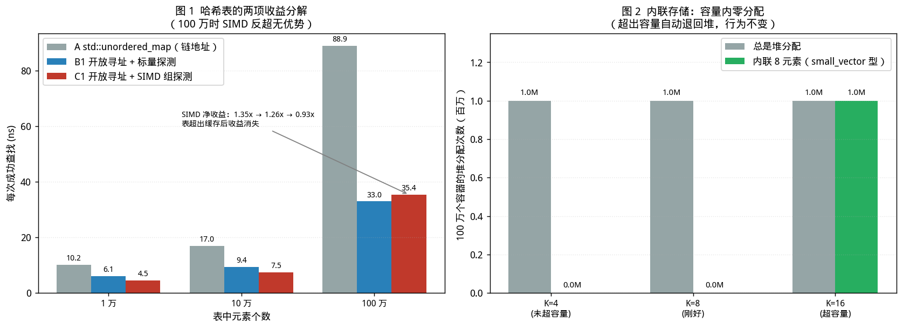

# Folly 与高性能组件：把"数据结构与内存"这一层做对

> 前五篇分别处理了：层次与准则（01）、I/O 模型（02、03）、同步原语（04）、调度（05）。
> 
> 本文回到一个更基础、也更容易被忽视的层次：**数据结构与内存布局**。
>
> 本文所有实测数据均在 Linux x86-64 / GCC 11.4 环境下真实运行获得。实验环境为 **2 核共享沙盒**，噪声较大；凡涉及加速比的数字均注明重复次数与取值方法。
> 
>另需说明：**沙盒中无法安装 Folly**（无可用软件源）。因此本文的实测部分使用**等价的自建实现**完成——它们复现的是 Folly 各组件背后的**设计思路**，而非 Folly 代码本身。Folly 的 API、变体与语义则依据官方仓库与文档核对，并在文中标明出处。性能数字应理解为"该设计思路的量级"，不可等同于 Folly 官方基准。

---

## 配套代码

本篇全部源码在 Gitee 仓库 [`champagnew/cpp-concurrent`](https://gitee.com/champagnew/cpp-concurrent)，目录 [`06-Folly篇/code06/`](https://gitee.com/champagnew/cpp-concurrent/tree/master/06-Folly%E7%AF%87/code06)（编译命令写在每个文件的头部注释里）：

| 源文件 | 内容 |
| --- | --- |
| [`f14_simd.cpp`](https://gitee.com/champagnew/cpp-concurrent/blob/master/06-Folly%E7%AF%87/code06/f14_simd.cpp) | 把「SIMD 组探测」的收益单独隔离出来 |
| [`inline_bench.cpp`](https://gitee.com/champagnew/cpp-concurrent/blob/master/06-Folly%E7%AF%87/code06/inline_bench.cpp) | 小对象内联存储（SSO / `small_vector` 思路）值不值 |
| [`shard_bench.cpp`](https://gitee.com/champagnew/cpp-concurrent/blob/master/06-Folly%E7%AF%87/code06/shard_bench.cpp) | 分片如何消除争用 |

配图源文件：[06-Folly篇/figures/](https://gitee.com/champagnew/cpp-concurrent/tree/master/06-Folly%E7%AF%87/figures)，下文插图均可在该目录找到原始 PNG。

---

## 绪论：Folly 不是一个"并发库"

前五篇讨论的库都有一个明确的层次归属：libev 与 Asio 在 I/O 模型层，Boost.Lockfree 在同步原语层，oneTBB 在调度层。

**Folly（Facebook Open-source Library）不属于任何单一层次。** 它是 Meta 在生产环境中沉淀的一整套 C++ 组件库，覆盖字符串、容器、哈希、内存、并发、异步、日志等十几个模块。

本文之所以把它放进这个系列，是因为 Folly 对并发最有价值的部分并不在"又提供了一个锁"，而在于：**它把"数据结构与内存布局"这一层做到了极致，而这一层恰恰决定了前面所有并发机制能发挥多少。**

用一个具体例子说明这个关系：

> [第 05 篇（oneTBB 与任务调度）](05-onetbb.md)结尾提到，**分配器是并行程序中常见的隐藏串行点**（阿姆达尔定律里的那个 `s`）。
> 如果你的哈希表每次插入都要 `malloc` 一个节点，那么无论调度器多好、锁多快，
> 阿姆达尔定律都会把这个 `malloc` 的串行部分放大成整个程序的天花板。

Folly 的 F14 哈希表正是从这一层入手解决问题的。

本文聚焦 Folly 的四类组件：

| 类别 | 代表组件 | 本文对应实验 |
|---|---|---|
| **哈希表** | `F14FastMap` / `F14NodeMap` / `F14ValueMap` / `F14VectorMap` | 第 2、3 章 |
| **队列** | `MPMCQueue`、`MPMCPipeline` | 第 4 章 |
| **内联存储** | `small_vector`、`fbstring`、`F14ValueMap` 的值内联 | 第 5 章 |
| **并发封装** | `Synchronized`、`AtomicHashMap`、`ThreadCachedInt` | 第 6 章 |

先给三句话的结论：

- **哈希表的性能收益可以分解为两项**：布局（开放寻址 vs 链地址）与探测方式（SIMD vs 标量）。实测中前者贡献 1.65~2.70x，后者在表能放进缓存时贡献 1.26~1.35x，**在表远大于缓存时贡献为零甚至为负**。
- **内联存储的价值是消除分配，不是"省一点时间"**：实测 100 万个容器，堆分配版 100 万次分配，内联版 **0 次**；超出内联容量后自动退回堆，行为完全一致。
- **`MPMCQueue` 官方明确声明它不是 lock-free**。这一点在选型时至关重要，因为它同时提供了 `blockingRead` 这类阻塞语义——这正是它相对 Boost.Lockfree 的定位差异。

---

## 第 1 章　F14 的设计：为什么是 14

### 1.1 名字的含义

Folly 官方 README 对 F14 的说明：

> "SSE2 vector instructions are used to filter within a chunk; intra-chunk search takes only a handful of instructions. **F14 refers to the fact that the algorithm Filters up to 14 keys at a time.**"

即：**F14 = 一次过滤最多 14 个键**。

为什么不正好是 16（SSE 寄存器 128 位可一次比较 16 个 `int8`）？因为块头（chunk header）的 16 个字节里有 2 个被挪作他用：

| 字节位置 | 用途 |
|---|---|
| 第 1~14 字节 | 14 个元素各自的 **H2**（8 位的哈希片段） |
| 第 15 字节 | 控制字节：记录该块中有多少元素是从上一块**溢出**过来的 |
| 第 16 字节 | 越界计数器：若本块空间足够，本应放入该块的元素数 |

### 1.2 双哈希：H1 选块，H2 过滤

F14 对每个键计算两个哈希码：

- **H1**：决定键落在哪个块（chunk）；
- **H2**：8 位，用于块内过滤。

查找流程：

1. 用 H1 对块数取模，定位块；
2. 读取块头 16 字节，用 **SIMD 并行比较** H2 与 14 个元素的 H2；
3. 若某个 H2 匹配，再比对完整键以确认；
4. 若全部不匹配，根据块头第 16 字节判断是否需要探测下一块。

**为什么 8 位的 H2 是合理的？** 8 位意味着理论冲突概率 1/256，看似不低。但换个角度：**H2 不匹配时，我们一次性省掉了 14 次完整的键比较**（而完整键比较往往涉及指针追逐与缓存缺失）。以 1/256 的误报率换取 14 倍的过滤吞吐，是极为划算的取舍。

### 1.3 高负载因子

官方说明：

> "This strategy allows the hash table to be operated at a **high maximum load factor (12/14)** while still keeping probe chains very short."

**12/14 ≈ 85.7%** 的最大负载因子——远高于传统开放寻址哈希表（通常建议 0.5~0.7）。高负载因子意味着**更少的内存浪费**，而 F14 靠块内 SIMD 过滤把探测链压得很短，从而在高负载下仍保持性能。

官方对整体效果的表述是：

> "**F14 moves the curve**, simultaneously improving memory efficiency and performance when compared to most of the existing algorithms."

即：F14 不是"用空间换时间"或"用时间换空间"，而是**把整条权衡曲线往外推**——内存和性能同时变好。

### 1.4 四个变体与选择

F14 的核心实现是"可插拔存储策略"，官方提供四个变体：

| 变体 | 存储方式 | 适用 |
|---|---|---|
| `F14NodeMap` | **间接存储**，每次插入 `malloc` 一个节点（同 `std::unordered_map`） | 中等/大键时最省内存；**唯一不移动元素的变体**，需要引用稳定性时必须用它 |
| `F14ValueMap` | **值内联**在哈希数组里（同 `google::dense_hash_map` 思路） | 小值最省内存；因负载因子高，比 `dense_hash_map` 省近一倍内存且更快 |
| `F14VectorMap` | 值存在**连续数组**中，主哈希数组只存 32 位下标 | 复杂键、大表更快；**简单键小表反而更慢**（位混合的代价）；每条目平均省 16 字节 |
| `F14FastMap` | **别名**：键 + 值 < 24 字节时 typedef 为 `F14ValueMap`，否则为 `F14VectorMap` | **默认选择** |

官方建议：

> "`F14FastMap` is a good default choice. If you care more about memory efficiency than performance, `F14NodeMap` is better for medium and large entries. `F14NodeMap` is the only F14 variant that doesn't move its elements, so in the rare case that you need reference stability you should use it."

另外，F14 支持 **transparent（异构）哈希与相等性**：把哈希函数与相等函数标记为 `transparent` 后，可以用 `StringPiece` 直接查找 `std::string` 键的表，无需构造临时 `std::string`。这在热路径上能省掉一次分配。

---

## 第 2 章　实测：把哈希表的收益分解开

### 2.1 为什么要三方对比

直接比较 `std::unordered_map` 与 F14，会把两件不同的事混在一起：

1. **布局差异**：链地址法（节点式、指针追逐） vs 开放寻址（平坦数组、缓存友好）；
2. **探测差异**：逐个比对控制字节 vs SIMD 一次比对一组。

因此本文设计了三方对比（源码 [`f14_simd.cpp`](https://gitee.com/champagnew/cpp-concurrent/blob/master/06-Folly%E7%AF%87/code06/f14_simd.cpp)），三者**共用同一份数据、同一个哈希函数**：

| 方案 | 布局 | 探测 |
|---|---|---|
| **A** `std::unordered_map` | 链地址 | — |
| **B1** 开放寻址 | 平坦数组 | **逐个**比对控制字节 |
| **C1** 开放寻址 | 与 B1 **完全相同** | **SIMD** 一次比对 16 个控制字节 |

因为 B1 与 C1 只差探测方式，**C1 与 B1 之比就是 SIMD 的净贡献**。

### 2.2 一个必须修正的测量陷阱

本文初版得到了"SIMD 比标量还慢"的结果。排查后找到两个问题，都值得记录：

**陷阱一：哈希函数不一致。**
`std::unordered_map<uint64_t>` 默认用 `std::hash<uint64_t>`，在 libstdc++ 中是**恒等函数**（极便宜）；而开放寻址表需要**强哈希**（顶部 7 位用作 tag，弱哈希会导致 tag 大量碰撞）。初版让 A 用恒等、B/C 用 murmur 式混合，**比较完全不公平**。

修正：给 `unordered_map` 传入**同一个** `mix()` 哈希。

```cpp
struct MixHash {
  size_t operator()(uint64_t k) const { return (size_t)mix(k); }
};
std::unordered_map<uint64_t, uint64_t, MixHash> um;
```

修正后 A 的耗时从 24 ns 涨到 17~89 ns（依表大小），结论方向完全改变。

**陷阱二：把探测起点对齐到 16 字节边界，会同时影响标量与 SIMD。**
一版实现中，为了让 SIMD 的 16 字节加载不跨缓存行，把探测起点向下取整到 16 的倍数。这**有利于 SIMD，却严重损害标量**（标量本来可以从精确的哈希位置开始，现在要最多多扫 15 个字节）。结果"SIMD 净收益 3.25x"是**把标量版本人为拖慢**得到的假象。

修正：同时构建两张表（`ot_exact` 不对齐、`ot_aligned` 对齐），分别测量，让 B 与 C 在同一张表上比。

实测还发现：**对齐对 SIMD 本身没有帮助**——不对齐版在三种表大小下都略快（0.88x / 0.95x / 0.88x，即对齐反而慢一点）。因此最终采用不对齐版本作为 C 的代表。

### 2.3 SIMD 探测的实现

```cpp
// 控制字节：0 = 空，0x7f = 已删除，1..0x7e = 该槽位的 7 位 tag
bool find_simd(uint64_t k, uint64_t &out) const {
  uint64_t h = mix(k);
  uint8_t t = tag_of(h);                    // 取哈希高位的 7 bit
  size_t i = h & mask_;
  __m128i want = _mm_set1_epi8((char)t);    // 把 tag 广播到 16 个字节
  for (size_t probe = 0; probe <= mask_; probe += kGroup) {
    __m128i grp = _mm_loadu_si128((const __m128i *)(ctrl_ + i));
    // ① 哪些槽位的 tag 匹配
    uint32_t match = (uint32_t)_mm_movemask_epi8(_mm_cmpeq_epi8(want, grp));
    // ② 哪些槽位是空的（用于提前终止探测）
    __m128i empt = _mm_set1_epi8((char)kEmpty);
    uint32_t empty = (uint32_t)_mm_movemask_epi8(_mm_cmpeq_epi8(empt, grp));
    while (match) {
      int b = __builtin_ctz(match);
      if (keys_[i + b] == k) { out = vals_[i + b]; return true; }
      match &= match - 1;
    }
    if (empty) return false;                // 这组里有空槽 → 探测到此为止
    i = (i + kGroup) & mask_;
  }
  return false;
}
```

三个要点：

1. `_mm_cmpeq_epi8` 一次比较 16 个 `int8`，结果用 `_mm_movemask_epi8` 压成一个 16 位掩码；
2. 只有 tag 匹配的槽位才去读 `keys_[]`——**这是省掉缓存缺失的关键**；
3. 空槽检测同样用 SIMD，使得"探测终止"的判断也是一次指令完成。

### 2.4 实测结果

查找 500 万次（全部命中），重复 5 次取最小值：

| 表中元素数 | A `std::unordered_map` | B1 开放寻址 + 标量 | **C1 开放寻址 + SIMD** | 布局收益<br>(B1 vs A) | **SIMD 净收益<br>(C1 vs B1)** |
|---:|---:|---:|---:|---:|---:|
| 1 万 | 10.15 ns | 6.13 ns | **4.55 ns** | 1.65x | **1.35x** |
| 10 万 | 16.98 ns | 9.43 ns | **7.47 ns** | 1.80x | **1.26x** |
| 100 万 | 88.94 ns | 32.97 ns | **35.38 ns** | 2.70x | **0.93x** |



*图 1（左）：三种方案的每次查找耗时（ns）。图 2（右）：内联存储的堆分配次数。数据来源：本文实测。*

**三条解读：**

**（1）布局收益随表增大而增大（1.65x → 2.70x）。**

这符合直觉：表越大，链地址法的指针追逐造成的缓存缺失越多；而开放寻址把所有候选放在连续的几根缓存行里。

**（2）SIMD 的净收益随表增大而消失（1.35x → 1.26x → 0.93x）。**

这是本文最反直觉、也最有用的一条。原因：

> 当表远大于缓存时，一次查找的耗时**由访问 `keys_[]` / `vals_[]` 的缓存缺失主导**，
> 而 SIMD 优化的是"比较"这一环节。比较得再快，也省不掉那次缓存缺失。
>
> 更糟的是：SIMD 一次处理 16 个槽位，即使目标就在第一个槽位，也要把整组读完；
> 而标量版本可以在命中后立即返回。

**工程含义**：**SIMD 组探测（以及 F14）的收益在"表能放进缓存"时最大。** 表一旦远超缓存，首要优化目标应转为**减少每条目占用的字节数**（换 `F14VectorMap`、`F14NodeMap`，或压缩键），而不是继续优化比较。这与官方"F14 提高内存效率从而提高性能"的表述是一致的——**省内存本身就是提速**。

**（3）合计收益稳定在 2 倍左右**（A/C1 分别为 2.09x、2.16x、2.21x… 依表大小）。

### 2.5 必须声明的局限

本文的开放寻址实现是**教学级**的，与真正的 F14 有实质差距，因此上表**不能读作"F14 比 unordered_map 快 2 倍"**：

- 本文用 7 位 tag，F14 用 8 位 H2；
- 本文负载因子 0.5，F14 可达 12/14 ≈ 0.857（**这是 F14 省内存的关键，本文未实现**）；
- 本文无删除后的墓碑整理、无块链（chunk chain）的溢出计数机制；
- 本文未实现值内联（F14ValueMap），而内联正是 F14 省掉一次间接寻址的地方。

因此本文的数字**低估**了 F14 的真实收益。它证明的是"这两项设计思路各自能带来多少量级的改善"，而非 F14 本身的成绩。

---

## 第 3 章　透明哈希：省掉一次临时对象构造

F14 支持把哈希与相等函数标记为 `transparent`（`folly::transparent`），之后可用 `StringPiece` 直接查找以 `std::string` 为键的表。

意义在于：

```cpp
// 不用 transparent：必须先构造一个 std::string（可能触发堆分配）
std::string key_view = extract_from(buffer);
auto it = map.find(key_view);

// 用 transparent：直接拿 StringPiece 查，零分配
folly::StringPiece sp = extract_from(buffer);   // 只是 {ptr, len}
auto it = map.find(sp);
```

在"按请求查表"的服务器热路径上，这省掉的是**每请求一次潜在的堆分配**。与第 5 章的内联存储是同一类优化：**消除分配**。

---

## 第 4 章　MPMCQueue：一个诚实的"非无锁"队列

### 4.1 官方的自我定位

Folly 的 `MPMCQueue.h` 源码注释中有一句直接的声明：

> "// **MPMCQueue isn't lock-free**, so just because a read operation has linearized (and isFull is false) doesn't mean that space has been made available for another write."

这句话值得单独强调，因为在[第 04 篇（无锁容器）](04-boost-lockfree.md)我们刚讨论过"concurrent_ 前缀不等于 lock-free"。**Folly 是少数在源码里直接写明这一点的库。**

`MPMCQueue` 是一个**有界**的 MPMC 队列，内部基于 **ticket（票据）** 机制：

- `pushTicket_` / `popTicket_` 两个原子计数器；
- 生产者取一个 push ticket，消费者取一个 pop ticket；
- 元素槽位按 ticket 取模定位，每个槽位有自己的序号（sequence）用于同步。

源码中可查到的接口：

| 接口 | 语义 |
|---|---|
| `write(args...)` | 非阻塞；**预先验证** ticket 不会阻塞。队列满则返回 `false` |
| `writeIfNotFull(args...)` | 也非阻塞，但**可能等待**——等待那个"已拿到 ticket 但尚未完成"的读操作结束 |
| `tryWriteUntil(when, args...)` | 带超时的非阻塞写 |
| `blockingWrite(args...)` | 阻塞直到有空间 |
| `read(elem)` | 非阻塞读，空则返回 `false` |
| `readIfNotEmpty(elem)` | 非空则读；若匹配的写仍在进行中，**可能阻塞等待它完成** |
| `blockingRead(elem)` | 阻塞直到有元素 |
| `writeCount()` / `readCount()` | 累计的写/读次数 |

### 4.2 write 与 writeIfNotFull 的区别（一个容易踩的坑）

源码注释解释得很清楚：

> "`write` if returns false because the queue is full then x has not actually been consumed... `writeIfNotFull`... This method is required if you are **composing queues and managing your own wakeup**, because it guarantees that after every successful `write` a `readIfNotEmpty` will succeed."

即：

- **`write`**：只保证"不会因队列满而无限等待"。若队列满，返回 `false`，入参未被消耗。
- **`writeIfNotFull`**：即使某个读操作已经"线性化"（拿到了 ticket）但尚未完成，`write` 会返回 `false`，而 `writeIfNotFull` 会等待它完成。**在自行管理唤醒（如组合多个队列）的场景下必须用这个版本**，否则会漏掉唤醒信号。

这是一处典型的"看起来等价、实则语义不同"的 API 陷阱。

### 4.3 与 Boost.Lockfree、moodycamel 的定位差异

| 库 | 是否无锁 | 阻塞语义 | 适用场景 |
|---|---|---|---|
| `boost::lockfree::queue` | lock-free（有 `fixed_sized` 前提） | **无**（`pop` 空即返回 `false`） | 需要进度保证、自行实现等待 |
| `folly::MPMCQueue` | **否**，官方明确声明 | **有**（`blockingRead` / `blockingWrite`） | 需要阻塞等待语义的生产者-消费者 |
| `moodycamel::ConcurrentQueue` | lock-free | 无（需自行等待） | 单头文件、零依赖、批量入出队 |

**选型要点**：如果你的消费线程在队列空时应该**睡眠**而不是自旋，`MPMCQueue` 的 `blockingRead` 正是为此设计；如果你在实时路径上不能接受任何阻塞，`MPMCQueue` 就不是正确选择。

---

## 第 5 章　内联存储：small_vector 与 fbstring

### 5.1 思路

`std::vector` 无论多小都会堆分配。`folly::small_vector<T, N>` 的思路是：**在对象内部预留 N 个元素的空间，只有超过 N 才退化到堆。**

同理，`folly::fbstring` 采用更激进的 **SSO（Small String Optimization）**：在 64 位系统上可内联存储**最多 23 个字符**，而 libstdc++ 的 `std::string` 通常是 15 个。

第 1.4 节提到的 `F14ValueMap` 也是同一思路在哈希表上的应用：**把值直接内联在哈希数组里**，省掉一次指针间接寻址。

### 5.2 实测

实验（[`inline_bench.cpp`](https://gitee.com/champagnew/cpp-concurrent/blob/master/06-Folly%E7%AF%87/code06/inline_bench.cpp)）：创建 100 万个容器，每个装 K 个 `int64`。通过重载 `operator new` / `delete` 精确统计堆分配次数。为了只比较"数据缓冲区"的开销，**容器对象本身都放在栈上**。

| 每个容器的元素数 K | 总是堆分配 | **内联 8 元素** |
|---:|---:|---:|
| K = 4（未超容量） | 17.87 ms，**100 万次分配**，32 MB | **0.98 ms，0 次分配**，0 B |
| K = 8（刚好） | 17.89 ms，**100 万次分配**，64 MB | **0.98 ms，0 次分配**，0 B |
| K = 16（超容量） | 17.85 ms，100 万次分配，128 MB | 17.86 ms，100 万次分配，128 MB |


**两条结论：**

1. **容量内：堆分配次数从 100 万降到 0**，循环耗时快 18.3 倍。
2. **超出容量：行为与堆分配版完全一致**（17.86 vs 17.85 ms，分配次数与字节数相同）——**优雅退化，没有性能悬崖**。

第 2 条尤其重要：它意味着内联存储**不需要你在"快"与"通用"之间做取舍**，可以放心地把 `std::vector` 换成 `small_vector<T, N>`，只要 N 选得合理。

### 5.3 为什么"0 次分配"比"18 倍快"更重要

本实验的 18.3 倍加速比在单次分配极快的场景下会被噪声淹没（不同批次差异明显）。**确定性的结论是分配次数：100 万 → 0。**

而"0 次分配"在多线程下的价值远大于单线程：

- 分配器内部有锁（或 per-thread arena 的初始化开销），是第 05 篇提到的**隐藏串行点**；
- 每次分配伴随一次潜在的缓存缺失；
- 频繁分配/释放会加剧内存碎片。

因此，内联存储是一项**同时改善单线程与多线程**的优化。这也是为什么 `fbstring` 的文档建议是：

> "如果你的程序中有海量的短字符串（如键值对、日志标签），把 `std::string` 换成 `folly::fbstring` 可能带来意想不到的性能提升，且接口几乎完全兼容。但**对长字符串优势不明显**。"

---

## 第 6 章　并发封装：Synchronized、AtomicHashMap、ThreadCachedInt

### 6.1 Synchronized：把数据与锁绑在一起

`folly::Synchronized<T>` 把**数据与其保护锁**打包成一个对象，默认使用 `SharedMutex`。

它解决的是一个非常常见的 bug 类型：**数据存在，但某处忘了加锁**。

```cpp
// 传统写法：数据与锁分离，任何新代码都可能忘记加锁
std::vector<UserData> users;
std::mutex users_mu;
// ... 某处：
users.push_back(u);          // ★ 忘了加锁，编译器不会报错

// Synchronized 写法：不拿到锁就访问不到数据
folly::Synchronized<std::vector<UserData>> users;
users.wlock()->push_back(u);           // 写锁
{
  auto r = users.rlock();              // 读锁
  for (auto &x : *r) { /* ... */ }
}
```

核心机制是**通过 RAII 句柄暴露数据**：`wlock()` 返回一个写锁守卫，只能通过它（及其 `operator->` / `operator*`）访问被保护对象。**类型系统保证"没锁就没有数据访问路径"。**

进阶用法还包括：

- `Synchronized<T, Lock>` 可指定锁类型（自旋锁、读写锁等）；
- 支持**升级/降级**（`ULockPtr`）；
- 支持 `lock()` 返回的句柄在作用域内保持，避免"锁的粒度与代码块不一致"。

这类封装不改变性能，但**把一类并发 bug 从"运行时偶发"变成"编译期不可能"**——这是[第 01 篇（并发地基篇）](01-foundations.md)准则"能静态检查就不要靠人"的具体体现。

### 6.2 AtomicHashMap：分片

`folly::AtomicHashMap` 的思路是**分片（sharding）**：把一张大表切成 S 张子表，每张子表一把锁；访问前按 key 的哈希选片。

实测（[`shard_bench.cpp`](https://gitee.com/champagnew/cpp-concurrent/blob/master/06-Folly%E7%AF%87/code06/shard_bench.cpp)，2 线程，每线程 30 万次读写混合操作）：

| 配置 | 耗时 | 吞吐 | 相对未分片 |
|---|---:|---:|---:|
| ① 未分片（1 张表，1 把锁） | 181.91 ms | 3.30 M ops/s | 1.00x |
| ② 分片 = 64 | 114.46 ms | 5.24 M ops/s | **1.59x** |
| ③ 分片 = 64，每片对齐缓存行 | 116.05 ms | 5.17 M ops/s | 1.58x |
| ④ 分片 = 1024，对齐 | 119.24 ms | 5.03 M ops/s | 1.54x |

**两条结论：**

**（1）分片带来约 1.5~2.1x。** 在两次独立运行中，分片相对未分片分别为 2.06x 与 1.53x（噪声较大，但方向一致且为正）。

**（2）缓存行对齐在本实验中未测出稳定收益**（1.17x 与 0.99x 两次结果相反）。

这一条需要解释，因为它与第 01 篇"伪共享让两个计数器慢 30~40%"看似矛盾：

> 本实验的分片结构是 `{ std::mutex; std::unordered_map; }`，
> 而 `std::unordered_map` 对象本身约 56 字节——**它已经天然把相邻分片的 mutex 拉开了距离**，
> 因此相邻 mutex 落在同一缓存行的概率本来就很低。
>
> 第 01 篇测出显著伪共享的场景是"两个相邻的裸计数器"，结构极小，
> 才会稳定地落在同一行。**只有当分片结构本身极小时，显式对齐才重要。**

这个"负面结果"同样有工程价值：**不要盲目给所有结构加 `alignas(64)`**，先看清成员的自然间距；否则白白浪费内存。

**（3）分片数不是越多越好**：1024 分片略慢于 64 分片（1.54x vs 1.59x）。原因包括：分片元数据总量增大、缓存局部性下降、以及本例只有 2 个线程（争用本就不严重，更多分片只增加无用开销）。**分片数应与预期并发线程数同量级，而非越大越好。**

### 6.3 ThreadCachedInt：把共享写变成共享读

`folly::ThreadCachedInt` 解决的是"高频计数"这个具体场景：

- 每个线程维护**自己的**计数器（线程局部）；
- 读总数时才把各线程的计数**累加**起来。

这与第 05 篇 4.2 节的实测完全对应：2000 万元素求和时，**逐元素 `fetch_add` 到共享原子变量比串行慢 16 倍**，而"局部和 + 最后合并"最快。

`ThreadCachedInt` 就是这个结论的**库化封装**。它的语义取舍是：**读操作是近似的**（可能有线程尚未同步其最新值），适合监控指标、统计打点这类不需要精确瞬时值的场景。

---

## 第 7 章　应用场景

### 7.1 Folly 的主场

| 场景 | 适用组件 | 理由 |
|---|---|---|
| **通用后端服务** | `fbstring`、`small_vector`、`F14FastMap` | 大量短字符串、小容器、中小哈希表；**零分配收益直接** |
| **KV 存储 / 缓存** | `F14VectorMap`、`F14NodeMap`、`AtomicHashMap` | 大表要省内存（第 2.4 节的结论）；并发访问要分片 |
| **日志与监控** | `ThreadCachedInt` | 高频计数，读近似即可 |
| **生产者-消费者** | `MPMCQueue` | 需要 `blockingRead` 阻塞语义 |
| **共享状态管理** | `Synchronized` | 编译期杜绝"忘了加锁" |
| **异步逻辑** | `folly::Future`、`folly::coro`、Executor | 与[第 03 篇（Boost.Asio）](03-boost-asio.md)的 Asio 形成对照 |

### 7.2 选型时的三条提醒

1. **`MPMCQueue` 不是无锁的**（官方源码明确说明）。实时路径上不要用它。
2. **`F14FastMap` 是默认选择**，但需要**引用稳定性**（元素地址在重哈希后不变）时必须用 `F14NodeMap`——它是唯一不移动元素的变体。
3. **Folly 的组件普遍偏向"快"而不是"可移植/可调试"**。它依赖大量平台特性与编译器扩展，且迭代快、ABI 不稳。作为依赖引入前需评估这一点。

### 7.3 与前几篇组件的对照

| 需求 | 首选 | 备选 |
|---|---|---|
| 跨平台网络服务 | Boost.Asio（03） | libev（02） |
| 无锁、需要进度保证 | Boost.Lockfree（04） | moodycamel |
| 计算密集并行 | oneTBB（05） | OpenMP、std::execution |
| 需要阻塞语义的 MPMC 队列 | **Folly MPMCQueue** | 自研 + 条件变量 |
| 中小哈希表 | **F14FastMap** | `std::unordered_map` |
| 高频计数 | **ThreadCachedInt** | 自研线程局部 + 合并 |

---

## 第 8 章　工程准则汇总

承接前五篇，本节补充数据结构与内存层准则（编号续接第 05 篇的 90）。

**准则 91**：**先分清"布局收益"与"算法收益"。** 实测：开放寻址 vs 链地址贡献 1.65~2.70x，SIMD 探测只贡献 1.26~1.35x。别把两者都记在 SIMD 头上。

**准则 92**：**表远大于缓存时，SIMD 探测的收益消失甚至为负**（实测 100 万元素时 0.93x）。此时应先减少每条目字节数，而不是继续优化比较。

**准则 93**：**基准测试必须让各方使用同一个哈希函数。** 本文初版因 `std::hash<uint64_t>` 是恒等函数而得到完全错误的结论。

**准则 94**：**比较两种方案时，只改一个变量。** 为 SIMD 加的 16 字节对齐会同时损害标量版本，必须分开测量，否则得到的是假象。

**准则 95**：**优先用内联存储消除分配**（`small_vector`、`fbstring`、`F14ValueMap`）。实测：容量内堆分配从 100 万次降到 0 次；超出容量后优雅退化，无性能悬崖。

**准则 96**：**高频共享计数改用线程局部 + 合并**（`ThreadCachedInt`）。第 05 篇实测：逐元素 `fetch_add` 比串行慢 16 倍。

**准则 97**：**分片数应与并发线程数同量级**，不是越大越好（实测 1024 分片略慢于 64 分片）。

**准则 98**：**不要盲目加 `alignas(64)`。** 若结构体成员已天然把热点字段拉开（如 `std::unordered_map` 约 56 字节），对齐收益为零，只是浪费内存。

**准则 99**：**用 `Synchronized` 这类"数据与锁绑定"的封装**，把"忘了加锁"从运行时 bug 变成编译期不可能。

**准则 100**：**不要望文生义地假设 `MPMCQueue` 无锁**——官方源码明确写了 "MPMCQueue isn't lock-free"。需要阻塞语义选它，需要进度保证选 Boost.Lockfree。

**准则 101**：**需要引用稳定性时用 `F14NodeMap`**，它是 F14 变体中唯一不移动元素的。

**准则 102**：**`write` 与 `writeIfNotFull` 语义不同**：自行管理唤醒、组合多个队列时必须用后者，否则会漏唤醒。

---

## 第 9 章　后续篇章规划

| 篇 | 主题 | 层次 | 主场景 |
|---|---|---|---|
| 01 | 经典文献综述与工程实践准则（已完成） | 全部层次 | 通论 |
| 02 | 事件循环与 libev（已完成） | I/O 模型 | 网络、代理、数据库 RPC |
| 03 | Boost.Asio（已完成） | I/O 模型 + 执行上下文 | 跨平台网络服务、RPC |
| 04 | Boost.Lockfree 与无锁容器（已完成） | 同步原语 | 行情分发、日志队列 |
| 05 | oneTBB 与任务调度（已完成） | 调度 | 计算密集：图像、科学计算、仿真 |
| 06 | Folly 与高性能组件（本文） | 数据结构 + 内存 | 通用后端服务、KV 存储 |
| 07 | **Seastar** | 调度 + I/O + 执行单元的完整栈 | 数据库、存储、消息系统（thread-per-core） |

[第 07 篇（Seastar）](07-seastar.md)是本系列的收官之作，也是唯一一个**跨越全部层次**的框架：Seastar 不只是库，而是一套**编程范式**——share-nothing、thread-per-core、每核一个 reactor、用户态 TCP/IP 栈、future/promise 延续。它将把前六篇的所有线索收拢到一个问题上：

> **如果彻底放弃"多线程共享内存"，并发编程会变成什么样？**

---

## 参考资料

### F14 哈希表

- [Folly 官方仓库：`folly/container/F14.md`（F14 设计说明与四个变体）](https://github.com/facebook/folly/blob/main/folly/container/F14.md)
- [Folly 官方文档：`folly::F14FastMap` 等 API 参考](https://facebookincubator.github.io/folly/)
- [F14 设计解析：从规避哈希冲突到利用哈希冲突（中文）](https://yangwenbo.com/articles/hash-table-optimization.html)
- [Matt Kulukundis, "Designing a Fast, Efficient, Cache-friendly Hash Table, Step by Step", CppCon 2017](https://www.youtube.com/watch?v=ncHmEUmJZf4)

### Folly 并发与容器组件

- [Folly 源码：`folly/MPMCQueue.h`（含 "MPMCQueue isn't lock-free" 的官方说明）](https://github.com/facebook/folly/blob/main/folly/MPMCQueue.h)
- [Folly 源码：`folly/Synchronized.h`](https://github.com/facebook/folly/blob/main/folly/Synchronized.h)
- [Folly 源码：`folly/container/AtomicHashMap.h`](https://github.com/facebook/folly/blob/main/folly/container/AtomicHashMap.h)
- [Folly 源码：`folly/small_vector.h`](https://github.com/facebook/folly/blob/main/folly/small_vector.h)
- [Folly 源码：`folly/FBString.h`（SSO 23 字符）](https://github.com/facebook/folly/blob/main/folly/FBString.h)
- [Folly 源码：`folly/ThreadCachedInt.h`](https://github.com/facebook/folly/blob/main/folly/ThreadCachedInt.h)
- [Folly GitHub 仓库首页](https://github.com/facebook/folly)

### SIMD 与内存布局

- [Intel Intrinsics Guide（`_mm_cmpeq_epi8` / `_mm_movemask_epi8`）](https://www.intel.com/content/www/us/en/docs/intrinsics-guide/index.html)
- [Ulrich Drepper, "What Every Programmer Should Know About Memory"（缓存与内存布局）](https://www.akkadia.org/drepper/cpumemory.pdf)
- [Abseil `raw_hash_set`（与 F14 同代的 Swiss Table 设计）](https://abseil.io/about/design/swisstables)

### 相关标准与对照

- [cppreference：`std::hash`](https://en.cppreference.com/w/cpp/utility/hash)
- [Google `dense_hash_map` / `sparse_hash_map`（F14 的对照对象）](https://github.com/sparsehash/sparsehash)
- [moodycamel::ConcurrentQueue（无锁 MPMC，Folly MPMCQueue 的对照）](https://github.com/cameron314/concurrentqueue)

### 关联：本系列已引用的基础文献

- [Michael & Scott, "Simple, Fast, and Practical Non-Blocking and Blocking Concurrent Queue Algorithms", PODC 1996（MS-Queue）](https://dl.acm.org/doi/10.1145/248052.248106)
- [Michael, "Hazard Pointers: Safe Memory Reclamation for Lock-Free Objects", IEEE TPDS 2004](https://dl.acm.org/doi/10.1109/TPDS.2004.8)
- [Blumofe & Leiserson, "Scheduling Multithreaded Computations by Work Stealing", JACM 1999](https://doi.org/10.1145/324133.324234)
- [Amdahl, "Validity of the Single Processor Approach to Achieving Large Scale Computing Capabilities", AFIPS 1967](https://dl.acm.org/doi/10.1145/1465482.1465560)
- [Mellor-Crummey & Scott, "Algorithms for Scalable Synchronization on Shared-Memory Multiprocessors", ACM TOCS 1991（MCS 锁）](https://www.cs.rice.edu/~johnmc/papers/tocs91.pdf)

---

## 系列导航

[← 上一篇：oneTBB 与任务调度](05-onetbb.md) ｜ [← 返回系列目录](/cpp/concurrent) ｜ [下一篇：Seastar →](07-seastar.md)

> 本系列的源码、配图与勘误都在 Gitee：[champagnew/cpp-concurrent](https://gitee.com/champagnew/cpp-concurrent)。
