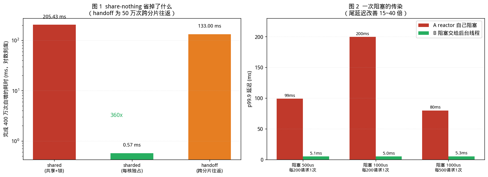

# Seastar 与 thread-per-core：如果彻底放弃共享内存

> 前六篇分别处理：层次与准则（01）、I/O 模型（02、03）、同步原语（04）、调度（05）、数据结构与内存（06）。
> 
>前六篇的隐含前提一直是：**多个线程共享同一份内存，然后用锁、原子、无锁结构去协调访问。**
> 
> 本文要问的是另一个问题：
>
> **如果干脆不做共享，会怎样？**
>
> 本文所有实测数据均在 Linux x86-64 / GCC 11.4 环境下真实运行获得。实验环境为 **2 核共享沙盒**，噪声较大；凡涉及加速比的数字均注明重复次数与取值方法。
> 
>另需说明：**沙盒中无法编译 Seastar**（依赖过多且无网络源）。因此本文的实测部分使用**自建的等价模型**完成——它们复现的是 Seastar 各设计决策背后的**代价结构**，而非 Seastar 本身。Seastar 的架构、API 与语义依据官方文档与源码核对，并在文中标明出处。性能数字应理解为"该设计决策的量级"，不可等同于 Seastar 官方基准。

---

## 配套代码

本篇全部源码在 Gitee 仓库 [`champagnew/cpp-concurrent`](https://gitee.com/champagnew/cpp-concurrent)，目录 [`07-Seastar篇/code07/`](https://gitee.com/champagnew/cpp-concurrent/tree/master/07-Seastar%E7%AF%87/code07)（编译命令写在每个文件的头部注释里）：

| 源文件 | 内容 |
| --- | --- |
| [`cross_core.cpp`](https://gitee.com/champagnew/cpp-concurrent/blob/master/07-Seastar%E7%AF%87/code07/cross_core.cpp) | 共享原子、分片、跨核委派三种组织方式的代价 |
| [`reactor_sim.cpp`](https://gitee.com/champagnew/cpp-concurrent/blob/master/07-Seastar%E7%AF%87/code07/reactor_sim.cpp) | reactor 线程里的一次阻塞，会传染给多少个后续请求 |
| [`latency_hist.cpp`](https://gitee.com/champagnew/cpp-concurrent/blob/master/07-Seastar%E7%AF%87/code07/latency_hist.cpp) | 尾延迟：为什么平均值骗人 |
| [`ctx_switch.cpp`](https://gitee.com/champagnew/cpp-concurrent/blob/master/07-Seastar%E7%AF%87/code07/ctx_switch.cpp) | 线程数与上下文切换 / 内核态时间的关系 |

配图源文件：[07-Seastar篇/figures/](https://gitee.com/champagnew/cpp-concurrent/tree/master/07-Seastar%E7%AF%87/figures)，下文插图均可在该目录找到原始 PNG。

---

## 绪论：一个彻底的假设

回顾前六篇，我们一直在解决同一个问题的不同侧面：

| 篇 | 解决的问题 | 手段 |
|---|---|---|
| 01 | 共享内存的正确性 | 内存模型、内存序 |
| 04 | 共享访问的效率 | 无锁数据结构 |
| 05 | 让多个核都有活干 | 工作窃取 |
| 06 | 减少共享访问的次数 | 分片、线程局部 |

这些手段的共同前提是**共享**。而 Seastar 提出的问题是：

> 如果从一开始就不共享，这些手段是不是都不需要了？

Seastar 的答案是肯定的，并给出了一套完整的架构：

- **每核一个 shard**（分片），每个 shard 是一个**独立的 OS 线程**，绑定到一个核；
- 每个 shard 有**自己的 reactor（事件循环）、自己的内存池、自己的任务队列、自己的 I/O 调度器**；
- shard 之间**不共享可变状态**；需要跨 shard 访问时，必须通过**显式的消息传递**（`smp::submit_to`）；
- shard 内**绝不阻塞**。

本文先给出三个核心结论：

1. **share-nothing 省掉的是同步原语的全部成本**。实测：同样的 400 万次自增，共享 + 锁需要 **196 ms**，每核独占只需 **0.78 ms**——**相差约 250 倍**。
2. **代价是跨核访问变成显式消息传递**。实测一次跨分片往返约 **254 ns**（50 万次往返共 127 ms）。因此 Seastar 的关键工程问题是**数据分片要分得好**，让跨分片访问尽可能少。
3. **"不能超订线程数"的真正理由不是上下文切换**。实测：纯计算负载下把线程数从 1 加到 64（32 倍于核数），墙钟时间几乎不变（404 → 392 ms），非自愿上下文切换 < 4 次。真正的理由是**内存与缓存**——thread-per-core 下每个 shard 持有一份完整数据，多一个 shard 就多一份。

---

## 第 1 章　share-nothing：省掉了什么

### 1.1 三种模式的对比

实验（[`cross_core.cpp`](https://gitee.com/champagnew/cpp-concurrent/blob/master/07-Seastar%E7%AF%87/code07/cross_core.cpp)）：完成 400 万次自增（2 线程 × 200 万次），对比三种组织方式。

| 模式 | 组织方式 | 耗时 | 说明 |
|---|---|---:|---|
| **shared** | 一个共享计数器 + 一把 `std::mutex` | **196.01 ms** | 传统的多线程共享 |
| **sharded** | 每个线程独占一份，最后汇总 | **0.78 ms** | share-nothing |
| **handoff** | 跨分片消息往返（50 万次） | 127.03 ms | 一次往返约 **254 ns** |



*图 1（左）：三种模式的耗时对比（对数刻度）。图 2（右）：一次阻塞对 p99.9 尾延迟的影响。数据来源：本文实测。*

**shared 与 sharded 相差约 250 倍。** 这个数字本身不重要（它高度依赖于锁争用强度与核数），重要的是它的**构成**：

- sharded 模式下，每个线程只是在写自己的 `volatile` 字段，**没有任何原子操作、没有任何缓存行弹跳、没有任何系统调用**；
- shared 模式下，每次自增都要做一次 `lock` / `unlock`，在低争用时是原子 RMW，在高争用时退化为 futex 睡眠/唤醒（[第 01 篇（并发地基篇）](01-foundations.md) 3.2 节）。

### 1.2 测量陷阱：编译器会把循环折叠掉

本实验的初版得到了 **0.03 ms** 的 sharded 结果——这显然是假的。原因是：

```cpp
long local = 0;
for (long i = 0; i < ops; ++i) local += 3;
```

编译器会把整个循环折叠成一次乘法（`local = ops * 3`）。修正方式是把累加目标改为**每轮都真的写内存**的 `volatile` 字段：

```cpp
struct alignas(64) Shard { volatile long v = 0; char pad[56]; };
Shard &mine = counters[(size_t)t];
for (long i = 0; i < ops; ++i) mine.v += 3;
```

这与[第 04 篇（无锁容器）](04-boost-lockfree.md) 3.4 节的教训同源：**写基准时，先确认编译器没有把你要测的东西优化掉。**

### 1.3 这不是"省了锁"这么简单

250 倍这个数字容易被误读为"锁很慢"。更准确的说法是：

> **share-nothing 让同步原语的开销归零，不是因为它找到了更快的锁，而是因为它让"需要同步"这件事不再发生。**

这带来三个连带效应：

1. **代码里不再有锁，因此不再有死锁、优先级反转、锁顺序问题**——第 01 篇与第 04 篇讨论的一整类问题从根上消失。
2. **不再有伪共享**（第 01 篇 6.3 节）——每个 shard 的数据只被自己访问。
3. **分配器不再是串行点**（[第 05 篇（oneTBB 与任务调度）](05-onetbb.md)准则 88）——Seastar 为**每个 shard 提供独立的内存池**，分配几乎总是在本核完成（详见 4.2 节）。

### 1.4 代价：跨核访问变成显式消息

sharded 模式快的前提是**数据恰好在本地**。如果需要的数 据在另一个 shard 上，就必须做一次 **`smp::submit_to`**——这正是上表中 `handoff` 那一行。

实测：**一次跨分片往返约 254 ns**（50 万次往返共 127.03 ms，重复 5 次取最小值）。

作为对照，第 04 篇测得同一环境下 SPSC 无锁队列的一次传递约 55 ns（往返）。本实验的 254 ns 更高，因为跨分片消息还需要：

- 构造工作项（`async_work_item`）；
- 唤醒对端 shard 的 reactor；
- 等待响应回到本地 shard。

**这个数字决定了 Seastar 的工程方法论**：

> 一切设计的首要目标，是**让跨分片访问尽可能少**。
> 分片键（partition key / 连接归属）选得好不好，直接决定性能。

Seastar 官方文档对这一设计的评价是：

> "**Explicit cross-core communication makes the concurrency model auditable**: cross-shard hops are visible `submit_to` calls, not hidden contention."

即：跨核跳转在代码里是**看得见的 `submit_to` 调用**，而不是隐藏在锁里的争用。这个"可审计性"是 share-nothing 的重要附带价值。

---

## 第 2 章　reactor：绝不阻塞

### 2.1 Seastar 的异步模型

官方文档列出的三个设计目标：

1. **Non-blocking execution**：会阻塞的操作（I/O、定时器）立即返回，交回一个 `future`；
2. **Composability**：复杂异步流程可由简单异步操作链接而成；
3. **Share-nothing compatibility**：所有异步操作都在单个 reactor 线程上执行，避免锁与原子操作。

文档同时指出两个传统方案的不足：

> "Threads introduce synchronization overhead and context switching costs. Raw callbacks lead to fragmented, hard-to-read code (**callback hell**)."

`future` / `promise` 的核心语义：

- `future<T>`：一个"将来会有的值"的**读端**，是一次性通道的读侧；
- `promise<T>`：**写端**，通过 `set_value()` / `set_exception()` 使 future 就绪；
- 状态：未就绪 / 就绪（值）/ 就绪（异常）。

调用 `.then(callback)` 时：

- 若 future **已就绪**，回调**内联执行**（不分配 continuation 对象）；
- 若未就绪，分配一个 continuation 挂到 promise 上，待就绪后由 reactor 调度执行。

continuation 的返回类型会被自动"展平"：返回 `T` 得到 `future<T>`，返回 `future<T>` 得到 `future<T>`（不嵌套）。

### 2.2 实测：一次阻塞的传染性

这是 Seastar 编程模型**第一条戒律**的实证：**reactor 线程里绝不能做阻塞调用。**

实验（[`reactor_sim.cpp`](https://gitee.com/champagnew/cpp-concurrent/blob/master/07-Seastar%E7%AF%87/code07/reactor_sim.cpp)）：一个 reactor 线程从队列中取请求处理；每若干个请求会遇到一个"必须阻塞"的操作（对应同步文件 I/O、压缩、或一次缺页）。对比两种处理：

- **模式 A**：reactor 自己阻塞；
- **模式 B**：把阻塞操作交给后台线程，reactor 继续处理。

统计每个请求的端到端延迟（入队 → 处理完）。

| 阻塞配置 | A：reactor 自己阻塞<br>p99.9 | B：交给后台线程<br>p99.9 | **改善** |
|---|---:|---:|---:|
| 阻塞 500 us，每 200 请求 1 次 | 99,248.9 us | **5,067.2 us** | **19.6x** |
| 阻塞 1000 us，每 200 请求 1 次 | 199,550.7 us | **5,035.9 us** | **39.6x** |
| 阻塞 1000 us，每 500 请求 1 次 | 79,971.9 us | **5,306.3 us** | **15.1x** |


**读这组数字的关键：一次只阻塞 0.5~1 毫秒，尾延迟却恶化 15~40 倍。**

原因是**传染**：

> 阻塞期间，**队列里已经到达的所有请求**都要多等这段时间。
> 负载越高（队列越长），被传染的请求越多。

这也解释了为什么[第 02 篇（事件循环与 libev）](02-event-loop-libev.md)测得"回调里做 5 ms 阻塞，吞吐从 37,731 req/s 崩到 81 req/s"——那是同一个效应在吞吐维度的表现。

### 2.3 尾延迟：为什么平均值骗人

承接上一节，补充一个独立的观察（[`latency_hist.cpp`](https://gitee.com/champagnew/cpp-concurrent/blob/master/07-Seastar%E7%AF%87/code07/latency_hist.cpp)）：同一段工作重复 20 万次，测量每次耗时并输出分位数。

| 分位数 | 耗时 |
|---|---:|
| 平均值 | 1.005 us |
| p50 | 0.981 us |
| p90 | 1.240 us |
| p99 | 1.300 us |
| **p99.9** | **7.659 us** |
| p99.99 | 15.658 us |
| **最大** | **355.817 us** |

`p99.9 / p50 = 7.8x`，`max / p50 = 362.7x`。

**平均值与 p50 几乎一致（1.005 vs 0.981），但最大值是 p50 的 363 倍。** 若一次用户请求要串行经过 M 段这样的处理：

| M | p50 合计 | p99.9 合计 | max 合计 |
|---:|---:|---:|---:|
| 1 | 1.0 us | 7.7 us | 355.8 us |
| 10 | 9.8 us | 76.6 us | 3,558.2 us |
| 50 | 49.0 us | 382.9 us | 17,790.8 us |

**这就是 Seastar 关注 p99.9 而非平均吞吐的原因**：在扇出为 50 的微服务链路里，尾延迟会被放大 50 倍，而平均值完全看不出来。

### 2.4 任务配额：如何给尾延迟设上界

Seastar 用**协作式调度 + 任务配额（task quota）**约束尾延迟：

> "Cooperative scheduling with a task quota keeps tail latency bounded — no single continuation can monopolize the core beyond **~0.5 ms** before the loop re-polls I/O."

即：任何一个 continuation 都不能独占该核超过约 0.5 ms，之后事件循环会重新轮询 I/O。这从**机制上**给单个任务的影响设了上界——这是第 2.2 节那类问题的系统性解法（对比：普通线程池没有这个保护）。

代价是：编写 continuation 时必须自己注意不要写超长的同步计算；如果确实有耗 CPU 的工作，需要主动切分或用 `seastar::thread`（下文 3.3 节）。

---

## 第 3 章　SMP：跨核通信

### 3.1 架构

依据官方源码（`include/seastar/core/smp.hh`）与文档：

```
Shard 0 (CPU 0)          Shard 1 (CPU 1)         Shard N (CPU N)
  reactor                  reactor                 reactor
  message_queue            message_queue           message_queue
  memory pool              memory pool             memory pool
  task queue               task queue              task queue
        │                        │                        │
        └────────────  smp_message_queue ─────────────────┘
                    （无锁队列，shard 间两两相连）
```

`smp` 类的主要 API：

| API | 语义 |
|---|---|
| `smp::count` | shard 总数 |
| `submit_to(shard, func)` | 在指定 shard 上执行函数，返回 `future` |
| `invoke_on_all(func)` | 在所有 shard 上执行 |
| `invoke_on_others(func)` | 在除自己外的所有 shard 上执行 |
| `this_shard_id()` | 当前 shard 的 ID（`thread_local`） |

### 3.2 批处理：摊薄跨核开销

`smp_message_queue` 的处理采用**批处理**：

> "The message queue processes work items **in batches** to minimize cross-CPU cache misses and improve throughput"

相关参数：`batch_size = 16`、`prefetch_cnt = 2`。

这与第 04 篇"批处理摊薄"、第 05 篇"任务粒度"是**同一个道理在数据通路上的体现**：

> 跨核传递有固定成本，批量能把成本摊到多条消息上。

读者可以把第 04 篇 3.2 节那张"每批消息数 K vs 每条耗时"的表拿过来对照——Seastar 的 `batch_size = 16` 就是这张表上的一个具体取值。

### 3.3 服务组：给跨核调用设配额

`smp_service_group` 提供跨核调用的**资源控制**：

- 每个服务组有 `max_nonlocal_requests` 上限，用**每 shard 的信号量**限制并发的跨核操作；
- RAII 式的 `smp_service_group_semaphore_units` 自动释放；
- 支持**超时**；
- 默认服务组不限制并发。

意义在于：防止某个 shard 被跨核请求淹没，从而保护尾延迟。这与[第 03 篇（Boost.Asio）](03-boost-asio.md) Asio 的 `executor`、第 05 篇 oneTBB 的 `task_arena` 属于同一类思想——**给资源使用设显式边界**。

### 3.4 alien：与非 Seastar 线程互操作

`include/seastar/core/alien.hh` 提供 **alien threads** 机制：让外部（非 Seastar）线程能与 shard 通信（`alien::message_queue`、`alien::instance`）。

这解决的是一个现实问题：**你不可能让所有代码都遵守 Seastar 的模型**。第三方库、遗留代码、或必须用阻塞 API 的场合，需要一条"逃生通道"。

### 3.5 seastar::thread：受控的阻塞

Seastar 还提供 `seastar::thread`——一种特殊的线程抽象，允许在其内部写**看起来是阻塞**的代码（如 `read()` 然后 `write()`），但实际由框架管理，阻塞点是**协作式让出**而非真阻塞。

适用场景：移植遗留的同步代码，或逻辑本身用顺序写法更清晰。代价是它比 `future` 链更重（每个 `seastar::thread` 需要自己的栈）。

---

## 第 4 章　支撑 share-nothing 的两个基础设施

### 4.1 每核内存分配器

Seastar **替换了全局分配器**（`src/core/memory.cc`）：

- 启动时把物理内存**按 shard 划分**（NUMA 感知），每个 shard 从自己的区域分配；
- 小对象用 size-classed 的 `small_pools`；
- **释放属于其他 shard 的内存时**，通过跨分片机制把内存**归还给属主**，而不直接触碰其他核的池子。

官方的评价很直接：

> "This per-core allocator is a **load-bearing part of share-nothing**: without it, every `new`/`delete` would reintroduce the global contention the architecture exists to avoid."

即：**每核分配器是 share-nothing 的承重结构**。没有它，每次分配都会重新引入架构本想消除的全局争用。

这一点值得与[第 06 篇（Folly）](06-folly.md)对照：Folly 用 `small_vector` / `fbstring` **减少**分配次数，Seastar 用每核池**消除**分配的争用——两者都在解决"分配器是隐藏串行点"这同一个问题（第 05 篇准则 88），但层次不同：一个在数据结构层，一个在架构层。

### 4.2 两套网络栈

Seastar 提供两套网络栈，通过 `--network-stack` 选择：

| 栈 | 头文件 | 说明 |
|---|---|---|
| **POSIX** | `include/seastar/net/posix-stack.hh` | **默认**。通过普通 socket 使用内核 TCP/IP 栈，由所选 reactor 后端驱动。无需特殊权限 |
| **Native** | `include/seastar/net/native-stack.hh` | **完整的用户态 TCP/IP 栈**，跑在 shard 内，基于 **DPDK** 或 virtio 设备。数据通路**完全绕过内核** |

Native 栈的代价是**需要独占的网卡与 DPDK**；收益是最低延迟与最高吞吐——每个核处理自己的 RX/TX 队列，报文全程留在用户态。

> **注意**：POSIX 栈是大多数部署的实际选择。不要因为"Seastar 有用户态网络栈"就以为必须用 DPDK。

### 4.3 三种 reactor 后端

Seastar 的 reactor 支持三种内核后端，按能力**自动探测选择**：

| 后端 | 特点 |
|---|---|
| **io_uring** | 现代首选；真正的 **Proactor**（返回完成结果而非就绪） |
| **linux-aio** | 老内核；Seastar 早年就在 AIO 后端实现了用户态环形缓冲的完成收割 |
| **epoll** | 兜底；受限环境下可用 |

相关优化（依据官方资料）：

- **用户态收割完成**：AIO 环（`try_reap_events`）与 io_uring 的 CQ 在热路径上**无需系统调用**；
- **批量提交**：操作累积在 SQ 中，每次轮询迭代用一次 `io_uring_submit` 刷新；
- **就绪 future 的免分配快路径**：对已就绪的 future 调 `.then()` **内联执行**，不分配 continuation；
- **可选的忙轮询（busy-polling）**：完全消除中断与唤醒延迟，代价是 100% CPU 占用。

第 2 点与第 04/05 篇的批处理结论一致；第 3 点则是"零成本抽象"思想在异步框架里的体现。

---

## 第 5 章　实测：超订线程的真实代价

### 5.1 一个反直觉的负面结果

常见说法是"线程数超过核数会导致大量上下文切换，严重损害性能"。本文用 [`ctx_switch.cpp`](https://gitee.com/champagnew/cpp-concurrent/blob/master/07-Seastar%E7%AF%87/code07/ctx_switch.cpp) 实测了这一点：固定总工作量（4000 万次 `sin`），把线程数从 1 加到 64（本机 2 核，即 **32 倍超订**）。

| 线程数 | 墙钟耗时 | 用户态 tick | 内核态 tick | 自愿切换 | 非自愿切换 |
|---:|---:|---:|---:|---:|---:|
| 1 | 404.39 ms | 40 | 0 | 1 | 0 |
| 2 | 373.37 ms | 38 | 0 | 2 | 0 |
| 4 | 408.40 ms | 42 | 0 | 3 | 1 |
| 8 | 390.65 ms | 38 | 0 | 2 | 0 |
| 16 | 401.02 ms | 40 | 0 | 2 | 0 |
| 32 | 408.21 ms | 40 | 0 | 2 | 1 |
| **64** | **392.04 ms** | 34 | 0 | 4 | 0 |

**结论：在纯计算、无阻塞、无共享写争用的负载下，32 倍超订几乎没有代价。** 非自愿上下文切换全程 ≤ 1 次，内核态时间为 0。

这与第 05 篇 1.4 节（4 倍超订几乎无损）的结论一致，并将其扩展到 32 倍。

**但必须严格限定这条结论的适用范围。** 它成立的条件是：

- 线程**不阻塞**（不做 I/O、不 sleep、不等待锁）；
- 线程之间**没有高频共享写**（否则回到第 05 篇 4.2 节那个"比串行慢 16 倍"的场景）；
- 只关心吞吐，不关心延迟。

真实服务中这三条往往都不成立。

### 5.2 那么 Seastar 为什么坚持"线程数 = 核数"

既然超订的调度开销这么小，Seastar 限制 shard 数等于核数的理由是什么？

**不是**上下文切换。真正的理由有三条：

**（1）内存。** thread-per-core 下，**每个 shard 持有一份完整的数据分片**。若开 64 个 shard 而只有 2 个核，就要维护 32 倍冗余的数据结构。这是 share-nothing 的直接代价。

**（2）缓存与 NUMA。** 每个 shard 绑定一个核，其数据常驻该核的缓存与本地内存节点。线程数超过核数后，同一个核上会有多个 shard 轮转，**每次轮转都意味着缓存全冷**——这个代价远超上下文切换本身。

**（3）延迟可预测性。** 第 2.4 节的任务配额机制（~0.5 ms）只在"一个核一个 shard"时才有意义。若一个核上跑多个 shard，单个 shard 的等待时间就取决于同核上有几个 shard 在排队——尾延迟不再有界。

**这一条是本文最想纠正的一个常见误解**：Seastar 限制线程数，不是因为"线程切换贵"，而是因为 **share-nothing 的内存模型 + 缓存亲和 + 延迟上界**。

### 5.3 shared vs sharded 的再讨论

回到第 1.1 节的 250 倍。需要提醒的是：这个数字**不代表真实应用的收益**，因为：

- 真实应用中，数据往往不能完美分片，必然有一定比例的跨分片访问（每次约 254 ns）；
- Seastar 自身的开销（future/continuation 分配、reactor 轮询）在本文模型中不存在；
- 本文的 shared 基线用了 `std::mutex`，而真实系统可能用更精细的方案。

官方对 ScyllaDB 的宣传是"相比基于锁的设计有 **5~10x** 提升"——这比 250 倍保守得多，也现实得多。**引用时应该用官方的 5~10x，而不是本文这个隔离实验的 250 倍。**

---

## 第 6 章　Seastar 的代价与适用边界

### 6.1 官方列出的弱点

依据官方资料，Seastar 的弱点包括：

> "**Steep learning curve.** The future/promise/continuation model, share-nothing discipline, and 'never block the reactor' rule are hard to internalize."

学习曲线陡峭是最主要的一条。此外还有：

- **生态隔离**：Seastar 有自己的一套原语（future、shard、内存），与标准库、Boost、Folly 的互操作需要适配层（`alien`）；
- **编程约束强**：reactor 内不能阻塞，意味着不能用大量现成的同步库；
- **调试困难**：continuation 链的栈是"逻辑栈"而非调用栈，崩溃栈难以阅读；
- **内存开销**：每 shard 一份数据。

### 6.2 适用场景

| 场景 | 为什么适合 | 实例 |
|---|---|---|
| **分布式数据库** | 数据天然可按 key 分片；跨分片访问可控；尾延迟是核心指标 | **ScyllaDB**（Cassandra 的 C++ 重写） |
| **消息/日志系统** | 分区（partition）天然对应 shard；顺序写、批处理友好 | **Redpanda**（Kafka 的 C++ 重写） |
| **高并发存储服务** | I/O 密集 + Proactor 模型（io_uring）契合 | 各类 KV 存储 |
| **需要可预测尾延迟的服务** | 任务配额 + 无阻塞 + 绑核，三重保障 | 低延迟 API 网关 |

### 6.3 不适用场景

| 场景 | 原因 |
|---|---|
| **计算密集型、无明显分片键** | 第 05 篇的 oneTBB 更合适：工作窃取自动平衡负载 |
| **小规模服务、开发效率优先** | 学习成本远超收益；用 Asio（第 03 篇）+ 线程池足够 |
| **大量使用第三方同步库** | 每条都要包装成异步，成本极高 |
| **数据无法分片、访问高度随机** | 跨分片访问（254 ns/次）会主导耗时 |
| **需要频繁与现有多线程代码交互** | 需要 `alien`，边界成本高 |

### 6.4 与前六篇组件的对照

| 需求 | 首选 | 备选 |
|---|---|---|
| 跨平台网络服务，中等并发 | Boost.Asio（03） | libev（02） |
| 无锁、需要进度保证 | Boost.Lockfree（04） | moodycamel |
| 计算密集并行 | oneTBB（05） | OpenMP、std::execution |
| 阻塞语义的 MPMC 队列 | Folly MPMCQueue（06） | 自研 + 条件变量 |
| 中小哈希表 | F14FastMap（06） | `std::unordered_map` |
| **极致尾延迟 + 可分片的数据服务** | **Seastar** | 自研 thread-per-core |

---

## 第 7 章　工程准则汇总

承接前六篇，本节补充架构层准则（编号续接第 06 篇的 102）。

**准则 103**：**先问"能不能不共享"，再问"怎么共享"。** 实测：共享 + 锁 196 ms vs 每核独占 0.78 ms。**消除共享比优化同步有效得多。**

**准则 104**：**跨分片访问必须有显式成本意识。** 实测一次跨分片往返约 254 ns。**分片键的选择是 Seastar 应用最重要的设计决策。**

**准则 105**：**reactor 线程内绝不阻塞。** 实测：一次 1 ms 阻塞使 p99.9 恶化 **39.6 倍**——因为阻塞会传染给队列中已到达的所有请求。

**准则 106**：**关注 p99.9，不要只看平均。** 实测：平均值 1.005 us、p50 0.981 us，但 max 是 p50 的 **363 倍**；扇出 50 的链路会把尾延迟放大 50 倍。

**准则 107**：**给单个任务的执行时间设上界。** Seastar 用任务配额（~0.5 ms）；普通线程池没有这个保护，需自行保证。

**准则 108**：**跨核/跨线程传递要批量。** Seastar `smp_message_queue` 的 `batch_size = 16` 与第 04 篇"批处理摊薄"、第 05 篇"任务粒度"是同一原理。

**准则 109**：**给跨核调用设配额**（`smp_service_group`），防止某个分片被淹没。

**准则 110**：**share-nothing 必须配每核内存分配器。** 官方明确称其为"承重结构"——否则每次 `new`/`delete` 都会重新引入全局争用。

**准则 111**：**不要以为 Seastar 必须用 DPDK。** POSIX 栈是默认且是大多数部署的实际选择。

**准则 112**：**"不能超订线程数"的理由不是上下文切换。** 实测 32 倍超订在纯计算负载下几乎无损（非自愿切换 ≤ 1 次）。真正的理由是**内存冗余、缓存失效、尾延迟无界**。

**准则 113**：**引用性能数字时区分"隔离实验"与"系统工程"。** 本文的 250 倍是隔离实验；ScyllaDB 官方口径是 **5~10x**。对外沟通应使用后者。

---

## 第 8 章　全系列总结

### 8.1 七篇的层次地图

| 篇 | 层次 | 核心问题 | 代表库 |
|---|---|---|---|
| 01 | 全部 | 什么是正确的并发 | —（论文与准则） |
| 02 | I/O 模型 | 怎么知道"数据来了" | libev |
| 03 | I/O 模型 + 执行上下文 | 怎么组织异步流程 | Boost.Asio |
| 04 | 同步原语 | 怎么不阻塞地共享数据 | Boost.Lockfree |
| 05 | 调度 | 怎么让多个核都有活干 | oneTBB |
| 06 | 数据结构 + 内存 | 怎么让共享访问更少、更快 | Folly |
| 07 | 架构 | 怎么根本不需要共享 | Seastar |

### 8.2 贯穿全系列的六条主线

回顾七篇，有六条结论反复出现，它们构成了本系列的骨架：

**① 一切性能问题先问"瓶颈在哪一层"。** 第 04 篇证明队列开销主要来自跨核缓存行传递而非 CAS；第 05 篇证明加速比上界由串行部分决定；第 06 篇证明表太大时 SIMD 收益消失而应减少每条目字节数。**在错误的层次上优化，收益为零。**

**② 固定开销可以被摊薄，这是最普适的优化手段。** 第 04 篇批处理（443 → 6 ns）、第 05 篇任务粒度、第 07 篇 `smp` 批处理（`batch_size = 16`）——同一个道理在三个层次上的体现。

**③ 共享写是并行程序的头号杀手。** 第 05 篇实测逐元素原子加比串行慢 **16 倍**；第 01 篇伪共享让两个无关计数器慢 30~40%；第 07 篇证明消除共享能带来数量级的改善。

**④ 无锁的价值是有界性，不是速度。** 第 04 篇最有力的一组数据：持锁线程卡住 300 ms 时，消费者**一条消息都取不到**；无锁方案全部取走。

**⑤ 测量必须控制变量，且要防编译器。** 全系列记录了至少六次"第一版测错"：MCS 锁在 2 核上反而最慢、`new`/`delete` 配对被优化掉、加速比分母用错、SIMD 对照组的对齐污染、哈希函数不对等、循环被折叠成乘法。**这些都是真实的工程经验。**

**⑥ 尾延迟比吞吐更能反映系统质量。** 第 07 篇实测 max 是 p50 的 363 倍；一次 1 ms 阻塞让 p99.9 恶化 39.6 倍。**平均值会掩盖一切。**

### 8.3 选型决策树

```
数据的访问模式是什么？
├─ 可以清晰分片（按 key / 连接 / 分区）
│   └─ 且要求极低尾延迟 → Seastar（07）
│      否则 → 每分片一把锁 / AtomicHashMap（06）
│
├─ 不可分片，但读多写少
│   └─ 共享读 + 定期重建 / RCU
│
├─ 不可分片，写频繁
│   ├─ 短临界区、低争用 → mutex（01）
│   ├─ 需要进度保证   → Boost.Lockfree（04）或 moodycamel
│   └─ 高频计数      → 线程局部 + 合并（06）
│
└─ 是计算任务，不是数据
    └─ 依赖复杂 → oneTBB flow_graph（05）
       简单循环 → OpenMP / parallel_for（05）

I/O 密集型？
├─ 跨平台、中等并发 → Boost.Asio（03）
├─ Linux、极致控制   → libev（02）或 io_uring
└─ 存储 + 极致尾延迟 → Seastar（07）
```

### 8.4 结束语

本系列从一篇 1990 年的自旋锁论文开始，到一个"彻底不共享"的架构结束。这条路径恰好也是过去三十年并发编程思想的演进方向：

> **从"如何正确地共享"，到"如何少共享"，再到"如何不共享"。**

但必须强调的是：**越往后，代价越高。** Seastar 的性能来自它对编程方式的强约束，这些约束不是所有人都付得起。第 01 篇的准则 1 至今仍然有效——

> **先测量，再优化；先正确，再快速。**

---

## 参考资料

### Seastar 官方文档与源码

- [Seastar 官方文档首页（含 Tutorial、Futures and Promises、Multicore 等章节）](https://docs.seastar.io/index.html)
- [Seastar GitHub 仓库](https://github.com/scylladb/seastar)
- [Seastar 源码：`include/seastar/core/smp.hh`（smp 类、smp_message_queue、批处理参数）](https://github.com/scylladb/seastar/blob/master/include/seastar/core/smp.hh)
- [Seastar 源码：`include/seastar/core/future.hh`（future / promise / continuation）](https://github.com/scylladb/seastar/blob/master/include/seastar/core/future.hh)
- [Seastar 源码：`src/core/memory.cc`（每核内存分配器）](https://github.com/scylladb/seastar/blob/master/src/core/memory.cc)
- [Seastar 源码：`include/seastar/net/native-stack.hh`（用户态 TCP/IP 栈）](https://github.com/scylladb/seastar/blob/master/include/seastar/net/native-stack.hh)
- [Seastar 源码：`include/seastar/net/posix-stack.hh`（默认 POSIX 栈）](https://github.com/scylladb/seastar/blob/master/include/seastar/net/posix-stack.hh)
- [Seastar 源码：`include/seastar/core/alien.hh`（与非 Seastar 线程互操作）](https://github.com/scylladb/seastar/blob/master/include/seastar/core/alien.hh)
- [Seastar 教程：`doc/tutorial.md`（future/continuation 与 SMP）](https://github.com/scylladb/seastar/blob/master/doc/tutorial.md)
- [Seastar 异步编程模型解析（DeepWiki）](https://deepwiki.com/scylladb/seastar/3-asynchronous-programming-model)
- [Seastar 多核（SMP）架构解析（DeepWiki）](https://deepwiki.com/scylladb/seastar/2.4-multi-core-smp)

### 基于 Seastar 的系统

- [ScyllaDB 官网（Cassandra 的 C++ 重写，shard-per-core）](https://www.scylladb.com/)
- [ScyllaDB：Seastar 架构与 shard-per-core 说明](https://www.scylladb.com/product/technology/)
- [Redpanda 官网（Kafka 的 C++ 重写，基于 Seastar）](https://redpanda.com/)
- [Seastar 设计与性能特征综述（含 native/POSIX 栈、每核分配器、任务配额）](https://sparkles.petar-kirov.dev/research/async-io/seastar)

### 内核 I/O 与网络

- [io_uring 官方文档与 `io_uring_submit` 说明](https://kernel.dk/io_uring.pdf)
- [Linux AIO 与 io_uring 对比（Seastar 后端选择依据）](https://kernel.dk/io_uring.pdf)
- [DPDK 官网](https://www.dpdk.org/)
- [man7：`epoll(7)`](https://man7.org/linux/man-pages/man7/epoll.7.html)

### 尾延迟与可伸缩性

- [Dean & Barroso, "The Tail at Scale", CACM 2013（尾延迟放大效应）](https://research.google/pubs/pub40801/)
- [Gunther, "A General Theory of Computational Scalability Based on Rational Functions"（USL）](https://arxiv.org/abs/0808.1431)
- [Amdahl, "Validity of the Single Processor Approach to Achieving Large Scale Computing Capabilities", AFIPS 1967](https://dl.acm.org/doi/10.1145/1465482.1465560)

### 关联：本系列已引用的基础文献

- [Mellor-Crummey & Scott, "Algorithms for Scalable Synchronization on Shared-Memory Multiprocessors", ACM TOCS 1991（MCS 锁）](https://www.cs.rice.edu/~johnmc/papers/tocs91.pdf)
- [Franke, Russell, Kirkwood, "Fuss, Futexes and Furwocks", OLS 2002（futex）](https://kernel.org/doc/ols/2002/ols2002-pages-479-495.pdf)
- [Michael & Scott, "Simple, Fast, and Practical Non-Blocking and Blocking Concurrent Queue Algorithms", PODC 1996（MS-Queue）](https://dl.acm.org/doi/10.1145/248052.248106)
- [Michael, "Hazard Pointers: Safe Memory Reclamation for Lock-Free Objects", IEEE TPDS 2004](https://dl.acm.org/doi/10.1109/TPDS.2004.8)
- [Blumofe & Leiserson, "Scheduling Multithreaded Computations by Work Stealing", JACM 1999](https://doi.org/10.1145/324133.324234)
- [Chase & Lev, "Dynamic Circular Work-Stealing Deque", SPAA 2005](https://dl.acm.org/doi/10.1145/1073970.1073974)
- [Herlihy, "Wait-Free Synchronization", ACM TOPLAS 1991](https://dl.acm.org/doi/10.1145/114005.102808)
- [Lamport, "How to Make a Multiprocessor Computer That Correctly Executes Multiprocess Programs", IEEE TC 1979](https://dl.acm.org/doi/10.1109/TC.1979.1675439)

---


## 附录：全系列文件清单

全系列 7 篇正文与配套代码都在 Gitee 仓库 [champagnew/cpp-concurrent](https://gitee.com/champagnew/cpp-concurrent) 中，下表列出每一篇的文档与代码目录：

| 篇 | 文档 | 配套代码 |
| --- | --- | --- |
| 01 | [`01-并发地基篇-从经典论文到工程方针.md`](https://gitee.com/champagnew/cpp-concurrent/blob/master/01-%E5%9C%B0%E5%9F%BA%E7%AF%87/01-%E5%B9%B6%E5%8F%91%E5%9C%B0%E5%9F%BA%E7%AF%87-%E4%BB%8E%E7%BB%8F%E5%85%B8%E8%AE%BA%E6%96%87%E5%88%B0%E5%B7%A5%E7%A8%8B%E6%96%B9%E9%92%88.md) | [`01-地基篇/code/`](https://gitee.com/champagnew/cpp-concurrent/tree/master/01-%E5%9C%B0%E5%9F%BA%E7%AF%87/code) |
| 02 | [`02-事件循环与libev-从select到epoll.md`](https://gitee.com/champagnew/cpp-concurrent/blob/master/02-libev%E7%AF%87/02-%E4%BA%8B%E4%BB%B6%E5%BE%AA%E7%8E%AF%E4%B8%8Elibev-%E4%BB%8Eselect%E5%88%B0epoll.md) | [`02-libev篇/code02/`](https://gitee.com/champagnew/cpp-concurrent/tree/master/02-libev%E7%AF%87/code02) |
| 03 | [`03-BoostAsio-从Reactor到Proactor.md`](https://gitee.com/champagnew/cpp-concurrent/blob/master/03-Asio%E7%AF%87/03-BoostAsio-%E4%BB%8EReactor%E5%88%B0Proactor.md) | [`03-Asio篇/code03/`](https://gitee.com/champagnew/cpp-concurrent/tree/master/03-Asio%E7%AF%87/code03) |
| 04 | [`04-BoostLockfree与无锁容器.md`](https://gitee.com/champagnew/cpp-concurrent/blob/master/04-Lockfree%E7%AF%87/04-BoostLockfree%E4%B8%8E%E6%97%A0%E9%94%81%E5%AE%B9%E5%99%A8.md) | [`04-Lockfree篇/code04/`](https://gitee.com/champagnew/cpp-concurrent/tree/master/04-Lockfree%E7%AF%87/code04) |
| 05 | [`05-oneTBB与任务调度.md`](https://gitee.com/champagnew/cpp-concurrent/blob/master/05-oneTBB%E7%AF%87/05-oneTBB%E4%B8%8E%E4%BB%BB%E5%8A%A1%E8%B0%83%E5%BA%A6.md) | [`05-oneTBB篇/code05/`](https://gitee.com/champagnew/cpp-concurrent/tree/master/05-oneTBB%E7%AF%87/code05) |
| 06 | [`06-Folly与高性能组件.md`](https://gitee.com/champagnew/cpp-concurrent/blob/master/06-Folly%E7%AF%87/06-Folly%E4%B8%8E%E9%AB%98%E6%80%A7%E8%83%BD%E7%BB%84%E4%BB%B6.md) | [`06-Folly篇/code06/`](https://gitee.com/champagnew/cpp-concurrent/tree/master/06-Folly%E7%AF%87/code06) |
| 07 | [`07-Seastar与thread-per-core.md`](https://gitee.com/champagnew/cpp-concurrent/blob/master/07-Seastar%E7%AF%87/07-Seastar%E4%B8%8Ethread-per-core.md) | [`07-Seastar篇/code07/`](https://gitee.com/champagnew/cpp-concurrent/tree/master/07-Seastar%E7%AF%87/code07) |

---

## 系列导航

[← 上一篇：Folly](06-folly.md) ｜ [← 返回系列目录](/cpp/concurrent)

> 本系列的源码、配图与勘误都在 Gitee：[champagnew/cpp-concurrent](https://gitee.com/champagnew/cpp-concurrent)。
