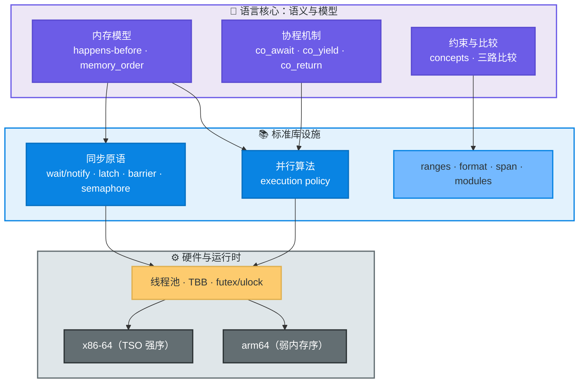
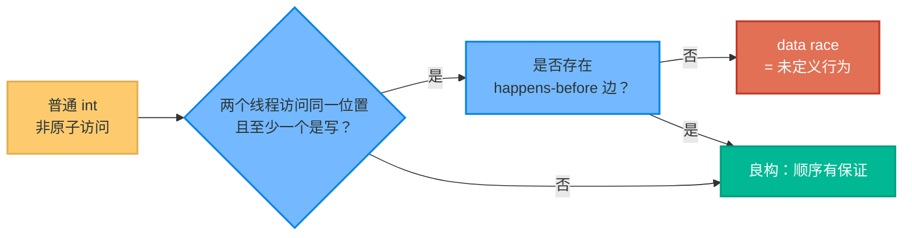
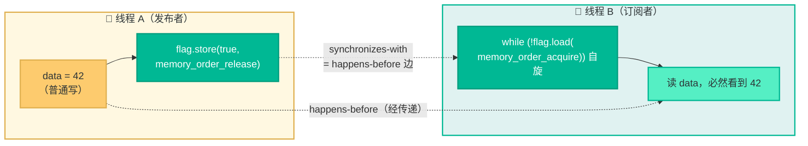
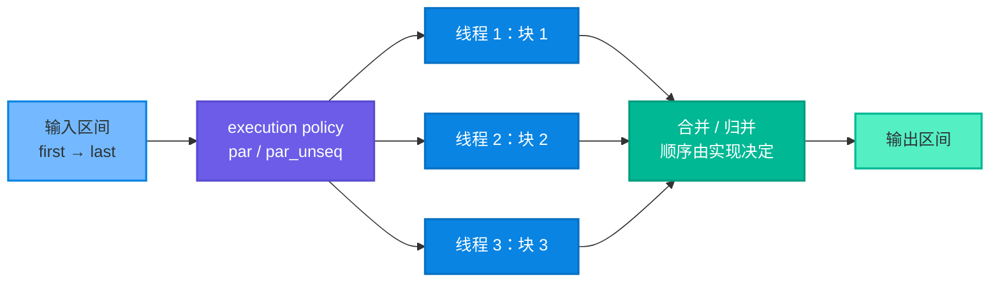
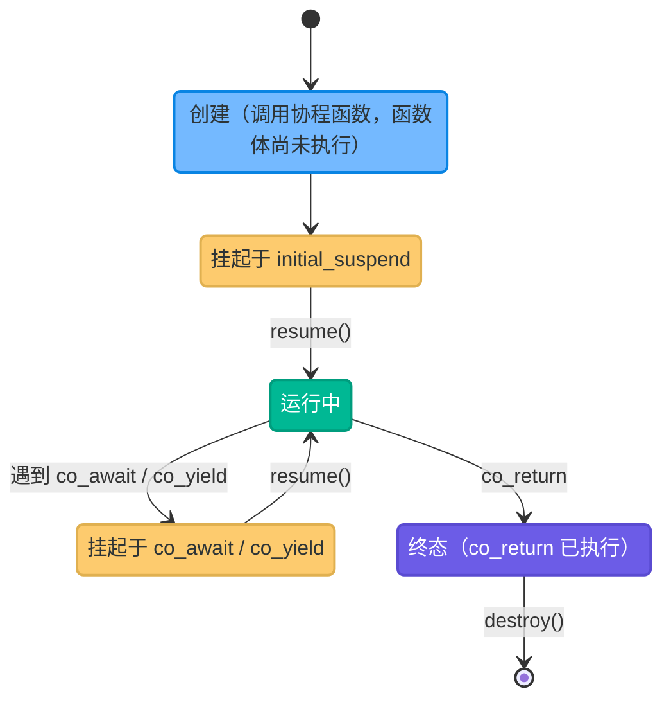
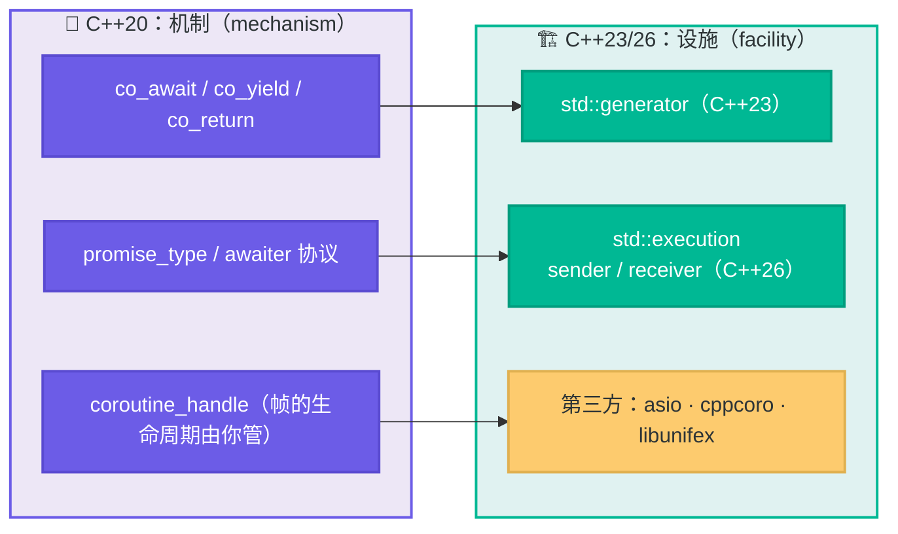
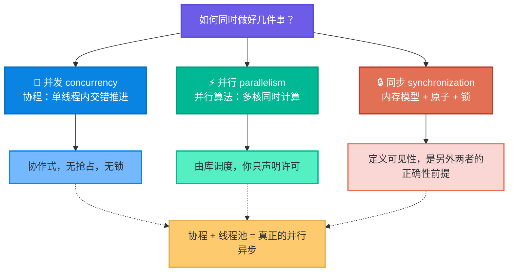

# 现代 C++ 的三块硬骨头：内存模型、并行算法与协程

> 环境：macOS 15 · Intel Core i5-8257U（4 物理核 / 8 逻辑核）· clang 22.1.8 + libc++ 22 · 标准依据 N4861（C++20）。
>
> 文中的每个数字都是这台机器上跑出来的，每段代码都收在 `cpp17-20-samples/` 里，能编能跑。实测输出按原样贴，包括不好看的部分。

“C++17/20 新特性”这类文章我读过不少，写法基本是清单式：structured bindings、`if constexpr`、concepts、ranges、modules……一条条念下去。读完你大概能答上几道面试题，但真到写代码时，还是不知道这些玩意之间是什么关系，也不知道今天该动哪一个。

清单的问题在于它只回答“有什么”，不回答“哪些真的改变了你写程序的方式”。

所以我换个走法：只挑三块硬骨头——**内存模型、标准并行算法、协程**——每一条结论都落到机器码或者实测数字上。其余那些好用的语法糖，后面用两节当补充，不占正文篇幅。

---

## 1. 先看全局：C++17/20 到底改了什么

三句话说完：

- **C++17 干的是“补课”**：并行算法、`<filesystem>`、`optional`/`variant`/`any`/`string_view`、`std::byte`、`reduce`/`scan`。标准库缺的东西，它一次性补齐。
- **C++20 干的是“重建抽象层”**：concepts 让模板约束变得可读，ranges 让算法能组合，modules 把编译期依赖收束起来，协程把“暂停/恢复”变成语言机制。
- **两者共用的地基，是 C++11 定下的内存模型**。地基不牢，`std::atomic`、并行算法、`jthread` 全都站不住。



篇幅不短，先给一张导航表，你按需跳：

| 你想解决的问题 | 跳到 | 大概读多久 |
|---|---|---|
| 搞懂 `memory_order`，以及那个“读到旧值”的怪 bug 是怎么来的 | §2 | 15 min |
| 一行代码吃满多核，顺便搞清为什么你的机器上可能编不过 | §3 | 12 min |
| 写生成器、写异步任务，弄明白 `co_await` 背后发生了什么 | §4 | 18 min |
| 补 C++17/20 的日常语法（结构化绑定、concepts、ranges、modules） | §5、§6 | 15 min |
| 手上有老代码要迁：编译开关、落地顺序、检查清单 | §8 | 8 min |

> ⏭️ 只关心协程的，可以直接翻到 §4。但如果你打算在生产里用协程，我建议先读 §2.5——协程加上共享状态，是最容易翻车的地方。

---

## 2. 内存模型：所有并行特性的地基

### 2.1 data race 是未定义行为，不是“值旧了一点”

下面这段代码，几乎每个 C++ 程序员都写过：

```cpp
int counter = 0;                       // 普通 int，不是 std::atomic
void worker() { for (int i = 0; i < 1000; ++i) ++counter; }
// 主线程起 4 个 std::thread 跑 worker，然后期望 counter == 4000
```

很多人对它的心理预期是“最多少加几次，跑到 39xx 也认了”。这个预期是错的。

标准的规定是：两个线程访问同一个内存位置、至少一个是写、彼此之间没有 happens-before 关系，就是 **data race**；而 data race 是未定义行为（[intro.races][races]）。未定义行为的意思是编译器有权假设它压根不存在，于是它可以把整个循环优化成一条 `counter += 1000`，可以让四个线程各缓存各的，也可以让程序打印任何东西。



> ⚠️ 这是 C++ 和 Java/C# 最容易被忽略的语义差异之一。Java 的 `int` 字段虽然也不原子，但行为被定义死了：可能撕裂，可能读到旧值。C++ 直接判 UB。所以“我跑了半年没出事”在 C++ 里不构成任何证据。

### 2.2 三个关系：sequenced-before、synchronizes-with、happens-before

内存模型只用**一个**概念回答“线程 A 的写，线程 B 能不能看见”：happens-before。它由两条规则合成：

1. **同一线程内**：语句按 sequenced-before 排序。编译器可以重排，但不能改变你能观察到的结果。
2. **跨线程**：一个 `release` 写 + 一个 `acquire` 读，如果读**读到了**写的值，就建立一条 synchronizes-with 边。

两条边加上传递闭包，就是 happens-before。它定义的是**可见性**，不是**时间先后**。两件事可以在时间上同时发生而毫无 happens-before 关系；反过来，时间上更早的操作也可能不在 happens-before 里。



这就是最经典的发布/订阅模式。抓住一句话就行：**你要保证的不是“原子”，是“因果”。**

### 2.3 `memory_order`：六种取值，一张表

这张表建议存下来，写原子代码前扫一眼，能省掉很多“为什么它偶尔不生效”的排查时间。

| 枚举 | 它到底保证什么 | 典型正确用途 | 常见误用 |
|---|---|---|---|
| `relaxed` | 只保证原子性 + 同一变量的修改顺序（coherence），不建立任何跨变量、跨线程的顺序 | 统计计数器、无锁结构里的“我改过谁”标记、`shared_ptr` 引用计数（`fetch_sub(relaxed)` 那一半） | 拿它当“数据就绪”标志位 → 读到标志却读不到数据 |
| `consume` | 规范仍在修订，实践中等同 `acquire`（我实测：libc++ 生成的机器码和 acquire 一字不差） | 别用 | 以为能省掉 ARM 上的屏障 |
| `acquire`（读） | 读之后的操作不得上移到它之前 | 订阅者等就绪标志、拿锁 | 只在读侧用 acquire，写侧却用 relaxed |
| `release`（写） | 写之前的操作不得下移到它之后 | 发布者提交数据、解锁 | 和 `relaxed` 读配对（不成立） |
| `acq_rel` | RMW 操作同时具备两者语义 | 引用计数的 `fetch_sub`、自旋锁的 `exchange` | 以为它能替代 `seq_cst`（关键区别见 §2.5） |
| `seq_cst` | 所有 `seq_cst` 操作共享**同一个全局总顺序** S | 默认值；Dekker/Peterson 型算法；需要“多变量一致视图”的场景 | 需要 StoreLoad 屏障的地方仍用 acquire/release（§2.5 实测会失败） |

> 💡 默认值就是 `seq_cst`。写 `std::atomic` 时不写 memory_order 不是偷懒，是正确的保守选择。性能问题等测出来再谈，别提前优化。

### 2.4 实测一：同一段 C++，两种硬件生成的机器码

空口说“acquire 在 x86 上不要钱”没什么说服力，直接看汇编更省事。

`cpp17-20-samples/codegen.cpp` 把每种内存序各写成一个独立函数，用 `-O2 -S` 出汇编。下表是 clang 22 在 x86-64 与 arm64 上的实际结果（arm64 用 `-target arm64-apple-macos14` 交叉生成，指令选择和真机一致）：

| C++ 写法 | x86-64 机器码 | arm64 机器码 |
|---|---|---|
| `store(v, relaxed)` | `movl %edi, _g(%rip)` | `str w0, [x8]` |
| `store(v, release)` | `movl %edi, _g(%rip)` | `stlr w0, [x8]` |
| `store(v, seq_cst)` | `xchgl %edi, _g(%rip)` | `stlr w0, [x8]` |
| `load(relaxed)` | `movl _g(%rip), %eax` | `ldr w0, [x8]` |
| `load(acquire)` | `movl _g(%rip), %eax` | `ldapr w0, [x8]` |
| `load(seq_cst)` | `movl _g(%rip), %eax` | `ldar w0, [x8]` |
| `fetch_add(1, relaxed)` | `lock addl %edi, _g(%rip)` | `ldadd w0, w8, [x8]` |
| `fetch_add(1, seq_cst)` | `lock addl %edi, _g(%rip)` | `ldaddal w0, w8, [x8]` |

这张表能读出三个反直觉的结论。

**① x86 上 acquire/release 是免费的。** x86-64 是 TSO（Total Store Order）模型，硬件本身就保证“读—读”“写—写”不重排，所以 acquire 读和 release 写都编译成普通 `mov`。你写 `memory_order_acquire`，唯一的收益是拦住**编译器**别搬代码，跟给 CPU 加指令没关系。

**② x86 上 relaxed 的 RMW 和 seq_cst 的 RMW 是同一条指令。** 两者都是 `lock addl`，锁前缀本身已经是全屏障。实测 1 亿次自增：

```
relaxed    5.18 ns/op      seq_cst    4.96 ns/op
relaxed    4.93 ns/op      seq_cst    4.93 ns/op
relaxed    4.96 ns/op      seq_cst    4.98 ns/op
```

两组数字完全重合，剩下那点差异就是测量噪声。也就是说：**在 x86 上为了“省一条屏障”把 `seq_cst` 降级成 `relaxed`，写 RMW 时一个指令都没省，却把正确性丢了。** 这笔买卖亏得很难看。

**③ arm64 上代价只是挪了个位置。** `stlr` 同时承担 release 和 seq_cst 的 store；真正的差别出现在 load（`ldar` vs `ldapr`）和 RMW（`ldaddal` vs `ldadd`）。ARMv8 的 `LDAPR` 是 RCpc 语义，比 `LDAR`（RCsc）弱，这正是“acquire 总是够用、seq_cst 有时候不够”在机器码层面的样子。

> ⚠️ 别只在 x86 上验证弱内存序的正确性。x86 的 TSO 会替你把大量 bug 藏起来。§2.5 那个例子在 x86 上都能复现出最高 30% 的错误率，换到 arm64 只会更难看。

### 2.5 实测二：StoreLoad litmus test，为什么 acquire/release 不够

这是整篇里最值得带走的一个实验。经典的 Store Buffer（SB）测试，三行写完：

```
初始 x = 0, y = 0
线程 A:  x = 1;  r0 = y
线程 B:  y = 1;  r1 = x
```

如果两个线程都读到 0（`r0 == 0 && r1 == 0`），在顺序一致性下是不可能的：那要求 A 写 x 排在 B 读 x 之后、B 写 y 排在 A 读 y 之后，叠加各自的程序顺序，正好绕成一个环。

但真实硬件上，写是先扔进 store buffer 的，读可以越过自己还没提交的写。于是这个“不可能”的结果会大量出现。

`cpp17-20-samples/dekker.cpp` 用 `std::barrier`（C++20）让两个线程每轮严格同步，跑 200 000 轮，只改内存序：

| 内存序 | 第 1 轮 | 第 2 轮 | 第 3 轮 |
|---|---|---|---|
| `relaxed` / `relaxed` | 29.98% | 8.37% | 27.11% |
| `acquire` / `release` | 7.98% | 23.05% | 25.72% |
| `seq_cst` / `seq_cst` | **0.00%** | **0.00%** | **0.00%** |

三个事实，一个比一个扎心：

1. **错误结果是真实存在、可以稳定复现的**，不是教科书吓人。占比在 8%–30% 之间晃（幅度受调度影响），但从来没消失过。
2. **`acquire`/`release` 和 `relaxed` 一样不安全。** 原因就在上一节的表里：x86 的 release store 是普通 `mov`，acquire load 也是普通 `mov`，两个都拦不住 StoreLoad 重排。acquire/release 管的是“读之后/写之前”的搬家，管不了“自己的写什么时候被别人看见”。
3. **只有 `seq_cst` 把异常率压到 0**，因为 x86 的 `seq_cst` store 编译成 `xchgl`。这条指令隐含原子语义，会把 store buffer 冲刷掉。

> ⚠️ 所以结论很硬：任何 Dekker/Peterson/自旋握手风格的算法，必须用 `seq_cst`。release → acquire 这条传递链只在“读到了对方写的值”时成立，而这里的问题恰恰是**双方都没读到**。

> 🤔 顺带回答一个老问题：`volatile` 为什么替代不了 `std::atomic`？因为 `volatile` 只约束编译器别删访问、别重排 volatile 之间的相对顺序，它对 CPU 重排和跨线程可见性一无所知。把上面的实验里 `std::atomic<int>` 换成 `volatile int`，结果只会更惨。

### 2.6 C++17/20 在模型层补的几件工具

#### 2.6.1 `atomic::wait` / `notify_one`（C++20）

C++20 之前，“等一个标志位”只有两条路：自旋（烧 CPU）或者 `condition_variable`（得配 mutex，代码啰嗦）。C++20 给了 `std::atomic<T>::wait(old)` / `notify_one()` / `notify_all()`：值不变就睡着，值变了就醒。说白了，就是把 futex 做进了标准库。

`cpp17-20-samples/wake.cpp` 拿同一个需求（消费者等一个 500 ms 后才来的标志位）写了两种版本，用 `getrusage` 量 CPU 时间：

```
spin   wall=0.508s cpu=0.484s  (cpu/wall=0.95)
wait   wall=0.506s cpu=0.000s  (cpu/wall=0.00)
```

墙钟时间一模一样，但自旋烧掉 0.95 个核，`wait` 几乎不占 CPU（内核把线程挂起了）。功耗和吞吐的差别是数量级的。

> 💡 标准保证 `wait` **只在值真正变化后才返回**（底层就算出现虚假唤醒，实现也会重试），所以它比 `condition_variable` 少一层 `while` 循环的心智负担。但别拿它当信号量使：它比较的是值，不是计数。

#### 2.6.2 `std::atomic_ref`（C++20）

已有的内存，比如别人定义的 `int`、数组元素、第三方结构体的字段，你没法把它们改成 `std::atomic`。`atomic_ref` 给的是一个作用域内的原子视图：

```cpp
int value = 0;
{
  std::atomic_ref<int> ref(value);        // 这段作用域内，value 的操作是原子的
  ref.fetch_add(1, std::memory_order_relaxed);
}                                          // 作用域结束，game over
```

`cpp17-20-samples/aref.cpp` 用 4 个线程各对独立数组元素自增 100 万次，结果 `total=4000000 expect=4000000`，`is_always_lock_free = 1`。

> ⚠️ 三个硬约束：①被引用的对象必须满足 `alignof(T)` 对齐；②`atomic_ref` 活着的时候，不允许再用普通方式访问该对象；③不能引用位域。违反任何一条都是 UB，编译器不会提醒你任何一个字。

#### 2.6.3 `latch` / `barrier` / `semaphore`（C++20）

过去这几样东西要么自己手搓条件变量，要么引 Boost。C++20 一次性补齐，区别就在“能不能重复用”：

| 原语 | 语义 | 可重用 | 典型场景 |
|---|---|---|---|
| `std::latch` | 一次性倒数，数到 0 所有等待者放行 | ❌ | 主线程等 N 个 worker 初始化完 |
| `std::barrier` | 循环屏障，每轮等齐 N 个参与者，可挂一个 completion 函数 | ✅ | 迭代算法每轮同步（§2.5 的实验就用了它） |
| `std::counting_semaphore<N>` | 计数信号量，`acquire`/`release` | ✅ | 限流、有界队列 |
| `std::binary_semaphore` | 就是 `counting_semaphore<1>` | ✅ | 轻量互斥/事件 |

```cpp
std::barrier sync(threads, []() noexcept { /* 每轮结束后由其中一个线程执行 */ });
// 每个 worker 里：  sync.arrive_and_wait();
```

> 💡 `barrier` 的 completion 函数是它比“手写两个条件变量”优雅的地方：统计本轮结果、交换双缓冲，都可以塞进去，而且保证只执行一次。

#### 2.6.4 `std::jthread` + `stop_token`（C++20）

`std::thread` 的历史遗留问题有两个：析构时如果还 joinable 就 `std::terminate`，以及完全没有标准的取消机制。`jthread` 一次解决：析构时自动 `request_stop()` + `join()`，顺便把 `stop_token` 送进你的函数。

```cpp
std::jthread worker([&](std::stop_token st) {          // 自动 join
  std::unique_lock lk(m);
  while (!st.stop_requested()) {
    if (cv.wait_for(lk, st, std::chrono::milliseconds(10),
                    [&]{ return st.stop_requested(); })) break;
    ++ticks;                                            // 定期工作
  }
});
worker.request_stop();                                  // 协作式取消
cv.notify_all();                                        // 唤醒可能正在 wait 的线程
```

`cpp17-20-samples/jth.cpp` 实测输出：

```
worker: stopped after 9 ticks, stop_requested=1
main: jthread 已自动回收
```

> ⚠️ `stop_token` 是**协作式**的：它不会杀线程，只是把“该停了”这个标志和唤醒机制一起送到。你忽略它，线程照样跑到天荒地老。这既是限制也是优点——不会有析构函数在任意点被强杀。

#### 2.6.5 模型层的其他补丁

| 特性 | 版本 | 一句话 | 实测/坑 |
|---|---|---|---|
| `std::atomic<T>::is_always_lock_free` | C++17 | 编译期就知道某个原子类型是否无锁 | 本机 `atomic<int>` = 1，`atomic<double>` = 1，`atomic<long long>` = 1 |
| `std::atomic_flag::test/clear` | C++20 | 唯一保证无锁的原子类型终于能“读”了 | 在此之前只能 `test_and_set` |
| `std::atomic<std::shared_ptr<T>>` | C++20 | 原子的 `shared_ptr`，不加锁也能安全替换 | **libc++ 22 尚未提供**（下面贴了报错） |
| 二进制补码成为强制要求 | C++20（P0907R4） | 有符号整数的表示和位运算行为被写死 | 原来是“实现定义”，现在是标准行为 |
| `constinit` | C++20 | 强制在静态初始化期完成初始化，避开静态初始化顺序灾难 | 和 `constexpr` 的区别：只要求常量初始化，不要求不可变 |

`atomic<shared_ptr>` 缺失的实证（`cpp17-20-samples/atomic_shared_ptr_probe.cpp`）：

```
error: static assertion failed due to requirement
       'std::is_trivially_copyable<std::shared_ptr<int>>::value':
       std::atomic<T> requires that 'T' be a trivially copyable type
note: in instantiation of template class 'std::__check_atomic_mandates<std::shared_ptr<int>>'
```

这就是“标准写了 ≠ 你的标准库实现了”的活样本。读任何特性说明时，都该回到自己的工具链上验一次。

### 2.7 工程上的默认选择

理论讲完，落到“我这段代码到底该写哪个”：

| 你的场景 | 推荐 | 理由 |
|---|---|---|
| 统计计数、心跳数 | `relaxed` | 只需要原子性，不需要顺序 |
| 发布一份只读数据给别的线程 | release store ↔ acquire load | 经典发布/订阅，代价最低 |
| 引用计数 | `fetch_sub(1, acq_rel)`；或 `fetch_sub(1, release)` + 末端 `atomic_thread_fence(acquire)` | 最后一个持有者的析构不能被上移，否则对象销毁之后你还在读它 |
| 多个变量需要一致视图 | `seq_cst` | 只有全序能保证“要么全看到新，要么全看到旧” |
| 想省指令 | **先测量** | x86 上 RMW 的 relaxed 与 seq_cst 同码（§2.4） |
| 需要跨架构正确 | 上 TSan，并在 ARM 上跑一遍 | x86 的 TSO 会掩盖一半问题 |

> ⚠️ 用工具，别用眼睛。`-fsanitize=thread` 能抓出绝大多数 data race，`-fsanitize=address,undefined` 能抓生命周期错误。不过也要知道 TSan 的局限：它和某些手写原子操作（比如自己包的 futex）会互相干扰，而且它会显著改变时序，测到的竞态只是冰山露出水面的那点。

---

## 3. 标准并行算法：把“可以并行”写进类型里

### 3.1 一行 vs 一百行

C++17 把 Parallelism TS 合进了标准，于是你有了这些：

```cpp
#include <algorithm>
#include <execution>

std::sort(std::execution::par, v.begin(), v.end());                       // 并行排序
long long sum = std::reduce(std::execution::par, v.begin(), v.end(), 0LL); // 并行归约
double dot = std::transform_reduce(std::execution::par,
                                   a.begin(), a.end(), b.begin(), 0.0);   // 并行内积
```

手写“等价物”要付多少代价？`cpp17-20-samples/par_bench.cpp` 里的 `sort_parallel` 做了分块排序 + 两两归并，一共 20 多行。看着不多，但三个事实得说清楚：它**只覆盖排序这一个算法**；每一行都在新增出错机会（块边界算错会漏元素，归并区间写错会重复或丢数据，异常路径上 `join` 可能被跳过）；而且这些 bug 全是偶发的。



### 3.2 policy 是“许可”，不是“保证”

这句话要刻在脑子里，后面所有坑都从这儿长出来：

| policy | 语义 | 实现可以做什么 | 你要放弃什么 |
|---|---|---|---|
| `seq` | 不并行、不乱序：元素函数的调用序列和串行版一致 | 什么都不做 | 无 |
| `par` | 允许在多个线程上执行 | 分块、抢任务、开多少线程都行 | 元素函数之间不能有数据竞争；执行顺序不可预测 |
| `par_unseq` | 允许线程 + 向量化交织（SIMD 与线程混合） | 跨迭代向量化、乱序发射 | 元素函数里不能加锁、不能分配内存、不能有阻塞调用 |
| `unseq`（C++20） | 只允许向量化，不允许多线程 | SIMD | 同上，但线程安全的压力小得多 |

**policy 从来没承诺过“会并行”。** 数据量太小的时候，实现完全可以悄悄退回串行，这正是它“没让你的小程序变慢”的原因。你拿到的是一张许可证，不是一份保证书。

> 💡 为什么 `par_unseq` 的限制这么狠？因为编译器要把多个迭代交织成一条 SIMD 指令流。你在元素函数里放个 `std::lock_guard`，向量化之后的语义根本没法定义。这也解释了为什么 `std::sort(par_unseq, ...)` 虽然合法，实现通常不会真去向量化——policy 是许可，实现可以选择不用。

### 3.3 三条硬约束（踩了就是崩溃或 UB）

1. **元素函数抛异常 → `std::terminate`**（[algorithms.parallel.exceptions][parexc]）。道理是：实现要能自由决定在哪个线程抛。所以并行算法里别做可能抛出的操作，或者自己在元素函数里把异常收掉。
2. **元素函数之间不得有数据竞争。** 注意“看起来无害”的写法也算：多个元素同时 `push_back` 到同一个 vector、同时递增同一个计数器，全都算。
3. **不是所有算法都有并行版，也不是所有容器都能用。** 需要前向/随机访问迭代器（`std::list`、`std::forward_list` 基本无缘），而且只有算法集合里的一部分被标准化（`sort`、`for_each`、`transform`、`reduce`、`scan`、`find`……）。

### 3.4 实测：这台机器上的 libc++ 根本没有并行算法

这是“照着文档写”和“代码真的能编”之间最典型的一道沟。同一段代码在这台机器上：

```
$ clang++ -std=c++20 -O2 par.cpp -o par
par.cpp:9:35: error: no member named 'par' in namespace 'std::execution'
```

是的，连 `std::execution::seq` 都不存在，原因还是同一个：

```
error: no member named 'seq' in namespace 'std::execution'
```

去翻 libc++ 的 `<execution>` 头就明白了：整个 `std::execution` 命名空间都被包在 `#if _LIBCPP_HAS_EXPERIMENTAL_PSTL` 里，而这个宏要求 libc++ **编译的时候**就找到 TBB 才会打开。Homebrew / Xcode 自带的预编译 libc++，默认都没有。

那“并行算法”的价值到底能不能量化？我把 §3.1 那段手写的分块 + 归并跑了一遍（`par_bench.cpp`，2000 万个 `int`，3 次取最好，同一份数据校验结果一致）：

```
N=20000000, hw=4, 3 次取最好
  std::sort (单线程)   :   1503.1 ms
  4 线程 分块+归并     :    480.2 ms  (加速比 3.13x)
  结果校验: 前=-2147483129 后=2147483211 已排序=1
```

**3.13x**。4 个物理核，接近线性，但被归并段那段串行部分拖住了。这就是 `std::sort(std::execution::par, ...)` 一行代码买到的性能。

不过买来的**不只是性能**。更重要的是：那 20 行手写代码的正确性责任，从“你”转移到了“标准库实现”。这笔账，比 3 倍加速值钱。

> ⚠️ 换到 arm64 的 Mac 上，`hw.ncpu` 更大，但内存带宽会成为瓶颈，加速比通常低于核数比。加速比不是线性增长的，别拿核数去做容量规划。

### 3.5 实现状态：三个标准库，三种命

| 实现 | 状态 | 怎么开 |
|---|---|---|
| **libstdc++（GCC）** | GCC 9 起支持；需要 TBB 后端 | `g++ -std=c++17 -O2 x.cpp -ltbb`（部分发行版要装 `libtbb-dev`） |
| **MSVC** | VS 2017 15.7 起支持，基于 PSTL + Windows 线程池 | `/std:c++17 /EHsc`，默认可用 |
| **libc++（clang）** | 默认**不提供**（我实测） | 需要在编译 libc++ 时开启 PSTL 并链接 TBB；或者干脆换 libstdc++ |

> 💡 如果你的目标是“跨平台用上并行算法”，现实做法是抽象一层自己的 `parallel_for` / `parallel_sort`：MSVC 和 libstdc++ 上走 `std::execution`，libc++ 上退回线程池（或者直接用 oneTBB）。别指望 `std::execution::par` 是三家都有货。

### 3.6 它真正改变的是“可组合性”

C++20 的 ranges 把算法从“一对迭代器”变成“一个序列对象”，于是可以串起来：

```cpp
std::vector<int> v = /* ... */;
std::ranges::sort(v);                                    // 不需要 v.begin(), v.end()
auto evens = v | std::views::filter([](int x){ return x % 2 == 0; });
```

但这里有个 C++20 的现实限制要提醒：**ranges 算法和 execution policy 目前不能组合**。`std::ranges::sort(std::execution::par, r)` 在 C++20 里不存在（给 ranges 算法加 policy 重载的提案还在路上）。所以“并行 + ranges”眼下只能二选一，或者你自己包一层适配。

### 3.7 什么时候不要用并行算法

反过来说，下面这些场景上并行算法纯属给自己找事：

- **单线程工作量 < 1 ms**：线程唤醒和任务切分的固定成本可能比收益还大。
- **元素函数有副作用且顺序重要**：`par` 下顺序不可预测，日志会乱成一团。
- **需要强异常保证**：元素函数一抛就是 `terminate`。
- **数据依赖链很长**：比如前缀和这种本质上串行的操作（`inclusive_scan` 虽然有并行版，但实现复杂、常数大）。
- **对调试成本敏感**：并行算法的栈回溯会变得又长又深。

---

## 4. 协程：把状态机交给编译器

### 4.1 同一个需求，三种写法

需求很简单：生成一串数，惰性、按需、不占内存。

| 写法 | 状态存在哪 | 代码量 | 可组合性 | Debug 时你看到什么 |
|---|---|---|---|---|
| 手写状态机（迭代器 + 成员变量） | 对象里 | 30–50 行 | 差（每种状态机一份代码） | 能单步，但逻辑被拆碎 |
| 回调 / 延续传递 | 堆上的闭包链 | 随需求迅速膨胀 | 组合后不可读 | 栈里全是 `std::function` 调用 |
| **协程（`co_yield`）** | **编译器生成的帧里** | **5–10 行** | **好（能嵌套、能组合）** | 源码就是线性逻辑，“暂停点”就是 `co_yield` |

协程的价值不在“更快”，而在于**它让“暂停/恢复”的代码形态回到了线性**。这句话值得单独记一下，后面所有取舍都由它推出来。

### 4.2 机制：三个关键字背后是什么

C++20 的协程是**无栈协程**：编译器把函数体切成状态机，帧（frame）里存局部变量和“恢复点”。你写的是函数，编译器生成的是结构体 + `switch`。



三个关键字各对应一组钩子：

| 你写的 | 编译器生成的调用 |
|---|---|
| `co_await expr` | `expr.await_ready()` 返回否 → `expr.await_suspend(handle)` → 恢复时 `expr.await_resume()` |
| `co_yield v` | 等价于 `co_await promise.yield_value(v)`，通常返回 `suspend_always` |
| `co_return v` | `promise.return_value(v)`（或 `return_void()`），然后进入 `final_suspend()` |

所以“写一个协程类型” = 实现一个 `promise_type`。它必须提供 `get_return_object`、`initial_suspend`、`final_suspend`、`return_void`/`return_value`、`unhandled_exception`。还有一个必须你自己拍板的点：**`initial_suspend` 返回 `suspend_always` 还是 `suspend_never`**。这决定了协程是“惰性启动”还是“调用即执行”。

### 4.3 最小生成器：40 行，加一组实测

`cpp17-20-samples/gen.cpp` 里有一个完整的 `Generator<T>`（支持 `for` 循环）：

```cpp
template <class T>
struct Generator {
  struct promise_type {
    T current{};
    Generator get_return_object() {
      return Generator{std::coroutine_handle<promise_type>::from_promise(*this)};
    }
    std::suspend_always initial_suspend() noexcept { return {}; }   // 惰性启动
    std::suspend_always final_suspend() noexcept { return {}; }
    std::suspend_always yield_value(T v) noexcept { current = std::move(v); return {}; }
    void return_void() noexcept {}
    void unhandled_exception() { std::terminate(); }
  };
  using handle = std::coroutine_handle<promise_type>;
  struct iterator {
    handle h;
    bool operator==(std::default_sentinel_t) const { return !h || h.done(); }
    iterator& operator++() { h.resume(); return *this; }
    T operator*() const { return h.promise().current; }
  };
  explicit Generator(handle h) : h_(h) {}
  Generator(Generator&& o) noexcept : h_(std::exchange(o.h_, {})) {}   // 移动
  Generator(const Generator&) = delete;                               // 帧是唯一的，禁止拷贝
  ~Generator() { if (h_) h_.destroy(); }
  iterator begin() { h_.resume(); return iterator{h_}; }
  std::default_sentinel_t end() { return {}; }
private:
  handle h_;
};
```

有了它，业务代码就回到了一行式：

```cpp
Generator<int> iota_from(int start, int count) {
  for (int i = 0; i < count; ++i) co_yield start + i;   // 挂起，把控制权还给 for 循环
}
```

**实测（2000 万次迭代，三种写法结果校验一致）**：

| 写法 | `-O2` | `-O0` |
|---|---|---|
| 协程生成器 | **0.24 ns/元素**（4.7 ms） | 46.28 ns/元素（925.6 ms） |
| 手写状态机（C++17 等价写法） | 0.25 ns/元素（4.9 ms） | 6.78 ns/元素（135.6 ms） |
| 裸循环 | 0.20 ns/元素（4.0 ms） | 1.68 ns/元素（33.5 ms） |

再加一组“短命协程”（每个生成器只 `co_yield` 3 次，共创建/销毁 100 万次）：

```
1M short generators (3 values each): 22.4 ns/value (total 67 ms)     # -O2
1M short generators (3 values each): 111.3 ns/value (total 334 ms)   # -O0
```

三组数字，三个都反直觉：

1. **`-O2` 下协程真的接近零成本。** 0.24 vs 手写 0.25 ns，彻底打平。原因是 clang 把 `begin()` 内联后做了 HALO（Heap Allocation eLision Optimization）——帧被证明不会逃逸，就直接放到调用者栈上。
2. **`-O0` 下协程是成本灾难。** 46 ns vs 1.68 ns，27 倍。Debug 构建里每个协程帧都要 `operator new`，还要保存恢复完整的寄存器上下文，优化器完全插不上手。
3. **短命协程暴露的是“帧分配”成本。** 22 ns/值意味着每个生成器创建销毁大概要 60–70 ns。所以：**协程适合“少创建、多产出”**（一个 `co_yield` 循环吐 10 万个值），不适合“每个元素创建一次协程”。

> ⚠️ 这个“零成本”是**优化器挣来的，不是语言保证的**。把同样的代码丢进 `-O0`、丢进不内联的库边界、丢进带异常边界的帧里，成本立刻回来。性能敏感路径上的协程，得像任何热代码一样老老实实测，别信“零成本”这三个字。

### 4.4 用 `co_await` 写一个调度器

协程只提供“暂停/恢复”，不提供“谁来恢复”。`cpp17-20-samples/sched.cpp` 用 40 行写了个协作式调度器：一个就绪队列 + 一个 `Yield` awaiter + 对称转移（`await_suspend` 直接返回下一个要恢复的 `handle`）。

```cpp
struct Yield {                        // awaiter：把自己挂回就绪队列
  Scheduler* s;
  bool await_ready() const noexcept { return false; }
  void await_suspend(std::coroutine_handle<> h) const { s->ready.push_back(h); }
  void await_resume() const noexcept {}
};

Task worker(Scheduler& s, const char* name, int steps) {
  for (int i = 0; i < steps; ++i) {
    printf("  %s step %d\n", name, i);
    co_await Yield{&s};               // 主动让出
  }
  printf("  %s done\n", name);
}
```

实测输出（A 三步、B 两步、C 一步）：

```
  A step 0
  B step 0
  C step 0
  A step 1
  B step 1
  C done
  A step 2
  B done
  A done
main: 所有协程执行完毕
```

**这段输出里没有一个线程。** 三个协程在同一个线程上轮流推进，顺序由就绪队列决定，完全确定。这就是协作式并发：没有抢占，没有锁，没有上下文切换的系统调用。

> 💡 对称转移是这里最容易被忽略的细节。`await_suspend` 返回 `coroutine_handle` 时，编译器会**尾调用**到那个协程，而不是层层返回再重新进入。这让“N 个协程互相唤醒”不会线性消耗栈空间——否则 10 万个协程链式恢复会直接爆栈。

### 4.5 代价与陷阱

协程不是“用了就快”，坑还挺集中，我先列出来：

| 陷阱 | 说明 | 规避 |
|---|---|---|
| 帧在堆上 | 默认 `operator new` 分配帧，HALO 只是优化 | 给热点类型重载 `promise_type::operator new/delete`，或者用内存池 |
| **悬挂引用** | `co_await` 期间局部变量还在帧里，但**引用参数指向的对象可能已经销毁** | 协程参数按值传，或用 `shared_ptr` 把所有权说清楚 |
| 生命周期 | 协程帧由**你**管（`coroutine_handle::destroy`）：忘了是泄漏，提前了是 UB | 用 RAII 包装（这篇里的 `Task`/`Generator` 都做了） |
| 不能在构造/析构里 `co_await` | 构造函数不能是协程 | 用静态工厂函数返回 `Task` |
| 异常 | `promise_type::unhandled_exception` 是唯一出口，默认 `terminate` | 在 `unhandled_exception` 里用 `std::current_exception()` 存起来，恢复时重抛 |
| 没有标准调度器 | C++20 只给机制；`std::generator`（C++23）和 `std::execution`（C++26）才是设施 | 短期用 cppcoro / asio / libunifex 之类的库 |
| 调试体验 | 断点会跳进状态机内部，栈回溯里拉出一条 `resume()` 链 | 用带协程帧视图的调试器（lldb/gdb 都行），或把关键状态显式写进成员变量，方便肉眼看 |

### 4.6 “机制”与“设施”的分界线

这是理解 C++20 协程最重要的一句话：



C++20 交付的是“你可以做”，不是“你拿来就能用”。所以 2019–2023 年这段时间里，所有协程库干的都是同一件事：把机制包装成设施。

**如果你的项目只是想要一个生成器，别手写 `promise_type`**，用 C++23 的 `std::generator` 或者成熟库。手写一遍的价值在于“知道它怎么转的”，不在于“以后都用它”。

---

## 5. 补充一：C++17 的“日常糖”

这一节短一点，因为这些是语法便利，不改变程序的结构复杂度。全部能在 `cpp17-20-samples/cxx17.cpp` 里跑通。

```cpp
// 结构化绑定：一次解包多个值
for (const auto& [name, age] : ages) { /* ... */ }
auto [x, y] = Point{3, 4};

// if / switch 的初始化语句：作用域收进分支
if (auto it = ages.find("ada"); it != ages.end()) { /* ... */ }

// 折叠表达式：变参模板不用再递归展开
template <class... Ts> auto sum_all(Ts... ts) { return (ts + ...); }

// if constexpr：分支在编译期被丢弃
if constexpr (std::is_integral_v<T>) { /* ... */ }

// CTAD：类模板实参推导
std::pair p{1, 2.5};           // std::pair<int, double>
std::vector v{1, 2, 3};        // std::vector<int>

// inline 变量：头文件里定义常量不再是 ODR 陷阱
inline constexpr int kPort = 8080;

// 嵌套命名空间一行写完
namespace app::net::http { }

// [[nodiscard]]
template <class T> [[nodiscard]] T checked_id(T v);
```

实测输出（节选）：

```
  [sb] ada=36
  [sb] point=3,4
  [ctad] pair(second=2.5) vector.size=3
  [fold] sum_all(1,2,3,4)=10 kind<int>=integral kind<double>=floating
  [optional] has_value=0 value_or=-1
  [variant] index=1
  [string_view] header-only view
  [fs] cwd=/private/tmp/cppblog exists=1
```

每一件都对应一个“以前要写一堆”的老问题，值得抄一张表：

| 特性 | 它替代了什么 | 一句注意 |
|---|---|---|
| 结构化绑定 | `std::tie` + 预先声明的变量 | 绑定到 `auto&` 才能改原件，`auto` 是拷贝 |
| `if constexpr` | SFINAE / 标签分发 / 特化 | 被丢弃的分支仍然要语法正确，而且不能是“一实例化就报错”的代码 |
| 折叠表达式 | 递归模板 / `initializer_list` 累加 | 空参数包时 `(ts + ...)` 推导不出类型（只有 `&&`/`||`/`,` 有空包默认值），`sum_all()` 直接编译失败 |
| CTAD | 显式写模板参数 | 聚合类型的推导规则比较绕，必要时自己写 deduction guide |
| `optional`/`variant` | 指针哨兵值 / 手写 tagged union | `variant` 的 `visit` 要处理所有分支，`valueless_by_exception` 是个真实存在的状态 |
| `string_view` | `const char*` + `size_t` / `const std::string&` | **不拥有**数据：不能从临时 `std::string` 构造后长期持有 |
| `<filesystem>` | boost::filesystem / POSIX 裸接口 | 带 `error_code` 的重载比抛异常版更适合生产代码 |
| 保证的拷贝消除 | 依赖 RVO | 它改变的是语义（按值返回不再要求可拷贝），不只是优化 |

---

## 6. 补充二：C++20 的其他关键拼图

### 6.1 concepts：把约束写进签名

```cpp
template <std::integral T> T square(T x) { return x * x; }   // 只用标准 concept

template <class T>
concept Shape = requires(T s) {                              // 自己的 concept
  { s.area() } -> std::convertible_to<double>;
  { s.name() } -> std::convertible_to<std::string>;
};
void describe(const Shape auto& s);                          // 约束写在参数上
```

真正的收益不在语法，在**报错信息**。同一段错误调用，两种写法的实际诊断（`-fsyntax-only`，clang 22）。

C++17 SFINAE 版本：

```
error: no matching function for call to 'square'
note: candidate template ignored: requirement 'std::is_integral_v<std::string>' was not satisfied [with T = std::string]
```

C++20 concepts 版本：

```
error: no matching function for call to 'square'
note: candidate template ignored: constraints not satisfied [with T = std::string]
note: because 'std::string' does not satisfy 'integral'
note: because 'is_integral_v<std::string>' evaluated to false
```

说实话，简单约束下这点差别不算什么。**真正的分水岭在深层约束**：当函数的约束是 `std::ranges::random_access_range` 而你不满足时，clang 会一层层告诉你哪一级子约束挂了、根因在哪：

```
note: because 'Broken' does not satisfy 'random_access_range'
note: because 'Broken' does not satisfy 'bidirectional_range'
note: because 'Broken' does not satisfy 'forward_range'
note: because 'Broken' does not satisfy 'input_range'
note: because 'Broken' does not satisfy 'range'
note: because 'ranges::begin(__t)' would be invalid: call to deleted function call operator ...
```

这就是“约束被拆成能解释的命题”的直接结果。SFINAE 时代你只能对着一屏 `no type named 'type' in 'std::enable_if<false, void>'` 发呆。

> ⚠️ concepts 不改变语义，它改的是诊断和重载选择规则。**别为了“看起来现代”给每个模板都加 concept**：约束的粒度应该对应“这个模板真正需要什么能力”，多了反而把人绕进去。

### 6.2 ranges：算法可组合

```cpp
auto pipeline = v
    | std::views::filter([](int x) { return x % 2 == 0; })   // 只要偶数
    | std::views::transform([](int x) { return x * x; })     // 平方
    | std::views::take(4);                                   // 取前 4 个
// 输出： 0 4 16 36
```

`views` 是**惰性且不拥有数据**的。这让“流水线”零分配，也顺手带来了 C++20 最经典的悬垂 bug：

```cpp
// ❌ 悬垂：view 不拥有数据，返回"关于局部变量的 view"是最常见的错误
auto evens_of(std::vector<int> v) {
  return v | std::views::filter([](int x) { return x % 2 == 0; });   // v 在 return 后就销毁了
}
```

> 💡 C++23 的 `std::ranges::to<std::vector>()` 可以把结果物化，缓解“中间结果必须存成变量”的尴尬。

### 6.3 modules：编译期依赖终于可控

`#include` 的本质是文本替换，代价是每个 TU 都把那一堆头文件重新解析一遍，还有宏泄漏和 ODR 问题。C++20 的 modules 换成了“编译一次、二进制导入”。三阶段构建（本机实测可用）：

```bash
clang++ -std=c++20 --precompile math.cppm -o math.pcm      # 1. 预编译模块接口
clang++ -std=c++20 -c math.pcm -o math.o                   # 2. 生成目标文件
clang++ -std=c++20 -fmodule-file=math=math.pcm main.cpp math.o -o modapp   # 3. 使用
```

实测输出 `add(2,3)=5 twice(21)=42`。比编译速度更值得注意的是可见性：模块里**没 `export` 的函数对外不可见**。这是宏和 `static` 都做不到的隔离。

```cpp
export module math;
export int add(int a, int b);      // 导出
int internal_helper(int x);        // 不导出：外部 import 后不可见
```

验证（预期失败）：

```
error: use of undeclared identifier 'internal_helper'
```

> ⚠️ 工程现状（2026 年视角）：clang/GCC/MSVC 都能编模块了，但**构建系统**（CMake 3.28+ 才有 `FILE_SET CXX_MODULES`）、依赖扫描、增量编译、调试信息、sanitizer 与模块的兼容性，都还在陆续成熟。全量模块化的时机没到，但“新代码用模块、老代码继续 `#include`”的混合模式已经能用了。

### 6.4 format / span / 三路比较 / consteval

```cpp
std::format("{{{}}} = {:.3f} (hex {:#x})", "pi", 3.1415926, 255)   // {pi} = 3.142 (hex 0xff)
```

`std::format` 一次性解决了 `printf` 的类型不安全，和 `iostream` 格式化能力弱这两件事：类型由实参推导，格式串编译期可检查，性能通常还比 `ostream` 好（实测输出见上）。

```cpp
int raw[] = {1, 2, 3, 4};
std::span<int> sp{raw};          // 不拥有、不拷贝、带长度
for (int& x : sp) x *= 10;       // raw[3] == 40
```

`std::span` 是“指针 + 长度”的标准化，省掉了 `(ptr, len)` 两个参数各自传错的经典 bug。注意它**不拥有**数据，也别从临时容器构造完长期持有。

```cpp
struct Version { int major, minor, patch; auto operator<=>(const Version&) const = default; };
Version a{1,2,3}, b{1,3,0};
a < b   // true，六个比较运算符全部自动生成
```

> ⚠️ 默认的三路比较按成员顺序做**字典序**比较，而且遇到浮点成员会生成偏序（`partial_ordering`）：NaN 会让 `==` 和 `<` 同时不成立。语义需要想清楚的时候，别用 `= default`。

```cpp
consteval int cuberoot_int(int n) { int r = 0; while ((r+1)*(r+1)*(r+1) <= n) ++r; return r; }
constexpr int c = cuberoot_int(126);   // 5，必须编译期求值，否则编译错误
```

`consteval`（立即函数）和 `constexpr`（允许编译期求值）的分工很清楚：一个强制，一个允许。配合 `constinit`（强制静态初始化期完成初始化），“静态初始化顺序灾难”这类问题可以彻底消掉。

### 6.5 其他常用小件

| 特性 | 一句话 | 坑 |
|---|---|---|
| 指定初始化 `P{.x=1, .y=2}` | 聚合初始化的可读性大幅提升 | 必须按成员声明顺序写，不能跳；不能和构造函数共存 |
| `template <auto V>` | 非类型模板参数可以是任意字面量 | 浮点、类类型参数的限制仍然很多 |
| `char8_t` / `std::u8string` | UTF-8 有了独立类型 | 破坏性变更：`u8"..."` 的类型变了，老代码得改 |
| `[[likely]]` / `[[unlikely]]` | 分支预测提示 | 位置敏感（放 `if` 上还是语句上，不同编译器解释不同） |
| `std::bit_cast` | 类型双关，安全且 `constexpr` | 要求同大小、可平凡复制 |
| `std::source_location` | 替代 `__FILE__`/`__LINE__` 宏 | 当默认参数时取的是**调用点**位置，这正是你要的 |
| `std::midpoint` / `std::lerp` | 避免溢出的中点、线性插值 | 浮点边界行为有明确定义，比手写 `(a+b)/2` 安全 |
| `std::erase` / `erase_if` | 容器删除的一行写法 | 修掉了 `remove-erase` 惯用法忘写 `erase` 的经典 bug |
| `string::starts_with` / `ends_with` | C++20 | **`contains` 是 C++23**（我实测：C++20 下用它直接编译报错） |

---

## 7. 三者关系：并发、并行、同步不是一回事



| 术语 | 在这篇里的精确含义 | 谁负责 |
|---|---|---|
| **并发**（concurrency） | 多个任务在**逻辑上**同时推进（单核也能做到） | 协程（§4）、线程 |
| **并行**（parallelism） | 多个任务在**物理上**同时执行 | 并行算法（§3）、线程池 |
| **同步**（synchronization） | 规定线程之间的可见性与顺序 | 内存模型 + 原子 + 锁（§2） |

把这三个词混着谈，是“现代 C++ 很难”的主要来源之一。它们各有各的失败模式：协程翻在生命周期和悬挂引用上，并行算法翻在数据竞争和异常上，内存模型翻在可见性和重排上。调试手段也完全不是一套东西。

---

## 8. 迁移与工程实践

### 8.1 编译开关

| 编译器 | 标准 | 关键开关 | 备注 |
|---|---|---|---|
| clang | C++20 | `-std=c++20`（协程在 C++20 模式下默认开，不用额外 flag） | 只有 Homebrew 的 clang 才拿得到完整 libc++ 22，Xcode 自带的更旧 |
| clang（modules） | C++20 | `--precompile` + `-fmodule-file=` | CMake ≥ 3.28 支持 `FILE_SET CXX_MODULES` |
| GCC | C++20 | `-std=c++20 -fcoroutines`（GCC 10/11 时代需要） | 并行算法要加 `-ltbb` |
| MSVC | C++20 | `/std:c++20 /EHsc /Zc:__cplusplus` | `/Zc:__cplusplus` 不加，`__cplusplus` 会对你撒谎 |
| 通用 | — | `-O2` + `-fsanitize=thread`（调试版） | 协程在 `-O0` 下的成本见 §4.3 |

### 8.2 落地顺序建议

> ⏭️ 如果你的代码库还停在 C++11/14，别一把梭到 C++20。按收益/风险比，分四步走更稳。

1. **先切 C++17，只用 vocabulary types**：`optional`/`variant`/`string_view`/`filesystem`/结构化绑定。零 ABI 风险，代码立刻变短。
2. **再上并行算法**（前提是目标平台是 MSVC，或者 libstdc++ + TBB）：从 `std::sort(par)`、`std::reduce(par)` 这种“输入输出明确”的点开始，边上边跑 TSan。
3. **然后补 concepts/ranges**：从新代码开始用，别急着回去给老模板套约束。
4. **最后才碰协程**：先把“谁是调度器、帧归谁管、异常往哪走”这三个问题想清楚，再动手。

### 8.3 检查清单

写完并发代码，过一遍这个清单，能省下很多个深夜：

- [ ] 所有跨线程共享的可变状态，要么用 `std::atomic`，要么被锁/信号量保护，要么通过 happens-before 边发布
- [ ] 没有用 `volatile` 做线程间同步
- [ ] 默认用 `seq_cst`；改成 `acquire`/`release`/`relaxed` 的地方都写了注释说明为什么安全
- [ ] Dekker/Peterson 风格的算法用 `seq_cst`（§2.5 实测：acquire/release 会失败）
- [ ] 并行算法的元素函数是纯的：不抛异常、不抢锁、不写共享状态
- [ ] 目标平台的 `<execution>` 真的可用（§3.4：libc++ 默认没有）
- [ ] 每个协程类型都有 RAII 包装，帧一定被 `destroy()`，而且只销毁一次
- [ ] 协程参数按值传，或者明确说明被引用的对象活得比协程长
- [ ] Debug 构建（`-O0`）也跑一次性能测试——协程的退化可能是 20 倍以上
- [ ] CI 里跑 TSan + ASan + UBSan，而不是靠 code review 找竞态

---

## 附录 A：样例索引

文中的每个实验都对应下面这些源文件，想复现可以直接照着编译。

| 文件 | 对应章节 | 说明 |
|---|---|---|
| `cpp17-20-samples/codegen.cpp` | §2.4 | 各内存序的机器码（`-S` 出汇编对比） |
| `cpp17-20-samples/dekker.cpp` | §2.5 | StoreLoad litmus test，含 `std::barrier` |
| `cpp17-20-samples/wake.cpp` | §2.6.1 | 忙等 vs `atomic::wait` 的 CPU 时间对比 |
| `cpp17-20-samples/aref.cpp` | §2.6.2 | `std::atomic_ref` 对普通数组的原子视图 |
| `cpp17-20-samples/jth.cpp` | §2.6.4 | `std::jthread` + `stop_token` + `condition_variable_any` |
| `cpp17-20-samples/gen.cpp` | §4.3 | 生成器实现 + 三种写法性能对比 |
| `cpp17-20-samples/sched.cpp` | §4.4 | 40 行协作式调度器（含对称转移） |
| `cpp17-20-samples/par_bench.cpp` | §3.4 | 手写分块并行排序 vs `std::sort` |
| `cpp17-20-samples/misc.cpp` | §6 | concepts/ranges/format/span/variant/三路比较 |
| `cpp17-20-samples/cxx17.cpp` | §5 | C++17 语法糖逐条验证 |
| `cpp17-20-samples/checks.cpp` | §2.6.5 | 同步原语可用性与 `is_always_lock_free` |
| `cpp17-20-samples/err17.cpp`、`err20.cpp`、`err20b.cpp` | §6.1 | 预期编译失败：诊断信息对比 |
| `cpp17-20-samples/atomic_shared_ptr_probe.cpp` | §2.6.5 | 预期编译失败：libc++ 22 缺 `atomic<shared_ptr>` |
| `cpp17-20-samples/mod/` | §6.3 | C++20 modules 三阶段构建 |

统一编译命令：

```bash
CXX=/usr/local/opt/llvm/bin/clang++
$CXX -std=c++20 -O2 -pthread <file>.cpp -o <app> && ./<app>
```

---

## 参考

[races]: https://eel.is/c++draft/intro.races
[parexc]: https://eel.is/c++draft/algorithms.parallel.exceptions
[cppref-mo]: https://en.cppreference.com/w/cpp/atomic/memory_order
[cppref-atomic]: https://en.cppreference.com/w/cpp/atomic/atomic
[cppref-aref]: https://en.cppreference.com/w/cpp/atomic/atomic_ref
[cppref-barrier]: https://en.cppreference.com/w/cpp/thread/barrier
[cppref-latch]: https://en.cppreference.com/w/cpp/thread/latch
[cppref-sem]: https://en.cppreference.com/w/cpp/thread/counting_semaphore
[cppref-jthread]: https://en.cppreference.com/w/cpp/thread/jthread
[cppref-stop]: https://en.cppreference.com/w/cpp/thread/stop_token
[cppref-exec]: https://en.cppreference.com/w/cpp/algorithm/execution_policy_tag_t
[cppref-paralg]: https://en.cppreference.com/w/cpp/algorithm
[cppref-coroutine]: https://en.cppreference.com/w/cpp/language/coroutines
[cppref-generator]: https://en.cppreference.com/w/cpp/coroutine/generator
[cppref-concepts]: https://en.cppreference.com/w/cpp/language/constraints
[cppref-ranges]: https://en.cppreference.com/w/cpp/ranges
[cppref-modules]: https://en.cppreference.com/w/cpp/language/modules
[cppref-format]: https://en.cppreference.com/w/cpp/utility/format/format
[cppref-span]: https://en.cppreference.com/w/cpp/container/span
[cppref-spaceship]: https://en.cppreference.com/w/cpp/language/operator_comparison
[cppref-consteval]: https://en.cppreference.com/w/cpp/language/consteval
[cppref-constinit]: https://en.cppreference.com/w/cpp/language/constinit
[cppref-stdexecution]: https://en.cppreference.com/w/cpp/execution
[cppref-featuretest]: https://en.cppreference.com/w/cpp/feature_test

- 标准草案（N4861 / C++20 及后续草案的在线版本）：
  - [intro.races][races]（数据竞争与 happens-before）
  - [algorithms.parallel.exceptions][parexc]（并行算法的异常处理）
  - [atomics.order]（原子操作与内存序）· [dcl.fct.def.coroutine]（协程定义）· [expr.await]（awaiter 协议）
- cppreference 条目：[std::memory_order][cppref-mo] · [std::atomic][cppref-atomic] · [std::atomic_ref][cppref-aref] · [std::barrier][cppref-barrier] · [std::latch][cppref-latch] · [std::counting_semaphore][cppref-sem] · [std::jthread][cppref-jthread] · [std::stop_token][cppref-stop] · [执行策略][cppref-exec] · [并行算法][cppref-paralg] · [协程][cppref-coroutine] · [std::generator][cppref-generator] · [concepts][cppref-concepts] · [ranges][cppref-ranges] · [modules][cppref-modules] · [std::format][cppref-format] · [std::span][cppref-span] · [三路比较][cppref-spaceship] · [consteval][cppref-consteval] · [constinit][cppref-constinit] · [std::execution（C++26）][cppref-stdexecution] · [特性测试宏][cppref-featuretest]
- 主要提案（按文中出现顺序）：P0024R2（并行算法进 C++17）· P1135R6（C++20 同步库：wait/notify、latch、barrier、semaphore）· P0019R8（`atomic_ref`）· P0122R7（`span`）· P0660R10（`jthread` 与停止令牌）· P0907R4（二进制补码）· P0154R1（`constexpr <atomic>`：`is_always_lock_free`）· P0896R4（ranges）· P0912R5（协程并入 C++20）· P1103R3（modules）· P0515R3（三路比较）· P0645R10（`std::format`）· P1073R3（`consteval`）· P1143R2（`constinit`）· P0784R7（constexpr 容器）· P2300R10（`std::execution`，C++26）
