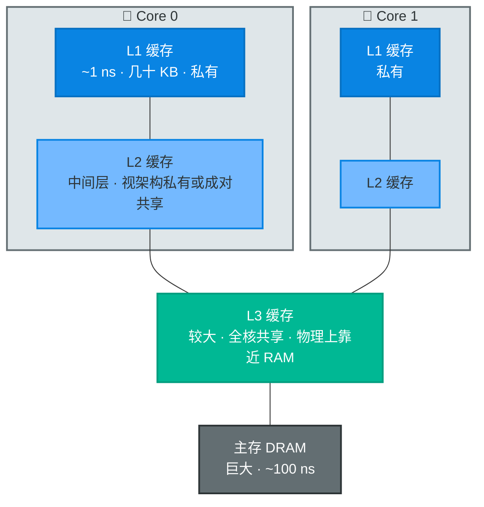
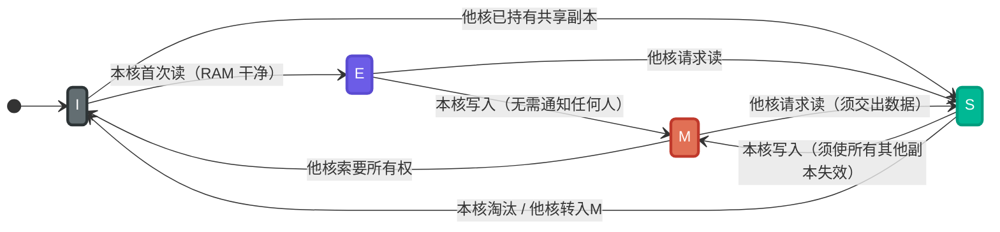
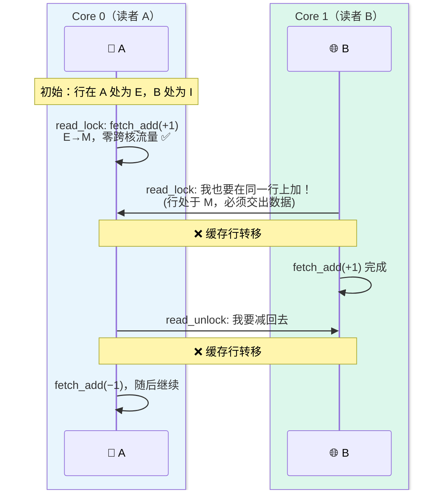
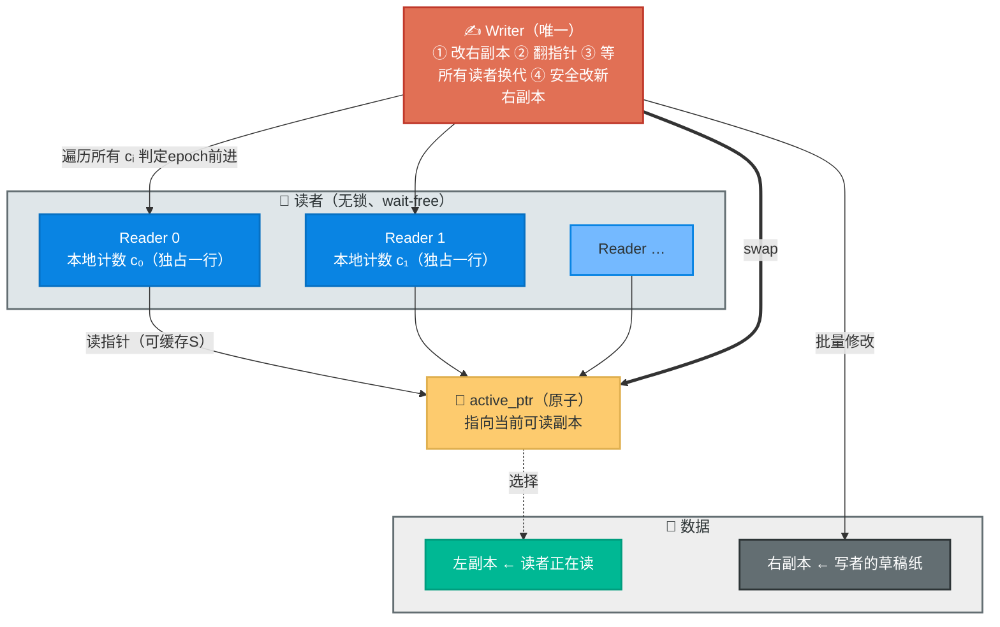
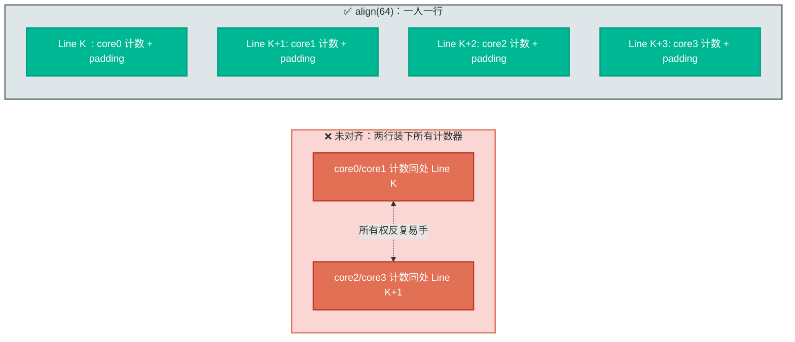

# Mutex 慢吗？——从缓存一致性看并发协调的真实代价

> 本文根据 Jon Gjengset 在 Jane Street 的技术讲座 **“Are Mutexes Slow?”**（正式标题 *The Cost of Concurrency Coordination）整理。除第 7 节问答环节的部分补充事实外，所有论点、实验设置与数字均出自讲座本身；文中基准数字是演讲者在**其演示机器上的单次观测值**，量级可信、精确值不可移植。
>
> 视频：<https://youtu.be/tND-wBBZ8RY>

---

## 1. 一个反直觉的开场

先抛结论：**Mutex 不慢。**

这不是抬杠。按 Goodridge 定律，任何以疑问句形式出现的标题都可以回答“否”。真正有意思的是原因：我们每个人都**真实地观察到过**“程序卡在锁上变慢”，某个 mutex 的获取耗时异常，某段临界区吞吐惨淡。既然观察属实，凭什么还说它不慢？

围绕锁的民间智慧通常是这样的：

- “Mutex 慢，能不用就不用。”
- “读多写少就该上读写锁（reader-writer lock），读者可以随便并行，宇宙和谐，一切飞快。”
- “无锁（lock-free）数据结构最好、最快。”

这些说法各自都有一部分真相，但它们全都停留在**接口层**。要判断一段并发代码到底会不会慢、为什么慢，必须往下走一层，回答两个更基本的问题：

1. **锁到底是什么？** CPU 层面执行一次 `lock()` 时发生了什么？
2. **“慢”是什么？** 时间花在了哪里？

本文按讲座的顺序走完这条链路：一个极简基准 → 两条跌破眼镜的曲线 → MESI 缓存一致性协议 → 读写锁的结构性缺陷 → left-right 数据结构 → 一次伪共享调试 → 选型决策框架。

> ⏭️ 只想要结论的读者可以直接跳第 8 节的检查清单和第 9 节的总结。

---

## 2. 实验设计：只读的锁，为什么会慢？

实验简单到几乎不构成实验：一个共享计数器，多线程**并发读取**，没有任何线程写入。

```rust
// 讲稿中的基准骨架（Rust，pthread_mutex 风格封装）
let counter = Arc::new(Mutex::new(0usize));   // Arc：多线程共享同一份数据
for _ in 0..n_threads {
    let c = Arc::clone(&counter);
    thread::spawn(move || loop {
        black_box(*c.lock().unwrap());        // *guard：加锁 → 读值 → 释放
    });
}
```

三个细节值得说明：

- **`Arc`**：引用计数智能指针，让多个线程指向同一份数据，是 Rust 跨线程共享的标准姿势。
- **`*c.lock().unwrap()`**：取锁得到 guard，解引用读出数值，guard 离开作用域自动解锁。整个临界区只有“读一个字”这么短。
- **`black_box`**：编译器屏障。不加它，编译器会推断出“循环体只是重复读同一个没被写过的外层变量”，把整个循环连同**加锁动作一起优化掉**——你测的就是一个空转循环，毫无意义。这个细节后面还会回来咬人（见 §8 讨论）。

直觉预期应该是：没有写入 ⇒ 没有互斥需求 ⇒ 怎么也应该接近单线程读的速度，最差也不过保持平稳。

### 2.1 Mutex 的曲线：断崖之后是平原

讲座里这里只有一张曲线图，讲者给的是三个数字（横轴线程数、纵轴吞吐）：

| 线程数 | 吞吐（约） | 讲者的换算 |
| --- | --- | --- |
| 1 | ~2.5 亿 ops/s | 2.5 GHz CPU 上，加锁 + 读一次 ≈ **10 条指令**，非常快 |
| 2 | ~2500 万 ops/s | **掉了一个数量级**（十分之一） |
| ≥3 | 略降后近乎持平 | 一直趴在很低的水平 |

曲线的形状是「**断崖 + 平原**」：单核到双核直接跳水十倍，之后基本躺平。注意这不是对数轴的把戏——从 2.5 亿到 2500 万是实打实的 10 倍。

两点让人不安：

1. **双核就崩**。如果 mutex 的语义是「同一时刻只放行一个线程」，那性能曲线合理的形状应该是**一条水平线**——永远有一个线程在推进，加线程不加吞吐，但至少不减。实际是雪崩。
2. **线程越多越糟**。这不是“并行收益饱和”，是“并行带来负收益”。

看到这条线，多数人会给出一致的判决：*mutex 慢*。先别急着下结论，看第二条线。

### 2.2 Reader-Writer Lock 的曲线：比 Mutex 更惨的“读优化”

换成分享读锁（`rwlock.read()`）跑同样的只读基准：

- 起点与 mutex 相当；
- 随线程增加同样大约掉 10 倍，前段略好于 mutex；
- **关键差异：mutex 掉下去以后躺平，读写锁却持续恶化**：读者越多，读写锁反而比 mutex 还慢。

讲座在这里故意停顿发问：一个号称专为读多写少设计的同步原语，为什么在纯读场景下会被朴素 mutex 反超？如果你的第一反应是“不知道啊，这不合理”——恭喜，这正是讲座有意制造的直觉缺口。答案要到 CPU 缓存里找。

---

## 3. 向下看一层：CPU 缓存层级与 MESI

### 3.1 缓存层级：距离即成本

RAM 里的数据离 CPU “很远”，远到电信号沿铜线走一个来回，需要**数百条指令的时间**。几百个周期对一个乱序流水线来说是一段永恒。于是 CPU 在芯片上焊了一层层越来越近、也越来越小的存储：



要点（具体尺寸/归属因 CPU 架构而异，此处取讲座给出的通用模型）：

- **L1 极近极小**，直接 soldered 在核上，**每核私有**；访问延迟约 1 ns，几乎不花时间。
- **L3 较大、全核共享**，位置上更接近 RAM 而非 L1。
- **L2 居中**，是否共享取决于架构。
- 缓存管理的粒度不是字节地址，而是**缓存行（cache line）**：硬件把整块内存切成 **64 字节**的条带，每个条带是一个一致性单元。一个 `usize` 计数器占 8 字节，一行能装 8 个。

### 3.2 MESI：谁拥有这一行？

当一个核缓存了某个缓存行、另一个核也想碰它，就必须有协议协商“谁能写、何时写、新值如何回到 RAM”。主流协议是 **MESI**（变体众多：MSI、MOESI……讲座原话“字母组合有一堆，但都是 MESI-like”）。每个缓存行在每个核的视角里有四种状态之一：

| 状态 | 含义 | 隐含义务 |
| --- | --- | --- |
| **M**odified | 我是唯一持有者，且内容与 RAM 不一致（脏） | 别人要读，我既交出权限还得交出数据（写回） |
| **E**xclusive | 我是唯一持有者，内容干净 | 别人来拿不需要我给数据，我只需转为无效 |
| **S**hared | 多个核各持一份相同副本 | **谁想写，必须先跟所有人打招呼** |
| **I**nvalid | 我没有可用副本（条目可能还在，但作废了） | 想要就得重新申请 |



> 💡 **本节唯一的硬核洞察**：对**共享状态**的每一次写，都需要一次跨核协调——把所有 Shared 副本打成 Invalid，让自己独占（M/E），用完再把行降级回 Shared 让别人能读。锁的性能问题，本质上是“锁的内部状态有多少次跨核搬运”的问题。

### 3.3 两种“距离”的价格表

讲座给出的延迟数量级：

| 操作 | 延迟 |
| --- | --- |
| 命中 L1 | ~1 ns |
| **跨核传输一个缓存行** | **~30 ns** |
| 访问主存 DRAM | ~100 ns |

「访问主存要 100 ns，这是大家公认的“慢”」——对照下表第二行：**一次跨核缓存行搬运约 30 ns**。一次完整的“加读锁 + 解锁”需要两次搬运，光协调就是 ~60 ns，**已经走完了去主存一趟路程的六成**。

---

## 4. 破案：读写锁为什么死于自己的计数器

现在回头看基准里那个“什么都不做”的读锁。它的实现通常是：锁内部维护一个**读者计数**，`read_lock()` = 对计数器做一次原子 fetch-add（+1），`read_unlock()` = 再 fetch-add（−1）。

问题在于：这个计数器躺在**一个**缓存行上，N 个读者都要**写**它。

于是即便业务数据零写入，锁自身每一轮 acquire/release 都在强制进行缓存行的所有权交接。用 MESI 术语描述两个读者 A、B 的交错：



算账：**每一个读者的“加锁+解锁”周期 = 2 次缓存行跨核转移 ≈ 60 ns**。100 个读者，这 100 次 +1 被迫串行排队：每个持有者都要先把行升到 Exclusive、改完、再交给下一个索取者。讲座的表述非常精辟：

> 读写锁内部有一段**顺序化（sequential）的部分**：一百个线程都想拿读锁，它们全部写在同一个共享字段上；第 k 个核必须先拿到独占权、加一、再交出去，第 k+1 个核才能开始。

这就同时解释了两条诡异曲线：

- **读写锁随读者数持续恶化**：读者之间互相制造跨核流量，人数越多 ping-pong 越密。“读优化”原语在纯读压力下反而不敌 mutex，这就是它曲线掉头向下的原因。
- **Mutex 掉到地板后躺平**：互斥语义保证同一时刻只有一个核持有锁行，acquire→release→acquire 天然串成一条所有权链，链条长度不受竞争者数量放大；吞吐上限被“行在核间接力的单程时间”钉死，所以呈平台状。

### 4.1 为什么 mutex 的处境“没那么糟”？

对比一下两种锁对锁内状态的操作序列：

| | 读锁周期 | Mutex 周期 |
| --- | --- | --- |
| acquire | fetch-add 共享计数器（与其他读者争） | CAS 抢锁字（反正只能一个人赢） |
| 持锁期间 | 别的读者照样涌进来写同一行 | **没人能碰锁字**，我就是唯一 owner |
| release | 又一次 fetch-add | 解锁：行大概率**还在我手里**（读者最多拿走 S 副本，没有东西可写回） |

Mutex 的串行是**语义要求**的串行，一次交接喂一个等待者；读写锁的串行是**实现缺陷**带来的串行，它违背了自己“读者并行”的承诺。讲座由此给出一个重要推论：

> **reader lock 的扩展性甚至差于 mutex**。

### 4.2 为什么平时感觉不到？

绝大多数真实代码里，“加锁后执行的逻辑”远长于“加锁本身的开销”，缓存未命中被业务计算摊薄，无人关心。危险区只有一种：**热路径上的超短临界区**——比如一次哈希表查找就读一个计数器就走。此时 cache miss 的时间 > 你业务代码的时间，同步开销与有用功倒挂。这也解释了为什么工程界对这个问题普遍无感：只有当你写那种“深而热的循环”时，才需要懂 MESI。

> ⚠️ 讲座特别指出开销的非线性：“锁用得越频繁（临界区越短），单位操作的同步开销占比越高”。这与直觉恰好相反，你越想靠高频细粒度锁提速，锁的相对代价越大。长临界区请随意使用 mutex，无脑用就好。

---

## 5. 换个思路：left-right——把“共享写”从读者身上拆掉

诊断清楚了，药方也就有了方向：**读者的数量不该转化为对共享缓存行的写压力**。能不能设计一种原语，让读者彼此完全独立、各写各的行，把协调成本全部堆给稀少的写者？

Jon 在读博期间被这个问题正面击中：他的负载是海量读者 + 极少写者，读者的全部工作只是一次哈希表查找，正是 §4.2 说的最坏情形，读锁开销“杀死”了他。于是他参与设计了 **left-right 数据结构**（后续发展为同名 Rust crate）。

### 5.1 机制

核心思想：**数据放两份，读者读哪份由一个原子指针说了算；写者永远改那份“没人看”的。**



完整的一次写流程：

1. 写者在一侧副本（如右侧）上**累积一批修改**（此刻读者全在看左侧），双方零接触。
2. **翻转 `active_ptr`**：下一批进入的读者将改读右侧新数据。
3. **宽限期检测（grace period）**：写者遍历**每个读者自己的计数器**，确认每个都至少「换代」过一次，即旧世代读者已全部退出、新指针值已被所有人读到。
4. 确认后，原本没人看的左侧现在成了新的“草稿侧”，可以安全修改。

换代检测的具体规则（回应现场提问而补全的细节）：读者在**进入操作前和退出操作后各给自己的计数器 +1**，即每个完整操作使计数 +2。写者的判据是：**某读者的计数要么相比 swap 时刻增加了，要么当前为偶数**——偶数意味着该读者此刻不在操作中。这样“长期休眠的读者”不会卡死写者：休眠者计数不变但必为偶数。（注意：休眠读者不影响其他读者继续读，只会推迟写者进入下一步。）

### 5.2 为什么它在 MESI 层面是“对的”

对照 §3 的规则逐行检查：

- **读者读 `active_ptr`**：这是个几乎永不变更的只读目标：行长期停在 Shared 态，读它不产生所有权迁移。
- **读者写自己的计数器**：每读者独占缓存行，行永远是自家 **Exclusive/Modified**，**读者之间零共享、零通信**。讲座原话：读者线程所在的核“可以把那一行永远留在 exclusive 态，根本不需要 shared”。
- **写者扫计数器**：只在 swap 后做一轮宽限检测时，才短暂把各行拉成 Shared。这是系统里**唯一**的跨核流量源，频率正比于写操作次数。

读者因此获得了教科书级的性质：讲座强调读路径**不仅 lock-free，而且 wait-free**：无锁、无循环、无重试，固定几步：读指针、计数 +1、访问数据、计数 +1，返回。

### 5.3 结果曲线：这次终于线性了

同机重跑只读基准，left-right 的吞吐随线程数**近似直线上升**：单核约 2.5–3 亿 ops/s，十核附近达到约 **30 亿 ops/s**——正是“核数 × 单核吞吐”的理想形状。这个数字本身就是论文：它证明前面两条曲线压垮的不是「锁」这个概念，问题出在**共享缓存行的乒乓**。

### 5.4 代价清单：它不是银弹

讲座毫不含糊地列出了 left-right 的账单（这也是“算法对齐工作负载”主题的伏笔）：

| 代价 | 说明 |
| --- | --- |
| **内存翻倍** | 两份完整数据副本 |
| **读可见性弱** | 非 linearizable，仅最终一致；读者可能读到陈旧数据。金融交易不能用，缓存/查询类用途合适 |
| **写者可能等所有读者** | 默认读者可见陈旧；若写者要求“人人见到新值才能继续”，可显式等待，但写成本进一步上升 |
| **单写者** | 多写者只能在外层再套 mutex——“并发结构上再摞一把锁，等着哭吧”（讲座原话大意） |
| **操作必须确定性** | 指针翻面后，要把同一份操作日志重放到另一侧副本，两次应用必须收敛到相同状态。不是所有数据结构都满足 |
| **写者不能太频繁** | 写占比升高后退化到不如读写锁；读:写 = 9:1 时讲座实测 left-right 仍优于读写锁（因为读写锁被九个读者的相互争用惩罚得更狠） |

---

## 6. 插曲：四核处的十倍深坑——伪共享实案

基准曲线本该笔直向上，但 left-right 实测在 **4 核处突然跌掉约 10 倍**。排除了 NUMA 跨插槽、远端内存访问等常见嫌疑后，真凶浮出水面：每个并发程序员第一课就学到的**伪共享（false sharing）**。

回想 §3.1：一致性协议管的是 **64 字节缓存行**，不是变量。left-right 里每个读者一个计数器，本来设计意图是「各写各行」；但如果两个读者的计数器**碰巧落在同一行**里，那么即使二者从不访问同一变量，MESI 眼中它们是**同一个所有权对象**——A 写 A 的计数器把行变成 M，B 写 B 的计数器就必须先把行从 A 手里抢过来。缓存行照旧乒乓，ping-pong 回来了。



修复是一行级别的：给承载计数器的类型加上 **64 字节对齐**（Rust 里 `#[repr(align(64))]`，C++ 里 `alignas(64)` / C++17 `std::hardware_destructive_interference_size`），强制每个计数器独占一行。问题解决，曲线恢复线性。新版 left-right crate 已包含此修复——讲座自嘲：“我给'上游'提了这个 PR，上游就是我自己。”

> ⚠️ **这个调试故事的元教训**：这类问题错在**比日常抽象层更低的一层**：“CPU 之间话说得太多”。`perf` 之类的采样工具很难直接告诉你“你的两个无关变量在同一行上打架”。没有 MESI 直觉的人，遇到四核塌陷只会怀疑调度器、NUMA 或者玄学；有直觉的人，第一个就去查行布局。**理解硬件不是为了写出 clever 代码，而是为了让性能现象可解释、可调试。**

---

## 7. 延伸：Q&A 里的高密度信息

讲座末尾的问答同样有料，择要改写：

**Q：有没有硬件层面的革新能让 mutex 快 10 倍？**
A：没有革命性的。演进式的例子倒有几个：

- MESI 的前身是 **MSI**，后来硬件设计师发现加上 Exclusive 态能让某些负载省掉约一半的缓存行争用，于是协议真的多了一个字母；现代架构的协议状态“已经七八个字母了”。
- **3D 封装**（如 AMD 的 X3D 系列）把额外缓存堆叠到芯片上方——更大的 L3、更短的物理距离，跨核取数不再需要跑那么远。
- **fetch-add 合并**：fetch-add 是可交换操作（每人 +1，顺序无所谓），理论上可以让多个核把各自的 +1 汇集到一个核统一执行再分发结果，从而减少缓存行往返。历史上曾有实现采用过这类优化，但当下不知哪个平台仍在用。
- 天花板在于这些微架构协议**高度保密**：指令集手册只承诺外部可观测语义，内部实现不得而知，公开资料多年前的部分今天还在不在用都不知道——很多结论只能是推测。

**Q：软件层面 mutex 的实现差异大吗？**
A：早期各语言各造轮子，后来操作系统提供 **futex**（fast user-space mutex，Linux），用户态自旋 + 内核睡眠的组合成为标配，语言库再包装空间不大，各家“质量如今大致等价”。有意思的是近年优化方向不再是降低争用（争用已是基线物理下限），而是**压缩锁体积**：mutex 一度做到 1 字节，现在甚至有 **2 bit** 的方案。但陷阱随即出现：把许多 2-bit 锁打包在一起，又落回 §6 的伪共享问题——除非你有策略地安排哪些锁共处一行、且它们互不争用。“你可以想象这个兔子洞有多深。”读写锁则不同：OS 支持方式五花八门，用户态还有大量设计空间（如每核一份读锁副本，线程先查自己所在核再取对应那把）。

**Q：编译器对 mutex 有哪些“惊喜”优化？**
A：编译器对锁其实很克制，手段主要是**屏障（barrier）**：在生成代码里插入“特殊的小闪光标记”（有的约束编译器、有的约束 CPU、有的双双约束）：禁止把锁后的读重排到加锁前，禁止把解锁前的写漂移到解锁后。这关乎乱序执行的语义正确：若不加约束，CPU 完全可能“先读了值、再去拿锁”，得到一个看似正常实则错误的 mutex。顺带一提，讲座还提到近年“让编译器笨一点”的呼声——CPU 越来越快，与其精细优化不如保守编译留出更多合法变换空间——一家之言，聊作趣闻。

---

## 8. 选型决策框架：慢从来不是锁的属性，而是匹配度的属性

回到标题。把全文证据拼起来：

| 方案 | 单线程 | 高并发纯读 | 瓶颈根源 |
| --- | --- | --- | --- |
| Mutex | ~250 M ops/s | 低平台期（~十几 M） | 锁字所有权串行接力（语义如此，不可避免） |
| 读写锁 | 相当 | **持续恶化，不如 mutex** | 读者集体写共享计数器，缓存行 ping-pong 随人数放大 |
| left-right | 相当 | **线性扩展到 ~3 G ops/s** | 无共享读路径；写者扫描读者计数器，成本 ∝ 写频率 |

三者没有绝对优劣：mutex 对“短而互斥的更新”仍是正确答案，读写锁对“长临界区 + 偶发读锁冲突”依然好用，left-right 只在“读极多、写极少、可容忍陈旧”时封神。**真正的规律是：并发的快慢，取决于数据流动模式与硬件缓存层级是否对齐。**

据此提炼的检查清单（源自讲座结尾的自问清单）：

1. **读:写比例是多少？** 决定候选集合（mutex / rwlock / left-right / per-core 副本）。
2. **临界区代码多长？** 短到接近缓存 miss 量级（几十 ns）时，同步开销吃掉有用功；长则放心用锁。
3. **线程规模多大？** 两三个线程，本文一切分析都不重要；上了几十个核才需要 MESI 直觉。
4. **能容忍最终一致吗？** 是否需要 read-your-writes？是否需要 linearizability？left-right 两者都给不了。
5. **测量优先**：先量再优化；不要从“网上评测最快的 mutex”出发选件，要从自己负载的数据传输模式出发选算法。
6. **警惕共享可变字段的放置**：伪共享排查是并发调演的第一项（`alignas` / `#[repr(align(64))]` / cacheline padding / pahole / perf c2c）。

讲座的金句收尾：

> **Lock-free ≠ contention-free。** 没有锁不等于没有争用。只要数据在铜线之间搬家，CPU 就会让你付出代价。能不让它搬，就别搬。

以及点题之句：

> 这不是锁的问题，从来就不是。**协调之所以昂贵，是因为缓存一致性协议要保证你的程序正确执行所必须做的跨核通信。锁只是你恰好选用的那个接口。**

---

## 9. 总结

- Mutex 本身不慢：单核一次加锁 + 读约 10 条指令；它的“慢”是高并发短临界区下缓存行串行走私有的固有成本。
- 读写锁在超短读临界区场景可扩展性**劣于** mutex，根源是读锁实现里的共享计数器写压力。这也是对“读多写少请用读写锁”这句民间智慧的重要修正。
- 病根在 MESI：写共享行需要跨核协调（~30 ns/跳），绕开这一点即可解锁线性扩展。
- left-right 用“双副本 + 每读者独占缓存行的 epoch 计数”换来 wait-free 读路径，代价是双倍内存、单写者、最终一致、确定性操作重放与伪共享风险。
- 工程方法：从工作负载的读写比、临界区长度、线程数、一致性需求出发选择算法，并对齐缓存行布局；永远先测量。

## 参考资料

- [Video: The Cost of Concurrency Coordination — Jon Gjengset @ Jane Street](https://youtu.be/tND-wBBZ8RY)（本讲稿所依据的原始讲座，2026-03-25，46:35）
- [crates.io: left-right](https://crates.io/crates/left-right)（讲座作者开发的 Rust left-right 并发库；含 §6 的对齐修复版本）
- [What Every Programmer Should Know About Memory](https://people.freebsd.org/~lstewart/articles/cpumemory.pdf) — Ulrich Drepper（讲座推荐的缓存层级/MESI 深入读物，“第一个链接”即此类时序分解文章）
- [Scalable Reader-Writer Locks for NUMA Systems](http://www.cs.man.ac.uk/%7Esinghars/OnlinePapers/nsdi05rwlock.pdf) — Boyd-Wickizer et al.（讲座提及的 per-core 读锁改造方案来源）
- 站内延伸阅读：[01 并发地基篇](/cpp/concurrency/01-foundations/)、[04 Boost.Lockfree 与无锁容器](/cpp/concurrency/04-boost-lockfree/)、[07 Seastar 与 thread-per-core](/cpp/concurrency/07-seastar/)

<!-- 注：以上外部链接为讲座中口头推荐文献的标准出处补全，供按图索骥。 -->
