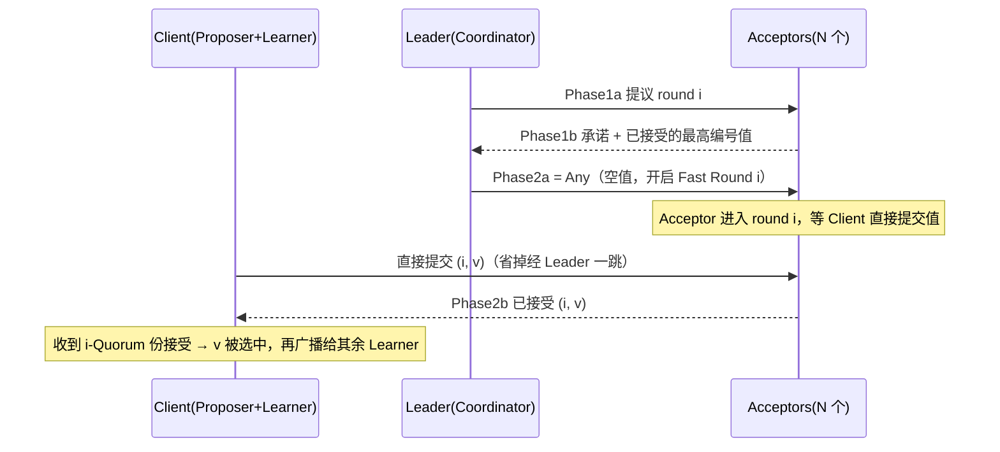

# Fast Paxos：用更大的 Quorum 换掉一次消息跳转

> 本文以 Kaffee 的《Fast Paxos》（2018）为骨架，补全论文侧的关键结论（消息延迟下界、quorum 不等式与冲突恢复），并在文末列出参考原文中三处需要修正的地方。若还没读过 [Basic Paxos](basic-paxos.md) 与 [Multi-Paxos](multi-paxos.md)，建议先看那两篇——本文默认你已经接受「两阶段 + 多数派」这套设定。

---

## 1. 起点：Classic Paxos 的第三个跳

Paxos 的历史可以切成三段：1998 年《The Part-Time Parliament》给出原始描述，2001 年《Paxos Made Simple》重述一次，2005 年 Lamport 又写了《Fast Paxos》（MSR-TR-2005-33，期刊版 2006 年发表于 *Distributed Computing*）。**正确性在 1998 年就已经足够**，后面所有工作做的都是同一件事：在延迟、吞吐、消息量之间重新分配代价。

Classic Paxos 一次决议的消息路径是三步：

```
Proposer → Leader(Coordinator) → Acceptor → Learner
```

这一步之差为什么值得单独写一篇论文？因为 Lamport 自己后来证明了：**在正常无冲突的情况下，达到共识最少需要 2 个消息延迟**，而 Classic Paxos 走的是 3 个。Fast Paxos 就是贴着这个下界设计的算法——它把正常路径压到 2 个延迟，代价是冲突时退化成 3 个，而这个冲突代价后来也被证明是不可避免的（详见 Lamport 对 [TR-2005-33](https://www.microsoft.com/en-us/research/wp-content/uploads/2016/02/tr-2005-33.pdf) 的背景自述）。

所以本文的问题可以一句话表述：**在 Leader 仍然是协调者的前提下，能不能让值不经过 Leader 就直接进入投票？**

## 2. 角色重述：把协议放回 C/S 架构

Fast Paxos 论文花了不少篇幅把 Paxos 从「协议角色」重新描述成贴近工程的样子。这个重述不是文字游戏，它直接决定了后面那条优化能不能成立。

| 论文角色 | 在 C/S 架构里对应什么 |
| --- | --- |
| Client | 既是 Proposer 又是 Learner：提请求的人，最后也由他学结果 |
| Coordinator | Proposer 的协调者，可以有多个 |
| Leader | 众多 Coordinator 中被选定的那一个 |
| Acceptor | Server（副本），负责投票表决 |

关键在于第一行：**Client 同时是提议者和学习者**。传统画法把 Proposer 和 Learner 拆成两个角色，反而遮蔽了一个事实——值从客户端来，结果也回客户端去，Leader 夹在中间只是转发。

## 3. 关键洞察：Leader 在 Phase2a 只是「转述者」

### 3.1 先把四个阶段摆正

| 阶段 | 谁发给谁 | 内容 |
| --- | --- | --- |
| Phase1a | Leader → Acceptor | `prepare(n)`，提议新一轮编号 n |
| Phase1b | Acceptor → Leader | 承诺不再接受小于 n 的提案；附上已接受的最高编号提案 `(m, w)` |
| Phase2a | Leader → Acceptor | 依据回值**决定值**，发 `accept(n, v)` |
| Phase2b | Acceptor → Leader/Learner | 已接受 `(n, v)` |

Phase2a 的决定规则只有两支：

1. 所有回值都是空（没人投过值）→ **Leader 自由决定一个值**；
2. 有人投过值 → 取提案编号最大的那个值。

### 3.2 转述者是怎么出现的

分水岭就在第 1 支。当「没人投过值」时，Leader 那个值从哪来？只能是客户端给它的。也就是说，**Leader 从头到尾没有生成过值，它只是把客户端的意图搬进协议**。

既然值本来来自客户端，那就可以反过来：Leader 发一条**不带值的消息**告诉 Acceptor「这一轮我不指名了，谁来报值都行」，然后自己退出通信。客户端直接对 Acceptor 提交，路径上凭空少了一跳。

### 3.3 把「自由决定权」下放

用一句话概括这次改造：**Classic Paxos 把「自由决定值」的权利交给 Leader，Fast Paxos 把它还给 Client。**

这也是理解后续所有复杂度（冲突、恢复、quorum 变大）的唯一入口：一旦允许多个 Client 同时往同一个 round 报值，就必然要处理「他们报的不一样」这种情况。Classic Paxos 根本不存在这个问题，因为同一个 round 里只有一个提交者。

## 4. Any 消息与 Fast Round

### 4.1 Any 的语义

这条不带值的消息就是 `Any`。字面意思：Acceptor 你爱怎么处理怎么处理，我只负责把这一轮开起来。Acceptor 收到 Any 后做一次初始化（记下 round 号、进入等待状态），然后等 Client 直接送来真正的值。

所以一个 Fast Round 由两段组成：

- **开启段**：Leader 发 Any；
- **报值段**：Client 直接把 `(i, v)` 投给 Acceptor。

顺利的话 Leader 只做初始化，之后完全不出现在关键路径上。

### 4.2 两类 Round 如何区分

- **Fast Round**：由 Any 开启，Client 直接报值；
- **Classic Round**：Leader 没发 Any，仍然自己指名值，流程与原来完全一致。

这两类 round 可以共存，用 round number 区分即可——论文把这个区分编码进 round number（原文只说「可通过 Round Number 加以区分」，编码细节留给实现）。

### 4.3 一次 Fast Round 的时序



注意 Phase1a/1b 在稳态下是可以长期复用的（这就是 Multi-Paxos 的做法），真正每次决议都要付的成本只有「Client → Acceptor → Learner」这两跳。

## 5. 冲突：乐观锁的代价

### 5.1 为什么编号全序还会撞

这是初学者最容易卡住的地方：提案编号是全序的，不同 Proposer 编号必然不同，同一 Proposer 也不会在同一 round 报两个值——那怎么会有「同一个 round 出现两个值」？

因为 **Fast Round 是 round 级的容器，不是提案级的**。Any 一下发，整轮编号 i 就定了；之后不管多少个 Client 报 `(11, v)`、`(12, w)`，在 round i 眼里都是「round i 收到了 v 和 w 两个值」。Kaffee 举的例子很精确：round 10 里 Proposer1 报 `(11, 1)`、Proposer2 报 `(12, 2)`，对 round 10 而言就是「有两个值，谁也说不清该选哪个」。

### 5.2 冲突的两种后果

1. **没有人凑够 fast quorum**：值压根没被选中，这一轮的延迟白付；
2. **有值被选中但 Leader 难以确认**：恢复时 Leader 拿到多个候选值，无法用「编号最大」这条规则唯一确定，必须靠额外的判定规则（下一节的 O4）去推。

### 5.3 锁死安全性的两个条件

Fast Paxos 靠两条约束把安全性重新焊死：

1. **每个 Acceptor 在同一个 Fast Round 里只投一个值**。不能两个都投，否则一致性没有讨论基础。
2. **任意两个 Fast Quorum 必须相交**。理由很直白：如果两个 fast quorum 互不相交，v 和 w 可以各自凑齐一个 quorum 同时「被选中」，一致性当场完蛋。

再加上一条隐含要求：**新的 classic quorum 必须与已选值的 fast quorum 相交**，否则新 Leader 永远看不到那个值，会选出第二个值。

这三条合起来，就是下面那堆不等式的来源。

## 6. Quorum 到底要多大

### 6.1 三条集合不等式

设 $N$ 个 Acceptor、Classic Round 容忍 $F$ 个失败、Fast Round 容忍 $E$ 个失败，记 $Q_c = N - F$、$Q_f = N - E$：

| 要求 | 不等式 | 直觉 |
| --- | --- | --- |
| 任意两个 classic quorum 相交 | $Q_c + Q_c > N$ | 两次选主不能各说各话 |
| classic quorum 与任意 fast quorum 相交 | $Q_c + Q_f > N$ | 新 Leader 一定能看到已选值 |
| classic quorum 与**任意两个** fast quorum 有共同点 | $Q_c + 2Q_f > 2N$ | 同一 fast round 里不能有两个值同时成立 |

第三条是 Fast Paxos 特有的，也是它 quorum 变大的根源。它来自三集合交集的下界：$|A \cap B \cap C| \ge |A| + |B| + |C| - 2N$，要保证交集非空就必须让三者大小之和超过 $2N$。

### 6.2 化简

把 $Q_c = N - F$、$Q_f = N - E$ 代入前两条，得到 $N > 2F$ 与 $N > E + F$；代入第三条：

$$(N - F) + 2(N - E) > 2N \;\Longrightarrow\; N > 2E + F$$

这就是 Fast Paxos 那两个著名的条件：

$$N > 2F \qquad N > 2E + F$$

在对称取法 $Q_c = Q_f$ 下，第三条给出 $3Q > 2N$，即

$$Q \ge \left\lfloor \frac{2N}{3} \right\rfloor + 1$$

代入 $N = 3E + 1$ 时恰好是 $Q = 2E + 1$。

### 6.3 常见配置与对照

| 场景 | 副本数 | Quorum | 容忍故障 |
| --- | --- | --- | --- |
| Classic Paxos | $2F+1$（3 副本） | $F+1 = 2$（半数以上） | 1 |
| Fast Paxos | $3E+1$（4 副本） | $2E+1 = 3$ | 1 |
| Fast Paxos | $3E+1$（7 副本） | $2E+1 = 5$ | 2 |

一句话：**同样的容错能力，Fast Paxos 要多一截副本**（3 → 4，5 → 7），而且每次写要有更多副本参与投票并回包。这就是「少一跳」的对价——用带宽和节点数换延迟。

## 7. 冲突恢复（Recovery）

### 7.1 为什么 2b 要发给 Leader

正常情况下 Acceptor 只把 Phase2b 回给 Learner 就够了，但在 Fast Paxos 里**必须顺手也发给 Leader**。否则 Leader 以为一切正常，根本不知道发生过冲突，也就不会启动恢复。

### 7.2 一个关键等价：2b ≡ 1b

恢复之所以能做得便宜，靠的是这个观察：**Round i 的 Phase2b 与 Round i+1 的 Phase1b 在语义上等价**。两者都表达两件事：

1. 我参与过哪些 round、投了什么值；
2. 我承诺不再对小于 i+1 的 round 投票。

所以只要 Leader 手上的 2b 足够还原出完整的投票情况，它就能**跳过 Phase1a/1b**，直接进 Round i+1 的 Phase2a。这就是恢复路径能比「从头重来」便宜的原因。

### 7.3 两条恢复路线

- **协调者式恢复（coordinator-based）**：Leader 发现冲突，若证据足以判定某个值已被选中，直接执行 Round i+1 的 Phase2a；证据不足就老老实实从 Phase1a 重来。
- **非协调式恢复（non-coordinated）**：Acceptor 之间互传 2b，每个 Acceptor 自己算、自己执行 Round i+1 的 Phase2a。这又省掉 Leader 一跳，但要求 i-Quorum 与 (i+1)-Quorum 完全相同，而且 Acceptor 被迫兼职 Proposer。Kaffee 的评价是「搞得过于复杂」，论文本身也只把它当可选项。

## 8. 完整流程

1. **Phase1a**：Leader 向 Acceptor 提出 round i。
2. **Phase1b**：Acceptor 回复承诺，附带已接受的最高编号提案与值。
3. **Phase2a**：Leader 汇总回值，决定走哪条路——
   - 无任何值：**发 Any**，开启 fast round，Acceptor 等 Client 直接报值；
   - 只有一个值：直接作为该 round 的值提交；
   - 有多个值：按判定规则挑出「可能已被选中」的那一个；
   - 多个值但都不满足判定规则：自由决定一个，把决定权收回。
4. **Phase2b**：Acceptor 投完，把结果发给 Learner（以及 Leader，供其察觉冲突）。

## 9. 成本模型与工程现实

### 9.1 三笔账

| 账目 | Classic Paxos | Fast Paxos |
| --- | --- | --- |
| 正常路径 | 3 跳 | 2 跳 |
| 冲突路径 | 不存在冲突 | 退化成 3 跳或整轮重来 |
| Quorum | 半数以上 | 约 2/3 以上（`N=3E+1`、`Q=2E+1`） |
| 副本成本 | 3 副本容忍 1 故障 | 4 副本容忍 1 故障 |
| 架构清晰度 | 角色边界清楚、易扩展 | Client 深度参与，Leader 随时退出关键路径，难描述难排查 |

### 9.2 为什么没成为主流

Kaffee 的结论是「理论上可行，实际中很难操作」，我基本同意，可以拆成四条：

- **它是乐观锁**：默认不冲突，冲突出补偿。并发一高，补偿成本线性增长，省下的那一跳很容易被吃回去甚至倒亏。
- **quorum 变大意味着负载变重**：每次写要更多副本参与并回包，吞吐与网络成本同步上升。
- **架构变糊**：Client 深度进入一致性过程，「谁负责收敛」这件事变得难以陈述。
- **缺少成熟的 Multi 化**：工程上真正落地的是 Multi-Paxos / Raft 这类把「一轮选举 + 持续复制」做厚的形态，Fast Paxos 停在单值共识层面，直接工程化的系统很少。

### 9.3 两个常见误解

- **ZooKeeper 的 `FastLeaderElection` 与 Fast Paxos 无关**。那里的 fast 指的是选举投票收敛快，不是「fast round」那套机制。中文资料里经常把两者混为一谈。
- **不要和 Cheap Paxos 混淆**。Cheap Paxos 省的是**节点数**（用辅助节点顶替故障节点，维持原 quorum），不省延迟；Fast Paxos 省的是**延迟**，反而多花节点。两者优化方向相反。

真正继承 Fast Paxos 思想的是后来的工作：**EPaxos 的 fast path**、**Flexible Paxos 的 quorum 松弛理论**，都是沿着「重新设计 quorum 结构来换延迟」这条线走的。

## 10. 与参考原文的三处出入

整理时对照论文，发现 Kaffee 原文有三处需要修正，读原文时如果对不上，问题大概出在这里：

1. **阶段编号写错**：原文 §2 把「Acceptor 回应已参与投票的最大编号和值」标成 `Phase2b`，应为 `Phase1b`；把「Leader 收集 Acceptor 的返回值」标成 `Phase2a`，实际是 1b 的接收动作。本文第 3.1 节的表格按论文更正。
2. **§7.1 的 quorum 下标可疑**：原文写「Leader 在 Round i 中收到 (i+1)-Quorum 个 Phase2b 消息」，字面说不通。按论文语义应是「收到的 2b 足以凑成一个 **i-Quorum**（该 fast round 自己的 quorum）的完整投票」，才谈得上直接跳到 Round i+1 的 Phase2a。
3. **§6 的 quorum 下界不是通式**：原文写 $|Q_f| \ge N - \lceil N/4 \rceil \ge \lceil 3N/4 \rceil$，代入 $N=7$ 得 5，而 $\lceil 3N/4 \rceil = 6$，两个不等式自相矛盾。严格的界来自 $Q_c + 2Q_f > 2N$：$Q_c = Q_f$ 时为 $\lfloor 2N/3 \rfloor + 1$，在 $N = 3E+1$ 时恰好 $2E+1$。中文资料里流传的「fast quorum 要 3N/4」只是 $N = 4, 5$ 附近的具体数字，别当通式用。

## 参考资料

- Leslie Lamport. *Fast Paxos*. MSR-TR-2005-33（期刊版：*Distributed Computing* 19(2):79–103, 2006）。[PDF](https://www.microsoft.com/en-us/research/wp-content/uploads/2016/02/tr-2005-33.pdf)
- Leslie Lamport. *Paxos Made Simple* (2001)。[PDF](https://lamport.azurewebsites.net/pubs/paxos-simple.pdf)
- Kaffee.《Fast Paxos》. 博客园, 2018-03。[原文](https://www.cnblogs.com/kaffeetrinken/p/8490736.html)

---

*← 返回[分布式共识](/system-design/distributed-consensus)* · *上一篇：[Multi-Paxos](multi-paxos.md)*
