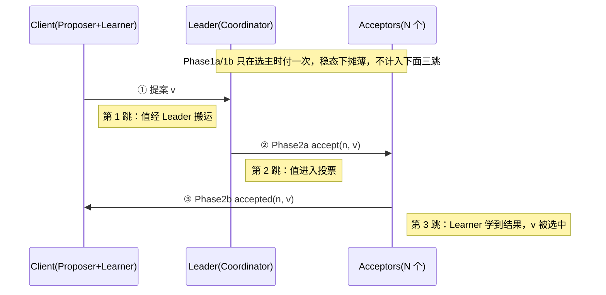
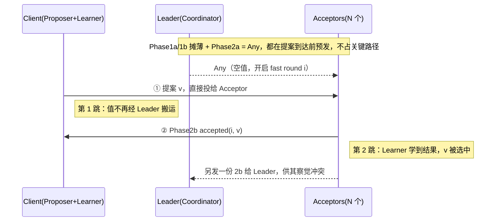

# Fast Paxos：用更大的 Quorum 换掉一次消息跳转

## 1. 起点：Classic Paxos 的第三个跳

Paxos 的历史可以切成三段：1998 年《The Part-Time Parliament》给出原始描述，2001 年《Paxos Made Simple》重述一次，2005 年 Lamport 又写了《Fast Paxos》（MSR-TR-2005-112，期刊版 2006 年发表于 *Distributed Computing*）。**正确性在 1998 年就已经足够**，后面所有工作做的都是同一件事：在延迟、吞吐、消息量之间重新分配代价。

Fast Paxos 动的就是「正常路径有几跳」，所以先把这三跳数清楚。

### 1.1 正常路径是哪三跳

下面的前提是 Leader 稳定、Phase 1 已经摊薄（也就是 Multi-Paxos 的做法），只数一次决议真正要付的通信：

| 跳 | 谁 → 谁 | 报文 | 这一跳在干什么 |
| --- | --- | --- | --- |
| 第 1 跳 | Client → Leader | 提案请求（「我想提 v」） | 把值从客户端搬进协议 |
| 第 2 跳 | Leader → Acceptor | Phase2a `accept(n, v)` | Leader 把值交下去，请副本投票 |
| 第 3 跳 | Acceptor → Learner | Phase2b `accepted(n, v)` | 投票结果抵达 Learner，v 被选中 |



三跳按职责可以分成两类：第 2、3 跳是协议本体——删掉第 2 跳没人投票，删掉第 3 跳没人知道结果；第 1 跳只是**值的搬运**，它不产生任何协议状态，Leader 在这一跳里是个纯粹的转述者。

所以本节标题里的「第三个跳」，指的就是多出来的那一个：**它在时间上排第 1，在成本账上排第 3**。

### 1.2 为什么这一跳值得写一篇论文

先摆两条界：**任何共识算法都至少要 2 个消息延迟**，才有进程能学到被选定的值；而且在两个提案并发提出时，没有算法能保证 2 跳内学到结果。两条界都在 Fast Paxos 论文 §1 里讲了出处。

关键在于下界的适用范围。传统表述里，「提议者」和「决定者」是同一批进程，值不需要搬运，所以 Classic Paxos 恰好用满 2 跳；一旦放进真正的 C/S 系统——客户端提议、服务端决定——它就变成 3 跳，多出来的正是上面那第 1 跳。论文管这叫「虚幻的最优」：最优的不是算法，是问题表述。

所以 Fast Paxos 贴着下界设计的实际含义是：正常路径压到 2 跳，冲突时退化成 3 跳。整个论文就是在回答一个问题——**在 Leader 仍然是协调者的前提下，能不能让值不经过 Leader 就直接进入投票？**

## 2. 角色重述：把协议放回 C/S 架构

Fast Paxos 论文花了不少篇幅把 Paxos 从「协议角色」重新描述成贴近工程的样子。这个重述不是文字游戏，它直接决定了后面那条优化能不能成立。

| 论文角色 | 在 C/S 架构里对应什么 |
| --- | --- |
| Client | 既是 Proposer 又是 Learner：提请求的人，最后也由他学结果 |
| Coordinator | Proposer 的协调者，可以有多个 |
| Leader | 众多 Coordinator 中被选定的那一个 |
| Acceptor | Server（副本），负责投票表决 |

关键在于第一行：**Client 同时是提议者和学习者**。传统画法把 Proposer 和 Learner 拆成两个角色，反而遮蔽了一个事实——值从客户端来，结果也回客户端去，Leader 夹在中间只是转发。

## 3. 关键洞察：Leader 在 Phase2a 只是「转述者」

### 3.1 先把四个阶段摆正

| 阶段 | 谁发给谁 | 内容 |
| --- | --- | --- |
| Phase1a | Leader → Acceptor | `prepare(n)`，提议新一轮编号 n |
| Phase1b | Acceptor → Leader | 承诺不再接受小于 n 的提案；附上已接受的最高编号提案 `(m, w)` |
| Phase2a | Leader → Acceptor | 依据回值**决定值**，发 `accept(n, v)` |
| Phase2b | Acceptor → Leader/Learner | 已接受 `(n, v)` |

Phase2a 的决定规则只有两支：

1. 所有回值都是空（没人投过值）→ **Leader 自由决定一个值**；
2. 有人投过值 → 取提案编号最大的那个值。

### 3.2 转述者是怎么出现的

分水岭就在第 1 支。当「没人投过值」时，Leader 那个值从哪来？只能是客户端给它的。也就是说，**Leader 从头到尾没有生成过值，它只是把客户端的意图搬进协议**。

既然值本来来自客户端，那就可以反过来：Leader 发一条**不带值的消息**告诉 Acceptor「这一轮我不指名了，谁来报值都行」，然后自己退出通信。客户端直接对 Acceptor 提交，路径上凭空少了一跳。

### 3.3 把「自由决定权」下放

用一句话概括这次改造：**Classic Paxos 把「自由决定值」的权利交给 Leader，Fast Paxos 把它还给 Client。**

这也是理解后续所有复杂度（冲突、恢复、quorum 变大）的唯一入口：一旦允许多个 Client 同时往同一个 round 报值，就必然要处理「他们报的不一样」这种情况。Classic Paxos 根本不存在这个问题，因为同一个 round 里只有一个提交者。

## 4. Any 消息与 Fast Round

### 4.1 Any 的语义

这条不带值的消息就是 `Any`。字面意思：Acceptor 你爱怎么处理怎么处理，我只负责把这一轮开起来。Acceptor 收到 Any 后做一次初始化（记下 round 号、进入等待状态），然后等 Client 直接送来真正的值。

所以一个 Fast Round 由两段组成：

- **开启段**：Leader 发 Any；
- **报值段**：Client 直接把 `(i, v)` 投给 Acceptor。

顺利的话 Leader 只做初始化，之后完全不出现在关键路径上。

### 4.2 两类 Round 如何区分

- **Fast Round**：由 Any 开启，Client 直接报值；
- **Classic Round**：Leader 没发 Any，仍然自己指名值，流程与原来完全一致。

这两类 round 可以共存，用 round number 区分即可——论文把这个区分编码进 round number（原文只说「可通过 Round Number 加以区分」，编码细节留给实现）。

### 4.3 一次 Fast Round 的时序



注意 Phase1a/1b 在稳态下是可以长期复用的（这就是 Multi-Paxos 的做法），真正每次决议都要付的成本只有「Client → Acceptor → Learner」这两跳。

### 4.4 对比：到底少了哪一跳

把两张时序图按「提案之后的第几个延迟」对齐：

| 累计延迟 | Classic Paxos | Fast Paxos |
| --- | --- | --- |
| 1 | Client → Leader（第 1 跳） | Client → Acceptor（值直达副本） |
| 2 | Leader → Acceptor（第 2 跳） | Acceptor → Learner（学到结果） |
| 3 | Acceptor → Learner（第 3 跳） | —— |

答案很明确：**少掉的是 Classic 的第 1 跳，也就是「值在 Client 与 Acceptor 之间经过 Leader 的那次搬运」**。Classic 里值的路径是 `Client → Leader → Acceptor`，两跳；Fast 里是 `Client → Acceptor`，一跳。

有三点容易读错，必须说清：

1. **`Leader → Acceptor` 这条链路并没有消失**，Any 仍然走它。但 Any 不带值，可以在提案到达之前很久就发掉（论文的说法是：它几乎为每个实例都发一条，但一条物理消息能覆盖所有这些实例，摊薄成本可以忽略），所以它不占「提案之后」的时钟。反过来，如果 Any 必须等到有提案才能发，省下的那一跳立刻会被还回去。
2. **Phase2a 也没有消失**，它只是换了发送者和接收者的关系：Acceptor 收到 Client 的提案后，把这条提案**当作** round i 的 Phase2a 来执行。协议阶段一分为四的骨架完好，变的是「谁有权指名值」。
3. **前提是不冲突**。两个不同提案被不同 Acceptor 以不同顺序收到时，2 跳不成立，这正是下一节的题目。

## 5. 冲突从哪来

### 5.1 为什么编号全序还会撞

这是初学者最容易卡住的地方：提案编号是全序的，不同 Proposer 编号必然不同，同一 Proposer 也不会在同一 round 报两个值——那怎么会有「同一个 round 出现两个值」？

因为 **Fast Round 是 round 级的容器，不是提案级的**。Any 一下发，整轮编号 i 就定了；之后不管多少个 Client 报 `(11, v)`、`(12, w)`，在 round i 眼里都是「round i 收到了 v 和 w 两个值」。Kaffee 举的例子很精确：round 10 里 Proposer1 报 `(11, 1)`、Proposer2 报 `(12, 2)`，对 round 10 而言就是「有两个值，谁也说不清该选哪个」。

顺带把「冲突（collision）」这个词说准：它不是「两个提案同时发出」，而是**两个提案被不同 Acceptor 以不同顺序收到**。发送时间相同、但所有副本的收序一致时，大家投的还是同一个值（第一个到达的那个），根本没有冲突。这也是论文说「所有 Acceptor 挂同一块以太网时冲突几乎不会发生」的原因。

### 5.2 冲突的两种后果

1. **没有任何值凑够 fast quorum**：这一轮白付，什么都没选中，要重来；
2. **值凑够了，但 Leader 手上的 2b 不完整**：它无法用「编号最大」这条规则唯一确定该继承谁，必须靠额外的判定规则（第 7 节的 O4）去推。推错一次，一致性就破了。

### 5.3 锁死安全性的两个条件

Fast Paxos 靠两条约束把安全性重新焊死：

1. **每个 Acceptor 在同一个 Fast Round 里只投一个值**。不能两个都投，否则一致性没有讨论基础。
2. **任意两个 Fast Quorum 必须相交**。理由很直白：如果两个 fast quorum 互不相交，v 和 w 可以各自凑齐一个 quorum 同时「被选中」，一致性当场完蛋。

再加上一条隐含要求：**新的 classic quorum 必须与已选值的 fast quorum 相交**，否则新 Leader 永远看不到那个值，会选出第二个值。

这三条合起来，就是下面那堆不等式的来源。

## 6. Quorum 到底要多大

### 6.1 三条集合不等式

设 $N$ 个 Acceptor、Classic Round 容忍 $F$ 个失败、Fast Round 容忍 $E$ 个失败，记 $Q_c = N - F$、$Q_f = N - E$：

| 要求 | 不等式 | 直觉 |
| --- | --- | --- |
| 任意两个 classic quorum 相交 | $Q_c + Q_c > N$ | 两次选主不能各说各话 |
| classic quorum 与任意 fast quorum 相交 | $Q_c + Q_f > N$ | 新 Leader 一定能看到已选值 |
| classic quorum 与**任意两个** fast quorum 有共同点 | $Q_c + 2Q_f > 2N$ | 同一 fast round 里不能有两个值同时成立 |

第三条是 Fast Paxos 特有的，也是它 quorum 变大的根源。它来自三集合交集的下界：$|A \cap B \cap C| \ge |A| + |B| + |C| - 2N$，要保证交集非空就必须让三者大小之和超过 $2N$。

### 6.2 化简

把 $Q_c = N - F$、$Q_f = N - E$ 代入前两条，得到 $N > 2F$ 与 $N > E + F$；代入第三条：

$$(N - F) + 2(N - E) > 2N \;\Longrightarrow\; N > 2E + F$$

这就是 Fast Paxos 那两个著名的条件（论文 §3.4.1 的写法也是这两条）：

$$N > 2F \qquad N > 2E + F$$

在对称取法 $Q_c = Q_f$ 下，第三条给出 $3Q > 2N$，即

$$Q \ge \left\lfloor \frac{2N}{3} \right\rfloor + 1$$

论文里「最大化 E」的取法是 $E = F = \lceil N/3 \rceil - 1$，代入 $N = 3E + 1$ 时恰好是 $Q = 2E + 1$。

### 6.3 常见配置与对照

| 场景 | 副本数 | Quorum | 容忍故障 |
| --- | --- | --- | --- |
| Classic Paxos | $2F+1$（3 副本） | $F+1 = 2$（半数以上） | 1 |
| Fast Paxos | $3E+1$（4 副本） | $2E+1 = 3$ | 1 |
| Fast Paxos | $3E+1$（7 副本） | $2E+1 = 5$ | 2 |

一句话：**同样的容错能力，Fast Paxos 要多一截副本**（3 → 4，5 → 7），而且每次写要有更多副本参与投票并回包。这就是「少一跳」的对价——用带宽和节点数换延迟。

## 7. 冲突恢复：一个具体例子走完

### 7.1 为什么 2b 要抄送 Leader

正常情况下 Acceptor 只把 Phase2b 回给 Learner 就够了，但在 Fast Paxos 里**必须顺手也发给 Leader**。否则 Leader 以为一切正常，根本不知道发生过冲突，也就不会启动恢复。

### 7.2 一个关键等价：2b ≡ 1b

恢复之所以能做得便宜，靠的是这个观察：**Round i 的 Phase2b 与 Round i+1 的 Phase1b 在语义上等价**。两者都表达两件事：

1. 我参与过哪些 round、投了什么值（`vrnd`、`vval`）；
2. 我承诺不再对小于 i+1 的 round 投票。

第 2 条是隐含的：Acceptor 一旦在 round i 投了票，它的 `rnd` 就被推到 i，自然不会再对更小的轮次投票。

所以只要 Leader 手上的 2b 足够还原出完整的投票情况，它就能**跳过 Phase1a/1b**，直接进 Round i+1 的 Phase2a。这就是恢复路径能比「从头重来」便宜的原因。

### 7.3 选值规则

把收到的 2b 当成 round i+1 的 1b，记 $Q$ 为这批 Acceptor，规则只有四条（对应论文 Figure 2）：

```text
k     = Q 中报告的最大投票轮次
V     = Q 中「在轮次 k 投过票」的值集合
O4(v) = 存在一个 k-quorum R，使 R∩Q 里每个人都「在轮次 k 投了 v」

k = 0             → 任选一个已提出的值（fast round 里就是发 Any）
|V| = 1           → 就选它
V 中恰有一个值满足 O4 → 必须选它
否则               → 任选一个已提出的值
```

第 1 支就是无冲突的正常情况。真正需要动脑的是后三支，而 $O4$ 的形状可以这样理解：**「v 有可能已被选中」的判据，是存在一个 fast quorum，它与你已知集合 $Q$ 的交集里所有人都投了 v**。

为什么是「可能」而不是「确定」：异步模型下 Leader 分不清「C 投了 w」和「C 投了 v、消息还在路上」，所以只能按最坏情况判。方向也是对的——继承一个「可能被选中、实际没被选中」的值是安全的（它毕竟是提出过的值），漏掉一个「已被选中」的值才是致命的。

下面两个例子都用 $N = 4$：Acceptor 为 A、B、C、D，fast quorum 与 classic quorum 都是 3（$N = 3E+1$，$E = 1$）。

### 7.4 例 1：谁也没凑够，自由取值

Round 10 是 fast round，Leader 已经发过 Any。两个 Client 同时报值：

| Acceptor | round 10 收到并投了什么 | Leader 收到 2b 了吗 |
| --- | --- | --- |
| A | v | ✓ |
| B | v | ✓ |
| C | w | ✓ |
| D | w | ✓ |

v 和 w 各拿 2 票，都不到 fast quorum 3，**round 10 一个值都没选中**。

Leader 把 4 份 2b 当 1b 用：$Q = \{A, B, C, D\}$，$k = 10$，$V = \{v, w\}$。$|V| = 2$，接着测 $O4$：每取一个 3 元 fast quorum，它与 $Q$ 的交集里都混着 v 和 w，凑不出「全票同一值」，所以 $O4(v)$ 和 $O4(w)$ 都是假。规则落到最后一支：**任选一个已提出的值**，比如选 v 进 round 11。

代价是 round 10 白付一次投票，安全性毫无损失——因为确实没有值被选中，选谁都不与「已选中」冲突。

### 7.5 例 2：已经选中但看不全，O4 救命

同样的配置，换一组到达情况：

| Acceptor | round 10 投了什么 | Leader 收到 2b 了吗 |
| --- | --- | --- |
| A | v | ✓ |
| B | v | ✓ |
| C | v | ✗（消息丢失或迟到） |
| D | w | ✓ |

事实上 v 拿了 A、B、C 三票 = fast quorum，**v 已经被选中**，这是既成事实，谁也不能翻。但 Leader 只看到 $Q = \{A, B, D\}$ 三份 2b。

如果 Leader 沿用 Classic Paxos 的规则——「取 `(vrnd, vval)` 里轮次最大的那一批」——它只能定位到 round 10，而 round 10 里有 v 和 w 两个值，规则就断在这里了：一旦它随便挑中 w，round 11 会把 w 也选中，系统出现两个被选定的值。

$O4$ 就是补这个洞的：

- $O4(v)$：取 round 10 的 fast quorum $R = \{A, B, C\}$，$R \cap Q = \{A, B\}$，两人 `vrnd` 都是 10 且都投了 v → **成立**。（C 到底投了什么都无所谓——$O4$ 只约束交集内的 Acceptor）
- $O4(w)$：$Q$ 里只有 D 投 w；而任何 3 元 fast quorum 与 $Q$ 的交集至少有 $|R| + |Q| - N = 3 + 3 - 4 = 2$ 个 Acceptor，不可能全投 w → **不成立**。

唯一满足 $O4$ 的值是 v，所以 Leader 必须选 v 进 round 11。**冲突在这里被安全化解**：v 被继承下来，round 11 不会推翻它，代价只是多了 classic quorum 那一轮的 2a/2b。

这里还藏着一个结论：**两个值不可能同时满足 $O4$**。若 $O4(v)$ 与 $O4(w)$ 都成立，则存在两个 fast quorum $R_v$、$R_w$，使 $R_v \cap Q$ 全投 v、$R_w \cap Q$ 全投 w；而 $R_v \cap R_w \cap Q$ 非空正是第 6 节那条 $Q_c + 2Q_f > 2N$ 保证的，非空就意味着有个 Acceptor 在 round 10 投了两个值——矛盾。

$O4$ 之所以写成「存在一个 quorum」，而不是「取票数最多的值」，也是这个原因：它要表达的是 quorum 级的交集性质。论文先一步把「多数派」泛化成任意 quorum 集合（`i`-quorum 还可以随轮次变化），在这个前提下「票数」根本没有定义，只有「谁的投票集合能盖住一个 quorum」才有意义。

### 7.6 两条恢复路线

- **协调式恢复（coordinated recovery）**：Leader 发现冲突后，把收到的 2b 当 1b，直接执行 Round i+1 的 Phase2a。代价是 round i+1 的 Phase 2（两个消息延迟、两次落盘）。论文建议 i+1 取 **classic** round number——协调式恢复里 Leader 从不发 Any，而 classic quorum 只会比 fast quorum 更小，没有理由让它也是 fast round。
- **非协调式恢复（uncoordinated recovery）**：Acceptor 之间互传 2b，每个 Acceptor 自己算、自己执行 Round i+1 的 Phase2b，省掉 Leader 一跳（只多一个消息延迟）。两个前提：i 和 i+1 **都**必须是 fast round number，否则少了 fast quorum 的相交保证；所有 Acceptor 必须用**同一个** (i+1)-quorum 判定，否则各自算出的值不同、round i+1 又会失败——协调者通常直接在 Any 消息里指定这个 $Q$。

论文对两者的取舍很克制：非协调式看起来更便宜，但它要求 2b 发给所有 Acceptor，冲突频繁时消息量会上来；冲突极罕见时，干脆换一个更大的轮次重来最划算。Kaffee 的评价是「搞得过于复杂」，论文本身也只把它当可选项。

## 8. 一次决议的完整流程

1. **Phase1a**：Leader 向 Acceptor 提出 round i。
2. **Phase1b**：Acceptor 回复承诺，附带已接受的最高编号提案与值。
3. **Phase2a**：Leader 汇总回值，决定走哪条路——
   - 无任何值：**发 Any**，开启 fast round，Acceptor 等 Client 直接报值（Classic Round 则自己指名值）；
   - 只有一个值：直接作为该 round 的值提交；
   - 有多个值：按 $O4$ 判定挑出「可能已被选中」的那一个；
   - 多个值但都不满足 $O4$：自由决定一个，把决定权收回。
4. **Phase2b**：Acceptor 投完，把结果发给 Learner（**以及 Leader，供其察觉冲突**）。
5. **冲突分支**：Leader 从 2b 发现 round i 里出现了多个值，按 §7 的规则走协调式或非协调式恢复，进 round i+1。

## 9. 成本模型与工程现实

### 9.1 三笔账

| 账目 | Classic Paxos | Fast Paxos |
| --- | --- | --- |
| 正常路径 | 3 跳 | 2 跳 |
| 冲突路径 | 不存在冲突 | 退化成 3 跳或整轮重来 |
| Quorum | 半数以上 | 约 2/3 以上（`N=3E+1`、`Q=2E+1`） |
| 副本成本 | 3 副本容忍 1 故障 | 4 副本容忍 1 故障 |
| 架构清晰度 | 角色边界清楚、易扩展 | Client 深度参与，Leader 随时退出关键路径，难描述难排查 |

### 9.2 为什么没成为主流

Kaffee 的结论是「理论上可行，实际中很难操作」，我基本同意，可以拆成四条：

- **它是乐观锁**：默认不冲突，冲突出补偿。并发一高，补偿成本线性增长，省下的那一跳很容易被吃回去甚至倒亏。
- **quorum 变大意味着负载变重**：每次写要更多副本参与并回包，吞吐与网络成本同步上升。
- **架构变糊**：Client 深度进入一致性过程，「谁负责收敛」这件事变得难以陈述。
- **缺少成熟的 Multi 化**：工程上真正落地的是 Multi-Paxos / Raft 这类把「一轮选举 + 持续复制」做厚的形态，Fast Paxos 停在单值共识层面，直接工程化的系统很少。

### 9.3 两个常见误解

- **ZooKeeper 的 `FastLeaderElection` 与 Fast Paxos 无关**。那里的 fast 指的是选举投票收敛快，不是「fast round」那套机制。中文资料里经常把两者混为一谈。
- **不要和 Cheap Paxos 混淆**。Cheap Paxos 省的是**节点数**（用辅助节点顶替故障节点，维持原 quorum），不省延迟；Fast Paxos 省的是**延迟**，反而多花节点。两者优化方向相反。

真正继承 Fast Paxos 思想的是后来的工作：**EPaxos 的 fast path**、**Flexible Paxos 的 quorum 松弛理论**，都是沿着「重新设计 quorum 结构来换延迟」这条线走的。

## 10. 与参考原文的几处出入

整理时对照论文，发现 Kaffee 原文有三处需要修正，读原文时如果对不上，问题大概出在这里：

1. **阶段编号写错**：原文 §2 把「Acceptor 回应已参与投票的最大编号和值」标成 `Phase2b`，应为 `Phase1b`；把「Leader 收集 Acceptor 的返回值」标成 `Phase2a`，实际是 1b 的接收动作。本文第 3.1 节的表格按论文更正。
2. **§7.1 的 quorum 下标可疑**：原文写「Leader 在 Round i 中收到 (i+1)-Quorum 个 Phase2b 消息」，字面说不通。按论文语义应是「收到的 2b 足以凑成一个 **i-Quorum**（该 fast round 自己的 quorum）的完整投票」，才谈得上直接跳到 Round i+1 的 Phase2a。
3. **§6 的 quorum 下界不是通式**：原文写 $|Q_f| \ge N - \lceil N/4 \rceil \ge \lceil 3N/4 \rceil$，代入 $N=7$ 得 5，而 $\lceil 3N/4 \rceil = 6$，两个不等式自相矛盾——下取整写成了上取整。即便改对，它也只在「最大化 F」这一种取法（$F = \lceil N/2 \rceil - 1$、$E = \lfloor N/4 \rfloor$）下成立；通式来自 $Q_c + 2Q_f > 2N$，$Q_c = Q_f$ 时为 $\lfloor 2N/3 \rfloor + 1$，在 $N = 3E+1$ 时恰好 $2E+1$。中文资料里流传的「fast quorum 要 3N/4」，别当通式用。

## 参考资料

- Leslie Lamport. *Fast Paxos*. MSR-TR-2005-112（期刊版：*Distributed Computing* 19(2):79–103, 2006）。[PDF](https://www.microsoft.com/en-us/research/wp-content/uploads/2016/02/tr-2005-112.pdf)
- Leslie Lamport. *Paxos Made Simple* (2001)。[PDF](https://lamport.azurewebsites.net/pubs/paxos-simple.pdf)
- Kaffee.《Fast Paxos》. 博客园, 2018-03。[原文](https://www.cnblogs.com/kaffeetrinken/p/8490736.html)

---

*← 返回[分布式共识](/system-design/distributed-consensus/)* · *上一篇：[Multi-Paxos](/system-design/distributed-consensus/paxos/multi-paxos/)*
